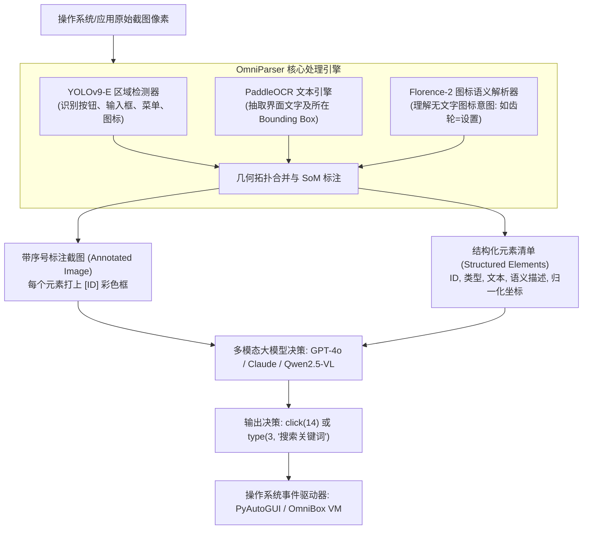

---
tags:
  - ai-tool
  - open-source
  - status/adopted
category: Agents
github: https://github.com/microsoft/OmniParser
stars: "22k+"
license: MIT
date_added: 2026-10-13
---

# 📦 OmniParser

> **一句话简介**：微软开源的通用纯视觉屏幕解析框架，将任意操作系统（Windows、macOS、Android、Linux）与桌面/移动应用的原始截图像素直接转换为带有边界框、可交互 ID 与功能语义说明的结构化元素，赋予任意多模态大模型顶级的端到端“Computer Use”屏幕操控能力。

## 📌 基本信息

| 属性 | 内容 |
| :--- | :--- |
| **仓库地址** | [GitHub: microsoft/OmniParser](https://github.com/microsoft/OmniParser) |
| **研发团队** | 微软研究院（Microsoft Research） |
| **技术栈** | Python, PyTorch, YOLOv9-E (`icon_detect_v3`), Florence-2, PaddleOCR |
| **许可证** | MIT（核心权重与代码已升级为宽松开源协议） |
| **关联生态** | [[Browser-Use]], [[OpenShell]], [[E2B]], [[Cline]], [[Aider]] |
| **关联实践** | [[纯视觉 GUI 智能体屏幕解析：基于 Microsoft OmniParser 的可交互元素检测与坐标基准定位实战]] |

---

## 🚀 核心架构与创新亮点

以往的自动化方案（如 Selenium、Playwright 或基于 Accessibility API 的脚本）严重依赖于底层 DOM 树或系统无障碍节点树。然而在真实的桌面端操作系统、虚拟化沙箱、Canvas/WebGL 渲染应用或自绘跨平台 UI（如 Flutter、Qt、Electron 复杂视图）中，**可访问性树往往缺失、扁平化或完全失效**。

直接把高分辨率（2K/4K）截图送入 GPT-4o 或 Claude 3.5 Sonnet，又面临**绝对像素坐标幻觉（Coordinate Hallucination）**、小图标识别失焦以及多步截图像素导致的巨大 Token 费用。

**OmniParser 的破局机制**：通过纯视觉三段式流水线，将无结构的像素图转换为**带标记的可交互符号流（Set-of-Marks, SoM）**。



### 1. 三段式无监督视觉解耦
- **细粒度交互区域检测（Detector）**：
  - V2 版本全面升级为基于 **YOLOv9-E** 的 `icon_detect_v3`，针对高分辨率屏幕、高密度密集按钮与超小尺寸图标进行了专门增强，召回率与交并比（IoU）大幅跃升。
- **图标功能语义生成（Icon Captioner）**：
  - 基于微调的 **Florence-2** 模型，专门预测无文字图形按钮的交互语义（如放大镜识别为 `search`、三道杠识别为 `menu hamburger`、软盘识别为 `save`），彻底解决大模型看不懂纯图标的死穴。
- **文字精准排版提取（OCR）**：
  - 提取截图中所有自然语言文本与标签，并将文本框与图标边界框进行空间重叠度对齐，生成图文一体的语义单元。

### 2. Set-of-Marks (SoM) 标号投影与零坐标幻觉
- OmniParser 会在原始图像上直接渲染醒目的彩色边框与数字编号标签（`[0]`, `[1]`, `[2]`...），并在 Prompt 中附带格式化元素列表。
- 多模态模型只需理解“点击 5 号按钮”或“向 12 号文本框输入内容”，无需直接输出易错的 `(1342, 856)` 绝对像素坐标，将 GUI 动作预测准确率提升了 30% 以上。

### 3. V2 极速推理与解耦生态
- **延迟优化 60%**：OmniParser V2 优化了图像输入缩放与 Florence-2 推理批处理，在高端 GPU 上单帧解析耗时降低至 0.6s 左右；
- **全套生态工具链**：
  - **`omniparserserver`**：基于 FastAPI 的高并发 GPU 推理微服务；
  - **`omnibox`**：基于 Docker + KVM 的轻量级 Windows 11 虚拟机沙箱，提供安全的 Agent 运行时隔离；
  - **`omnitool`**：集成 Gradio 的交互式全自动执行与测试中枢。

---

## 🛠️ 快速上手与配置

### 1. 环境准备与模型下载
```bash
git clone https://github.com/microsoft/OmniParser.git
cd OmniParser

# 安装核心依赖
pip install -r requirements.txt

# 下载 HuggingFace 官方预训练权重 (放入 weights/ 目录)
# 包含 icon_detect (YOLOv9), icon_caption (Florence-2)
python download.py
```

### 2. 核心 Python API 调用示例
```python
from utils import get_som_labeled_img, check_ocr_box, get_caption_model_processor
from PIL import Image
import torch

# 1. 加载模型处理器
device = 'cuda' if torch.cuda.is_available() else 'cpu'
caption_model_processor = get_caption_model_processor(
    model_name="florence2", 
    model_name_or_path="weights/icon_caption_florence", 
    device=device
)

# 2. 载入原始屏幕截图
image_path = "examples/desktop_screenshot.png"
image = Image.open(image_path)

# 3. 执行屏幕解析与 SoM 标注生成
labeled_image, parsed_content_list, label_coordinates = get_som_labeled_img(
    image_path,
    model=caption_model_processor,
    BOX_TRESHOLD=0.05,
    output_coord_in_ratio=True,
    draw_bbox_config={'draw_bbox': True, 'text_scale': 0.8}
)

# 4. 查看输出解析结果
print(f"检测到的交互元素数量: {len(parsed_content_list)}")
for item in parsed_content_list[:5]:
    print(f"ID: {item['id']} | 类型: {item['type']} | 文本/语义: {item['content']}")

# 保存带标号的合成图像
labeled_image.save("examples/annotated_screen.png")
```

---

## 💡 工程实战点评与适用场景

- **推荐使用场景**：
  - **跨平台桌面端 RPA 与 OS Agent**：无需目标应用暴露任何 API 或无障碍接口，直接自动化操作 Windows、macOS 上的专业工业软件、财务客户端与办公套件；
  - **云手机与移动端自动化**：支持 Android / iOS 屏幕直接投屏解析，执行无侵入式的真机自动化测试；
  - **游戏与 Canvas 应用交互**：破解 Web 3D、网页富客户端、Flash/Canvas 等 DOM 无法触达的黑盒应用。
- **潜在不足 / 局限性**：
  - 属于多阶段流水线，单次解析对 GPU 计算资源有一定需求（推荐使用至少 8GB 显存以上的独立 GPU）；
  - 在密集长表格或微小代码编辑器界面中，可能生成过密的分块边界框，需要配合非极大值抑制（NMS）过滤调优。
- **个人评估结论**：**建议引入（status/adopted）**。目前业界纯视觉 Computer Use 与 GUI Agent 领域事实上的标准屏幕语义解析基石。
