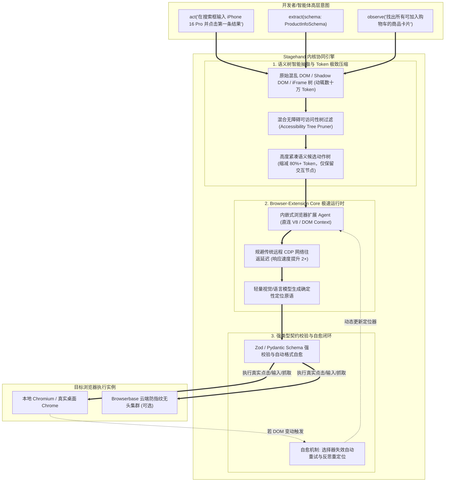

---
tags:
  - ai-tool
  - open-source
  - status/adopted
category: Agents
github: https://github.com/browserbase/stagehand
stars: "26k+"
license: Apache-2.0
date_added: 2026-11-18
---

# 📦 Stagehand

> **一句话简介**：Browserbase 团队开源的新一代 AI 驱动浏览器自动化与 Web 智能体（Web Agent）基座框架。破除传统 Playwright/Selenium 依赖脆弱 XPath/CSS 选择器在页面迭代时秒崩的痛点，创新推出 `act()`（自然语言原子操作）、`extract()`（基于 Zod 契约的强类型结构化数据抽取）与 `observe()`（自省感知与自愈定位器生成）三大 AI 原语；依托革命性的 Browser-Extension Core 架构，将推理编排内嵌至浏览器内核，实现 2× 极速操作响应、高达 80% 的 Token 压缩与极高鲁棒性的生产级自愈网页自动化。

---

## 📌 基本信息

| 属性 | 内容 |
| :--- | :--- |
| **仓库地址** | [GitHub: browserbase/stagehand](https://github.com/browserbase/stagehand) |
| **研发机构** | Browserbase 核心团队 |
| **技术栈** | TypeScript / Node.js, Python, Go, Playwright, Chrome DevTools Protocol (CDP), Zod, OpenAI/Anthropic/Gemini SDKs |
| **许可证** | Apache-2.0 License |
| **核心机制** | 核心三原语（`act` 自然语言动作执行、`extract` 强类型 schema 抽取、`observe` 动作空间感知）、Browser-Extension Core 运行时（近内核级快速执行，规避 CDP 竞态与长链路网络往返）、混合无障碍可访问性树裁剪（Accessibility Tree Pruning 压缩 ~80% Token）、自愈选择器（Self-Healing Locators，抗 DOM 类名混淆与结构重构）、穿透 Shadow DOM 与复杂跨域 iFrame |
| **运行模式** | **完全本地私有化**：开箱即用直连本地 Chromium/Chrome，无需注册任何商业云服务；**云端弹性增强**：一键无缝接入 Browserbase 全托管无头集群、会话视频重放与 OpenTelemetry 链路追踪 |
| **相关关联** | 关联实践: [[生产级 Web 智能体自动化架构：基于 Stagehand 的 AI 原语编排、Zod 强类型自适应抽取与 DOM 自愈容错实战]], [[2026-11-18-AI-Digest]], [[Browser-Use]], [[UI-TARS]], [[OmniParser]], [[Playwright]] |

---

## 🚀 核心特性与架构亮点



1. **破除传统自动化脚本脆断，确立三大 AI 原子操作规范**：
   - **`act(instruction)`**：使用自然人类语言直接操作页面，如 `await stagehand.act("点击右上角的登录按钮并选择 GitHub 登录")`。开发者无需手动审查几千层混淆的 Tailwind/React 动态类名（如 `class="flex items-center px-4 py-2 bg-blue-600..."`），底层自动解析目标语义并精准点击。
   - **`extract({ instruction, schema })`**：结合 **Zod** 或 Pydantic 严格类型契约，直接从凌乱非规整的网页中提取强类型数据。告别繁琐易碎的正则切分与手动 `querySelector`，若数据缺失或类型不符会自动要求模型自愈重提。
   - **`observe(instruction)`**：以极高自省能力返回当前页面针对该意图的所有可行操作列表（包含自动生成的稳定 Playwright 原生定位器与动作语义），让自主 Agent 能够根据候选动作进行精准长链规划。
2. **革命性 Browser-Extension Core 架构（v4 跃迁）**：
   - 传统浏览器智能体多通过外部 Node/Python 进程经由 Chrome DevTools Protocol（CDP）远程来回轮询网页快照，存在严峻的**网络延迟放大、CDP 管道拥塞与时序竞态条件（Race Condition）**。
   - Stagehand 首创将核心感知逻辑直接编译为内嵌于浏览器内核的扩展运行时（Extension Core），SDK 成为超轻量客户端，使得动作执行与页面判定速度提升 **2 倍以上**，彻底杜绝按钮刚渲染却被误判超时的顽疾。
3. **混合无障碍可访问性树（Accessibility Tree）裁剪，Token 消耗暴跌 80%**：
   - 现代大型网页（如电商、社交后台）的原始 HTML 动辄数百 KB 乃至数万行，若直接喂给大模型会引发严重长文本注意力漂移和巨额 Token 账单。
   - Stagehand 通过无障碍可访问性树结合轻量级启发式算法，剥离无意义的装饰性 `div/span`，仅提炼具备交互属性（Role/Name/State）的骨架树，将输入 Prompt Token 压减 80%~90%，极大降低了调用大模型的延迟与资金成本。
4. **自愈选择器与跨复杂组件穿透（Self-Healing Locators）**：
   - 针对现代 Web 架构中让传统工具闻风丧胆的 **Shadow DOM（包括 Closed Shadow DOM）、嵌套跨域 iFrame、Canvas 以及动态虚拟滚动列表（Virtual List）**，Stagehand 原生提供深度上下文穿透能力。
   - 当检测到底层页面 UI 发版导致旧元素路径失效时，Stagehand 不会直接抛出崩溃异常，而是利用实时语义感知重新推导当前匹配度最高的新锚点，实现生产环境无人值守自愈。
5. **双模自由切换：100% 本地开源与云端企业级增强**：
   - **本地开箱即用**：零商业绑定，直接连接本地 Puppeteer / Playwright 驱动的标准 Chromium 即可拥有完整能力；
   - **云端全托管协同**：需要应对高强度企业级防爬风控、动态代理轮换、指纹伪装、万人并发或远程会话回放时，仅需更改一行环境变量即可直连 Browserbase 云端浏览器平台。

---

## 🛠️ 快速上手与配置

### 1. 环境依赖与安装 (TypeScript / Node.js)

```bash
# 初始化并安装 Stagehand 与 Zod
npm install @browserbasehq/stagehand zod playwright
npx playwright install chromium
```

### 2. 核心调用示例：自然语言操作与强类型自愈抓取

创建 `web_agent.ts`：

```typescript
import { Stagehand } from "@browserbasehq/stagehand";
import { z } from "zod";

async function main() {
  // 1. 初始化 Stagehand (支持本地模式或接入 Browserbase)
  const stagehand = new Stagehand({
    env: "LOCAL", // 使用完全免费的本地 Chromium
    modelName: "gpt-4o", // 或 claude-3-5-sonnet, gemini-1.5-pro 等
    modelClientOptions: {
      apiKey: process.env.OPENAI_API_KEY,
    },
    headless: false, // 设为 false 可直观查看浏览器执行过程
  });

  await stagehand.init();
  const page = stagehand.page;

  console.log("[*] 导航至目标技术资讯网站...");
  await page.goto("https://github.com/trending");

  // 2. 原语一：act() 执行自然语言交互
  console.log("[*] 执行自然语言指令：切换语言过滤器为 Python...");
  await stagehand.act("点击语言筛选下拉框，并选择 'Python'");

  // 3. 原语二：observe() 探测页面可操作候选行为
  console.log("[*] 自省当前页面交互节点...");
  const actions = await stagehand.observe("寻找页面上前三个开源仓库的卡片链接与星标按钮");
  console.log(`[*] 探测到 ${actions.length} 个候选动作原语`);

  // 4. 原语三：extract() 基于 Zod Schema 进行强类型结构化提取
  console.log("[*] 提取前沿开源项目强类型数据...");
  const RepoSchema = z.object({
    repositories: z.array(
      z.object({
        repo_name: z.string().describe("仓库名称，如 owner/repo"),
        description: z.string().describe("仓库简明描述"),
        stars_today: z.string().describe("今日新增 Stars 数量"),
        primary_language: z.string().describe("主开发语言"),
      })
    ).describe("当前榜单排名前 3 的开源项目列表"),
  });

  const trendingData = await stagehand.extract({
    instruction: "提取排名前 3 的开源项目的名称、描述、今日新增 Star 数与主要语言",
    schema: RepoSchema,
  });

  console.log("[*] 强类型抽取结果：\n", JSON.stringify(trendingData, null, 2));

  // 5. 安全关闭浏览器上下文
  await stagehand.close();
}

main().catch(console.error);
```

---

## 💡 工程实战点评与适用场景

- **推荐使用场景**：
  - **复杂生产级数据采集**：电商竞对价格监控、社交舆情结构化抓取、金融研报下载，尤其目标网站前端 UI 频繁改版导致传统 XPath 经常失效的场景；
  - **端到端自动化业务流程（RPA & Agent Workflow）**：自动填写多步动态表单、跨系统流程审批、AI 自动化客户满意度调研、自动生成合同回执；
  - **企业级 UI 回归与冒烟测试**：摆脱编写脆弱繁琐定位器的噩梦，用高层人类意图编写端到端测试用例，即使 UI 样式迭代测试也能自愈通过。
- **潜在不足 / 局限性**：
  - **单步时延略高于纯代码脚本**：由于每个 `act()` 或 `extract()` 需要经过轻量语义解析或大模型推理，速度不及极度死板但纯静态的 `page.click("#submit")`（通常单步耗时 300ms~1.2s，适合重鲁棒性而非极限微秒高频并发的场景）；
  - **长链操作的意图漂移防控**：在超长多步骤交互中，仍需外层业务逻辑结合 `observe()` 返回的断言进行阶段性状态机兜底校验。
- **个人评估结论**：**极度推荐采纳（status/adopted）**。Stagehand 完美代表了网页自动化从“手写死选择器的刀耕火种”跨越到“大模型内嵌自愈的工业智能体时代”，是目前最优雅、最贴近开发者心智且具备高可用弹性的 Web Agent 基座。
