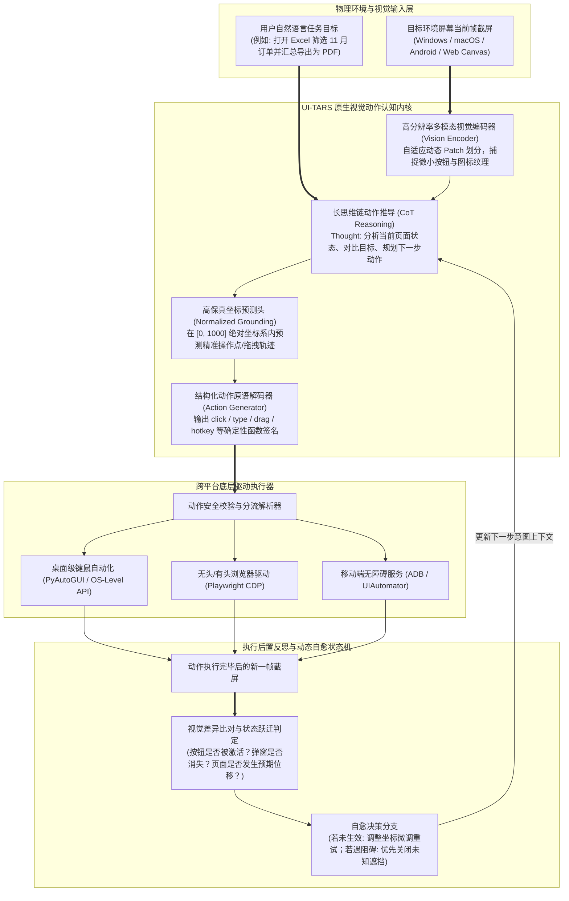

---
tags:
  - ai-tool
  - open-source
  - status/adopted
category: Agents
github: https://github.com/bytedance/UI-TARS
stars: "18.5k+"
license: Apache-2.0
date_added: 2026-11-12
---

# 📦 UI-TARS

> **一句话简介**：字节跳动官方开源的端到端原生多模态 GUI 智能体（Native Vision-Language-Action GUI Agent）开源基座。彻底颠覆传统“文本指令 + 外部 OCR + HTML/DOM 树解析”的两阶段脆弱架构，直接以原始屏幕截图为输入，端到端理解用户意图并直接生成精准的物理键鼠动作原语（点击、拖拽、长按、文本键入与热键组合），在 OSWorld、AndroidWorld、Mind2Web 等跨平台 GUI 自治基准上全面刷新 SOTA。

---

## 📌 基本信息

| 属性 | 内容 |
| :--- | :--- |
| **仓库地址** | [GitHub: bytedance/UI-TARS](https://github.com/bytedance/UI-TARS) |
| **研发机构** | 字节跳动技术团队 (ByteDance Seed) |
| **技术栈** | Python 3.10+, PyTorch, Transformers, vLLM, Playwright, PyAutoGUI, OpenCV, Pillow |
| **许可证** | Apache-2.0 License |
| **核心机制** | 原生端到端视觉-动作统一建模（Vision-Language-Action, VLA）、免 DOM/OCR 依赖、1000x1000 归一化高保真 Visual Grounding、统一步骤级键鼠动作空间、感知-推理-动作-反思（Observe-Think-Act-Reflect）闭环状态机 |
| **支持模型** | UI-TARS-2B / 7B / 72B（以原生 Qwen2.5-VL 多模态架构为底座，经过大规模 GUI 视觉轨迹强化对齐与人类偏好微调） |
| **覆盖平台** | Windows, macOS, Linux 桌面操作系统、现代浏览器环境（Chrome/Firefox）以及移动端（Android OS） |
| **相关关联** | 关联实践: [[端到端多模态 GUI 智能体实战：基于 UI-TARS 的视觉坐标定位、原生键鼠动作生成与长链操作自愈闭环]], [[2026-11-12-AI-Digest]], [[OmniParser]], [[Browser-Use]], [[OpenManus]], [[Open-Interpreter]], [[E2B]] |

---

## 🚀 核心特性与架构亮点



1. **从“文本与启发式提取”向“端到端原生视觉-动作统一建模（VLA）”的范式跃迁**：
   - 传统 GUI 自动化工具普遍采用两阶段方案：第一阶段使用 OCR 模型或 HTML DOM 解析器提炼出屏幕上的文本和可点击元素候选框（如 OmniParser），第二阶段将这些候选列表以长文本形式喂给大语言模型进行决策。这种方案在应对现代富 Web 应用（Canvas、WebGL、Shadow DOM）以及桌面 Native 客户端（非标准无障碍树）时，极易因 DOM 解析失效或 OCR 字符漏检导致智能体“致盲”。
   - UI-TARS 将视觉感知与动作生成深度融合为单一多模态大模型，以纯图像像素为直接感知输入，模型同时具备“视觉定位（Grounding）”与“逻辑动作规划（Action Planning）”双重能力，彻底斩断了中间数据解析的脆弱脆弱链条。
2. **高精度归一化绝对/相对坐标预测与统一步骤动作空间**：
   - 模型统一将任意分辨率的屏幕投影至 $[0, 1000] \times [0, 1000]$ 的归一化浮点空间，消除了不同显示器尺寸、操作系统 DPI 缩放带来的坐标漂移。
   - 定义了极简且富有表现力的通用动作指令集：`click(start_box='[x,y]')`、`double_click(start_box='[x,y]')`、`drag(start_box='[x1,y1]', end_box='[x2,y2]')`、`scroll(direction='down')`、`type(content='...')`、`hotkey(keys=['ctrl', 'c'])` 以及 `wait()`、`finished()` 等，无缝兼容桌面系统级 API 与 Web 端执行器。
3. **闭环状态反思与自适应容错自愈机制（Reflective Self-Healing）**：
   - 在每一步动作执行完成后，UI-TARS 要求环境重新捕获最新帧画面，并在思维链中输出明确的 `Observation` 与 `Reflection`：比对动作前后的视觉变化，验证预期状态是否达成。如果遇到按钮被浮动广告遮挡、网络慢加载骨架屏未消除或点击脱靶，模型能够自主识别异常并在下一步中规划自愈动作（如先点击遮罩关闭按钮、增加等待延时或微调点击坐标重试）。
4. **全平台即插即用部署生态与极致推理吞吐**：
   - 官方提供了与 vLLM 原生深度集成的推理镜像，利用 PagedAttention 与连续批处理（Continuous Batching），在保持高精度视觉分辨率的同时，将单步动作的推导延迟压缩至 300ms 以内，满足高响应度人机交互与自动化批量作业的严苛时效要求。

---

## 🛠️ 快速上手与配置

### 1. 环境依赖安装与环境准备

```bash
# 创建隔离虚拟环境
uv venv .venv --python 3.10
source .venv/bin/activate  # Windows 用户运行: .venv\Scripts\activate

# 安装 UI-TARS 客户端与操作系统自动化依赖
pip install transformers vllm pyautogui pillow opencv-python pydantic
```

### 2. 基于 vLLM 启动 UI-TARS-7B-DPO 极速多模态推理服务

```bash
# 单卡 RTX 4090 / A100 即可轻松部署 7B 视觉动作大模型
python -m vllm.entrypoints.openai.api_server \
    --model bytedance/UI-TARS-7B-DPO \
    --port 8000 \
    --served-model-name ui-tars \
    --trust-remote-code \
    --max-model-len 8192 \
    --limit-mm-per-prompt 'image=2' \
    --gpu-memory-utilization 0.90
```

### 3. Python 核心调用与端到端 OS 自动化执行脚本

```python
import base64
import io
import re
import time
import pyautogui
from PIL import Image, ImageGrab
from openai import OpenAI

client = OpenAI(base_url="http://localhost:8000/v1", api_key="empty")

def capture_screen_base64() -> tuple[str, int, int]:
    """捕获当前屏幕并转换为 Base64 编码，同时返回物理宽高"""
    screenshot = ImageGrab.grab()
    width, height = screenshot.size
    buffered = io.BytesIO()
    screenshot.save(buffered, format="PNG")
    img_b64 = base64.b64encode(buffered.getvalue()).decode("utf-8")
    return img_b64, width, height

def scale_coordinates(norm_x: int, norm_y: int, screen_w: int, screen_h: int) -> tuple[int, int]:
    """将 UI-TARS [0, 1000] 归一化坐标还原为操作系统实际物理像素"""
    real_x = int(norm_x / 1000.0 * screen_w)
    real_y = int(norm_y / 1000.0 * screen_h)
    return real_x, real_y

def run_gui_agent_step(task_prompt: str):
    img_b64, screen_w, screen_h = capture_screen_base64()
    
    system_instruction = (
        "You are UI-TARS, an end-to-end OS & Web GUI agent. Based on the user's request and current screen image, "
        "output your thought process and generate an action in the format: Action: action_name(args)."
    )
    
    response = client.chat.completions.create(
        model="ui-tars",
        messages=[
            {"role": "system", "content": system_instruction},
            {
                "role": "user",
                "content": [
                    {"type": "text", "text": f"User Goal: {task_prompt}"},
                    {"type": "image_url", "image_url": {"url": f"data:image/png;base64,{img_b64}"}}
                ]
            }
        ],
        temperature=0.0
    )
    
    content = response.choices[0].message.content
    print(f"🤖 UI-TARS 决策输出:\n{content}")
    
    # 解析并执行动作（以 click 为例）
    click_match = re.search(r"click\(start_box='\[(\d+),\s*(\d+)\]'\)", content)
    if click_match:
        norm_x, norm_y = int(click_match.group(1)), int(click_match.group(2))
        real_x, real_y = scale_coordinates(norm_x, norm_y, screen_w, screen_h)
        print(f"🎯 映射物理坐标: ({real_x}, {real_y})，准备执行鼠标左键单击...")
        pyautogui.moveTo(real_x, real_y, duration=0.3)
        pyautogui.click()
    elif "finished()" in content:
        print("✅ 任务已达成，Agent 主动结束执行。")
        return False
        
    return True

if __name__ == "__main__":
    task = "打开系统记事本并在首行输入 'Hello 2026 AI Radar!'"
    for step in range(5):
        print(f"\n--- 执行步骤 {step + 1} ---")
        continue_loop = run_gui_agent_step(task)
        if not continue_loop:
            break
        time.sleep(1.5)
```

---

## 💡 工程实战点评与适用场景

- **推荐选用场景**：
  - **复杂桌面软件/跨平台自动化（RPA 2.0）**：传统 RPA 面向财务 ERP、报税系统、专业 CAD 软件需要花费数周编写脆弱的元素选择器。UI-TARS 凭借强大的视觉通用理解力，能以零规则配置实现跨软件自主协同；
  - **无标准 DOM 的 Web 富交互应用**：面对使用 WebGL、全屏幕 Canvas 渲染的在线设计工具（如 Figma、Canva）或数据可视化仪表盘，传统 Web 爬虫完全失效，UI-TARS 是唯一能像真人一样通过视觉交互执行任务的工业解法；
  - **移动端全场景自动化测试与巡检**：原生适配 Android 屏幕与触控交互，可用于自动化手游挂机测试、应用市场批量上架合规检查与端到端核心业务回归测试。
- **潜在不足与工程注意点**：
  - **高分屏与多屏环境物理映射校准**：Windows/macOS 在 125%、150% 等非整数缩放比例下，截图尺寸与物理指针坐标并非 1:1，工程中必须经过 Windows DPI-Awareness 接口校准，否则极易发生微量点击偏移；
  - **极端安全沙箱与误触防控**：由于模型具备直接操作物理键鼠的权限，生产环境中必须配备操作白名单、危险动作（如清空磁盘、提交财务支付）人工双人复核拦截门禁，或直接置于独立虚拟化桌面（如 Windows Sandbox / Docker VNC）中运行。
- **个人评估结论**：**建议全面引入生产（Adopted）**。作为开源领域首个在 OSWorld 与通用 GUI 自动化上真正比肩并超越闭源商业方案的端到端 VLA 模型，UI-TARS 代表了从“语言智能体”向“行动智能体（Action Agent）”质变跃迁的里程碑。
