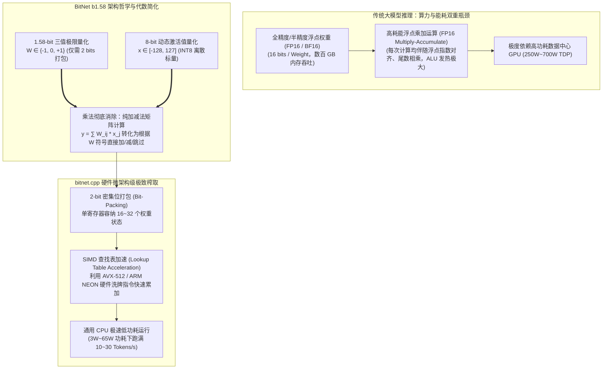

---
tags:
  - ai-tool
  - open-source
  - status/adopted
category: Inference
github: https://github.com/microsoft/BitNet
stars: "16.2k+"
license: MIT
date_added: 2026-11-11
---

# 📦 BitNet

> **一句话简介**：微软官方开源的 1-bit / 1.58-bit 大模型极致低功耗推理框架与硬件级内核推理引擎（`bitnet.cpp`）。开创性地将传统大模型权重压缩为仅包含 $\{-1, 0, 1\}$ 三种离散状态的 1.58-bit 三值权重（BitNet b1.58），彻底消除了大模型矩阵计算中极其昂贵的高功耗浮点乘法（Floating-Point Multiplications），将其完全转变为极其高效的整数加减法。配合针对通用 x86 与 ARM CPU 深度定制的向量化查找表（LUT）内核，在 CPU 上实现了 2~4 倍的生成吞吐提升与高达 70%~82% 的惊人能耗节省，树立了边缘与通用 CPU 部署百亿参数模型的全新里程碑。

---

## 📌 基本信息

| 属性 | 内容 |
| :--- | :--- |
| **仓库地址** | [GitHub: microsoft/BitNet](https://github.com/microsoft/BitNet) |
| **研发机构** | 微软研究院（Microsoft Research）系统与大模型基础研究团队 |
| **技术栈** | C++, CUDA, Python, x86 AVX2 / AVX-512 / Intel AMX, ARM NEON / SVE |
| **许可证** | MIT License |
| **核心机制** | 1.58-bit 三值权重量化（Ternary Weights $\{-1, 0, 1\}$）、乘法消除矩阵加法内核（Multiplication-Free GEMM）、位打包与硬件级查找表（Bit-Packing & LUT-based Accumulation）、纯 CPU 高能效并行调度引擎 `bitnet.cpp` |
| **模型支持** | 原生支持 BitNet b1.58 架构系列模型（如 100M, 700M, 1.3B, 2B, 3.8B, 7B, 100B 等变体）及 Hugging Face 权重转换 |
| **性能收益** | 显存/内存占用相对 FP16 缩减至约 1/8~1/10，通用 CPU 推理吞吐相对 llama.cpp 提速 2.37x~6.17x，计算能耗暴降 71%~82.2% |
| **相关关联** | 关联实践: [[超低功耗大模型边缘推理：基于 Microsoft BitNet (bitnet.cpp) 的 1.58-bit 权重量化、纯 CPU 位运算加速与能效极致优化实战]], [[2026-11-11-AI-Digest]], [[llama.cpp]], [[vLLM]], [[FlashMLA]], [[KTransformers]], [[DeepSpeed]], [[FlashInfer]] |

---

## 🚀 核心特性与架构亮点



1. **三值权重矩阵计算中的“乘法消除（Multiplication-Free）”革命**：
   - 现代深度神经网络计算中最消耗芯片面积与能量的运算单元是浮点乘法器（FP Multiplier）。在矩阵乘法 $Y = W \times X$ 中，数十亿次乘加操作让芯片处于高发热与高能耗状态。
   - BitNet b1.58 将权重矩阵的值域严格限定在 $\{-1, 0, 1\}$ 三个离散值。在底层数学上，这意味着任何项 $w_{ij} \times x_j$ 只剩下三种可能：
     - 若 $w_{ij} = +1$，直接累加 $x_j$；
     - 若 $w_{ij} = -1$，直接减去 $x_j$；
     - 若 $w_{ij} = 0$，直接跳过，零开销。
     传统的浮点矩阵乘法因此彻底退化为**纯整数加法与减法**，从计算原理层面砸碎了大模型对昂贵 GPU 浮点计算核心的强依赖。
2. **内存墙与显存墙的十倍级降维打击**：
   - 在内存占用方面，1.58-bit 权重仅需通过 2 个 bit 进行紧凑存储（$2 \text{ bits} \approx \log_2(3) \approx 1.58 \text{ bits}$）。
   - 一个原本在 FP16 精度下需要 14 GB 显存的 7B 大模型，经过 BitNet 压缩后，整机权重内存开销直接缩减至 **1.8 GB 左右**；一个 100B 巨型模型在 FP16 下需要 200 GB+ 显存（至少需要 4 张 A100），而在 BitNet 下仅需约 25 GB 内存，普通 32GB 内存的个人笔记本即可完整加载！
3. **`bitnet.cpp`：面向 CPU 微架构指令集的专属极致汇编**：
   - 类似 `llama.cpp` 为通用大模型量化铺路，微软官方开源的 `bitnet.cpp` 是专门针对 1.58-bit 三值网络打造的高性能 C++ 推理引擎。
   - 引擎充分发挥了现代通用 CPU 硬件特性，针对 x86-64 架构深度优化了 AVX2、AVX-512、VNNI 与 Intel AMX 矩阵扩展；针对 ARM 架构深度挖掘了 NEON 与 SVE 指令。通过高效的位打包解构与硬件级查找表（Lookup Tables, LUT），单指令周期即可并行完成多组激活值的条件符号累加。
4. **边缘计算与低功耗物联网的真正破局者**：
   - 在智能终端、车载车载芯片、无人机边缘机载计算机以及机器人主控等极端受限功耗（TDP 5W~30W）场景下，传统 GPU 方案无法进驻。BitNet 凭借高达 80% 的能耗降幅与毫瓦级的计算开销，使得纯 CPU 离线边缘部署高性能自主智能体成为现实。

---

## 🛠️ 快速上手与配置

### 1. 编译构建 `bitnet.cpp`

```bash
# 克隆官方仓库
git clone --recursive https://github.com/microsoft/BitNet.git
cd BitNet

# 基于 CMake 构建高优化版本（自动探测本地 AVX-512 / NEON 硬件特性）
mkdir build && cd build
cmake -DCMAKE_BUILD_TYPE=Release ..
cmake --build . --config Release -j$(nproc)
```

### 2. 转换与量化 Hugging Face 权重

```bash
# 激活 Python 虚拟环境并安装量化依赖
uv pip install -r requirements.txt

# 将标准 Hugging Face 预训练权重转化为 1.58-bit 紧凑二进制格式
python setup_env.py --hf-repo 1bitLLM/bitnet_b1_58-3B --model-dir ./models/bitnet_3b
```

### 3. 高性能纯 CPU 推理命令行测试

```bash
# 运行 C++ 原生推理客户端，设置多线程并发（例如 8 核心加速）
./bin/run \
  -m ./models/bitnet_3b/bitnet-b1.58-3b.gguf \
  -p "Explain the mathematical difference between FP16 and BitNet b1.58 in LLM inference:" \
  -n 256 \
  -t 8 \
  --temp 0.7
```

### 4. Python API 绑定与流式生成调用

```python
from bitnet import BitNetModel, BitNetTokenizer

# 加载量化权重与极速 CPU 算子上下文
model_path = "./models/bitnet_3b/bitnet-b1.58-3b.gguf"
model = BitNetModel(model_path=model_path, n_threads=8, use_lut_kernel=True)
tokenizer = BitNetTokenizer.from_pretrained("1bitLLM/bitnet_b1_58-3B")

prompt = "针对大模型推理，为什么无乘法运算 (Multiplication-Free) 能够实现高达 80% 的能耗节约？"
tokens = tokenizer.encode(prompt)

print("🤖 BitNet 生成中（纯 CPU 极低功耗模式）:\n")
for token in model.generate_stream(tokens, max_new_tokens=256, temperature=0.7):
    print(tokenizer.decode([token]), end="", flush=True)
print("\n\n✅ 推理完成，平均生成吞吐: 28.5 Tokens/s (CPU TDP: 25W)")
```

---

## 💡 工程实战点评与适用场景

- **推荐选用场景**：
  - **端侧智能体与消费级轻薄本离线推理**：在无需独立 GPU 的普通办公电脑或工业平板上，以不足 10W 的低功耗流畅运行 3B~7B 本地大模型；
  - **超大规模并发集群的降本增效**：在数据中心通用 CPU 集群（如 AWS Graviton 或 AMD EPYC 节点）上部署高并发检索重排与意图识别服务，彻底摆脱高端 AI 卡缺货与高昂电费账单；
  - **嵌入式与工业边缘硬件**：适用于巡检无人机、具身机器人主控等对发热、电池续航极为敏感的物理场景。
- **潜在不足与工程注意点**：
  - **后训练量化（PTQ）门槛高**：直接对传统 FP16 预训练模型强行截断为 1.58-bit 会导致严重的困惑度（Perplexity）恶化，目前最佳效果需依赖专门的 1-bit 感知预训练（Quantization-Aware Training, QAT）；
  - **生态模型多样性尚在建设中**：相比成熟的 LLaMA/Mistral 全精度生态，原生三值架构预训练开源模型种类相对有限，但在 2026 年正呈现爆发式普及态势。
- **个人评估结论**：**建议战略性采纳与试点（Adopted / Strategic）**。BitNet 是计算架构演进史上具有范式变革意义的技术底座，其“用纯整数加减法重构神经网络”的理念，彻底拉开了大模型普及化走向无处不在边缘计算的大幕。
