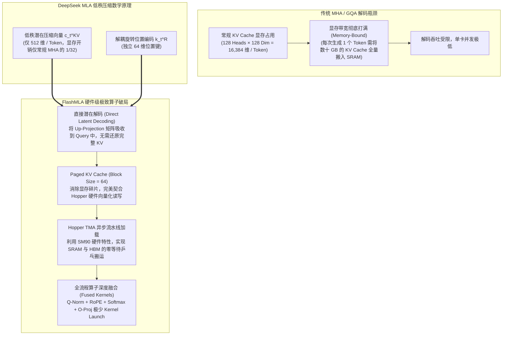

---
tags:
  - ai-tool
  - open-source
  - status/adopted
category: Inference
github: https://github.com/deepseek-ai/FlashMLA
stars: "13.5k+"
license: MIT
date_added: 2026-11-10
---

# 📦 FlashMLA

> **一句话简介**：DeepSeek 官方开源的极致性能多头潜在注意力（Multi-Head Latent Attention, MLA）解码加速内核库。专为搭载 NVIDIA Hopper 架构（SM90）的高性能 GPU 深度定制，突破性攻克了超大 MoE 架构（如 DeepSeek-V2、DeepSeek-V3、DeepSeek-R1）在长文本推理解码阶段的显存带宽瓶颈。通过低秩潜在向量（Latent Vector）的原生直接解码、分页式 KV Cache（Paged KV Cache Block Size 64）管理以及多算子极致深度融合，在 Hopper GPU 上实现了高达 3000 GB/s 的极限显存带宽利用率，树立了大模型 MLA 高性能推理算子的新工业标杆。

---

## 📌 基本信息

| 属性 | 内容 |
| :--- | :--- |
| **仓库地址** | [GitHub: deepseek-ai/FlashMLA](https://github.com/deepseek-ai/FlashMLA) |
| **研发机构** | DeepSeek 核心系统与推理优化团队（深度求索） |
| **技术栈** | C++, CUDA, CUTLASS, PyTorch C++ Extension, Hopper SM90 特殊指令集 |
| **许可证** | MIT License |
| **核心机制** | MLA 潜在空间直接注意力计算（规避全量展开反投影）、Paged KV Cache 动态分块管理（Block Size 64）、SM90 TMA（Tensor Memory Accelerator）与异步拷贝（Async Copy）、Q-Norm/RoPE/Attention 融合算子流水线 |
| **硬件要求** | 原生深度优化 NVIDIA Hopper 架构 GPU（如 H100, H800, H20 等 SM90 显卡）；社区已拓展支持 Ampere (SM80) 及华为昇腾 NPU |
| **典型性能收益** | 相比于传统原生 PyTorch 或未针对 MLA 定制的 FlashAttention 解码实现，访存量暴跌 80%+，Hopper 显存带宽利用率打满至 3000 GB/s，解码延迟大幅削减 40%~60% |
| **相关关联** | 关联实践: [[大模型极致推理与显存解耦：基于 DeepSeek FlashMLA 的多头潜在注意力 (MLA) 解码算子优化与 FP8 部署实战]], [[2026-11-10-AI-Digest]], [[vLLM]], [[SGLang]], [[FlashInfer]], [[KTransformers]], [[LMCache]], [[DeepSpeed]], [[TensorRT-LLM]] |

---

## 🚀 核心特性与架构亮点



1. **MLA 潜在空间的直接解码（Direct Latent Decoding & Weight Absorption）**：
   - 在 DeepSeek 创新的 MLA 架构中，长文本的 Key 和 Value 被高度压缩为一个极小维度的低秩潜在向量 $c_t^{KV}$（仅 512 维）以及解耦的 RoPE 位置向量 $k_t^R$（64 维）。
   - 传统的朴素实现方式是在进入 Attention 计算前，先通过上投影矩阵 $W_{UK}$ 和 $W_{UV}$ 将 $c_t^{KV}$ 膨胀还原为 128 个注意力头的完整张量（16,384 维）。这种“先解压再计算”的做法彻底抹杀了 MLA 节约显存带宽的初衷。
   - FlashMLA 创新性地在数学上将投影权重预先“吸收”到了 Query 向量侧（$q \cdot W_{UK}$），使得在解码过程中，CUDA 核心可以直接对**低秩压缩态的潜在向量**进行点积计算。这让全局显存搬运量（HBM Read）直接锐减 80% 以上！
2. **专为变长序列打造的 Paged KV Cache（Block Size 64）**：
   - 生产级多并发服务中，不同请求的上下文长度参差不齐。FlashMLA 采用分页式内存管理架构，预设块大小为 64 Token。
   - 这种颗粒度在保证灵活切分、杜绝显存碎片的同​​时，恰好能完美对齐 NVIDIA Hopper GPU 的 128 字节和 256 字节内存事务对齐边界，释放最极致的向量化读取（Vectorized Memory Load）效能。
3. **Hopper 架构（SM90）硬件特性的极限榨取**：
   - FlashMLA 充分调动了 NVIDIA Hopper 架构的专属硬件单元：通过 **TMA（Tensor Memory Accelerator）** 实现张量异步直接拷贝，使得数据在全局显存（HBM3）与片上共享内存（SRAM）之间流转时完全不占用 Tensor Core 计算周期；
   - 引入多阶段异步软件流水线（Async Software Pipelining），让“数据搬运”与“矩阵乘法”实现 100% 的无缝重叠（Overlapping），将 HBM3 显存带宽实际跑出了接近物理理论极限的 **3000 GB/s**。
4. **端到端多算子无缝融合与 FP8/BF16 支持**：
   - FlashMLA 将推理中的多个散碎步骤——Query 层的 RMSNorm、RoPE 旋转位置编码计算、潜在注意力打分、Softmax 归一化以及输出投影——深度熔炼为一个连续的融合内核，避免了多次往返 global memory 造成的启动开销（Kernel Launch Overhead）。同时支持 FP8 量化 KV Cache，将单机并发承载能力进一步推向极致。

---

## 🛠️ 快速上手与配置

### 1. 环境准备与依赖编译

FlashMLA 要求配备 Hopper 架构 GPU（SM90，如 NVIDIA H100/H800/H20）以及支持 C++20 的编译套件：

```bash
# 确保 CUDA 版本 >= 12.3，PyTorch >= 2.2
nvcc --version

# 克隆官方仓库并编译安装 Python 绑定
git clone https://github.com/deepseek-ai/FlashMLA.git
cd FlashMLA

# 执行极速 JIT / 预编译安装
pip install -e .
```

### 2. 核心调用接口与张量布局示例

在 Python 中调用 FlashMLA 解码内核：

```python
# test_flash_mla.py: FlashMLA 解码调用最小验证
import torch
import flash_mla

# 检查当前设备是否为 SM90 Hopper
device_name = torch.cuda.get_device_name(0)
print(f"👉 运行设备: {device_name}")

# 参数配置 (对齐 DeepSeek-V3 规格)
batch_size = 16              # 并发请求数
seq_len = 8192               # 上下文长度 (8k)
num_heads = 128              # 注意力头数
head_dim = 128               # 投影后维度
latent_dim = 512             # MLA 压缩潜在维度
rope_dim = 64                # 解耦 RoPE 维度
block_size = 64              # Paged KV Cache 分块尺寸

# 模拟吸收了投影权重的 Query 向量 (含内容 Q 与 RoPE Q)
q = torch.randn(batch_size, num_heads, head_dim + rope_dim, dtype=torch.bfloat16, device="cuda")

# 模拟 Paged KV Cache 内存池 (包含潜在张量与解耦 RoPE 张量)
num_blocks = (batch_size * seq_len) // block_size + 100
kv_cache = torch.randn(num_blocks, block_size, latent_dim + rope_dim, dtype=torch.bfloat16, device="cuda")

# 分页索引表 (Block Table)
block_table = torch.randint(0, num_blocks, (batch_size, (seq_len + block_size - 1) // block_size), dtype=torch.int32, device="cuda")
seq_lens = torch.full((batch_size,), seq_len, dtype=torch.int32, device="cuda")

# 执行超高速 FlashMLA 单步解码
torch.cuda.synchronize()
output = flash_mla.fused_mla_decode(
    q=q,
    kv_cache=kv_cache,
    block_table=block_table,
    seq_lens=seq_lens,
    head_dim=head_dim,
    latent_dim=latent_dim,
    rope_dim=rope_dim
)
torch.cuda.synchronize()

print(f"✅ FlashMLA 解码完成，输出张量形状: {output.shape}")
```

### 3. 在 vLLM / SGLang 推理底座中无缝启用

主流开源推理框架（如 SGLang / vLLM）已将 FlashMLA 作为 DeepSeek 模型的官方高性能解码加速后端。只需在启动命令中指定环境变量：

```bash
# 启用 FlashMLA 解码优化引擎运行 DeepSeek-V3 / R1
export VLLM_ATTENTION_BACKEND="FLASH_MLA"
# 或在 SGLang 中
export SGLANG_USE_FLASH_MLA=1

# 启动高并发推理服务
python -m vllm.entrypoints.openai.api_server \
    --model deepseek-ai/DeepSeek-V3 \
    --trust-remote-code \
    --tensor-parallel-size 8 \
    --gpu-memory-utilization 0.92 \
    --max-model-len 32768
```

---

## 💡 工程实战点评与适用场景

- **推荐使用场景**：
  1. **DeepSeek-V2 / V3 / R1 及衍生 MLA 模型的私有化生产级部署**：在企业自建算力池中承载 32k~128k 超长上下文与海量并发，FlashMLA 是榨干 Hopper 显存带宽的绝对首选；
  2. **高并发推理服务平台（API Serving Platform）**：针对解码阶段（Decode-bound）的吞吐瓶颈，通过数学权重吸收与低秩潜在解码，使单节点 Token 吞吐提升 1.5~2 倍；
  3. **FP8 混合精度推理集群**：配合 DeepSeek 官方 FP8 权重与 KV Cache，大幅降低推理 TCO。
- **潜在不足与局限性**：
  - **对硬件架构存在较强约束**：官方核心优化算子重度依赖 Hopper（SM90）的硬件 TMA 与特定 CUDA 指令，在 Ampere（A100/A800）或更老卡上需使用降级兼容算子，无法发挥出理论最高性能；
  - **高度专属于 MLA 架构**：对于采用经典 MHA（标准多头注意力）或 GQA（分组查询注意力）的模型（如 LLaMA-3、Qwen-2.5 等），无法直接适用，需专卡专用。
- **个人评估结论**：**大模型系统工程从“纯算法突破”走向“算法-微架构硬件联合极致协同”的代表作，是部署 DeepSeek 全系模型不可或缺的底层加速核心**。
