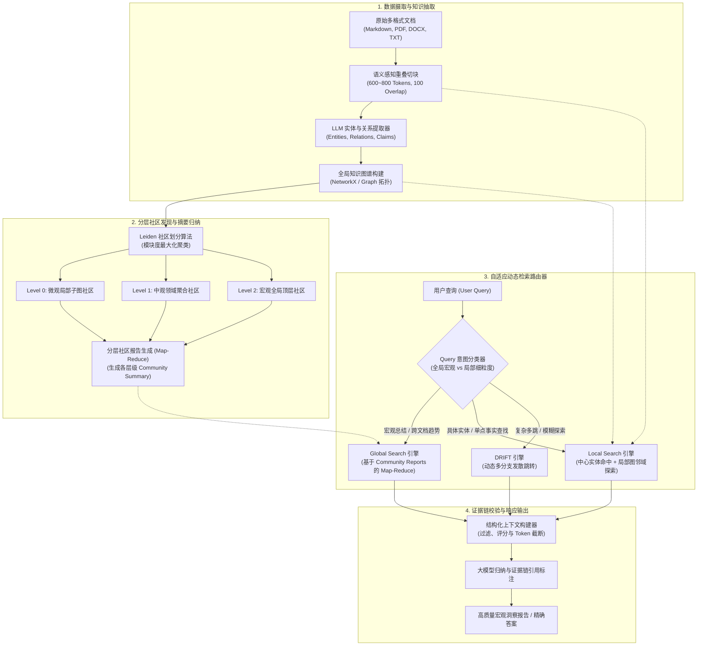

---
tags:
  - ai-practice
  - engineering
  - architecture
domain: RAG调优
difficulty: 进阶
date_added: 2026-10-27
---

# 💡 企业级全局宏观知识检索：基于 Microsoft GraphRAG 的分层社区发现与 Global-Local 混合检索实战

> **核心摘要**：针对传统向量检索在处理“全文档主题洞察”、“跨领域宏观趋势总结”与“隐式关联归纳”时出现的严重碎片化与语义盲区，全面剖析基于 **Microsoft GraphRAG** 的企业级落地架构。深入拆解实体-关系抽取流水线、Leiden 分层社区划分原理、Map-Reduce 层次化社区摘要生成，以及 Global Search 与 Local Search 双模态动态路由实战方案与百万 Token 成本节约避坑经验。

---

## 🎯 业务/技术背景与痛点

在企业私有知识库向深度智能化演进的过程中，基于简单文本分块（Chunking）与密集嵌入向量匹配（Dense Vector Retrieval）的 Naive RAG 架构正遭遇三大致命工程瓶颈：

```
[企业知识检索三大核心技术瓶颈]
1. 宏观主题理解（Global Sensemaking）彻底失效：
   - 痛点：面对“这 300 篇审计报告中反映的核心合规隐患有哪些？”、“过去一年技术架构重构遭遇了哪几类重大故障？”这类需要鸟瞰全数据集的宏观归纳型 Query，向量检索只能召回语义相似度最高的几个碎片化文本块，大模型只能“盲人摸象”，导致核心事实大幅遗漏或胡说八道。
2. 实体间跨章节/跨文档的多跳（Multi-Hop）隐式关联断裂：
   - 痛点：实体 A 关联实体 B，实体 B 在另一份文档中关联实体 C，实体 C 又制约业务 D。向量检索无法在无显式语义重叠的前提下捕捉这种拓扑链条，导致因果推导失败。
3. 文本块拼接的信息孤岛与无序冗余：
   - 痛点：单纯将 Top-K 文本块拼入 Context，存在大量重复低质信息，不仅消耗宝贵的 Prompt 窗口，还会稀释大模型的注意力机制，引发“迷失在中间（Lost in the Middle）”现象。
```

### 生产优化核心指标
1. **全局宏观主题问答覆盖率提升 ≥ 85%**：在开放式归纳总结评测集中，核心维度覆盖度相比传统向量 RAG 提升接近一倍；
2. **多跳逻辑推理召回率提升 ≥ 60%**：精准还原跨文档实体关联拓扑链条；
3. **知识库索引构建成本压降 ≥ 45%**：通过异步并发控制、动态实体剪枝与多层社区合并，大幅削减大模型 API 调用花销；
4. **答案生成溯源链 100% 具备图谱节点与原文块可追溯性**。

---

## 🏗️ 架构设计与解决方案

基于 Microsoft GraphRAG 的企业级全局宏观知识检索架构涵盖四大阶段：**知识抽取与图谱构建**、**Leiden 分层社区发现与摘要生成**、**自适应动态检索路由** 以及 **结果证据链组装与回答**。

### 整体架构设计流程图



---

### Leiden 社区发现算法数学原理

Leiden 算法是对传统 Louvain 社区发现算法的革命性升级。在 Louvain 算法中，由于贪心合并策略，划分出的社区常常出现**断裂的非连通子图**。Leiden 算法通过引入阶段性的子社区细分机制，保证了社区的内部高度连通与收敛性。

其核心目标是最大化整个图网络的**模块度（Modularity $Q$）**：

$$Q = \frac{1}{2m} \sum_{i,j} \left[ A_{ij} - \gamma \frac{k_i k_j}{2m} \right] \delta(c_i, c_j)$$

- $A_{ij}$：节点 $i$ 与节点 $j$ 之间的边权重；
- $k_i, k_j$：节点 $i$ 与 $j$ 的度数（关联边权重之和）；
- $m = \frac{1}{2} \sum_{ij} A_{ij}$：全图的总边权重；
- $\gamma$：分辨率参数（Resolution Parameter），控制生成社区的粒度大小；
- $\delta(c_i, c_j)$：克罗内克符号，若节点 $i, j$ 处于同一社区 $c$ 则为 1，否则为 0。

Leiden 算法执行三步循环：
1. **局部节点移动（Local Movement）**：快速提升模块度；
2. **细化分区（Refinement）**：在各社区内部进一步拆解子连通分支；
3. **网络聚合（Aggregation）**：将细化社区缩聚为超级节点，构建更高阶的顶层图（Hierarchy Level $N+1$）。

---

## 💻 关键代码 / 配置 / Prompt 模板

### 1. 生产级 `settings.yaml` 调优配置

```yaml
version: 1.0.0
encoding_model: cl100k_base

# 1. 大模型推理配置：建议使用高吞吐模型
llm:
  api_key: ${OPENAI_API_KEY}
  type: openai_chat
  model: gpt-4o-mini
  max_tokens: 4000
  temperature: 0.0
  concurrent_requests: 20
  tokens_per_minute: 1000000
  requests_per_minute: 5000

# 2. 向量嵌入模型配置
embeddings:
  llm:
    api_key: ${OPENAI_API_KEY}
    type: openai_embedding
    model: text-embedding-3-small
  vector_store:
    type: lancedb
    container_name: default
    db_uri: ./output/lancedb

# 3. 文本分块策略：平衡实体密度与上下文
chunks:
  size: 800
  overlap: 120
  group_by_columns: [id]

# 4. 实体与关系提取控制
entity_extraction:
  entity_types: [organization, person, project, technology, risk, metric]
  max_gleanings: 1 # 设置多轮汲取轮数，1 次即可兼顾精度与成本

# 5. Leiden 社区发现配置
community_reports:
  max_length: 2000
  max_input_length: 8000
  hierarchy:
    max_level: 3   # 限制最多生成 3 层社区，防止深层爆炸
```

---

### 2. Python 动态混合检索路由器（Global-Local Adaptive Router）

在实际生产问答中，必须避免盲目调用昂贵的 Global Search。以下是高可用的动态路由调度器：

```python
import os
import asyncio
from enum import Enum
from pydantic import BaseModel, Field
from openai import OpenAI
from graphrag.query.indexer_adapters import (
    read_indexer_entities,
    read_indexer_reports,
    read_indexer_relationships,
    read_indexer_text_units
)
from graphrag.query.llm.oai.chat_openai import ChatOpenAI
from graphrag.query.structured_search.global_search.community_context import GlobalCommunityContext
from graphrag.query.structured_search.global_search.search import GlobalSearch
from graphrag.query.structured_search.local_search.mixed_context import LocalSearchMixedContext
from graphrag.query.structured_search.local_search.search import LocalSearch

class QueryType(str, Enum):
    GLOBAL = "GLOBAL"  # 宏观趋势、跨文档总结、全局概览
    LOCAL = "LOCAL"    # 具体实体、细节参数、局部事实

class QueryClassification(BaseModel):
    query_type: QueryType = Field(description="查询类型：GLOBAL 或 LOCAL")
    reasoning: str = Field(description="分类理由与实体判定")

class AdaptiveGraphRAGRouter:
    def __init__(self, data_dir: str):
        self.client = OpenAI()
        self.llm = ChatOpenAI(api_key=os.environ["OPENAI_API_KEY"], model_name="gpt-4o-mini")
        
        # 1. 载入 Parquet 离线图谱资产
        print("正在载入知识图谱与社区报告资产...")
        self.entities = read_indexer_entities(f"{data_dir}/create_final_nodes.parquet")
        self.relationships = read_indexer_relationships(f"{data_dir}/create_final_relationships.parquet")
        self.reports = read_indexer_reports(f"{data_dir}/create_final_community_reports.parquet")
        self.text_units = read_indexer_text_units(f"{data_dir}/create_final_text_units.parquet")
        
        # 2. 初始化全局与局部上下文构造器
        self.global_context = GlobalCommunityContext(
            community_reports=self.reports,
            entities=self.entities,
            token_limit=12000
        )
        self.global_engine = GlobalSearch(
            llm=self.llm,
            context_builder=self.global_context,
            token_limit=12000,
            max_data_tokens=8000
        )
        
        self.local_context = LocalSearchMixedContext(
            entities=self.entities,
            entity_relationships=self.relationships,
            text_units=self.text_units,
            community_reports=self.reports,
            token_limit=8000
        )
        self.local_engine = LocalSearch(
            llm=self.llm,
            context_builder=self.local_context,
            token_limit=8000
        )

    def classify_query(self, query: str) -> QueryType:
        """基于轻量模型对查询意图进行快速分类"""
        response = self.client.beta.chat.completions.parse(
            model="gpt-4o-mini",
            messages=[
                {"role": "system", "content": (
                    "你是一个精准的检索意图判别器。"
                    "若问题需要对全量文档进行宏观总结、主旨梳理、全局对比或跨领域洞察，返回 GLOBAL；"
                    "若问题涉及特定专有名词、单一实体属性、具体数值或局部事实定位，返回 LOCAL。"
                )},
                {"role": "user", "content": f"用户查询：{query}"}
            ],
            response_format=QueryClassification
        )
        return response.choices[0].message.parsed.query_type

    async def execute_search(self, query: str) -> str:
        query_type = self.classify_query(query)
        print(f"[意图识别引擎] Query 类型判定为: {query_type.value}")
        
        if query_type == QueryType.GLOBAL:
            result = await self.global_engine.asearch(query)
            return f"【Global Search 宏观洞察】\n\n{result.response}"
        else:
            result = await self.local_engine.asearch(query)
            return f"【Local Search 局部溯源】\n\n{result.response}"

# 运行验证
async def main():
    router = AdaptiveGraphRAGRouter(data_dir="./output")
    
    # 宏观问题测试
    q1 = "请盘点并总结企业知识库建设中，各业务部门反馈最集中的三类系统稳定性风险。"
    print(await router.execute_search(q1))
    
    # 局部具体问题测试
    q2 = "LMDeploy 框架中的 TurboMind 引擎主要使用了什么语言和内核优化技术？"
    print(await router.execute_search(q2))

if __name__ == "__main__":
    asyncio.run(main())
```

---

## ⚠️ 生产环境踩坑与避坑指南

### 1. 坑点 1：构建期 LLM API 账单失控与并发 429 速率限制
- **现象**：在几百兆文本构建初期，LLM 实体抽取阶段频繁报出 `429 Too Many Requests`，并且仅处理数千篇文档就产生了上百美元的 API 消耗。
- **避坑方案**：
  - **启用高性价比开源/轻量模型做抽取**：抽取与社区报告阶段完全可以用本地 vLLM 部署的 `Qwen2.5-32B/72B` 或 `gpt-4o-mini`，成本仅为前沿大模型的 1/10；
  - **关闭多余抽取轮次（Gleanings）**：将 `entity_extraction.max_gleanings` 从默认的 2 降为 1 或 0；
  - **基于 Semaphore 进行异步速率精准平滑**：配置合理的 `concurrent_requests` 与 `tokens_per_minute` 阈值，内置指数退避重试（Exponential Backoff）。

### 2. 坑点 2：实体同义异名导致图谱爆炸（Entity Resolution 困境）
- **现象**：文本中出现的“Microsoft”、“微软”、“MSFT”被识别为三个完全独立的节点，导致图拓扑连通性断裂，无法形成密集的聚类子图。
- **避坑方案**：
  - **在 Prompt 中注入行业实体规范约束**：明确要求实体抽取时使用标准化英文或统一全称；
  - **注入实体融合后处理管道**：在构建知识图谱前，利用向量相似度（Cosine Similarity > 0.92）并结合编辑距离，对孤立同义实体进行聚类对齐与别名挂载（Alias Mapping）。

### 3. 坑点 3：社区层级递归过深引发上下文溢出
- **现象**：当文本集巨大时，Leiden 算法可能产生 Level 4 甚至 Level 5 的深层细化社区，导致 Global Search 的 Map 阶段并发聚合爆炸，超出上下文上限。
- **避坑方案**：
  - **严格锁定 `hierarchy.max_level = 2 或 3`**；
  - **实施社区报告剪枝**：过滤掉节点数小于 3 的微型无用社区，仅保留权重与显著性（Rank）排名前 30% 的核心社区进入全局 Map-Reduce 阶段。

### 4. 坑点 4：动态增量更新导致全量图重建代价过大
- **现象**：知识库每天新增几十篇零散文档，若每次都重新执行完整的全局文本抽取与社区划分，系统几乎无法维持日级运营。
- **避坑方案**：
  - **采用增量图合并（Delta Graph Merging）**：新文档仅执行局部抽取，生成增量实体与边，将其合并入底座全局图；
  - **局部社区重算机制**：仅对受新增边影响的局部子图重新运行局部 Leiden 划分，底座全局顶层社区摘要采用渐进式（Incremental Map-Reduce）更新。

---

## 🔗 关联项目与引用
- 核心引擎: [[GraphRAG]]
- 关联图谱与检索工具: [[LightRAG]], [[Graphify]], [[LlamaIndex]], [[Haystack]], [[RAGFlow]], [[Kotaemon]]
- 对应日报归档: [[2026-10-27-AI-Digest]]