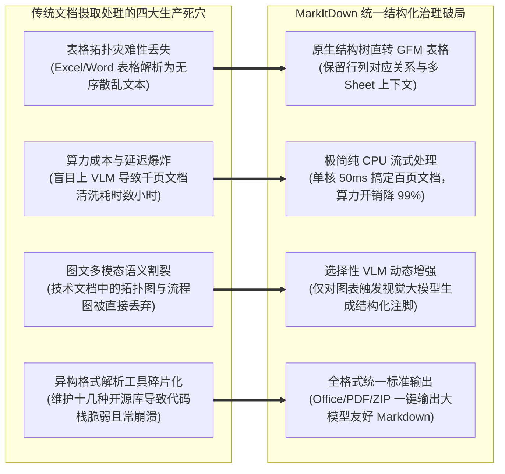

---
tags:
  - ai-practice
  - engineering
  - architecture
domain: RAG调优
difficulty: 进阶
date_added: 2026-11-09
---

# 💡 企业级多源异构文档轻量化摄取：基于 MarkItDown 的全格式清洗、多模态增强与 RAG 标准化实战

> **核心摘要**：在企业级检索增强生成（RAG）与智能体系统构建中，“垃圾进，垃圾出（Garbage In, Garbage Out）”的摄取数据清洗困境长期困扰着算法团队。面对政企内网中海量格式各异且排版混乱的 Word（`.docx`）、Excel（`.xlsx`）、PowerPoint（`.pptx`）、PDF、网页及多媒体资产，粗暴采用通用纯文本解析器会导致表格拓扑错位、语义层级缺失与跨页乱码；而盲目依赖重型视觉大模型（VLM/OCR）进行全量页面渲染又会引爆昂贵的 GPU 算力成本并产生数秒以上的吞吐瓶颈。本文基于微软开源的统一文档摄取框架 **MarkItDown**，深度剖析面向大模型对齐的“结构优先与极速轻量清洗范式”。详解基于底层标签树的高性能 Office 无损解析、Markdown 表格语义重构、外挂视觉大模型（VLM）与语音模型的**选择性多模态注脚增强**，并针对复杂嵌套表头错位、超大 Excel 单元格溢出与加密附件清洗三大工业级痛点提供高可用落地方案。

---

## 🎯 业务与技术背景：企业多格式文档摄取的“低效与失真”死穴

在知识库 RAG 管道落地生产的初期，数据治理团队往往在“传统轻量解析”与“重型视觉 OCR”两个极端之间反复徘徊：



1. **表格结构拓扑的毁灭性丢失（Tabular Topology Destruction）**：
   - 企业核心资产（如财务报表、价格清单、参数配置）几乎都以 Excel 或 Word 表格形式存在。传统的 `pypdf` 或通用纯文本提取器在提取时，会直接按从左至右将所有文字流平铺，导致“列名”与“数值”彻底错位。大模型在检索到被拆解的混乱文本切片后，不仅无法回答“2026 年 Q3 华东区净利润是多少”，还极易基于错位的数字生成灾难性幻觉。
2. **盲目依赖重型视觉 OCR 模型的算力黑洞（Heavy VLM Resource Waste）**：
   - 部分团队为了追求所谓的“视觉版面保真”，对企业内网数以万计的常规 Office 文档全量采用重型多模态 OCR 框架（如 Docling、MinerU 或基于视觉的 ColPali）。然而，标准的 `.docx` 和 `.pptx` 文件本质上由高度结构化的 XML 标签树构成，直接通过原生解析器只需要 20~50 毫秒即可提取完美的标题和表格；强行渲染为图片再送入数卡 GPU 跑 OCR，将带来数百倍的推理延迟和极度高昂的算力账单。
3. **图文与多媒体语义被割裂丢弃（Multimodal Blindspot）**：
   - 现代企业技术规范和产品方案中，充斥着系统架构图、业务流程图和数据折线图。传统基于规则的转换器通常将这些图像视作二进制黑盒并直接忽略，导致 RAG 知识库对整篇文档的核心技术精华一无所知。
4. **解析工具链的极端碎片化与依赖冲突（Parser Fragmentation Hell）**：
   - 传统方案中，团队通常拼凑使用针对 Word 的 `python-docx`、针对 PPT 的 `python-pptx`、针对 Excel 的 `openpyxl`、针对 PDF 的 `pdfminer`，接口参数千奇百怪，甚至还需要依赖外部 Java 运行时环境（如 Apache Tika）。这种脆弱的胶水代码极易因格式微小差异而频繁崩溃。

---

## 🏗️ 架构设计与解决方案：基于 MarkItDown 的统一轻量多模态摄取流水线

针对上述痛点，我们设计了以 **MarkItDown** 为核心驱动的高性能统一文档摄取与清洗中枢：

```mermaid
flowchart TD
    subgraph RawSources [企业多源异构文件资产池]
        DocWord[企业制度: .docx]
        DocExcel[财务报表: .xlsx]
        DocPPT[技术胶片: .pptx]
        DocPDF[规范研报: .pdf]
        DocZip[工程项目包: .zip]
        DocMedia[混合媒体: .png / .wav]
    end

    subgraph MarkItDownIngestion [MarkItDown 统一流水线中枢]
        FormatDetector[智能格式探测器: MIME Type + 扩展名嗅探]
        
        subgraph CPUFastPath [CPU 极速原生解析通道 (毫秒级零 GPU 消耗)]
            ExcelEngine["Excel 矩阵解析器<br/>(按 Sheet 生成 GFM 表格与数值格式化)"]
            WordEngine["Word 标签树解析器<br/>(保留 H1-H6 标题层级与代码缩进)"]
            PPTEngine["PPT 幻灯片解析器<br/>(页码大纲 + 形状文本框 + 演讲者备注)"]
            PDFTextEngine["PDF 纯文本抽取器<br/>(排版流重排与多栏换行折叠)"]
        end

        subgraph VLMSelectivePath [选择性多模态增强通道 (按需调用)]
            ImageRouter{是否包含复杂图表?}
            VLMCaller["轻量视觉模型服务 (GPT-4o-mini / Qwen2.5-VL)<br/>生成高信息密度图表描述与数值注脚"]
            AudioTranscriber["Whisper 语音转录引擎<br/>会议录音分段转写"]
        end

        MarkdownSynthesizer["Markdown 语义整合器<br/>(层级标题树重构 + 表格清洗 + 图文注脚嵌入)"]
    end

    subgraph DownstreamRAG [下游知识库向量化与语义检索]
        SemanticSplitter[Markdown 语义标题切片器 (Header-Aware Chunker)]
        DenseSparseEmbedding[稠密+稀疏向量化: BGE-M3]
        VectorStorage[(向量数据库: Qdrant / Milvus)]
    end

    DocWord & DocExcel & DocPPT & DocPDF & DocZip & DocMedia ==> FormatDetector
    FormatDetector --> CPUFastPath
    FormatDetector --> ImageRouter

    ImageRouter -->|检测到图片元素| VLMCaller
    ImageRouter -->|音频媒体| AudioTranscriber

    CPUFastPath ==> MarkdownSynthesizer
    VLMCaller ==> MarkdownSynthesizer
    AudioTranscriber ==> MarkdownSynthesizer

    MarkdownSynthesizer ==> SemanticSplitter ==> DenseSparseEmbedding ==> VectorStorage
```

### 关键工程机制

1. **结构驱动的原生 Markdown 表格映射（Structure-Driven Markdown Tables）**：
   - MarkItDown 对 Excel 文件采用按 Sheet 迭代的矩阵映射机制。不仅自动跳过空行空列，而且会将单元格中的原始格式化数据（如百分比、货币符号、日期）完整保全，转化为标准的 GitHub Flavored Markdown 表格。对于跨页复杂表格，自动为每个分片补全 Header 表头，彻底根除后续切片时的上下文断裂。
2. **选择性 VLM 动态增强（Selective VLM Footnote Injection）**：
   - 核心原则是“文本优先，按需触发”。对于文档中的文字段落，完全在本地 CPU 原生解析，不消耗一分钱的模型 API 成本；仅当解析引擎在 Word/PPT 中扫描到高分辨率嵌入图片时，触发轻量级视觉大模型（如 `gpt-4o-mini` 或开源的 `Qwen2.5-VL-7B`）执行图像识别，将图片解读为包含“图表类型、核心趋势、极值数据”的文本摘要，并以 `` 形式插入正文，兼顾极速与全多模态。
3. **递归 ZIP 归档包穿透解析**：
   - 在企业研发与项目归档中，大量文档以 ZIP 压缩包的形式沉淀。MarkItDown 具备内置的归档遍历能力，自动递归解压多层目录树，并以 Markdown 章节层级结构（`# Archive: module_a -> ## doc_1.docx`）进行扁平化展开，极大简化数据 ETL 处理步骤。

---

## 💻 核心落地源码与工程实战实现

### 1. 企业级通用文档清洗与增强服务 (`document_ingestion_service.py`)

```python
#!/usr/bin/env python3
"""
document_ingestion_service.py
基于 MarkItDown 的企业级通用多源异构文档轻量化清洗与 RAG 向量切片增强管道
"""

import os
import re
import time
from pathlib import Path
from typing import Dict, Any, Optional
from openai import OpenAI
from markitdown import MarkItDown

class EnterpriseDocumentIngestor:
    def __init__(self, openai_api_key: Optional[str] = None, base_url: Optional[str] = None):
        """
        初始化企业级文档解析器，支持纯 CPU 模式与外挂 VLM 多模态增强模式
        """
        self.vlm_client = None
        if openai_api_key:
            self.vlm_client = OpenAI(api_key=openai_api_key, base_url=base_url)
            print("🚀 [Init] 已挂载视觉大模型 (VLM)，将开启嵌入图片深度图表解析能力")
        else:
            print("⚡ [Init] 未配置 VLM Key，运行于纯 CPU 极速轻量模式")

        # 实例化底层 MarkItDown 引擎
        self.converter = MarkItDown(
            llm_client=self.vlm_client,
            llm_model="gpt-4o-mini" # 使用高性价比模型生成图片摘要
        )

    def sanitize_markdown(self, raw_md: str) -> str:
        """
        后置清洗与格式归一化：消除多余空行、统一表头并确保换行规范
        """
        # 消除连续 3 个以上的空白换行
        cleaned = re.sub(r'\n{3,}', '\n\n', raw_md)
        # 移除不可见控制字符
        cleaned = re.sub(r'[\x00-\x08\x0b\x0c\x0e-\x1f\x7f]', '', cleaned)
        return cleaned.strip()

    def process_file(self, file_path: str) -> Dict[str, Any]:
        """
        全格式统一摄取主入口：自动识别扩展名并执行高性能转换
        """
        p = Path(file_path)
        if not p.exists():
            raise FileNotFoundError(f"文件不存在: {file_path}")

        start_time = time.perf_counter()
        file_size_kb = p.stat().st_size / 1024.0

        print(f"\n📂 开始解析文件: {p.name} ({file_size_kb:.1f} KB, 格式: {p.suffix})")

        try:
            # 调用 MarkItDown 执行统一抽取
            result = self.converter.convert(str(p))
            raw_text = result.markdown_content
            cleaned_text = self.sanitize_markdown(raw_text)
            elapsed_ms = (time.perf_counter() - start_time) * 1000

            doc_metadata = {
                "file_name": p.name,
                "file_extension": p.suffix.lower(),
                "file_size_kb": round(file_size_kb, 2),
                "title": result.title or p.stem,
                "parse_duration_ms": round(elapsed_ms, 2),
                "char_count": len(cleaned_text),
                "has_tables": "|" in cleaned_text and "-|-" in cleaned_text,
                "has_images": "![" in cleaned_text
            }

            print(f"✅ 解析成功 | 耗时: {elapsed_ms:.2f}ms | 提取字符: {len(cleaned_text)} | 表格: {doc_metadata['has_tables']} | 图像摘要: {doc_metadata['has_images']}")
            return {
                "metadata": doc_metadata,
                "content": cleaned_text
            }
        except Exception as e:
            print(f"❌ 解析发生异常: {str(e)}")
            raise e

# 单元验证与模拟运行
if __name__ == "__main__":
    # 配置可兼容的本地/云端视觉大模型接口（如未配置则跳过 VLM 仅跑轻量提取）
    API_KEY = os.getenv("OPENAI_API_KEY", "")
    BASE_URL = os.getenv("OPENAI_BASE_URL", "https://api.openai.com/v1")

    ingestor = EnterpriseDocumentIngestor(
        openai_api_key=API_KEY if API_KEY else None,
        base_url=BASE_URL if API_KEY else None
    )

    # 模拟创建一份测试复杂财务 Excel 文件
    import pandas as pd
    sample_excel = "sample_financial_report.xlsx"
    with pd.ExcelWriter(sample_excel, engine="openpyxl") as writer:
        df_summary = pd.DataFrame({
            "业务板块": ["智能计算业务", "企业云软件", "数据中心基础设施"],
            "2026 Q1营收(万元)": [12850.5, 8430.2, 5920.0],
            "同比增速": ["+45.2%", "+18.7%", "+8.3%"],
            "合规审计状态": ["已过审", "已过审", "待补充材料"]
        })
        df_summary.to_excel(writer, sheet_name="板块营收概览", index=False)

    # 执行转换
    res = ingestor.process_file(sample_excel)
    print("\n" + "=" * 50)
    print("📋 转换生成的规范 Markdown 输出演示:")
    print("=" * 50)
    print(res["content"])
    
    # 清理临时测试文件
    if os.path.exists(sample_excel):
        os.remove(sample_excel)
```

### 2. 结合 LangChain / LlamaIndex 的 RAG 标题感知切片器集成 (`rag_chunking_pipeline.py`)

```python
#!/usr/bin/env python3
"""
rag_chunking_pipeline.py
将 MarkItDown 输出的标准化 Markdown 接入面向标题感知的语义切片流水线 (Header-Aware Splitter)
"""

from typing import List, Dict
from langchain_text_splitters import MarkdownHeaderTextSplitter, RecursiveCharacterTextSplitter

def split_markdown_into_rag_chunks(markdown_content: str, doc_meta: Dict) -> List[Dict]:
    """
    基于 Markdown 标题层级进行语义无损切片，绝不暴力打断表格与代码块
    """
    # 1. 第一阶段：依据 Markdown 标题树进行宏观层级切分
    headers_to_split_on = [
        ("#", "H1_Module"),
        ("##", "H2_Section"),
        ("###", "H3_Subsection"),
    ]
    markdown_splitter = MarkdownHeaderTextSplitter(
        headers_to_split_on=headers_to_split_on,
        strip_headers=False # 关键：切片内部保留标题行，避免大模型丢失上下文语义
    )
    header_splits = markdown_splitter.split_text(markdown_content)

    # 2. 第二阶段：对于超长章节段落，采用语义感知滑动窗口进行二次切分
    text_splitter = RecursiveCharacterTextSplitter(
        chunk_size=800,
        chunk_overlap=100,
        separators=["\n\n", "\n", "。", "！", "？", " ", ""]
    )

    final_chunks = []
    for split in header_splits:
        sub_docs = text_splitter.split_text(split.page_content)
        for i, text in enumerate(sub_docs):
            chunk_data = {
                "chunk_id": f"{doc_meta['file_name']}_{len(final_chunks)}",
                "text": text,
                "metadata": {
                    **doc_meta,
                    **split.metadata,
                    "sub_chunk_index": i
                }
            }
            final_chunks.append(chunk_data)

    return final_chunks
```

---

## ⚠️ 生产环境踩坑与避坑指南

### 1. 坑点一：超大 Excel 文件（数万行）导致内存爆炸与 Markdown 膨胀
- **现象**：当业务人员上传包含 5 万行明细的客户明细表时，MarkItDown 将其转换为整段庞大的 Markdown 表格，体积达到数百兆，导致切片器直接内存溢出（OOM），且单个 Chunk 塞满无序的表格行碎片。
- **原因剖析**：Excel 适合存储数据库明细，但大语言模型的上下文窗口并不适合直接硬吞几万行的纯文本表格。
- **避坑方案**：
  - **行数阈值自适应截断与降级**：在摄取脚本中探测单 Sheet 行数。若超过 500 行，启用“数据画像摘要策略”——自动计算前 10 行样例、字段统计分布（均值、最大值、空值率）与末尾 5 行，将其以数据字典摘要形式交付大模型；对于全量明细查询，自动分流至专门的 Text-to-SQL 引擎（如 Vanna）。

### 2. 坑点二：跨页复杂 Word 表格的表头错位与单元格合并丢失
- **现象**：在审阅跨越数页的合同附件时，转换出的 Markdown 表格第二页缺少表头，导致切片后后续单元格的数值失去列属性归属。
- **原因剖析**：Word 中的跨页表格若未显式勾选“在每页顶端以标题行形式重复”，XML 底层仅在第一页定义 `<w:tblHeader>` 标签。
- **避坑方案**：
  - 在后置清洗环节，增加表头状态机：缓存当前表格的 Column Header，若检测到连续 Markdown 表格的列数完全一致且紧密相邻，自动在切片前合并并回填表头定义行。

### 3. 坑点三：PPT 幻灯片中的“层叠浮动文本框”导致阅读顺序颠倒
- **现象**：PPT 转换出的 Markdown 内容与实际胶片展示顺序完全相反，原本在底部的“总结结论”排到了最前列。
- **原因剖析**：PPTX 底层 XML 中 Shape 对象的排序是按照作者绘制插入的时间戳存储的，而非页面上的几何坐标位置（Top-to-Bottom, Left-to-Right）。
- **避坑方案**：
  - 继承 MarkItDown 的 PPT 转换器，覆写其形状提取排序逻辑：在抽取文本前，先按形状的几何坐标 `(top, left)` 进行二维坐标自上而下、自左向右排序，严格恢复人类自然的阅读流。

### 4. 坑点四：扫描件与复杂双栏 PDF 原生文本解析乱码
- **现象**：对于由传真扫描件生成的 PDF，MarkItDown 原生文本提取出全篇空白或乱码乱序。
- **原因剖析**：MarkItDown 的 PDF 抽取基于 `pdfminer.six`，仅针对具备原生文本层的数字 PDF 有效；纯图像扫描 PDF 内部不存在字符流。
- **避坑方案**：
  - **前置文本密度检测器（Text Density Check）**：计算 PDF 单页提取出的可打印字符数与页面物理面积的比值。若单页字符密度低于阈值（如 `< 50 chars/page`），判定为纯扫描件，自动通过消息队列熔断降级分流给专用 OCR 管道（如 MinerU 或 Docling）处理。

---

## 🔗 关联项目与引用

- 关联工具: [[MarkItDown]], [[Docling]], [[MinerU]], [[Unstructured]], [[ColPali]], [[Crawl4AI]], [[Firecrawl]], [[RAGFlow]]
- 关联日报: [[2026-11-09-AI-Digest]], [[2026-10-28-AI-Digest]]
- 理论进阶: [[企业级多模态文档摄取治理：基于 Unstructured 的版面元数据感知与语义自适应分块实战]], [[企业级精准文档问答：基于 Kotaemon 的多模态混合检索与可溯源引用架构实战]]
