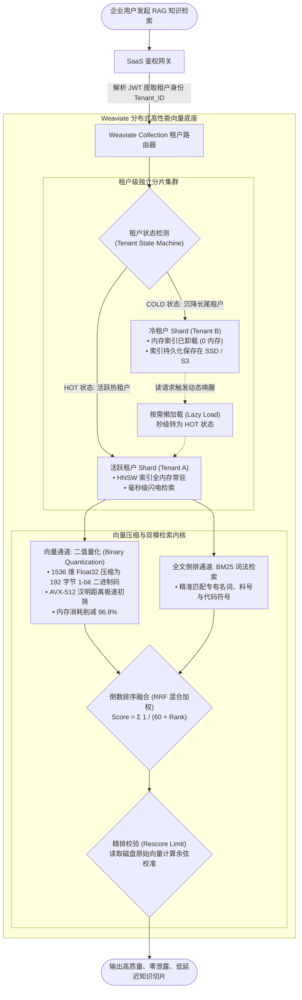

---
tags:
  - ai-practice
  - engineering
  - architecture
domain: RAG调优
difficulty: 进阶
date_added: 2026-10-15
---

# 💡 企业级多租户海量向量检索：基于 Weaviate 的动态租户隔离与 PQ-BQ 标量压缩实战

> **核心摘要**：企业级 SaaS RAG 与知识库平台在规模化落地时，普遍面临“数据合规下的强租户隔离”、“海量闲置租户占用昂贵内存”以及“千维嵌入向量显存爆炸”三大成本与架构壁垒。本文深入拆解 **Weaviate** 的**原生动态多租户（Dynamic Multi-Tenancy）**分片机制与**二值量化（BQ）/ 产品量化（PQ）**向量压缩算法，演示如何基于新一代 Python Client v4 构建支撑数万租户、热冷自动流转（HOT/COLD Offloading）、内存暴降 90%+ 且保持极高召回率的百亿级生产向量检索中枢。

---

## 🎯 业务/技术背景与痛点

在企业级 B2B SaaS 平台中，每个客户（租户）都希望拥有自己专属的私有知识库，并对数据安全有着严苛要求（如 GDPR、金融数据合规要求 A 租户与 B 租户严密物理/分片隔离）。采用传统向量方案通常遭遇以下严峻困境：

1. **共享大索引 + Metadata 过滤的致命缺陷**：
   - **安全隐患**：依赖应用层在查询时拼装 `WHERE tenant_id == 'xxx'`，一旦代码逻辑存在漏洞或大模型提取元数据出错，可能导致严重的数据跨租户越权泄露；
   - **HNSW 图退化（Graph Disconnection）**：当租户数据规模差异巨大时，高密度的全局 HNSW 索引在带有强过滤条件遍历时，会导致贪心搜索在图中过早陷入死胡同，召回率出现断崖式下跌，且检索耗时甚至慢于全表暴力扫描。
2. **“一租户一集群/单表”运维成本爆炸**：
   - 若为每个租户单独部署数据库或创建独立 Table/Collection，单集群在数千个租户下就会面临文件描述符耗尽、元数据管理节点崩溃的问题；
   - **80/20 闲置长尾法则**：SaaS 平台中 80% 的中小租户在大部分时间是静默的，但为了保持在线，传统方案必须将其向量索引常驻在极为昂贵的内存（RAM）中，基础设施成本居高不下。
3. **高维嵌入向量（High-Dimensional Embeddings）的内存膨胀**：
   - 现代前沿多模态与文本嵌入模型（如 1536 维、3072 维）通常以 32 位浮点数（Float32）存储，单条向量纯数据即占用 6KB~12KB，加上 HNSW 图结构开销，千万级向量即可轻易吃满 60GB~100GB 内存，硬件预算难以承受。

---

## 🏗️ 架构设计与解决方案

为打破上述痛点，**Weaviate** 提供了**原生动态多租户分片**与**自适应向量量化压缩**的端到端架构。



### 核心机制深度剖析：

1. **原生动态多租户（Dynamic Multi-Tenancy）与分层存储**：
   - **独立 Shard 物理隔离**：每个租户拥有完全独立的 HNSW 图与倒排索引文件，在存储与内存层面物理隔绝，彻底规避跨租户数据越权与 HNSW 图过滤退化；
   - **三态生命周期管理**：
     - `HOT`：数据与索引驻留内存，用于白天高频访问的头部企业；
     - `COLD`：数据与索引刷入本地 SSD 甚至挂载的对象存储（S3/MinIO），内存占用归零；
     - `OFFLOADED`：全量归档，仅保留元数据。在请求抵达时，可通过 API 在毫秒-秒级内动态无感切换。
2. **二值量化（Binary Quantization, BQ）与 AVX-512 加速**：
   - **量化原理**：若高维空间中各分量分布均匀，只需记录每个维度的正负符号（`> 0` 记为 1，`<= 0` 记为 0）。一个 1536 维的向量仅需 $1536 \div 8 = 192$ 字节；
   - **硬件加速**：向量之间的余弦相似度计算被转化为 CPU 级别极其廉价的异或（XOR）与 `POPCNT`（汉明距离）指令，单核每秒可执行上亿次距离计算；
   - **过采样重打分（Oversampling & Rescoring）**：初筛阶段用 BQ 快速筛选出 Top 100 候选集，再读取存储中的原始精度向量对这 100 条进行精准余弦重打分，在节省 90%+ 内存的同时，召回率几乎无损（保持在原生的 95%~99% 以上）。

---

## 💻 关键代码 / 配置 / 架构实战

以下代码基于官方最新的 **Weaviate Python Client v4**，演示从 Collection 创建、动态租户热冷生命周期管理、BQ 向量压缩配置，到带 RRF 混合检索的完整闭环：

```python
import weaviate
from weaviate.classes.config import (
    Configure,
    Property,
    DataType,
    VectorDistances
)
from weaviate.classes.tenants import Tenant, TenantActivityStatus
from weaviate.classes.query import MetadataQuery

# ---------------------------------------------------------
# 1. 初始化客户端连接 (默认启用 HTTP/2 gRPC 高速二进制协议)
# ---------------------------------------------------------
client = weaviate.connect_to_local(
    host="127.0.0.1",
    port=8080,
    grpc_port=50051
)

try:
    collection_name = "EnterpriseSaaSKnowledge"
    
    # 清理历史测试集合
    if client.collections.exists(collection_name):
        client.collections.delete(collection_name)

    # ---------------------------------------------------------
    # 2. 创建带动态多租户与 BQ 压缩配置的 Collection
    # ---------------------------------------------------------
    kb_collection = client.collections.create(
        name=collection_name,
        # 1. 开启原生多租户
        multi_tenancy_config=Configure.multi_tenancy(
            enabled=True,
            auto_tenant_creation=False  # 严格控制租户准入
        ),
        # 2. 配置 HNSW 索引与二值量化 (BQ) 压缩
        vector_index_config=Configure.VectorIndex.hnsw(
            distance_metric=VectorDistances.COSINE,
            quantizer=Configure.VectorIndex.Quantizer.bq(
                rescore_limit=50,   # 对初筛的 Top 50 候选进行原精度重排
                cache=True          # 缓存量化向量于内存，极速计算
            )
        ),
        # 3. 字段属性定义
        properties=[
            Property(name="doc_id", data_type=DataType.TEXT, index_searchable=False),
            Property(name="title", data_type=DataType.TEXT, index_searchable=True),
            Property(name="content", data_type=DataType.TEXT, index_searchable=True),
            Property(name="author", data_type=DataType.TEXT, index_filterable=True),
            Property(name="updated_at", data_type=DataType.DATE)
        ]
    )
    print(f"✅ 成功创建多租户集合: {collection_name}")

    # ---------------------------------------------------------
    # 3. 注册租户并配置初始热/冷状态
    # ---------------------------------------------------------
    # 模拟为两家客户开通企业私有空间
    kb_collection.tenants.create([
        Tenant(name="tenant_fintech_corp", activity_status=TenantActivityStatus.HOT),
        Tenant(name="tenant_logistics_ltd", activity_status=TenantActivityStatus.HOT)
    ])
    print("✅ 成功注册租户: tenant_fintech_corp (HOT), tenant_logistics_ltd (HOT)")

    # ---------------------------------------------------------
    # 4. 针对特定租户进行安全隔离数据灌入
    # ---------------------------------------------------------
    fintech_tenant = kb_collection.with_tenant("tenant_fintech_corp")
    
    # 写入金融租户的敏感合规文档 (模拟 1536 维 Embedding)
    mock_vector = [0.035, -0.012, 0.078, -0.054] * 384  # 1536 维
    fintech_tenant.data.insert(
        properties={
            "doc_id": "FIN-SEC-2026-001",
            "title": "跨境反洗钱高危账户监控预警操作规范",
            "content": "当单日累计跨境交易金额突破 100 万元或存在高频拆分交易时，风控引擎必须触发 T+0 冻结审查并报送央行反洗钱监测中心。",
            "author": "合规与风控稽核部"
        },
        vector=mock_vector
    )
    print("📥 成功为 tenant_fintech_corp 灌入文档数据！")

    # ---------------------------------------------------------
    # 5. 租户冷热分层调度实战 (将非活跃租户内存清空下沉至磁盘/对象存储)
    # ---------------------------------------------------------
    print("\n🌙 夜间长尾调度: 将 tenant_logistics_ltd 标记为 COLD 状态释放内存...")
    kb_collection.tenants.update([
        Tenant(name="tenant_logistics_ltd", activity_status=TenantActivityStatus.COLD)
    ])
    
    # 查询当前租户活跃状态
    tenants_status = kb_collection.tenants.get()
    for t_name, t_obj in tenants_status.items():
        print(f"  • 租户: {t_name} -> 当前运行状态: {t_obj.activity_status}")

    # ---------------------------------------------------------
    # 6. 带 RRF 融合与 BQ 重打分的精准混合检索 (Hybrid Search)
    # ---------------------------------------------------------
    query_text = "反洗钱跨境交易冻结监控标准与上报"
    query_vector = [0.032, -0.010, 0.075, -0.051] * 384  # 模拟用户 Query 向量

    print(f"\n🔍 针对金融租户执行 Hybrid 混合检索: '{query_text}'")
    search_results = fintech_tenant.query.hybrid(
        query=query_text,
        vector=query_vector,
        alpha=0.6,      # 0.6 权重偏向稠密语义向量，0.4 偏向 BM25 专有名词匹配
        limit=2,
        return_metadata=MetadataQuery(score=True, explain_score=True)
    )

    for idx, hit in enumerate(search_results.objects, start=1):
        print(f"\n🏆 Top {idx} 命中文档:")
        print(f"  - 标题: {hit.properties['title']}")
        print(f"  - 作者: {hit.properties['author']}")
        print(f"  - 混合加权得分: {hit.metadata.score:.4f}")
        print(f"  - 核心正文: {hit.properties['content']}")

finally:
    client.close()
```

---

## ⚠️ 生产环境踩坑与避坑指南

1. **二值量化（BQ）在低维或偏斜向量下的召回率坍塌**：
   - **坑点**：BQ 极度依赖维度的独立性与中心对称性。若使用的 Embedding 模型维度较低（如 256 维或 384 维），或者某些旧模型的向量未做标准化（非以 0 为中心对称），直接使用 BQ 会导致严重的信息丢失，召回率可能从 90% 跌落至 50% 以下。
   - **避坑方案**：在 1024 维及以上（如 OpenAI text-embedding-3、Cohere v3、Qwen/BGE 大型向量）时推荐优先使用 BQ；若使用 384~768 维轻量模型，建议改用 **产品量化（PQ）** 或标量量化（SQ8），既能节省 75% 内存，又能保证 95%+ 召回率。同时务必配置 `rescore_limit`（通常设置为最终 limit 的 5~10 倍），用未压缩向量精排兜底。
2. **长尾租户冷启动（COLD to HOT）引发 P99 延迟抖动**：
   - **坑点**：当低频租户从 `COLD` 状态首次唤醒时，Weaviate 需要从本地磁盘或 S3 异步解压并载入分片索引，首个请求可能面临数百毫秒至数秒的延迟，直接影响前端交互体验。
   - **避坑方案**：
     - **预热机制（Pre-warming）**：在用户在 SaaS 登录验证通过时，应用网关即可预先向 Weaviate 发送异步租户激活指令（通过更新其状态为 HOT），待用户真正打开知识库聊天界面并发起检索时，索引已在后台静默加载完毕；
     - **本地 NVMe 缓存**：若配置了对象存储卸载（Offloading to S3），节点本地务必配置 NVMe SSD 作为热点租户的二级缓存，避免重复全量网络下载。
3. **海量租户并发批量写入时的 gRPC 缓冲区溢出**：
   - **坑点**：使用新版 Python Client v4 的 `client.batch` 批量灌库时，若同时向成百上千个不同的租户并发写入，各个分片的 Write-Ahead-Log (WAL) 与 LSM-Tree Memtable 会争抢 I/O 与文件句柄，引发 gRPC `DEADLINE_EXCEEDED` 错误。
   - **避坑方案**：在执行大规模批量导入时，按租户对数据进行分批（Batch by Tenant），并适当调大操作系统的 `ulimit -n`（建议设置为 1,000,000 以上）。同时在 Python 客户端中将批处理模式设置为 `client.batch.dynamic()`，让客户端根据服务端背压（Backpressure）自适应调节并发速率。

---

## 🔗 关联项目与引用
- 核心存储引擎: [[Weaviate]]
- 向量数据库对比: [[Milvus]], [[Qdrant]], [[LanceDB]]
- 上层 RAG 编排框架: [[LlamaIndex]]
- 知识雷达出处: [[2026-10-15-AI-Digest]]
