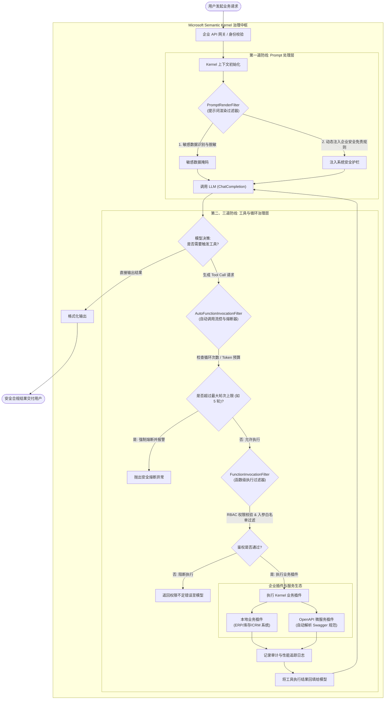

---
tags:
  - ai-practice
  - engineering
  - architecture
domain: Agent设计
difficulty: 进阶
date_added: 2026-10-15
---

# 💡 企业级多语言智能体编排：基于 Microsoft Semantic Kernel 的插件化架构与过滤器拦截实战

> **核心摘要**：企业级系统在落地多智能体（Agent）中枢时，普遍面临“多语言技术栈割裂”、“工具调用黑盒无审计”、“模型幻觉引发无限调用死锁”以及“提示词注入数据泄露”四大工业级难题。本文深度剖析 **Microsoft Semantic Kernel** 的企业架构范式，演示如何基于 **强类型 Kernel 插件** 与 **三层过滤器流水线（Filter Pipelines）**，构建具备精细化 RBAC 鉴权、敏感合规脱敏、自动工具调用配额熔断与全链路审计跟踪的企业级高可靠智能体网关。

---

## 🎯 业务/技术背景与痛点

随着企业从早期的“单次 Prompt 问答”迈向“自主决策执行复杂业务的 Agent 系统”，传统脚本化的开发方式快速暴露出严重的安全与架构隐患：

1. **异构技术栈与工具胶水代码膨胀**：
   - 大型企业的后端往往并存 Java 微服务集群、.NET 核心财务/ERP 系统以及 Python AI/数据算法中台。
   - 现存很多开源 Agent 框架（如早期的 LangChain）重度依赖 Python，将 Python 代码生硬封装为 REST 接口会导致大量的反序列化、类型丢失和中间网络跳数，缺乏跨语言标准规范。
2. **工具调用的黑盒无序与缺乏审计防御（Lack of Governance）**：
   - 当授予大模型“退款”、“发券”、“查询客户私有信息”等工具时，传统的直接调用方式缺乏前置鉴权与合规审计。
   - 一旦大模型遭遇直接/间接提示词注入（Prompt Injection），可能绕过业务防线执行危险操作，造成不可挽回的资产损失。
3. **模型决策失控与死锁 Token 账单爆炸**：
   - 在复杂 ReAct 规划或自动工具调用（Auto Tool Calling）场景中，模型可能因入参格式微小偏差或环境偶发报错，陷入连续不断重复调用同一个工具的“思考死循环”。
   - 若无全局执行层面的硬性熔断器，单次调用可能在数分钟内耗尽成百上千美元的 API 配额。
4. **模型切换时的厂商锁定与上下文割裂**：
   - 业务初期往往使用 OpenAI，后期需根据合规与成本要求无缝切换至 Azure OpenAI、私有化部署的开源大模型（如通过 LiteLLM/vLLM 托管的 Qwen 或 DeepSeek）。
   - 缺少统一的 Service 抽象层会导致业务调用层大面积重构。

---

## 🏗️ 架构设计与解决方案

为彻底解决企业级 Agent 的治理与异构集成难题，**Microsoft Semantic Kernel** 提出了以 `Kernel` 为单一可信调度中心、**三层拦截过滤器（Filter Pipelines）** 为安全护栏的架构设计。



### 核心设计机制解析：

1. **三层拦截过滤器（Filter Pipelines）**：
   - **`PromptRenderFilter`**：在模板渲染期介入。可检查并剥离 Prompt 中的手机号、身份证号、银行卡号等 PII 隐私信息，阻断提示词注入。
   - **`FunctionInvocationFilter`**：在具体函数执行前触发。可提取用户登录态 Token，校验该用户是否具备触发该特定插件（例如 `RefundPlugin.execute_refund`）的企业级角色的权限。
   - **`AutoFunctionInvocationFilter`**：掌控全局自主思考流。不仅能统计多步 Tool Calling 的整体延迟和 Token 消耗，还能在检测到死循环调用或预算超标时强行中断。
2. **强类型插件设计（Kernel Plugins）**：
   - 充分利用语言本身的类型注解。入参与出参严格定义，SK 运行时自动反射提取生成精准的 JSON Schema，最大程度降低模型工具调用的格式错误。
3. **OpenAPI 一键无侵入转化**：
   - 借助 `add_plugin_from_openapi`，直接将已有微服务网关暴露的 Swagger/OpenAPI JSON 声明转换为标准插件，省去数千行样板封装代码。

---

## 💻 关键代码 / 配置 / Prompt 模板

以下是在 Python 环境下构建带有多模型路由、自定义业务插件、三层过滤器安全治理的生产级完整实战代码：

```python
import asyncio
from typing import Any, Dict
from pydantic import BaseModel, Field

# 导入 Semantic Kernel 核心组件
from semantic_kernel import Kernel
from semantic_kernel.connectors.ai.open_ai import OpenAIChatCompletion
from semantic_kernel.connectors.ai.function_choice_behavior import FunctionChoiceBehavior
from semantic_kernel.functions import kernel_function
from semantic_kernel.filters import (
    FilterTypes,
    FunctionInvocationContext,
    AutoFunctionInvocationContext,
    PromptRenderContext,
)

# ---------------------------------------------------------
# 1. 业务数据模型与强类型业务插件
# ---------------------------------------------------------
class FinancialPlugin:
    """企业级财务与资金调拨核心插件"""

    @kernel_function(
        name="transfer_fund",
        description="执行企业账户之间的资金调拨操作。涉及高风险财务指令。"
    )
    def transfer_fund(
        self,
        from_account: str,
        to_account: str,
        amount: float
    ) -> Dict[str, Any]:
        print(f"💰 [底座系统正在转账] 从账户 {from_account} 转往 {to_account}，金额: ¥{amount:,.2f}")
        return {
            "status": "SUCCESS",
            "transaction_id": "TX-20261015-8899",
            "from": from_account,
            "to": to_account,
            "amount": amount
        }

    @kernel_function(
        name="get_account_balance",
        description="查询指定账户的可用余额"
    )
    def get_account_balance(self, account_id: str) -> float:
        balances = {
            "ACC-CORP-01": 2500000.0,
            "ACC-OPS-02": 15000.0
        }
        return balances.get(account_id, 0.0)

# ---------------------------------------------------------
# 2. 企业级三层拦截过滤器实现
# ---------------------------------------------------------

# 防线 1: Prompt 渲染与安全合规过滤器
async def prompt_safety_filter(context: PromptRenderContext, next):
    # 模拟敏感词检查与注入防御
    raw_prompt = context.rendered_prompt
    if "DROP TABLE" in raw_prompt.upper() or "IGNORE ALL PREVIOUS INSTRUCTIONS" in raw_prompt.upper():
        raise PermissionError("🚨 [安全警报] 检测到潜在的提示词注入或越权数据库攻击，请求被直接阻断！")
    
    print(f"🔍 [Prompt 审计] 原始提示词准备就绪，校验安全合规。")
    await next(context)

# 防线 2: 函数执行级过滤器（RBAC 鉴权与审计流）
async def rbac_and_audit_filter(context: FunctionInvocationContext, next):
    fn_name = context.function.name
    plugin_name = context.function.plugin_name
    arguments = context.arguments
    
    print(f"\n🛡️ [RBAC 鉴权校验] 准备触发操作: {plugin_name}.{fn_name}")
    
    # 针对资金调拨等高危工具执行硬性风控策略
    if fn_name == "transfer_fund":
        amount = float(arguments.get("amount", 0))
        if amount > 1000000:
            print(f"❌ [风控阻断] 单笔转账金额 ¥{amount} 超过普通 Agent 授权上限 (100万)！")
            context.result = "错误：单笔转账超过 1,000,000 元，需启动人工审批双签流程，操作已终止。"
            return  # 直接阻断，不向下执行原生代码
            
    # 执行原生插件业务逻辑
    await next(context)
    
    # 记录执行后审计
    print(f"✅ [审计归档] 函数 {plugin_name}.{fn_name} 执行完毕，返回值: {context.result.value}")

# 防线 3: 自动调用循环流控与熔断过滤器
async def loop_circuit_breaker_filter(context: AutoFunctionInvocationContext, next):
    current_step = context.execution_settings.function_choice_behavior.maximum_auto_invoke_attempts
    print(f"⚡ [流控监视] 当前处于 Agent 自动工具调用循环中，已执行工具数: {len(context.chat_history.messages)}")
    
    # 可以在此监控 Token 消耗与全局超时
    await next(context)
    
    if context.terminate:
        print("⚠️ [熔断生效] 业务触发提前终止标记，停止后续推理。")

# ---------------------------------------------------------
# 3. 组装 Kernel 引擎与执行
# ---------------------------------------------------------
async def main():
    kernel = Kernel()

    # 注册大模型服务
    kernel.add_service(
        OpenAIChatCompletion(
            service_id="azure_gpt4o",
            ai_model_id="gpt-4o",
            api_key="sk-enterprise-mock-key"
        )
    )

    # 注册业务插件
    kernel.add_plugin(FinancialPlugin(), plugin_name="Financial")

    # 挂载三层安全拦截过滤器
    kernel.add_filter(FilterTypes.PROMPT_RENDER, prompt_safety_filter)
    kernel.add_filter(FilterTypes.FUNCTION_INVOCATION, rbac_and_audit_filter)
    kernel.add_filter(FilterTypes.AUTO_FUNCTION_INVOCATION, loop_circuit_breaker_filter)

    # 配置自动函数调用策略 (设定安全熔断最大重试 5 次)
    settings = kernel.get_prompt_execution_settings_from_service_id("azure_gpt4o")
    settings.function_choice_behavior = FunctionChoiceBehavior.Auto(
        auto_invoke=True,
        maximum_auto_invoke_attempts=5
    )

    # 业务场景一：正常转账与查询
    user_goal = "帮我查询 ACC-CORP-01 的余额，如果充足，向 ACC-OPS-02 调拨 80,000 元用于运维支持。"
    print(f"\n==================== 业务请求执行开始 ====================")
    print(f"用户意图: {user_goal}")
    
    # 执行调用
    result = await kernel.invoke_prompt(
        prompt=user_goal,
        settings=settings
    )
    print(f"\n🤖 Agent 最终交付回复:\n{result}\n")

if __name__ == "__main__":
    asyncio.run(main())
```

---

## ⚠️ 生产环境踩坑与避坑指南

1. **异步过滤器中的死锁与上下文变量（ContextVariables）并发竞争**：
   - **坑点**：在 `FunctionInvocationFilter` 中，如果错误地使用同步 I/O（如直接同步查询 MySQL 或调用 `requests.get`），会导致 `asyncio` 事件循环被严重挂起，导致所有并发 Agent 吞吐骤降。
   - **避坑方案**：在过滤器中涉及数据库写入或网络鉴权时，必须全量采用异步客户端（如 `aiohttp`, `asyncpg`, `motor`），并在 `context.arguments` 发生修改时，确保深拷贝（`copy.deepcopy`），避免多分支并发时入参被意外篡改。
2. **OpenAPI / Swagger 导入导致上下文爆炸（Context Bloat）**：
   - **坑点**：企业现有的微服务 Swagger 文档往往非常庞大（包含数千个字段与几十个接口）。若全量作为插件挂载给模型，仅工具定义的 JSON Schema 就会吃掉 30k+ 的 Token，不仅模型响应极慢，而且极易诱发工具选择幻觉。
   - **避坑方案**：在将 OpenAPI 挂载为 Kernel 插件时，必须做**语义前置切分**。只导入当前业务领域相关的最小子集，或者构建“二级工具路由器（Two-Stage Tool Router）”——由轻量级分类模型先确定需要的插件组，再动态动态将该插件挂载到 Kernel 中。
3. **AutoFunctionInvocationFilter 中的死循环判定策略**：
   - **坑点**：仅靠 `maximum_auto_invoke_attempts`（最大调用次数）计数是不够的。如果模型一直使用错误入参调用同一个只读接口，虽然没造成破坏，但浪费了大量成本。
   - **避坑方案**：在 `AutoFunctionInvocationFilter` 中维护一个简易的 `(function_name, hash(arguments))` 滑动窗口队列。一旦发现**连续 2 次以完全相同的参数调用同一函数**，立即在 Filter 中向上下文注入纠正提示词，或者直接标记 `context.terminate = True` 强制熔断。

---

## 🔗 关联项目与引用
- 核心框架: [[Semantic-Kernel]]
- 工具通信标准: [[FastMCP]]
- 类型契约体系: [[PydanticAI]]
- 全链路追踪与可观测: [[Langfuse]]
- 知识雷达出处: [[2026-10-15-AI-Digest]]
