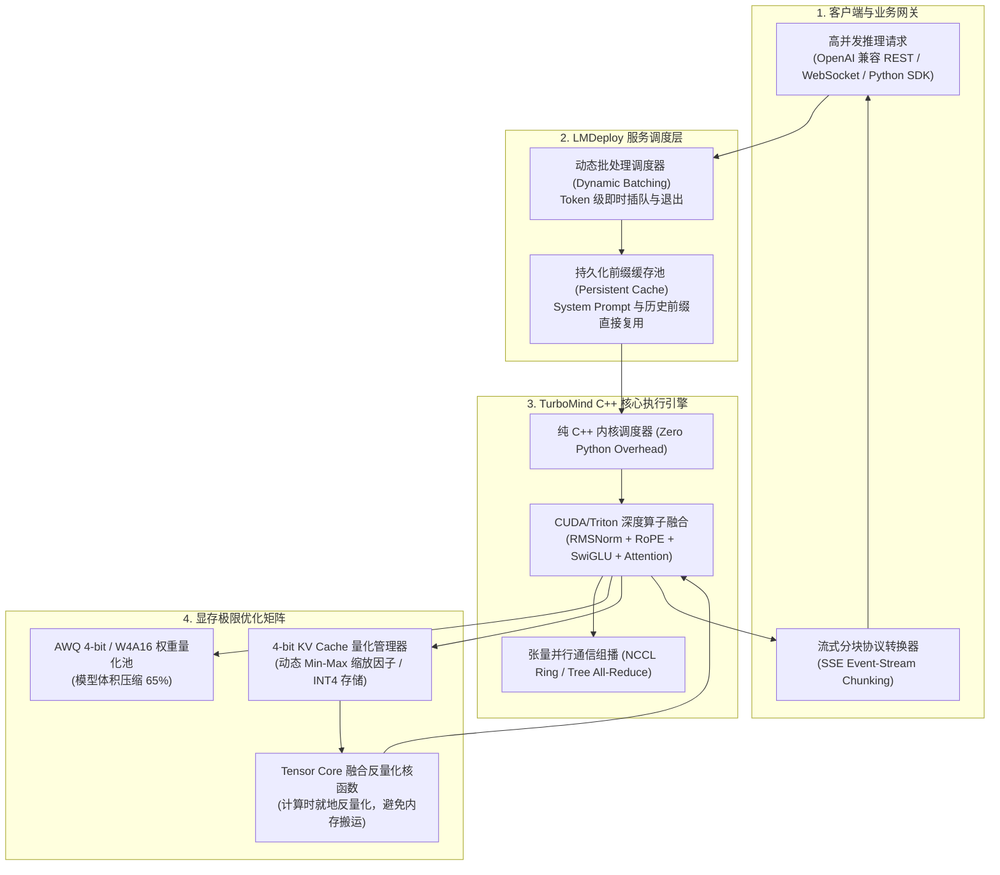

---
tags:
  - ai-practice
  - engineering
  - architecture
domain: 本地部署加速
difficulty: 进阶
date_added: 2026-10-26
---

# 💡 企业级大模型与多模态极速推理：基于 LMDeploy 的 TurboMind 引擎部署与 4-bit KV Cache 显存优化实战

> **核心摘要**：随着长上下文大语言模型（如 Qwen2.5、DeepSeek-V3/R1）与高分辨率多模态视觉模型（如 InternVL2.5、Qwen2-VL）深入企业核心业务，推理服务在应对海量并发与数万 Token 深度思维链（CoT）时面临严重的显存墙（Memory Wall）与显存带宽饱和瓶颈。本文全面拆解基于 **LMDeploy** 的 **TurboMind C++ 执行引擎** 进行极限推理加速，并落地 **4-bit KV Cache 量化**，在几乎零精度下降的前提下实现显存占用降低 65%~70%、并发吞吐跃升 3 倍的企业级生产实战方案。

---

## 🎯 业务/技术背景与痛点

在企业私有化部署智能客服、代码架构助手、长文档智能研报分析以及多模态图表识别场景中，推理服务架构师常遭遇三大致命工程瓶颈：

```
[企业大模型与多模态推理三大核心工程瓶颈]
1. 长上下文与多轮对话中 KV Cache 显存指数级膨胀：
   - 痛点：在 FP16 精度下，每个 Token 的 KV 缓存占用显存与层数、隐藏层维度以及并发请求数成正比。以 70B 模型在 32k 上下文为例，单并发请求仅 KV Cache 就消耗数 GB 显存。高并发场景下，显存瞬间耗尽并引发频繁的 CUDA OOM 崩溃。
2. 首字生成延迟（TTFT）与批处理吞吐（Throughput）的难以调和：
   - 痛点：传统的 Python 运行时框架在面对海量长短不一的混排请求时，显存碎片化严重，GPU 流处理器（SM）经常处于显存数据搬运等待中，首字响应时间过长，用户交互体验卡顿。
3. 多模态视觉模型（VLM）高清切片带来的显存与计算脉冲：
   - 痛点：视觉模型需要将高分辨率图片切分为数十个局部小图（Dynamic Patches）并经 ViT 转化为数千个视觉 Token，常规框架在图文拼接推理时发生严重的显存跳跃与算子调度抖动。
```

### 生产优化核心指标
1. **KV Cache 显存压降 ≥ 65%**：通过 4-bit KV Cache 量化技术，将单 Token 缓存空间从 16 位压缩至 4 位，极大释放物理显存；
2. **并发请求承载能力提升 2.5 ~ 3.5 倍**：在相同单卡或多卡集群上，可容纳的并发长文本会话数成倍增加；
3. **首字延迟（TTFT）降低 35% ~ 50%**：TurboMind C++ 融合算子大幅削减 Python 运行时开销与显存往返时延；
4. **精度损失控制在极小区间（PPL 恶化 < 0.1）**：通过严密的动态缩放因子校准，保证在数学证明、代码生成与多模态问答中的准确率不产生实质退化。

---

## 🏗️ 架构设计与解决方案

基于 LMDeploy 的企业级高性能推理架构分为四大核心层：**请求接入与动态批处理层**、**TurboMind C++ 内核执行层**、**4-bit KV Cache 显存存储与反量化层**，以及**硬件算子级加速层**。

### 整体架构设计流程图



---

### 4-bit KV Cache 量化数学原理

标准注意力机制中，针对第 $l$ 层每个注意力头，键矩阵 $K$ 与值矩阵 $V$ 的元素通常以 16 位浮点数（FP16/BF16，即 2 字节）存储：

$$\text{Memory}_{\text{KVCache}} = 2 \times 2 \times n_{\text{layers}} \times n_{\text{heads}} \times d_{\text{head}} \times L \quad (\text{bytes})$$

其中 $L$ 为当前序列总长度。当 $L$ 达到 32k、64k 时，单请求显存占用逼近极限。

LMDeploy 引入基于通道/块粒度的对称非对称混合量化：
1. **量化编码（Quantization）**：对每一个微块（Group/Block）内部的数值向量 $\mathbf{x}$ 计算极值并映射为 4-bit 无符号整数 $\mathbf{q} \in [0, 15]$：
   $$s = \frac{\max(\mathbf{x}) - \min(\mathbf{x})}{2^b - 1}, \quad z = \text{round}\left(-\frac{\min(\mathbf{x})}{s}\right)$$
   $$\mathbf{q} = \text{clip}\left(\text{round}\left(\frac{\mathbf{x}}{s}\right) + z, 0, 15\right)$$
2. **即时反量化融合计算（Fused Dequantization GEMV）**：在计算 Attention Score $\mathbf{q}_t K^T$ 时，不将整张 $K$ 矩阵显式反量化拷贝回显存，而是直接在 GPU 寄存器与 Tensor Core 计算单元内部，利用融合汇编指令即时解包为 FP16 进行点积运算：
   $$\hat{\mathbf{x}} = s \cdot (\mathbf{q} - z)$$
该机制将全局显存带宽读写压力直接削减到原来的 **25%**，打破了自回归生成阶段（Decode 阶段）受制于显存读取带宽的致命枷锁。

---

## 💻 关键代码 / 配置 / 服务化实操

### 1. 离线模型校准与量化转换（可选）

针对特定模型进行 4-bit 权重量化（AWQ）：
```bash
# 基于开源校准数据集对 Qwen2.5-7B 进行 AWQ 4-bit 权重量化
lmdeploy lite auto_awq \
   Qwen/Qwen2.5-7B-Instruct \
  --work-dir ./qwen2.5-7b-awq \
  --calib-dataset 'ptb' \
  --calib-samples 128 \
  --calib-seqlen 2048 \
  --wbits 4
```

### 2. 生产级 TurboMind 4-bit KV Cache API 服务部署

编写服务启动脚本 `start_lmdeploy_service.sh`：
```bash
#!/usr/bin/env bash
set -e

MODEL_PATH="Qwen/Qwen2.5-7B-Instruct"
PORT=23333
TP_SIZE=1 # 单卡或多卡张量并行大小

echo "启动 LMDeploy TurboMind 高性能推理集群..."

python3 -m lmdeploy serve api_server ${MODEL_PATH} \
    --backend turbomind \
    --model-format hf \
    --tp ${TP_SIZE} \
    --cache-max-entry-count 0.8 \
    --quant-policy 4 \
    --server-name 0.0.0.0 \
    --server-port ${PORT} \
    --max-batch-size 64 \
    --session-len 32768 \
    --log-level INFO
```

> **参数说明**：
> - `--quant-policy 4`：开启 4-bit KV Cache 显存优化（候选值：0 为关闭，4 为 4-bit，8 为 8-bit）；
> - `--cache-max-entry-count 0.8`：将空闲显存的 80% 动态分配给 KV Cache 缓冲池；
> - `--session-len 32768`：支持单会话最长 32k 上下文窗口。

---

### 3. 企业级 Python 高并发流式客户端调用

```python
import asyncio
import time
from openai import AsyncOpenAI

# 1. 客户端初始化 (完全兼容 OpenAI 标准协议)
client = AsyncOpenAI(
    api_key="EMPTY",  # LMDeploy 本地服务默认无鉴权
    base_url="http://127.0.0.1:23333/v1"
)

async def test_streaming_inference(query_id: int, prompt: str):
    """单请求高吞吐流式推理"""
    start_time = time.perf_counter()
    first_token_time = None
    collected_tokens = []
    
    response = await client.chat.completions.create(
        model="Qwen/Qwen2.5-7B-Instruct",
        messages=[
            {"role": "system", "content": "你是一位企业级系统架构专家，回答需严密、条理清晰并附带工程依据。"},
            {"role": "user", "content": prompt}
        ],
        temperature=0.6,
        max_tokens=1024,
        stream=True
    )
    
    async for chunk in response:
        delta = chunk.choices[0].delta
        if delta.content:
            if first_token_time is None:
                first_token_time = time.perf_counter()
            collected_tokens.append(delta.content)
            
    total_time = time.perf_counter() - start_time
    ttft = (first_token_time - start_time) * 1000 if first_token_time else 0
    token_count = len(collected_tokens)
    tps = token_count / total_time if total_time > 0 else 0
    
    print(f"[Query {query_id}] 完成: 生成 {token_count} Tokens | TTFT: {ttft:.1f}ms | 吞吐: {tps:.1f} Tokens/s")
    return "".join(collected_tokens)

async def main():
    prompts = [
        "请系统阐述在金融交易核心系统中，如何设计零数据丢失的分布式事务方案？",
        "请分析在 Linux 内核层，eBPF 技术相比于传统内核模块开发的核心安全性边界。",
        "请对比 ClickHouse 与 StarRocks 在实时数仓高并发点查与复杂多表关联场景下的底层算子差异。"
    ]
    tasks = [test_streaming_inference(i, p) for i, p in enumerate(prompts)]
    await asyncio.gather(*tasks)

if __name__ == "__main__":
    asyncio.run(main())
```

---

## ⚠️ 生产环境踩坑与避坑指南

### 1. `cache-max-entry-count` 动态超卖显存崩溃陷阱
- **踩坑现象**：将 `--cache-max-entry-count` 设置为 0.95 甚至更高，试图压榨全部显存，导致在并发请求中伴随少量外部 CUDA 上下文创建时，系统突然发生底层 `CUDA out of memory` 崩溃退出。
- **根因分析**：LMDeploy 在启动时会预先加载模型权重，并根据 `cache-max-entry-count` 比例锁定剩余显存。若设定过高，未给输入张量（Input Tensor）、激活值中间状态以及 NCCL 缓冲区预留余量，极易在长文本 Prompt 激增时发生 OOM。
- **避坑方案**：在生产环境中，单卡推理建议将该参数设定在 `0.75 ~ 0.82` 之间；多卡张量并行环境下，预留空间需根据卡数适当下调至 `0.70 ~ 0.75`。

### 2. 多模态（VLM）高分辨率图片输入突发抖动
- **踩坑现象**：部署 InternVL2.5 或 Qwen2-VL 多模态模型时，客户端连续传入 4K 级别超高分辨率图片，首字响应时间突然暴涨数十秒，GPU 显存波动剧烈。
- **根因分析**：VLM 会根据图片长宽比将高清图片拆解为数十张切片，导致单一请求瞬间产生 2000~4000 个视觉 Token，直接击穿批处理上限。
- **避坑方案**：在客户端前置网关层施加动态尺寸缩放（Max Resolution 约束），限制单图最大切片数量不超过 12 片，并在启动参数中显式配置 `--max-batch-size` 与 `--session-len`。

### 3. 多卡 Tensor Parallelism 通信阻塞与 NUMA 亲和性
- **踩坑现象**：在双路 CPU、8 卡服务器上拉起 `--tp 8` 时，吞吐并未达到预期的线性加速，甚至在特定批大小下性能不及 4 卡。
- **根因分析**：跨 NUMA 节点的 GPU 之间由于没有走 NVLink 而是回流到了 PCIe 总线，导致 NCCL `All-Reduce` 算子严重阻塞。
- **避坑方案**：使用 `numactl` 绑定进程至对应的 CPU Socket，并确认服务器物理拓扑（`nvidia-smi topo -m`），优先将 TP 限制在同一 NVLink 交换机环路内的 GPU 集合中。

### 4. 4-bit KV Cache 量化精度回测防线
- **避坑方案**：在正式发布 4-bit KV Cache 线上前，必须基于业务基准测试集执行 PPL（Perplexity）与准确率回归。若发现数学逻辑题出现幻觉提升，建议回退至 `--quant-policy 8`（8-bit KV Cache），在获得 50% 显存节省的同时实现绝对零精度损失。

---

## 🔗 关联项目与引用

- 关联工具卡片：[[LMDeploy]]
- 核心对比体系：[[vLLM]], [[TensorRT-LLM]], [[SGLang]], [[llama.cpp]]
- 官方开源仓库：[GitHub: InternLM/lmdeploy](https://github.com/InternLM/lmdeploy)
- 关联日报导航：[[2026-10-26-AI-Digest]]
