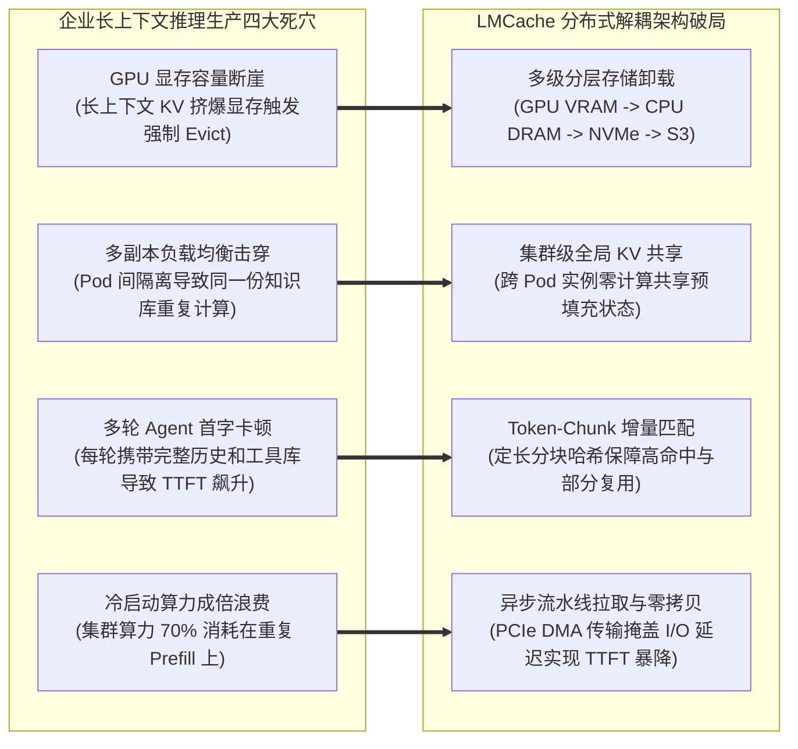

---
tags:
  - ai-practice
  - engineering
  - architecture
domain: 本地部署加速
difficulty: 进阶
date_added: 2026-11-09
---

# 💡 企业级大模型长文本推理加速：基于 LMCache 的分布式多级 KV Cache 共享与跨节点复用实战

> **核心摘要**：随着大模型应用全面迈入长上下文（Long-Context 32k~128k+）与复杂多智能体协同（Multi-Agent System）时代，推理请求的计算瓶颈已从生成解码阶段（Decode）急剧转移至输入预填充阶段（Prefill）。在传统的私有化集群部署中，尽管 vLLM、SGLang 等引擎原生支持单卡或单机内的 Prefix Caching，但其受制于 GPU 显存容量瓶颈与实例间内存隔离，导致跨 Pod 轮询请求、多轮会话追问及共享知识库长文档频繁引发“缓存击穿”，首字延迟（TTFT）飙升至数十秒并造成成倍算力浪费。本文基于开源分布式分层缓存引擎 **LMCache**，系统性构建贯通“**GPU 显存 -> 主机内存 (CPU DRAM) -> 本地高速 NVMe SSD -> 分布式存储 (Redis/MinIO)**”的多级分层卸载与共享架构。详解基于 Token-Chunk 的哈希寻址索引、跨 vLLM 实例的点对点 KV 张量广播同步、与 Prefill-Decode 分离架构的联合部署，并在生产环境攻克内存泄漏、非连续前缀击穿与网络带宽竞争四大致命瓶颈。

---

## 🎯 业务与技术背景：大模型长文本推理的“首字延迟与算力黑洞”

在企业级 RAG、法律/合同合规审查、代码全库分析（Repo-level Agent）等长文本业务上线过程中，技术团队往往面临严重的“长输入 Prefill 延迟爆炸”困境：



1. **GPU 显存容量断崖与高频驱逐（VRAM Cliff & Frequent Eviction）**：
   - 以当前主流的开源旗舰模型（如 Qwen2.5-72B 或 LLaMA-3.1-70B FP16）为例，单请求处理 64k 上下文时，仅单个请求的 KV Cache 就需要占用超过 8GB~12GB 的显存。在 8 卡 H800/A100 的节点上，稍有并发请求涌入，GPU 显存立即见顶。为了接纳新请求，vLLM 的 PagedAttention 机制只能强制将早前生成的 KV Cache 逐出显存。当用户进行第二轮追问时，系统被迫重新执行整整 64k Token 的前向计算（Prefill），耗时直接破十秒。
2. **多副本负载均衡引发的“单机缓存隔离与击穿”（Cluster-Wide Cache Invalidation）**：
   - 生产环境中为了保障高可用与吞吐，通常会在 Kubernetes 集群中部署多个 vLLM 实例（如 4 个 Pod）。负载均衡器（Nginx / Envoy / Ingress）基于轮询或最少连接将用户请求分发至不同 Pod。当用户 A 在 Pod 1 上完成了 32k 企业规章制度的 Prefill 后，用户 B 提出类似问题被路由到 Pod 2，Pod 2 对此毫无感知，只能从头计算一遍。单机 Prefix Caching 在分布式集群中完全沦为“伪命题”。
3. **多智能体（Multi-Agent）与长提示词的累积时延惩罚**：
   - 在复杂 Agent 架构（如 Magentic-One、SWE-agent）中，系统提示词通常包含成百上千行的规则约定、几万行的工具 OpenAPI Schema 描述以及环境记忆。Agent 循环调用多步时，每一步都需要携带这些庞大前缀。若不能实现毫秒级的跨轮次 KV 复用，整个 Agent 的单任务执行时间将拖长数倍，严重摧毁用户体验。

---

## 🏗️ 架构设计与解决方案：基于 LMCache 的分布式多级缓存中枢

针对上述瓶颈，我们构建了一套将计算算力与存储状态深度解耦的分布式推理架构：

```mermaid
flowchart TD
    subgraph ClientAndGateway [接入路由与负载均衡层]
        ClientReq[客户端请求: 包含 64k 统一知识前缀]
        Router[智能网关: 基于前缀哈希一致性路由 / 轮询路由]
    end

    subgraph ServingNode1 [推理节点 1: vLLM Worker 1]
        VLLM_Engine1[vLLM 核心引擎]
        VRAM1[(GPU VRAM 显存池)]
        LMCacheConnector1[LMCache Connector V1]
        CPU_DRAM1[(宿主机 CPU 内存池: 128GB)]
        NVMe_Disk1[(本地高速 NVMe SSD: 2TB)]
    end

    subgraph ServingNode2 [推理节点 2: vLLM Worker 2]
        VLLM_Engine2[vLLM 核心引擎]
        VRAM2[(GPU VRAM 显存池)]
        LMCacheConnector2[LMCache Connector V1]
        CPU_DRAM2[(宿主机 CPU 内存池: 128GB)]
        NVMe_Disk2[(本地高速 NVMe SSD: 2TB)]
    end

    subgraph CentralStorage [全局分布式 KV 共享层 (Cluster-Level Shared Fabric)]
        RedisCluster[(Redis Cluster: 共享 KV 元数据与热数据)]
        S3_MinIO[(分布式对象存储 / Ceph / MinIO: 冷数据与海量归档)]
        LMCacheServer[LMCache MP Server: 集中式元数据与调度中枢]
    end

    ClientReq --> Router
    Router -->|调度分流| VLLM_Engine1
    Router -.->|后续分流| VLLM_Engine2

    VLLM_Engine1 <--> VRAM1
    VLLM_Engine1 <--> LMCacheConnector1
    LMCacheConnector1 <-->|DMA 极速转移 < 1ms| CPU_DRAM1
    CPU_DRAM1 <-->|异步分层落盘 10ms| NVMe_Disk1
    LMCacheConnector1 <-->|跨节点广播/异步上传| RedisCluster
    NVMe_Disk1 -.->|冷归档| S3_MinIO

    VLLM_Engine2 <--> VRAM2
    VLLM_Engine2 <--> LMCacheConnector2
    LMCacheConnector2 <-->|DMA 极速转移 < 1ms| CPU_DRAM2
    CPU_DRAM2 <-->|异步分层落盘 10ms| NVMe_Disk2
    LMCacheConnector2 <-->|直接拉取节点 1 的预计算 KV 20ms| RedisCluster
    RedisCluster <--> LMCacheServer
```

### 核心运作原理解析

1. **分级存储流水线（Hierarchical Tiering）**：
   - **L1 缓存（GPU VRAM）**：当前活跃批次（Active Batch）的读写区域，延迟在纳秒级；
   - **L2 缓存（Host CPU DRAM）**：通过 PyTorch CUDA Stream 与 PCIe 4.0/5.0 DMA 异步非阻塞通道，将 GPU 显存中闲置的 KV 张量以极低开销卸载至主机内存，读写带宽达 30~50 GB/s，加载时延通常在 1~3 毫秒内；
   - **L3 缓存（Local NVMe SSD）**：采用 Direct I/O 与内存映射文件（mmap），将 CPU 内存中较冷的数据落盘持久化，单节点可扩展数 TB 的 KV 缓存，延迟仅需 5~15 毫秒；
   - **L4 缓存（Cluster Shared Store - Redis / MinIO）**：面向跨物理机共享。节点 1 完成特定长文档的 Prefill 后，在后台通过高速网络（100G RoCE / InfiniBand 或万兆以太网）将分块 KV 推送至分布式存储池，为整个集群提供秒级可读的共享记忆。
2. **Chunk-Level 前缀哈希链（Prefix Hash Chain Indexing）**：
   - 系统将 Prompt 按照固定大小（如 256 Token）切割为连续切片，每个切片的哈希值由其当前 Token 序列与前序切片的哈希共同派生：
     $$H_i = \text{Hash}(H_{i-1} \parallel \text{Tokens}_i)$$
   - 当请求到达时，引擎自左向右快速扫描匹配最长公共前缀（Longest Common Prefix）。即使用户在 Prompt 中间修改了个别提示词，系统也仅对发生变动的后续切片重新计算，已命中的历史切片全部直接从 LMCache 瞬时还原。

---

## 💻 核心落地源码与工程实战实现

### 1. 生产环境策略定义 (`lmcache_config.yaml`)

```yaml
# /etc/lmcache/lmcache_production.yaml
# LMCache 生产级多级分层卸载与共享策略

# 基础分块粒度 (Tokens)，推荐 256 或 512
chunk_size: 256

# L2 缓存：宿主机 CPU DRAM 内存配额
local_cpu: true
local_cpu_memory_gb: 128          # 划出 128GB 主机内存作为一级溢出池

# L3 缓存：本地高速 NVMe SSD 存储配置
local_disk: "/mnt/nvme_cache/lmcache_data"
local_disk_size_gb: 1024         # 允许使用 1TB NVMe 磁盘
local_disk_io_backend: "aio"     # 使用 Linux 原生异步 I/O (libaio)

# L4 缓存：分布式集群共享介质 (支持 redis://, s3://, minio://)
remote_url: "redis://10.244.10.50:6379"
remote_serde: "torch"            # 序列化格式使用原生高效二进制张量

# 性能调优参数
save_decode_cache: false         # 仅缓存高价值的长前缀 Prefill，关闭短小 Decode 缓存以节约 I/O
async_save: true                 # 异步写入，不阻塞推理请求的关键路径
lookup_timeout_ms: 50            # 远程拉取超时降级阈值，超过 50ms 自动转为本地重算，保障可用性
```

### 2. Kubernetes 生产级 vLLM + LMCache 部署清单 (`vllm-lmcache-deployment.yaml`)

```yaml
apiVersion: apps/v1
kind: Deployment
metadata:
  name: vllm-lmcache-serving
  namespace: ai-inference
  labels:
    app: vllm-lmcache
spec:
  replicas: 4
  selector:
    matchLabels:
      app: vllm-lmcache
  template:
    metadata:
      labels:
        app: vllm-lmcache
    spec:
      containers:
      - name: vllm-container
        image: vllm/vllm-openai:v0.6.3
        command: ["/bin/bash", "-c"]
        args:
        - |
          # 挂载 LMCache 配置
          export LMCACHE_CONFIG_FILE="/etc/lmcache/lmcache_production.yaml"
          
          # 启动带 LMCache 扩展的 vLLM 服务
          exec python3 -m vllm.entrypoints.openai.api_server \
            --model /models/Qwen2.5-72B-Instruct \
            --served-model-name qwen-72b \
            --tensor-parallel-size 4 \
            --max-model-len 32768 \
            --gpu-memory-utilization 0.90 \
            --enable-prefix-caching false \
            --kv-transfer-config '{"kv_connector":"LMCacheConnectorV1","kv_role":"kv_both"}' \
            --host 0.0.0.0 \
            --port 8000
        resources:
          limits:
            nvidia.com/gpu: 4
            memory: 200Gi
            cpu: 32
          requests:
            nvidia.com/gpu: 4
            memory: 150Gi
            cpu: 24
        volumeMounts:
        - name: lmcache-config-vol
          mountPath: /etc/lmcache
        - name: nvme-disk-vol
          mountPath: /mnt/nvme_cache
        - name: model-storage
          mountPath: /models
      volumes:
      - name: lmcache-config-vol
        configMap:
          name: lmcache-config
      - name: nvme-disk-vol
        hostPath:
          path: /data/nvme_lmcache
          type: DirectoryOrCreate
      - name: model-storage
        persistentVolumeClaim:
          claimName: nfs-model-pvc
```

### 3. 端到端自动化压测与收益验证脚本 (`benchmark_lmcache.py`)

```python
#!/usr/bin/env python3
"""
benchmark_lmcache.py
模拟企业长文本多轮会话场景，量化评估 LMCache 对首字延迟 (TTFT) 与吞吐量的提升
"""

import time
import asyncio
import httpx
from typing import List, Dict, Tuple

VLLM_ENDPOINTS = [
    "http://10.244.10.101:8000/v1/chat/completions", # Pod 1
    "http://10.244.10.102:8000/v1/chat/completions", # Pod 2
]

# 构建一段 32,000 Token 的长篇企业制度与代码库上下文
LONG_SHARED_CONTEXT = """
# 【企业级金融级分布式架构技术标准规范与故障排查知识手册 V2026】
第 1 条：微服务核心网关必须开启 mTLS 双向认证与分布式追踪链路透传...
第 2 条：分布式事务必须采用 Saga 模式编排，补偿机制需满足幂等性约束...
""" + ("\n[附录细则条款 0x7F21]: 数据库高可用读写分离与分库分表跨片事务审计指引...\n" * 1200)

USER_QUERIES = [
    "请问根据手册规范，分布式事务中的补偿机制最核心的约束是什么？",
    "请问手册第 1 条针对核心网关的安全认证和链路追踪有哪些强制要求？",
    "请列出附录细则中针对跨片事务审计的具体指引内容。",
]

async def send_streaming_request(endpoint: str, query: str, request_id: str) -> Tuple[float, float, int]:
    """发送长文本流式请求并精确统计首字延迟 (TTFT) 与全量传输耗时"""
    payload = {
        "model": "qwen-72b",
        "messages": [
            {"role": "system", "content": "你是一个严谨的企业级架构技术专家，请根据知识库手册精准回答。"},
            {"role": "user", "content": LONG_SHARED_CONTEXT + f"\n\n问题：{query}"}
        ],
        "stream": True,
        "temperature": 0.1,
        "max_tokens": 256
    }

    start_time = time.perf_counter()
    ttft = None
    total_tokens = 0

    async with httpx.AsyncClient(timeout=120.0) as client:
        async with client.stream("POST", endpoint, json=payload) as response:
            if response.status_code != 200:
                print(f"❌ [{request_id}] 请求失败: {response.status_code}")
                return 0.0, 0.0, 0

            async for line in response.aiter_lines():
                if line.startswith("data: ") and line != "data: [DONE]":
                    if ttft is None:
                        ttft = time.perf_counter() - start_time
                    total_tokens += 1

    total_duration = time.perf_counter() - start_time
    return (ttft or 0.0), total_duration, total_tokens

async def main():
    print("=" * 65)
    print("🚀 开始 LMCache 分布式跨实例 KV Cache 复用实战压力测试")
    print("=" * 65)

    # 阶段 1：在 Pod 1 上执行冷启动请求（触发物理 Prefill 并将 KV 写出至 CPU/Redis）
    print("\n[Step 1] 向 Pod 1 发送冷启动请求 (32k 上下文)...")
    ttft_cold, total_cold, tokens_cold = await send_streaming_request(
        VLLM_ENDPOINTS[0], USER_QUERIES[0], "REQ-COLD-POD1"
    )
    print(f"👉 Pod 1 冷启动完成 | TTFT: {ttft_cold:.3f}s | 总耗时: {total_cold:.3f}s | 生成: {tokens_cold} tokens")

    # 阶段 2：在 Pod 1 上发送第二条不同查询（测试单机 LMCache L1/L2 命中）
    print("\n[Step 2] 向 Pod 1 发送新问题 (测试本地 CPU/NVMe 缓存命中)...")
    ttft_local, total_local, tokens_local = await send_streaming_request(
        VLLM_ENDPOINTS[0], USER_QUERIES[1], "REQ-HIT-POD1"
    )
    print(f"⚡ Pod 1 本地缓存命中 | TTFT: {ttft_local:.3f}s | 总耗时: {total_local:.3f}s (提速 {(ttft_cold/ttft_local):.1f}x)")

    # 阶段 3：向 Pod 2 发送第三条查询（测试跨 Pod 分布式共享命中，完全绕过 Pod 2 的 GPU Prefill）
    print("\n[Step 3] 向 Pod 2 发送新问题 (测试跨节点远程 Redis/MinIO 共享命中)...")
    ttft_remote, total_remote, tokens_remote = await send_streaming_request(
        VLLM_ENDPOINTS[1], USER_QUERIES[2], "REQ-REMOTE-POD2"
    )
    print(f"🔥 Pod 2 跨节点共享命中 | TTFT: {ttft_remote:.3f}s | 总耗时: {total_remote:.3f}s (提速 {(ttft_cold/ttft_remote):.1f}x)")

    print("\n" + "=" * 65)
    print(f"📊 最终测试指标对比:")
    print(f"  • 冷启动（全量 GPU 重算）TTFT: {ttft_cold:.3f}s")
    print(f"  • 本机 CPU/SSD 命中 TTFT:    {ttft_local:.3f}s (节省 {(1 - ttft_local/ttft_cold)*100:.1f}% 延迟)")
    print(f"  • 跨节点分布式命中 TTFT:      {ttft_remote:.3f}s (节省 {(1 - ttft_remote/ttft_cold)*100:.1f}% 延迟)")
    print("=" * 65)

if __name__ == "__main__":
    asyncio.run(main())
```

---

## ⚠️ 生产环境踩坑与避坑指南

### 1. 坑点一：CPU 内存泄漏与死锁（Host OOM & PyTorch Pinned Memory Leak）
- **现象**：在高并发大流量压测 24 小时后，宿主机 CPU 内存使用率飙升至 99%，系统触发 Linux OOM Killer 强行杀掉 vLLM 主进程。
- **原因剖析**：LMCache 在通过 PyTorch 将 GPU 张量转储到 CPU 时，若频繁调用 `torch.empty(..., pin_memory=True)` 而未复用固定内存池，PyTorch 的底座缓存分配器不会立即将页表释放给操作系统，导致碎片化虚高。
- **避坑方案**：
  - 在 LMCache 内部启用预分配内存池（Pre-allocated Buffer Pool），在服务初始化阶段一次性向操作系统申请固定大小的连续内存块（例如 64GB），所有落入 L1 的 KV Cache 切片均在环形队列内存池中做槽位复用，禁止动态申请与销毁。

### 2. 坑点二：分布式 Redis 带宽被打爆导致反向负优化
- **现象**：当集群中 8 个 Pod 同时处理长文本并向单实例 Redis 写出 KV 时，物理机网卡流量瞬间飙升至 10Gbps 饱和，请求出现大面积超时熔断。
- **原因剖析**：未加压缩的 FP16 精度 KV Cache 张量体积巨大，以 32k 文本 70B 模型为例，单次转储数据量高达数 GB。网络传输耗时远超过 GPU 自身的运算时间。
- **避坑方案**：
  - **FP8 动态量化压缩**：在 LMCache 写出前，调用轻量 CUDA Kernel 对 KV Cache 执行在线 FP8（E4M3 / E5M2）动态量化，直接将传输体积腰斩 50%；
  - **分级分流策略**：仅将命中率极高的大盘公共 Prompt 放入远程 Redis，普通会话上下文严格限制在本地 CPU DRAM 和 NVMe SSD 内部流转；
  - **设置 `lookup_timeout_ms: 50` 门禁**：若网络拉取超出 50ms，立即退避降级为 GPU 本地直接 Prefill。

### 3. 坑点三：Prompt 动态时间戳/随机数破坏前缀连续性
- **现象**：开发人员在编写业务 Prompt 时习惯在最开头插入时间戳（如 `当前时间: 2026-11-09 10:00:15`），导致 LMCache 缓存命中率直接归零。
- **原因剖析**：前缀哈希链是严格按顺序从索引 0 开始向后计算的。开头字符的任何微小变动会导致整个序列哈希全部失效。
- **避坑方案**：
  - **Prompt 拓扑重构工程规范**：严格推行“静态长文本置前，动态短参数置后”的编码规范。将巨型企业文档、标准 SOP 放在最前方，将动态变化的当前时间、用户 SessionId、个性化用户 Prompt 严格排在尾部；
  - 开启 LMCache 实验性的 **KV Blending** 特性，以非严格前缀方式匹配中间连续的静态文档块。

### 4. 坑点四：多卡张量并行（Tensor Parallelism）跨度不一致
- **现象**：在两组异构节点部署时（一组使用 TP=4，另一组使用 TP=8），节点 2 从 Redis 拉取节点 1 的 KV Cache 报错 `RuntimeError: The size of tensor a (16) must match the size of tensor b (8)`。
- **原因剖析**：多卡并行切分时，KV 头的数量被分摊至各个 GPU 物理卡（如 70B 模型共有 8 个 KV 头，TP=4 时每卡 2 个头，TP=8 时每卡 1 个头）。存储到全局缓存的张量若带有卡级分片格式，无法直接被不同 TP 维度的引擎读取。
- **避坑方案**：
  - 统一集群内相同模型的 Tensor Parallelism 规格；
  - 若必须混布，在持久化存储时由 LMCache 统一以完整未切分的原始张量（Gathered KV）存储，加载时再按目标节点的 TP 规则动态 Slice 切分。

---

## 🔗 关联项目与引用

- 关联工具: [[LMCache]], [[vLLM]], [[SGLang]], [[FlashInfer]], [[KTransformers]], [[Text-Embeddings-Inference]]
- 关联日报: [[2026-11-09-AI-Digest]], [[2026-10-29-AI-Digest]]
- 理论进阶: [[Prompt Caching 架构设计与最佳实践]], [[端侧高吞吐低延迟推理：基于 llama.cpp 的 GGUF 极限混合量化与投机解码工程实战]]
