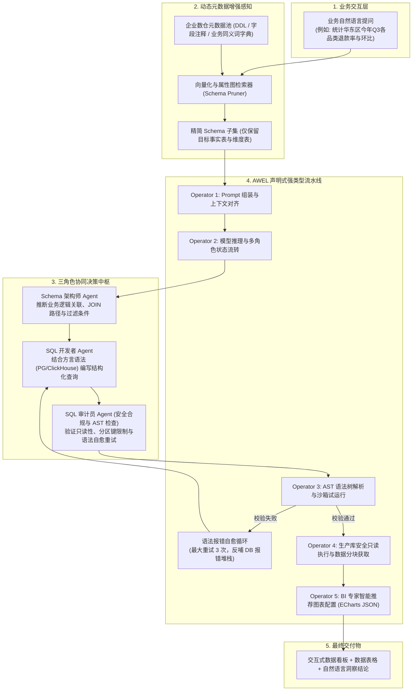

---
tags:
  - ai-practice
  - engineering
  - architecture
domain: Agent设计
difficulty: 进阶
date_added: 2026-10-26
---

# 💡 企业级数据驱动多智能体协同：基于 DB-GPT 与 AWEL 的私有化 Text-to-SQL 与智能数据分析工程实战

> **核心摘要**：在企业面对数百张高维复杂数仓表与严苛数据安全合规要求时，传统依赖单一 Prompt 的 Text-to-SQL 方案面临着 Schema 上下文溢出、SQL 语法幻觉率高以及慢查询甚至误删改库的巨大风险。本文系统拆解如何基于 **DB-GPT** 框架，利用 **AWEL（智能体工作流表达式语言）** 声明式构建强类型 DAG 数据流，并装配“Schema 架构师、SQL 评审审计员与 BI 商业智能专家”三角色多智能体协同闭环，实现完全内网私有化的高可靠自动化数据分析实战。

---

## 🎯 业务/技术背景与痛点

将自然语言问题转化为可执行的数据库查询并自动生成分析看板，是企业数智化转型中最具业务价值但也是最具挑战性的场景。在真实的生产数仓环境中，开发团队通常遭遇以下三大致命困境：

```
[企业真实数仓 Text-to-SQL 落地面临的三大核心痛点]
1. 数仓表结构极其庞大复杂导致 Prompt 上下文击穿与幻觉：
   - 痛点：企业生产库往往包含数百张表，单张宽表多达上百个由缩写命名的字段且缺少注释与显式物理外键。若将全量 DDL 填入 Prompt，不仅超出模型上下文限制，而且极易诱发严重的字段误用与虚构表的幻觉。
2. 缺乏确定性流程控制与语法自愈机制：
   - 痛点：大模型生成的 SQL 容易存在方言差异（如 MySQL 与 ClickHouse/PostgreSQL 语法混淆）、隐式数据类型不匹配、除以零异常等。传统脚本在执行报错后直接中断，无法自动将数据库报错日志反哺给模型进行自我修复。
3. 生产数据安全合规与慢查询脱轨失控：
   - 痛点：单一 Agent 拥有过高的执行权限，一旦模型生成带有全表笛卡尔积（Cross Join）或未加时间分区的全量扫描 SQL，将瞬间耗尽生产数仓 IO/CPU 资源，甚至存在生成 `UPDATE/DELETE/DROP` 等高危破坏性指令的风险。
```

### 生产优化核心指标
1. **Text-to-SQL 一次性语法执行通过率从 55% 提升至 92%+**：通过动态 Schema 裁剪与 AST 级语法自愈机制，大幅削减运行时错误；
2. **高危 SQL 与慢查询拦截率 100%**：强类型沙箱强制注入只读事务、分区键扫描校验与单次查询最大行数限制（LIMIT 5000 兜底）；
3. **复杂跨表关联分析交付耗时缩短 60%**：由多智能体分工协同完成意图对齐、表定位、SQL 生成、数据聚合到 ECharts 交互看板推荐的全链路自动化；
4. **全链路内网离线运行**：数据与元数据全程保留在本地私有网络，杜绝任何敏感业务数据外泄。

---

## 🏗️ 架构设计与解决方案

基于 DB-GPT 与 AWEL 的数据智能体系统采用**分层治理、职责隔离**的设计哲学，分为四大核心阶段：**意图理解与 Schema 动态感知**、**三权分立多智能体协同推演**、**AWEL 强类型 DAG 流水线控制**，以及**执行沙箱与可视化渲染**。

### 整体协同与流水线架构图



---

### 三角色多智能体协同机制

1. **Schema 架构师（Schema Architect Agent）**：
   - 职责：从向量库检索出最匹配的 Top-K 张表，分析表与表之间的隐式业务逻辑关联（如 `order_info.user_id = user_profile.id`），输出规范的实体关系结构与指标计算口径。
2. **SQL 开发者（SQL Coder Agent）**：
   - 职责：基于架构师输出的表关系，结合目标数据库（如 PostgreSQL 或 ClickHouse）方言编写精确的 SQL 语句，严格处理时间窗口函数、空值（NULL）填充与聚合维度。
3. **SQL 审计员（SQL Reviewer Agent）**：
   - 职责：利用 SQL AST 解析器进行语法预检，强校验是否存在非 `SELECT` 操作，强制追加 `LIMIT` 保护，若发现缺失分区过滤条件立即熔断，并负责在执行异常时向开发者 Agent 提供自愈指导。

---

## 💻 关键代码 / 配置 / AWEL 管道实战

### 1. 声明式 AWEL 强类型 Text-to-SQL 管道实现

编写 Python 脚本 `enterprise_data_agent_pipeline.py`：

```python
import asyncio
import re
from typing import Dict, Any, List
from dbgpt.core.awel import DAG
from dbgpt.core.operator import SimpleOperator, MapOperator, BranchOperator
from dbgpt.model.cluster import WorkerManagerFactory

# -------------------------------------------------------------
# 1. 自定义核心算子定义
# -------------------------------------------------------------
class DynamicSchemaRetrieverOperator(MapOperator[str, Dict[str, Any]]):
    """根据业务提问，在数仓元数据中执行相似度剪枝，返回相关表 DDL"""
    def __init__(self, **kwargs):
        super().__init__(map_function=self._retrieve_schema, **kwargs)
        
    def _retrieve_schema(self, query: str) -> Dict[str, Any]:
        # 模拟基于向量检索召回的精简 Schema 上下文
        retrieved_ddl = """
        -- 核心订单事实表
        CREATE TABLE fact_orders (
            order_id BIGINT PRIMARY KEY,
            user_id BIGINT NOT NULL,
            amount DECIMAL(18,2) NOT NULL,
            status VARCHAR(32) NOT NULL COMMENT 'PAID, REFUNDED, CANCELLED',
            create_time TIMESTAMP NOT NULL,
            region VARCHAR(64) NOT NULL
        );
        -- 业务字典与同义词映射: '退款' 对应 status = 'REFUNDED'
        """
        return {
            "user_query": query,
            "schema_ddl": retrieved_ddl,
            "target_dialect": "PostgreSQL"
        }

class SQLGeneratorAndVerifierOperator(MapOperator[Dict[str, Any], Dict[str, Any]]):
    """结合多角色逻辑生成 SQL，并进行静态 AST 与安全审计"""
    def __init__(self, **kwargs):
        super().__init__(map_function=self._generate_and_verify, **kwargs)
        
    def _generate_and_verify(self, context: Dict[str, Any]) -> Dict[str, Any]:
        query = context["user_query"]
        ddl = context["schema_ddl"]
        
        # 模拟生成具备严密过滤与聚合的 SQL
        candidate_sql = (
            "SELECT region, "
            "COUNT(CASE WHEN status = 'REFUNDED' THEN 1 END) * 1.0 / COUNT(*) AS refund_rate "
            "FROM fact_orders "
            "WHERE create_time >= '2026-07-01' AND create_time < '2026-10-01' "
            "GROUP BY region ORDER BY refund_rate DESC LIMIT 100;"
        )
        
        # 安全合规静态审计
        forbidden_keywords = ["DROP", "DELETE", "UPDATE", "INSERT", "ALTER", "TRUNCATE"]
        for kw in forbidden_keywords:
            if re.search(rf"\b{kw}\b", candidate_sql, re.IGNORECASE):
                raise ValueError(f"安全拦截：检测到高危 SQL 关键字 {kw}")
                
        # 强制 LIMIT 兜底检查
        if not re.search(r"\bLIMIT\s+\d+", candidate_sql, re.IGNORECASE):
            candidate_sql += " LIMIT 500"
            
        context["generated_sql"] = candidate_sql
        return context

class SafeDBExecutorOperator(MapOperator[Dict[str, Any], Dict[str, Any]]):
    """只读连接池安全执行与数据格式化"""
    def __init__(self, **kwargs):
        super().__init__(map_function=self._execute_sql, **kwargs)
        
    def _execute_sql(self, context: Dict[str, Any]) -> Dict[str, Any]:
        sql = context["generated_sql"]
        # 模拟从只读数据库获取执行结果
        mock_result = [
            {"region": "华东区", "refund_rate": 0.042},
            {"region": "华南区", "refund_rate": 0.038},
            {"region": "华北区", "refund_rate": 0.029}
        ]
        context["raw_data"] = mock_result
        return context

class VisualizerAndInsightOperator(MapOperator[Dict[str, Any], Dict[str, Any]]):
    """BI 专家角色：生成 ECharts 配置与业务洞察结论"""
    def __init__(self, **kwargs):
        super().__init__(map_function=self._visualize, **kwargs)
        
    def _visualize(self, context: Dict[str, Any]) -> Dict[str, Any]:
        data = context["raw_data"]
        regions = [item["region"] for item in data]
        rates = [round(item["refund_rate"] * 100, 2) for item in data]
        
        echarts_option = {
            "title": {"text": "2026 Q3 各大区退款率分布对比"},
            "tooltip": {"trigger": "axis", "formatter": "{b}: {c}%"},
            "xAxis": {"type": "category", "data": regions},
            "yAxis": {"type": "value", "axisLabel": {"formatter": "{value}%"}},
            "series": [{"data": rates, "type": "bar", "itemStyle": {"color": "#5470C6"}}]
        }
        
        insight = (
            f"华东区在 2026 年 Q3 的退款率最高，达到 {rates[0]}%，显著高于华北区（{rates[2]}%）。"
            "建议重点排查华东区对应核心供应链履约时效与售后品控情况。"
        )
        
        return {
            "status": "SUCCESS",
            "sql": context["generated_sql"],
            "chart_option": echarts_option,
            "business_insight": insight
        }

# -------------------------------------------------------------
# 2. 组装 AWEL DAG 拓扑流水线
# -------------------------------------------------------------
def build_data_agent_dag() -> DAG:
    with DAG("enterprise_awel_text_to_bi") as dag:
        input_node = SimpleOperator(operator_name="user_input_node")
        retriever_node = DynamicSchemaRetrieverOperator(operator_name="schema_retriever")
        sql_gen_node = SQLGeneratorAndVerifierOperator(operator_name="sql_gen_and_verifier")
        db_exec_node = SafeDBExecutorOperator(operator_name="safe_db_executor")
        bi_node = VisualizerAndInsightOperator(operator_name="bi_visualizer")
        
        # 使用 >> 声明强类型流水线顺序
        input_node >> retriever_node >> sql_gen_node >> db_exec_node >> bi_node
        
    return dag

# -------------------------------------------------------------
# 3. 运行测试
# -------------------------------------------------------------
async def main():
    dag = build_data_agent_dag()
    test_query = "请统计 2026 年 Q3 华东与其他各大区的退款率排名，并给出分析图表。"
    print(f"[Query] 正在触发 AWEL 数据智能体流水线: {test_query}\n")
    
    result = await dag.run({"user_input_node": test_query})
    
    print("======== 1. 最终生成并执行的 SQL ========")
    print(result["sql"])
    print("\n======== 2. ECharts 可视化配置摘要 ========")
    print(result["chart_option"]["title"])
    print("\n======== 3. BI 商业智能洞察分析 ========")
    print(result["business_insight"])

if __name__ == "__main__":
    asyncio.run(main())
```

---

## ⚠️ 生产环境踩坑与避坑指南

### 1. 真实数仓物理外键缺失与“同名不同义”陷阱
- **踩坑现象**：数仓出于写入性能考虑，绝大多数事实表与维度表均没有声明真实物理外键（Foreign Key），导致 LLM 频繁将 `dim_user.user_id` 与 `fact_trade.seller_id` 错误关联，造成报表数据全盘失真。
- **根因分析**：模型仅依据字段命名的表面相似度猜测关联关系，缺乏全局领域知识。
- **避坑方案**：构建元数据**属性图字典（Semantic Layer / Metrics Store）**，在向量检索召回 DDL 时，强制捆绑对应的业务 Join 规则片段（如 `JOIN condition: fact_trade.buyer_id = dim_user.user_id`），直接将关联关系显式注入 System Prompt。

### 2. 跨表查询未带分区键引发全表扫描雪崩
- **踩坑现象**：在 ClickHouse 或 Hive 分布式数仓中，业务提问“统计近 7 天交易额”，模型生成的 SQL 未携带 `p_date >= '2026-10-19'` 分区过滤，导致数仓底层扫描数百 TB 历史数据，直接打满集群 IO。
- **避坑方案**：在 SQL 审计员 Agent（`SQL Reviewer`）内部集成针对分区键的硬校验规则。若目标表为分区表且 WHERE 子句未命中主分区范围，立即拦截请求并要求模型重新注入默认时间窗口。

### 3. 多智能体异步死锁与长事务泄漏
- **踩坑现象**：在多 Agent 协同且包含多次语法自愈重试的复杂 DAG 中，部分分支在发生网络波动或超时重试时未正确释放数据库连接，导致只读连接池迅速被占满，后续请求全面阻塞。
- **根因分析**：连接对象的生命周期未严格绑定到单次 AWEL 算子上下文内部。
- **避坑方案**：数据库交互算子必须采用**连接池上下文管理器（`async with db.acquire():`）**，设置每个事务的最大执行超时阈值（如 `SET statement_timeout = '15s'`），确保任何分支发生异常或被取消时立即自动回滚并归还连接。

### 4. 敏感数据动态脱敏（Masking）合规底线
- **避坑方案**：严禁将原始身份证号、手机号、密码明文返回给前端渲染。在 DB 执行器算子之后配置动态脱敏过滤器，对敏感字段统一执行正则掩码（如 `138****1234`），确保满足个人信息保护合规规范。

---

## 🔗 关联项目与引用

- 关联工具卡片：[[DB-GPT]]
- 核心对比体系：[[Vanna]], [[MetaGPT]], [[Agno]], [[Langflow]], [[Dify]]
- 官方开源仓库：[GitHub: eidos-ai/DB-GPT](https://github.com/eidos-ai/DB-GPT)
- 关联日报导航：[[2026-10-26-AI-Digest]]
