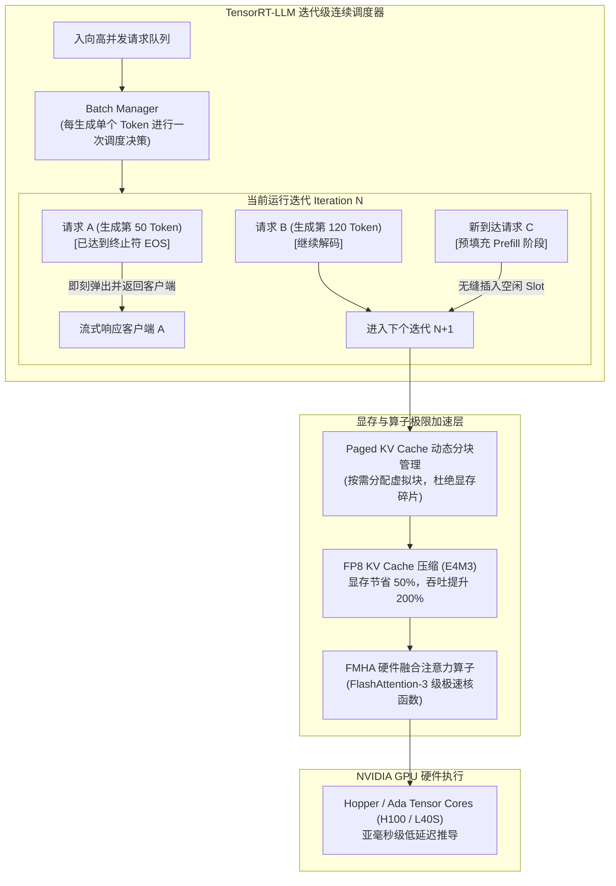

---
tags:
  - ai-practice
  - engineering
  - architecture
domain: 本地部署加速
difficulty: 进阶
date_added: 2026-10-16
---

# 💡 企业级极限推理加速：基于 NVIDIA TensorRT-LLM 的 In-Flight Batching 与 FP8 量化部署实战

> **核心摘要**：在企业大规模私有化大模型集群生产环境中，传统推理框架普遍遭遇“静态批处理气泡导致 GPU 算力严重饥饿”、“海量长文本并发下 KV Cache 显存爆炸（OOM）”以及“首字生成延迟（TTFT）难以达标”三大核心瓶颈。本文深度拆解 **NVIDIA TensorRT-LLM** 的工业级加速内核，详述如何利用 **迭代级连续批处理（In-Flight Batching）**、**FP8 KV Cache 显存极致压缩** 与 **硬件融合注意力（FMHA）**，构建支撑数万高并发、低延迟与最低单位 Token 算力成本的超高性能大模型推理引擎。

---

## 🎯 业务/技术背景与痛点

随着企业将 70B/110B 大参数模型部署至私有 GPU 集群（如 NVIDIA H100、A100、L40S），推理系统的整体吞吐量（Throughput）与服务等级协议（SLA）延迟成为衡量基础设施 ROI 的决定性指标。在传统基于 PyTorch 或早期静态批处理的推理方案中，存在严重的硬件资源浪费：

```
[传统静态批处理 (Static Batching)]
Request 1 (生成 50 tokens):  ██████░░░░░░░░░░░░░░░░░░░░ (等待 250 个周期的算力气泡与显存占用)
Request 2 (生成 300 tokens): ████████████████████████████ (主导批次总时长)
Request 3 (生成 80 tokens):  █████████░░░░░░░░░░░░░░░░░ (计算完成无法返回，强制等待 Request 2)
  └─> 整个 GPU 算力利用率（SM Utilization）暴跌，新到达请求全部在队列中死等！
```

1. **算力气泡与调度饥饿（Execution Bubbles）**：
   - 用户请求生成的 Token 长度分布呈现极强的长尾特征（有的请求只需 20 个 Token，有的长达 2000 个 Token）；
   - 在静态批处理模式下，单次 Batch 的执行时间由“最慢、生成最长”的请求决定。先完成的请求无法提前退出，导致 GPU Tensor Cores 产生高达 40%~60% 的空转等待。
2. **长文本并发下的 KV Cache 显存爆炸**：
   - 对于 LLaMA-3-70B 这类大型模型，单个 Token 的 KV Cache 显存开销极大；在 8K 上下文且高并发场景下，KV Cache 消耗的显存甚至会迅速反超模型权重本身，导致频繁发生 CUDA OOM 崩溃。
3. **Python GIL 与运行时解释调度瓶颈**：
   - 依赖纯 Python 事件循环驱动推理内核，在千级并发请求涌入时，CPU 线程上下文切换开销成为木桶短板，无法压满 NVLink 与 GPU 算力。

---

## 🏗️ 架构设计与解决方案

**NVIDIA TensorRT-LLM** 从底层彻底重写了 LLM 推理流水线，引入了**迭代级连续调度（In-Flight Batching）**与**端到端 C++ 运行时**，配合硬件专属的量化加速算子。



### 核心机制详解：

1. **In-Flight Batching 动态插拔机制**：
   - 调度粒度细化至“单 Token 级别”。一旦某个请求遇到 `<|endoftext|>` 或达到最大长度，该请求所占用的槽位与显存立即被释放，实时返回给客户端；
   - 队列中等待的新请求可以在**下一个生成周期立刻插队**进入预填充（Prefill）阶段，实现 GPU 流水线的 100% 饱和运转；
2. **FP8 KV Cache 极限显存压缩**：
   - 利用 NVIDIA 架构原生对 FP8（E4M3 格式，4 位指数、3 位尾数）的支持，在不损失模型注意力精度的情况下，将每个 Token 缓存的 Key/Value 矩阵压缩一半大小；
   - 在相同显存容量下，允许最大并发请求数翻倍（Concurrency $\times 2$）；
3. **纯 C++ 运行时解耦**：
   - 提供 `tensorrt_llm::runtime::ModelRunnerCpp`，调度逻辑、显存管理与 CUDA Stream 分发全部下沉至 C++ 层，CPU 调度开销近乎为零。

---

## 💻 关键代码 / 配置 / Prompt 模板

生产环境部署包含两个关键阶段：**模型检查点转换与量化编译**，以及**高性能 C++ 运行时驱动调用**。

### 阶段 1：使用 `trtllm-build` 编译针对特定硬件优化的 Engine

```bash
# 1. 下载官方模型并进入容器环境
# export MODEL_DIR="./Meta-Llama-3-70B-Instruct"

# 2. 导出 TRT-LLM 检查点并启用 FP8 KV Cache 与权重 SmoothQuant
python convert_checkpoint.py \
    --model_dir ${MODEL_DIR} \
    --output_dir ./checkpoint_llama3_70b_fp8 \
    --dtype float16 \
    --kv_cache_type fp8 \
    --tp_size 4  # 开启 4 卡张量并行 (TP=4)

# 3. 使用 trtllm-build 编译专精的高吞吐 Engine 文件
trtllm-build \
    --checkpoint_dir ./checkpoint_llama3_70b_fp8 \
    --output_dir ./engine_llama3_70b_tp4 \
    --gemm_plugin auto \
    --gpt_attention_plugin auto \
    --tokens_per_block 64 \
    --paged_kv_cache enable \
    --remove_input_padding enable \
    --use_custom_all_reduce enable \
    --max_batch_size 128 \
    --max_input_len 4096 \
    --max_seq_len 8192
```

### 阶段 2：Python 异步生产客户端（结合 C++ ModelRunner 并发流式调用）

```python
import asyncio
import os
import time
from tensorrt_llm import ModelRunnerCpp
from transformers import AutoTokenizer

class EnterpriseTRTLLMEngine:
    """企业级 TensorRT-LLM 极速推理服务封装"""
    
    def __init__(self, engine_dir: str, tokenizer_dir: str):
        print(f"🔧 正在初始化 TensorRT-LLM 高性能 C++ 运行时 (Engine: {engine_dir})...")
        self.tokenizer = AutoTokenizer.from_pretrained(tokenizer_dir)
        
        # 实例化纯 C++ 底层驱动的 ModelRunner 实例
        self.runner = ModelRunnerCpp.from_dir(
            engine_dir=engine_dir,
            lora_dir=None,
            rank=0  # 主进程 Rank
        )
        print("✅ TensorRT-LLM Engine 加载成功，已就绪！")

    async def generate_stream(self, prompt: str, max_tokens: int = 512, temperature: float = 0.7):
        """
        基于 In-Flight Batching 调度的高并发异步流式生成接口
        """
        start_time = time.perf_counter()
        
        # 编码 Prompt
        input_ids = self.tokenizer.encode(prompt, return_tensors="pt").squeeze().int()
        first_token_time = None
        generated_tokens = []

        # 调用底层 C++ 流式生成生成器
        stream_outputs = self.runner.generate(
            batch_input_ids=[input_ids],
            max_new_tokens=max_tokens,
            streaming=True,
            temperature=temperature,
            top_p=0.9,
            end_id=self.tokenizer.eos_token_id,
            pad_id=self.tokenizer.pad_token_id
        )

        for output in stream_outputs:
            if first_token_time is None:
                first_token_time = time.perf_counter()
                ttft_ms = (first_token_time - start_time) * 1000
                # 记录核心监控指标：首字延迟 TTFT
                # print(f"⚡ [Metric] 首字延迟 TTFT: {ttft_ms:.2f} ms")

            # 解码最新产生的 Token 增量
            token_id = output[0][0]
            generated_tokens.append(token_id)
            char_delta = self.tokenizer.decode([token_id])
            yield char_delta

        total_time = time.perf_counter() - start_time
        tps = len(generated_tokens) / total_time if total_time > 0 else 0
        # print(f"📊 [Metric] 生成结束: 共 {len(generated_tokens)} tokens, 吞吐: {tps:.2f} tokens/s")

# ==========================================
# 模拟高并发流式压测验证
# ==========================================
async def simulate_concurrent_requests(engine: EnterpriseTRTLLMEngine):
    test_prompts = [
        "请分析在金融风控系统中，实时反欺诈模型与大语言模型协同的架构设计思路。",
        "请编写一段基于 Python 的异步高并发 WebSocket 客户端处理脚本，包含自动重连与心跳。",
        "简述计算机体系结构中缓存一致性协议（MESI）的核心状态转移逻辑。"
    ]

    async def single_task(task_id: int, prompt_text: str):
        print(f"\n[Task {task_id}] 发起请求...")
        async for chunk in engine.generate_stream(prompt_text, max_tokens=256):
            # 实时接收流式 Token (生产中推流给前端 WebSocket/SSE)
            pass
        print(f"[Task {task_id}] 响应完毕！")

    # 并发触发 3 个异步任务，验证 In-Flight Batching 连续无缝插拔
    await asyncio.gather(
        single_task(1, test_prompts[0]),
        single_task(2, test_prompts[1]),
        single_task(3, test_prompts[2])
    )

if __name__ == "__main__":
    # 配置工程路径
    ENGINE_DIR = "./engine_llama3_70b_tp4"
    TOKENIZER_DIR = "./Meta-Llama-3-70B-Instruct"

    if os.path.exists(ENGINE_DIR):
        trt_service = EnterpriseTRTLLMEngine(ENGINE_DIR, TOKENIZER_DIR)
        asyncio.run(simulate_concurrent_requests(trt_service))
    else:
        print(f"⚠️ 提示: Engine 目录 {ENGINE_DIR} 暂未生成，请先执行 trtllm-build 编译！")
```

---

## ⚠️ 生产环境踩坑与避坑指南

### 1. 坑点一：KV Cache 预分配显存比例不当导致 CUDA OOM
- **现象**：Engine 启动时一切正常，但在高并发突发涌入时突然抛出 `[TensorRT-LLM] Out of Memory while allocating KV cache block` 致命错误。
- **避坑方案**：
  - 调整 `kv_cache_free_gpu_mem_fraction`（默认 0.85）。在多卡张量并行（TP）或共存其他辅助模型（如 Embedding）时，应保守设置为 `0.70 ~ 0.75`，预留足够的显存用于 Activation 激活值动态峰值；
  - 务必开启 `--paged_kv_cache enable`，启用分页显存管理，避免由于内存碎片导致的提前假死。

### 2. 坑点二：trtllm-build 编译期参数被线上长文本突发冲垮
- **现象**：编译时指定 `--max_input_len 2048`，线上偶发用户传入 3000 字超长提示词，系统直接硬中断报错或抛出越界异常。
- **避坑方案**：
  - 在 API 网关（如 Kong 或 Nginx）前置增加严格的 Token 截断与拦截校验中间件；
  - 编译期合理设定 `--max_seq_len`，同时开启 `--remove_input_padding`，该选项会自动在底层展平 Batch 矩阵，仅对真实有效 Token 进行计算，省去 Padding 带来的显存膨胀。

### 3. 坑点三：FP8 量化精度漂移与离群值（Outliers）质量劣化
- **现象**：直接进行原生全量 FP8 量化后，大模型在数学逻辑推理或代码补全场景下出现语法死循环或幻觉率陡增。
- **避坑方案**：
  - **选用高质量校准集（Calibration Dataset）**：严禁仅使用纯英文维基百科作为校准集；需采集企业真实生产对话日志（包含长文本、代码块与 JSON 格式）至少 512 条，覆盖真实分布；
  - **引入 SmoothQuant 算法**：在 `convert_checkpoint.py` 中增加 `--smoothquant 0.5` 参数，将激活层难以量化的离群尖峰平滑转移至权重层，完美保全精度。

---

## 🔗 关联项目与引用
- 核心加速引擎: [[TensorRT-LLM]]
- 现代推理对比: [[vLLM]], [[SGLang]], [[llama.cpp]]
- 降本加速实践: [[大模型端到端强类型输出：基于 Instructor 与 Pydantic 的流式结构化抽取与自愈重试实战]], [[端侧高吞吐低延迟推理：基于 llama.cpp 的 GGUF 极限混合量化与投机解码工程实战]]
- 今日日报脉络: [[2026-10-16-AI-Digest]]
- NVIDIA 官方文档: *NVIDIA TensorRT-LLM Architecture and In-Flight Batching Deep Dive (2024)*
