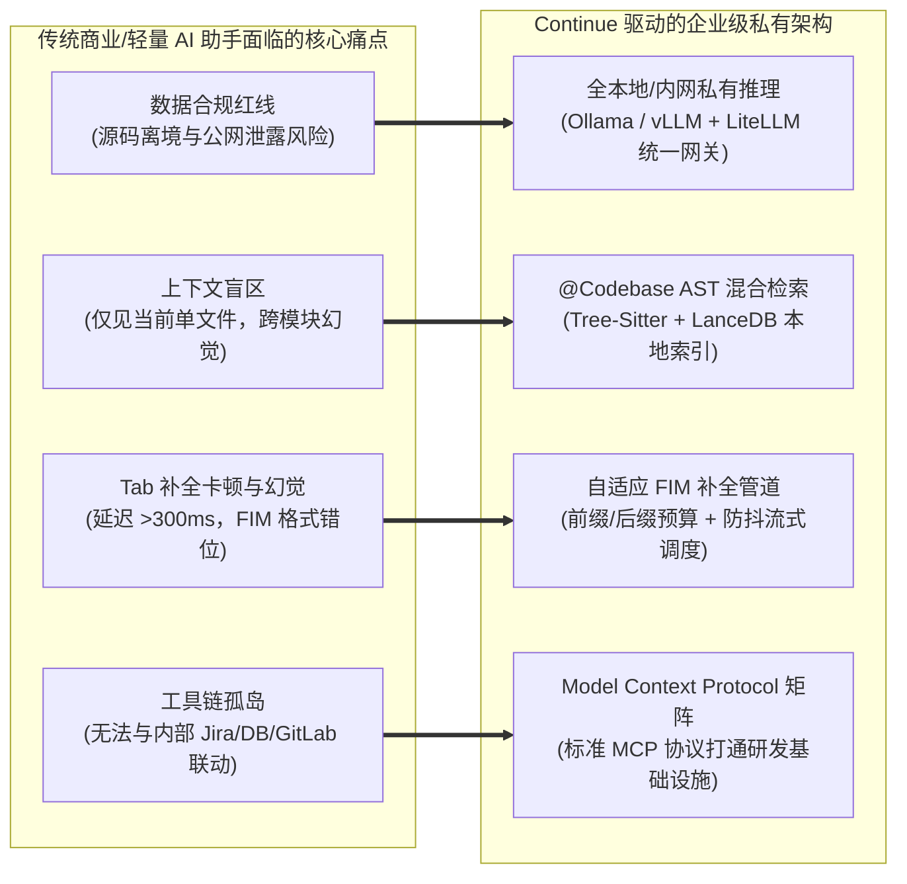

---
tags:
  - ai-practice
  - engineering
  - architecture
domain: Agent设计
difficulty: 进阶
date_added: 2026-11-05
---

# 💡 企业级私有化 AI 辅助编程架构：基于 Continue 的本地上下文编排、MCP 扩展与 FIM 补全实战

> **核心摘要**：在企业推进“AI 赋能软件研发全生命周期”的浪潮中，代码隐私合规红线、多文件跨仓库上下文感知盲区、Tab 补全高延迟与幻觉、以及研发工具链孤岛割裂构成了四大关键阻碍。本文基于开源顶级 IDE AI 助手 **Continue**，系统性拆解其结合 **AST 语法树与 LanceDB 列式向量检索的 `@Codebase` 上下文工程**、**Model Context Protocol (MCP) 跨工具协议编排**、以及针对本地代码大模型（Qwen2.5-Coder / DeepSeek-Coder）的 **FIM (Fill-in-the-Middle) 毫秒级补全调优**。提供企业内网全私有化部署架构规范、完整的生产级 `config.yaml` 编排、自定义 MCP 数据库检查服务代码与实战避坑策略。

---

## 🎯 业务与技术背景：企业级 AI 代码助手的四大落地痛点

在金融、电信、半导体及大型跨国企业中，软件资产是企业的绝对核心知识产权。引入通用商业闭源 Copilot（如 GitHub Copilot、Cursor）时，企业技术管理层面临极其尖锐的工程与合规挑战：



1. **知识产权与数据隐私合规红线（Data Sovereignty & IP Leakage）**：
   - 商业 SaaS 插件通常将用户光标前后的代码片段回传至公网商业模型。在面临 GDPR、等保三级及金融监管合规要求时，源码出境属于重大安全违规。企业亟需一套“数据 100% 不出本地或私有内网”的端到端解决方案。
2. **多文件全局上下文盲区（Cross-File Context Blindness）**：
   - 简单的提示词填充只能提供“当前打开的活跃文件（Active Editor）”。当开发者要求“在 Service 层增加一个接口并同步更新 Controller 与 DTO”时，缺乏全局符号表与代码拓扑的模型会凭空臆造入参类型和依赖库，生成大量无法编译的伪代码。
3. **Tab 自动补全的高延迟与格式坍塌（FIM Completion Failure & Latency Bottleneck）**：
   - 代码自动补全（Tab Completion）对交互延迟有着极致苛求（必须控制在 100~200ms 以内）。更致命的是，代码生成并非单纯的前向预测，而是典型的 **Fill-in-the-Middle (FIM)** 场景（需结合光标上文与下文推导中间内容）。如果 Prompt 模板与模型训练时采用的 FIM 特殊 Token（如 `<|fim_prefix|>`, `<|fim_suffix|>`, `<|fim_middle|>`）存在细微出入，模型将不断复写光标后面的已有代码，导致破坏性体验。
4. **研发生态工具链的数据孤岛（Tool Silo & Context Disconnection）**：
   - 程序员在写代码时需要频繁在 IDE、GitLab Merge Requests、企业 Wiki、以及测试数据库管理工具之间切换。传统代码助手缺乏标准化的外部数据接入协议，无法直接感知数据库 Schema 或业务需求卡片。

---

## 🏗️ 架构设计与解决方案：基于 Continue 的统一 IDE 智能中枢

为了彻底攻克上述痛点，构建如下分层解耦的企业级私有化 AI 编程中枢架构：

```mermaid
flowchart TD
    subgraph ClientHost [开发者终端 (VS Code / JetBrains)]
        UserCursor["光标键入事件 (Keystroke Event)"]
        ChatCommand["快捷指令 (Ctrl+L 对话 / Ctrl+I 行内编辑)"]
        
        subgraph ContinueCoreEngine [Continue 核心进程 (TypeScript Daemon)]
            FIM_Processor[FIM 调度器: Token 裁剪与防抖控制]
            ContextAssembler[上下文集成器: @Codebase / @Docs / @Terminal]
            MCP_ClientModule[MCP 客户端: 动态协议解析器]
        end
        
        subgraph LocalStore [本地持久化存储]
            LanceDB_Store[("LanceDB 嵌入向量表<br>(~/.continue/index)")]
            TreeSitterAST[Tree-Sitter 语法分块缓存]
        end
    end

    subgraph IntranetGateway [企业内网服务中枢 (On-Premises DMZ)]
        LiteLLM_Gateway["企业 AI 网关 (LiteLLM / 负载均衡 / 限流审计)"]
        
        subgraph ComputeNodes [GPU 算力推理集群]
            vLLM_Cluster["vLLM 服务集群<br>(DeepSeek-Coder-33B / Qwen2.5-Coder-32B)"]
        end
        
        subgraph MCP_Servers [企业内部 MCP 工具服务集群]
            GitLab_MCP["GitLab MCP Server: 代码审查与流水线状态"]
            DB_Schema_MCP["Database MCP Server: 表结构与元数据探测"]
        end
    end

    UserCursor -->|防抖 150ms| FIM_Processor
    ChatCommand --> ContextAssembler
    
    ContextAssembler <--> LocalStore
    ContextAssembler <--> MCP_ClientModule
    
    MCP_ClientModule <-->|JSON-RPC via stdio / SSE| MCP_Servers
    
    FIM_Processor -->|低延迟流式请求| LiteLLM_Gateway
    ContextAssembler -->|长上下文补全| LiteLLM_Gateway
    
    LiteLLM_Gateway --> ComputeNodes
```

### 1. `@Codebase` 上下文工程的底层索引机制
Continue 的代码库检索并非单纯将整个代码库暴力上传，而是采用了分层递进的混合索引管线：
1. **代码结构感知解析（AST Chunking）**：基于 `tree-sitter` 解析器，针对 Java、Python、TypeScript、Go 等主流语言，按类、方法、接口等语法单元进行语义分块，严格保持函数完整性并提取函数签名元数据；
2. **本地高性能向量化与列式存储**：利用轻量级嵌入模型（如本地运行的 `nomic-embed-text` 或 `bge-small`）生成嵌入，存入本地嵌入式列式向量数据库 **LanceDB**；
3. **混合多路召回（Hybrid Retrieval）**：当用户在提问中键入 `@Codebase` 时，Continue 结合 BM25 词法匹配与 LanceDB 密集向量检索进行倒数排名融合（RRF），挑选与当前任务最相关的代码定义和引用注入 Prompt。

### 2. Fill-in-the-Middle (FIM) 算法与 Token 预算动态划分
针对 Tab 自动补全，Continue 严格遵循 FIM 范式构造上下文。假定当前光标所在位置为 $C$，前文为 $T_{prefix}$，后文为 $T_{suffix}$，总 Token 预算上限为 $B$（通常设为 1024 或 2048）：

$$\text{Prompt}_{\text{FIM}} = \langle\text{fim\_prefix}\rangle \cdot \text{Truncate}(T_{prefix}, w_{pre} \cdot B) \cdot \langle\text{fim\_suffix}\rangle \cdot \text{Truncate}(T_{suffix}, w_{suf} \cdot B) \cdot \langle\text{fim\_middle}\rangle$$

其中权重分配一般遵循 $w_{pre} = 0.7$，$w_{suf} = 0.3$，即优先保留丰富的光标上方调用链与引用头，兼顾光标下方的语法闭合环境。

### 3. Model Context Protocol (MCP) 跨系统工具赋能
作为现代标准化智能体架构的重要一环，Continue 原生充当 MCP 宿主（Host）。通过标准 Stdio 或 SSE 传输通道，IDE 可以按需拉取外部 MCP Server 暴露的 Prompts、Resources 与 Tools。例如在编写 SQL 查询时，AI 助手可以直接通过 Database MCP 读取目标数据库的实时 Schema，杜绝字段名拼写错误。

---

## 💻 生产级完整实现方案

### 1. 企业级 Continue 核心配置文件 (`~/.continue/config.yaml`)

```yaml
name: Enterprise Private AI Dev Suite
version: 0.1.0

# ==========================================
# 1. 聊天与架构重构主模型 (直连内网私有 vLLM 高并发网关)
# ==========================================
models:
  - name: DeepSeek-Coder-32B (企业内网生产集群)
    provider: openai
    model: deepseek-ai/DeepSeek-Coder-32B-Instruct
    apiBase: http://10.10.20.100:8000/v1
    apiKey: intranet-corp-bearer-key-9981
    roles:
      - chat
      - edit
    contextLength: 32768
    completionOptions:
      temperature: 0.2
      topP: 0.95
      presencePenalty: 0.0

  - name: Qwen2.5-Coder-7B (本地离线备用)
    provider: ollama
    model: qwen2.5-coder:7b
    roles:
      - chat
      - edit

# ==========================================
# 2. 毫秒级 Tab 代码自动补全 (FIM 架构配置)
# ==========================================
tabAutocompleteModel:
  title: Qwen2.5-Coder-1.5B-FIM (本地极端低延迟)
  provider: ollama
  model: qwen2.5-coder:1.5b-base
  roles:
    - autocomplete

tabAutocompleteOptions:
  useCopyBuffer: true         # 结合系统剪贴板内容辅助补全判断
  maxPromptTokens: 1024       # 控制补全 Prompt 长度以压制推理延迟
  debounceDelay: 120          # 120ms 防抖，防止按键频繁打断推理
  multilineCompletions: always # 开启多行语法块智能补全
  prefixPercentage: 0.75      # 75% 显存预算分配给光标前文

# ==========================================
# 3. 本地代码库向量化与嵌入服务
# ==========================================
embeddingsProvider:
  provider: ollama
  model: nomic-embed-text

# ==========================================
# 4. 上下文扩展系统 (Context Providers)
# ==========================================
context:
  - name: codebase
    params:
      nRetrieve: 25           # 初筛检索候选块
      nFinal: 6               # 最终注入上下文的高分代码块
  - name: docs
    params: {}
  - name: terminal
    params: {}
  - name: open
    params:
      onlyPinned: false       # 自动关联当前工作区已打开的所有标签页

# ==========================================
# 5. Model Context Protocol (MCP) 企业工具扩展
# ==========================================
mcpServers:
  - name: enterprise-db-meta
    command: python
    args:
      - -m
      - dev_mcp.db_inspector
    env:
      DB_HOST: "10.10.30.50"
      DB_PORT: "5432"
      DB_NAME: "enterprise_trade_db"
      DB_USER: "readonly_analyzer"
      DB_PASS: "SafePassword123"

# ==========================================
# 6. 企业标准化 Slash Commands
# ==========================================
slashCommands:
  - name: sql-gen
    description: 结合数据库 MCP Schema 快速生成严谨的 MyBatis/SQL 脚本
    prompt: |
      请参考当前绑定的企业数据库 Schema，为以下业务逻辑编写高效 SQL 脚本：
      1. 必须使用参数化占位符防止 SQL 注入；
      2. 涉及长事务更新时明确注明排他锁策略；
      3. 说明相关索引命中情况。
      需求说明：{{{ input }}}
```

---

### 2. 企业级数据库元数据探测 MCP 服务实现 (`dev_mcp/db_inspector.py`)

利用 `FastMCP` 构建轻量级只读数据库元数据检查服务，挂载为 Continue 的 MCP Server，向 IDE 中的 AI 提供表结构感应能力：

```python
"""
企业级私有 Database MCP 服务
为 Continue 提供只读数据库表结构探测与 SQL Explain 上下文
"""
import os
import psycopg2
from psycopg2.extras import RealDictCursor
from mcp.server.fastmcp import FastMCP

# 初始化标准 MCP 服务实例
mcp = FastMCP("enterprise-db-inspector")

def get_connection():
    return psycopg2.connect(
        host=os.getenv("DB_HOST", "localhost"),
        port=int(os.getenv("DB_PORT", 5432)),
        dbname=os.getenv("DB_NAME", "postgres"),
        user=os.getenv("DB_USER", "postgres"),
        password=os.getenv("DB_PASS", "password"),
        connect_timeout=3
    )

@mcp.tool()
def list_table_schemas(schema_name: str = "public") -> str:
    """
    获取指定 schema 下所有业务数据表的名称与中文注释
    """
    query = """
        SELECT 
            c.relname AS table_name,
            obj_description(c.oid) AS table_comment
        FROM pg_class c
        JOIN pg_namespace n ON n.oid = c.relnamespace
        WHERE c.relkind = 'r' AND n.nspname = %s
        ORDER BY c.relname;
    """
    try:
        with get_connection() as conn:
            with conn.cursor(cursor_factory=RealDictCursor) as cur:
                cur.execute(query, (schema_name,))
                rows = cur.fetchall()
                if not rows:
                    return f"Schema '{schema_name}' 下未找到任何数据表。"
                
                result = [f"=== 数据库架构: {schema_name} ==="]
                for row in rows:
                    comment = row['table_comment'] or "无描述"
                    result.append(f"- 表名: {row['table_name']} | 业务说明: {comment}")
                return "\n".join(result)
    except Exception as e:
        return f"查询数据库表列表失败: {str(e)}"

@mcp.tool()
def describe_table(table_name: str, schema_name: str = "public") -> str:
    """
    获取指定数据表的完整列定义、主外键、字段类型及索引信息
    """
    query = """
        SELECT 
            a.attname AS column_name,
            format_type(a.atttypid, a.atttypmod) AS data_type,
            case when a.attnotnull then 'NOT NULL' else 'NULL' end AS is_nullable,
            col_description(a.attrelid, a.attnum) AS column_comment
        FROM pg_attribute a
        JOIN pg_class c ON c.oid = a.attrelid
        JOIN pg_namespace n ON n.oid = c.relnamespace
        WHERE c.relname = %s AND n.nspname = %s AND a.attnum > 0 AND NOT a.attisdropped
        ORDER BY a.attnum;
    """
    try:
        with get_connection() as conn:
            with conn.cursor(cursor_factory=RealDictCursor) as cur:
                cur.execute(query, (table_name, schema_name))
                rows = cur.fetchall()
                if not rows:
                    return f"未找到表 '{schema_name}.{table_name}' 的列定义。"
                
                output = [f"### 数据表定义: {schema_name}.{table_name}"]
                output.append("| 列名 | 数据类型 | 约束 | 中文字段说明 |")
                output.append("| :--- | :--- | :--- | :--- |")
                for r in rows:
                    comment = r['column_comment'] or "-"
                    output.append(f"| {r['column_name']} | {r['data_type']} | {r['is_nullable']} | {comment} |")
                return "\n".join(output)
    except Exception as e:
        return f"解析数据表 '{table_name}' 失败: {str(e)}"

if __name__ == "__main__":
    # 以标准 Stdio 模式运行，直接供 Continue 核心进程挂载交互
    mcp.run(transport="stdio")
```

---

### 3. 工程根目录索引排他配置文件 (`.continueignore`)

为了杜绝大型工程在首次构建 `@Codebase` LanceDB 索引时导致 CPU 与内存耗尽，必须在工程根目录下建立严密的过滤规范：

```gitignore
# 过滤编译器中间构建物与巨型依赖包
**/node_modules/
**/dist/
**/build/
**/target/
**/.gradle/
**/vendor/

# 过滤编译输出二进制与类文件
**/*.class
**/*.jar
**/*.war
**/*.so
**/*.dll
**/*.exe

# 过滤海量静态媒体资源与压缩包
**/*.png
**/*.jpg
**/*.jpeg
**/*.gif
**/*.svg
**/*.zip
**/*.tar.gz
**/*.parquet

# 过滤数据库本地持久化与大日志文件
**/*.log
**/*.sqlite
**/*.dump
**/*.bin
**/.git/
**/.idea/
**/.vscode/
```

---

## ⚠️ 生产环境踩坑与最佳避坑指南

### 1. LanceDB 索引构建卡死与内存溢出 (OOM) 陷阱
- **现象**：当首次在数百万行代码的 Monorepo 中激活 `@Codebase` 时，IDE 界面严重卡顿，Continue Core 进程 CPU 占用达到 100%，随后崩溃；
- **排查与根因**：没有配置 `.continueignore`，导致解析器将 `node_modules` 或 `build` 产物中的数十万个编译产物文件逐一读取并调用本地 Embedding 模型，造成内存与任务队列积压；
- **避坑方案**：在下发全员标准配置前，强制统一在项目模板中植入 `.continueignore`，并在 `config.yaml` 中将 `nRetrieve` 设为合理的范围（如 20~30），同时对本地磁盘路径 `~/.continue/index/` 设定定时磁盘配额清理机制。

### 2. Tab Autocomplete 补全疯狂“吞代码”或“重复生成”
- **现象**：光标移动到某行中间键入时，模型生成的内容将光标下方的已有大括号或行尾代码重复输出了一遍；
- **排查与根因**：当前采用的模型不是 **Base / FIM 预训练版本**（例如误选了纯 Instruct 对话微调版），或者 `config.yaml` 中模型配置缺失 FIM 特殊 Token 映射，导致引擎退化为常规 Next-Token 预测；
- **避坑方案**：
  1. 补全专用模型务必选用自带 FIM 训练权重的模型，例如 `qwen2.5-coder:1.5b-base` 或 `deepseek-coder:1.3b-base`；
  2. 若模型输出重复，在 Continue 快捷配置中开启 `multilineCompletions: always` 并适当调整 `debounceDelay`（推荐 120ms~180ms），防止连续击键产生未取消的并发请求竞争。

### 3. 多模型并发请求引发内网网关连接超时
- **现象**：数十位研发人员同时打开 IDE 时，内网大模型服务（vLLM）频频抛出 `504 Gateway Timeout` 或 `Connection Reset`；
- **排查与根因**：开发者频繁击键产生的 Tab 补全高频请求直接打到了昂贵的大参数对话集群（如 32B 模型），导致 GPU 显存队列被短上下文计算挤满，长文本对话请求排队阻塞；
- **避坑方案**：**实行“大小模型动静分流架构”**。全员 IDE 的 Tab 补全强制收敛至端侧本地 Ollama（1.5B 参数模型），零消耗网络算力；仅在用户显式触发 `Ctrl+L` 对话、`Ctrl+I` 行内重构或 Slash Command 时，请求才通过内网网关路由至 GPU 服务器。

### 4. MCP Stdio 子进程僵尸与连接泄漏
- **现象**：在长时间开启 IDE 后，任务管理器中残留大量 Python 后台子进程，数据库连接池耗尽；
- **排查与根因**：Continue 在重启窗口或热重载配置时，通过 Stdio 启动的子进程未正确捕获 `SIGTERM` 信号，且自定义 MCP 服务未设置连接池自动释放超时；
- **避坑方案**：编写自定义 MCP Server 时，必须使用上下文管理器（Context Manager）严密管理数据库连接，并在初始化代码中注册 `signal.signal(signal.SIGTERM, cleanup_handler)` 优雅退出；或将 MCP 服务以 SSE (Server-Sent Events) HTTP 独立微服务方式部署在容器集群中，由统一反向代理维护连接生命周期。

---

## 🔗 关联项目与引用导航
- 相关工具：[[Continue]]、[[Cline]]、[[Aider]]、[[FastMCP]]、[[LiteLLM]]、[[LanceDB]]
- 今日日报：[[2026-11-05-AI-Digest]]
