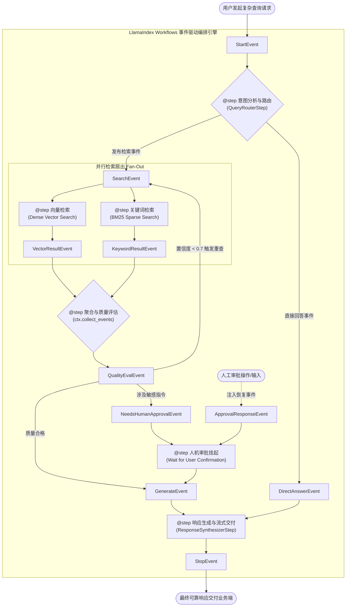

---
tags:
  - ai-practice
  - engineering
  - architecture
domain: Agent设计
difficulty: 进阶
date_added: 2026-10-14
---

# 💡 基于 LlamaIndex Workflows 的事件驱动型多智能体编排与异步 RAG 流水线实战

> **核心摘要**：传统有向无环图（DAG）与硬编码链（Chains）在构建高灵活度 Agent 动态路由、循环反思与人机在环（HITL）审批时面临严重的拓扑死板与阻塞瓶颈。本文深度剖析 **LlamaIndex Workflows** 基于事件发布/订阅（Event Pub/Sub）与 `@step` 装饰器的事件驱动架构，实战演示从多意图异步分发、双路并行检索、动态质量评估自愈重查到审批流断点恢复的工业级端到端落地闭环。

---

## 🎯 业务/技术背景与痛点

在企业级智能体应用与高阶 RAG 系统建设中，业务逻辑正变得愈发非线性和复杂：大模型需要根据前序检索质量决定是直接回答、拆解子问题重查、还是触发外部工具；而在高风险操作（如删除数据库记录、调用对外 API、发起财务付款）中，系统必须挂起并等待人工审核。采用传统的静态链或 DAG 框架通常面临以下严峻挑战：

1. **静态 DAG 图与硬编码链条的表达力死局**：
   - 传统的链式设计（如早期的 LangChain Chains 或固定步骤流水线）假设每一步的执行拓扑在编译期就已严格固定。
   - 一旦遇到“依据大模型评估结果动态决定是否循环重试（Reflection Loop）”或“在任意节点动态广播给多个专家智能体并行执行（Dynamic Fan-out）”，代码就会充斥着丑陋的嵌套 `if/else` 与递归调用，极难维护与监控。
2. **I/O 阻塞与流式体验割裂**：
   - 传统的同步执行阻塞主线程，无法高效利用现代 Python 的 `asyncio` 并发优势。
   - 当需要向前端实时流式输出中间推理状态（如“正在分析意图...”、“正在检索向量库...”、“检索结果相关性 0.85”）时，非事件驱动架构往往需要额外侵入业务逻辑去写 Hook 回调，耦合度过高。
3. **人工在环（Human-in-the-Loop, HITL）的挂起与恢复断裂**：
   - 传统框架缺乏原生的事件暂停机制。一旦需要等待用户输入确认，往往需要把上下文序列化写入外部 Redis/数据库，手动维护状态机迁移，开发成本高且极易引发状态不一致。
4. **状态隔离与并发竞争隐患**：
   - 多智能体并发执行时，若共享全局上下文变量，极易引发读写竞态条件（Race Condition），导致推理结果被意外覆盖。

---

## 🏗️ 架构设计与解决方案

为打破上述瓶颈，**LlamaIndex Workflows** 引入了纯粹的**事件驱动架构（Event-Driven Architecture）**。工作流中的每一个逻辑执行单元被解耦为由 `@step` 装饰的纯函数或异步方法，各个 Step 之间完全不感知彼此的存在，仅通过消费与发布强类型的 `Event` 对象进行隐式协作与状态流转。



### 核心架构特性：
1. **完全解耦的 Pub/Sub 拓扑**：Step 无需指定下游调用者是谁，仅声明“我接收什么事件，我产出什么事件”。引擎自动根据事件类型将输出路由到所有订阅该事件的下游 Step。
2. **多事件聚合等待（Fan-In Aggregation）**：借助 `ctx.collect_events`，下游 Step 可以优雅等待来自多个并发分支的所有事件（例如同时等待向量检索与稀疏检索完毕）后再行触发，无需复杂的信号量与线程锁。
3. **原生细粒度上下文容器（Workflow Context）**：每个工作流运行实例拥有独立的 `Context`，支持局部变量存储（`ctx.set/get`）与中间进度流式广播（`ctx.write_event_to_stream`）。

---

## 💻 关键代码 / 配置 / Prompt 模板

以下展示一套可直接用于生产环境的事件驱动高级 RAG 与多 Agent 反思审批完整实现：

```python
import asyncio
from typing import List, Optional
from pydantic import BaseModel
from llama_index.core.workflow import (
    Workflow,
    Event,
    StartEvent,
    StopEvent,
    step,
    Context,
    InputRequiredEvent,
    HumanResponseEvent
)

# ==========================================
# 1. 业务强类型事件定义 (Event Definitions)
# ==========================================

class SearchRequestEvent(Event):
    query: str
    attempt_count: int = 1

class VectorChunkEvent(Event):
    chunks: List[str]

class KeywordChunkEvent(Event):
    chunks: List[str]

class ContextEvaluationEvent(Event):
    query: str
    merged_contexts: List[str]
    relevance_score: float
    requires_approval: bool
    attempt_count: int

class SynthesisEvent(Event):
    query: str
    final_contexts: List[str]


# ==========================================
# 2. 事件驱动工作流主体 (Workflow Implementation)
# ==========================================

class EnterpriseAgenticRAGWorkflow(Workflow):
    """
    企业级事件驱动智能体工作流：
    支持意图路由、双路并行检索聚合、反思重查、高风险操作人工审批及最终合成
    """

    @step
    async def route_query(self, ctx: Context, ev: StartEvent) -> SearchRequestEvent | SynthesisEvent:
        query = ev.get("query")
        if not query:
            raise ValueError("查询内容不能为空")
            
        await ctx.set("original_query", query)
        # 写入流式事件供前端展示当前步骤
        ctx.write_event_to_stream(Event(msg=f"🚀 接收查询: {query}，正在进行多意图分发..."))

        # 敏感词快速探测或路由决策（此处示意业务逻辑）
        if "直接打招呼" in query:
            return SynthesisEvent(query=query, final_contexts=["日常问候，无需检索知识库"])

        return SearchRequestEvent(query=query, attempt_count=1)

    @step
    async def parallel_vector_search(self, ctx: Context, ev: SearchRequestEvent) -> VectorChunkEvent:
        ctx.write_event_to_stream(Event(msg=f"🔍 正在执行向量检索 (第 {ev.attempt_count} 次尝试)..."))
        await asyncio.sleep(0.3)  # 模拟异步向量库 I/O
        return VectorChunkEvent(chunks=[f"向量分块: 关于【{ev.query}】的核心定义与配置规范"])

    @step
    async def parallel_keyword_search(self, ctx: Context, ev: SearchRequestEvent) -> KeywordChunkEvent:
        ctx.write_event_to_stream(Event(msg=f"📚 正在执行 BM25 稀疏检索 (第 {ev.attempt_count} 次尝试)..."))
        await asyncio.sleep(0.2)  # 模拟异步 ES/BM25 I/O
        return KeywordChunkEvent(chunks=[f"BM25 分块: 历史变更日志与常见故障排查条目"])

    @step
    async def aggregate_and_evaluate(
        self, 
        ctx: Context, 
        ev: VectorChunkEvent | KeywordChunkEvent
    ) -> ContextEvaluationEvent | SearchRequestEvent | None:
        """
        扇入汇聚步骤：等待向量与关键词两路检索全部完成
        """
        # collect_events 收集指定数量的上游事件
        events = ctx.collect_events(ev, [VectorChunkEvent, KeywordChunkEvent])
        if events is None:
            return None  # 尚未全部到达，继续等待另一路

        vec_ev, kw_ev = events
        merged_chunks = vec_ev.chunks + kw_ev.chunks
        query = await ctx.get("original_query")

        # 模拟大模型相关性打分与敏感操作判定
        # 生产环境中可调用轻量 LLM 或 Cross-Encoder 进行判别
        relevance_score = 0.88
        requires_approval = "修改生产配置" in query

        ctx.write_event_to_stream(Event(msg=f"📊 上下文评估完成，相关性得分: {relevance_score}"))

        # 自我反思与重试逻辑（熔断上限设为 2 次）
        attempt = await ctx.get("attempt_count", default=1)
        if relevance_score < 0.75 and attempt < 2:
            await ctx.set("attempt_count", attempt + 1)
            ctx.write_event_to_stream(Event(msg="⚠️ 检索相关性不足，正在自动扩写并触发二次检索..."))
            return SearchRequestEvent(query=f"{query} 扩展上下文", attempt_count=attempt + 1)

        return ContextEvaluationEvent(
            query=query,
            merged_contexts=merged_chunks,
            relevance_score=relevance_score,
            requires_approval=requires_approval,
            attempt_count=attempt
        )

    @step
    async def handle_human_in_the_loop(
        self, 
        ctx: Context, 
        ev: ContextEvaluationEvent | HumanResponseEvent
    ) -> SynthesisEvent | InputRequiredEvent:
        """
        人工在环 (HITL) 决策挂起与恢复步骤
        """
        if isinstance(ev, ContextEvaluationEvent):
            if ev.requires_approval:
                ctx.write_event_to_stream(Event(msg="⏸️ 检测到高风险操作，工作流暂停，等待人工审批..."))
                # 挂起工作流并向调用方抛出输入请求
                return InputRequiredEvent(
                    prefix="【人工审批确认】当前操作涉及生产变更，是否批准执行？(yes/no): "
                )
            else:
                return SynthesisEvent(query=ev.query, final_contexts=ev.merged_contexts)

        # 接收外部人类响应事件
        elif isinstance(ev, HumanResponseEvent):
            user_input = ev.response.strip().lower()
            query = await ctx.get("original_query")
            if user_input in ["yes", "y", "approve"]:
                ctx.write_event_to_stream(Event(msg="✅ 人工审批已通过，继续执行生成..."))
                return SynthesisEvent(query=query, final_contexts=["[已通过审核] 生产变更操作指令集"])
            else:
                ctx.write_event_to_stream(Event(msg="❌ 人工审批已拒绝，终止变更。"))
                return SynthesisEvent(query=query, final_contexts=["[审核拒绝] 用户取消了该敏感操作"])

    @step
    async def synthesize_response(self, ctx: Context, ev: SynthesisEvent) -> StopEvent:
        ctx.write_event_to_stream(Event(msg="✍️ 正在组织语言，生成最终可靠解答..."))
        await asyncio.sleep(0.4)
        
        answer = f"【系统解答】针对问题 '{ev.query}'，参考依据: {'; '.join(ev.final_contexts)}"
        return StopEvent(result=answer)


# ==========================================
# 3. 运行调用与事件流监听测试
# ==========================================

async def run_demo():
    workflow = EnterpriseAgenticRAGWorkflow(timeout=60.0, verbose=False)
    
    # 模拟普通 RAG 任务
    print("\n--- [测试场景 1: 自动化 RAG 闭环] ---")
    handler = workflow.run(query="企业私有化部署架构规范")
    
    # 异步监听流式进度事件
    async for event in handler.stream_events():
        if hasattr(event, "msg"):
            print(f">> {event.msg}")
            
    final_result = await handler
    print(f"最终产出: {final_result}\n")

if __name__ == "__main__":
    asyncio.run(run_demo())
```

---

## ⚠️ 生产环境踩坑与避坑指南

1. **坑点 1：未处理事件导致的孤儿死锁（Dangling Events & Deadlock）**
   - **现象**：某个 Step 发射了一个自定义事件 `CustomEvent`，但工作流中没有任何 `@step` 监听该类型，或者由于逻辑分支错误导致事件丢失，整个工作流会一直阻塞直至 `timeout` 超时崩溃。
   - **避坑方案**：
     - 在编译或启动期对工作流进行静态图检查，确保每个发射的事件都有对应的消费者；
     - 在工作流类中配置兜底的捕获 step 或设置合理超时时间（`Workflow(timeout=30.0)`）。
2. **坑点 2：自我反思与重试循环中的递归风暴（Feedback Loop Storm）**
   - **现象**：当检索结果在阈值边界震荡（如阈值 0.8，模型评估始终得 0.79），Step 会不断发射 `SearchRequestEvent` 形成无限死循环，迅速耗尽 Token 额度并打满后端接口并发。
   - **避坑方案**：
     - 在 Event 载荷或 Context 中显式注入 `attempt_count` 递增计数器；
     - 严格设置硬性最大重试次数（建议 $\le 2$ 次），超过次数后强制退避降级，绝不允许无限重试。
3. **坑点 3：非可序列化对象写入 Context 引发分布式崩溃**
   - **现象**：在异步任务中，有开发者习惯将数据库连接对象、Elasticsearch 客户端句柄或不可被 Pickle 的复杂闭包存入 `await ctx.set("db_client", client)`。当工作流需要跨进程分发或通过 Redis 持久化状态以支持跨天断点续跑时，直接引发序列化异常。
   - **避坑方案**：
     - Context 内部**仅存储轻量级纯数据契约**（如字符串、数值、字典或 Pydantic 模型）；
     - 客户端实例统一通过依赖注入或单例工厂按需获取，保持状态与连接解耦。
4. **坑点 4：扇入汇聚步骤（Fan-In）中的竞态条件（Race Conditions）**
   - **现象**：多个并行 Step（如向量检索与 ES 检索）完成后直接使用 `await ctx.set("data", ...)` 更新同一个全局键，后完成者直接覆盖先完成者的数据。
   - **避坑方案**：
     - 严禁在并行分支中共享写入同一变量；
     - 必须使用框架提供的 `ctx.collect_events(ev, [EventA, EventB])` 原生汇聚机制，在所有依赖事件全部到达后一次性原子合并处理。

---

## 🔗 关联项目与引用

- 关联开源工具：[[LlamaIndex]], [[LangGraph]], [[CrewAI]], [[Crawl4AI]]
- 关联日报速览：[[2026-10-14-AI-Digest]]
- 延伸阅读：LlamaIndex Workflows 官方设计哲学与架构规范（LlamaIndex Core v0.12+）
