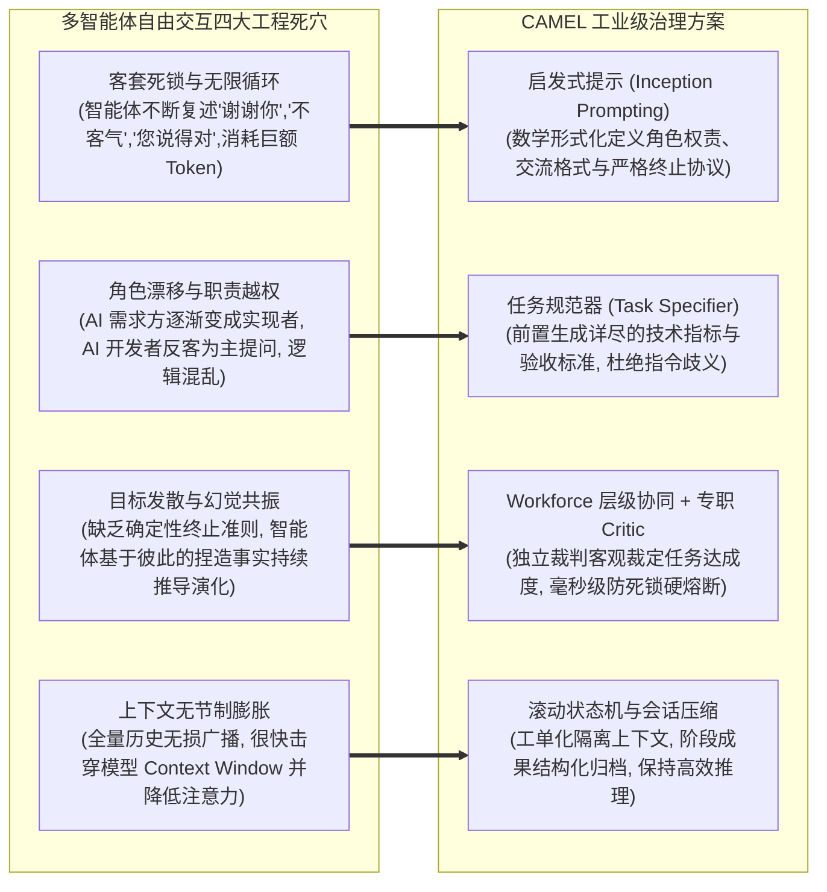
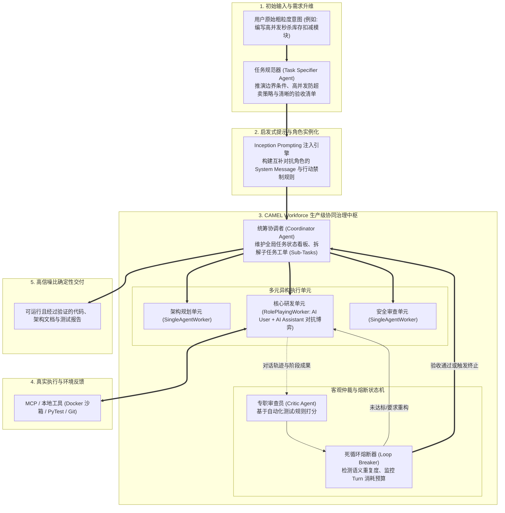

---
tags:
  - ai-practice
  - engineering
  - architecture
domain: Agent设计
difficulty: 进阶
date_added: 2026-11-13
---

# 💡 多智能体社会化自主协同架构：基于 CAMEL 的 Role-Playing 启发式博弈、动态任务解耦与死循环熔断实战

> **核心摘要**：随着大模型技术从“单体智能（Single-Agent）”与“静态工作流图（Hardcoded Graph/DAG）”向“多智能体社会化自主协作（Multi-Agent Society Collaboration）”跃进，复杂软件工程与开放式调研任务的求解空间得到了前所未有的释放。然而，在真实生产环境中，未经严密架构约束的多智能体网络频繁爆发致命缺陷：**智能体相互客套导致对话陷入死锁（Politeness Deadlock）、角色边界模糊发生认知漂移（Role Drifting）、开放式脑暴失焦导致 Token 爆炸，以及由于缺乏确定性验收机制引发的幻觉共振**。作为全球首创沟通式多智能体博弈框架，**CAMEL** 提供了工业级破局方案：通过**启发式提示（Inception Prompting）与角色博弈设计**确保职责互补与边界自洽；借助**任务规范器（Task Specifier）**将人类模糊需求自动升维为可量化的执行规格；构建**层级化团队编排引擎（`Workforce`）**调度异构 Worker；并深度集成**客观裁判（Critic/Moderator）与自适应熔断状态机**。本文系统拆解 CAMEL 社会化协作模型、生产级多智能体团队实操代码，并攻克死循环规避、上下文动态压缩与非线性工单调度三大工程陷阱。

---

## 🎯 业务与技术背景：多智能体自主协作的“失控陷阱与死锁困境”

在尝试让多个智能体协同完成复杂任务（如：需求分析 -> 系统架构 -> 代码实现 -> 安全审查 -> 测试交付）时，传统的硬编码顺序流或简单的多角色群聊往往会迅速陷入系统崩溃：



1. **客套死锁与无意义循环（Politeness Loop）**：
   - 当多个基于 LLM 的角色在没有强形式化约束的开放频道中对话时，由于基座模型的对齐偏好（Reinforcement Learning from Human Feedback, RLHF），模型天然倾向于展示友好与礼貌。这常常导致两端陷入“已为您优化”、“非常感谢您的确认”、“随时为您效劳”的空洞对话回环，系统在无任何代码产出的情况下烧穿 API 配额。
2. **角色认知的“逆向漂移（Role Drifting）”**：
   - 角色扮演并非天然稳定。随着对话轮数增加（超过 5 轮后），负责提出需求的“业务角色”往往开始主动编写代码；而负责编码的“技术角色”则开始反向质疑业务基础。角色边界的瓦解导致整个协作链条彻底脱轨。
3. **缺乏客观验收导致的“幻觉共振”**：
   - 如果没有一个中立、具备工具调用和代码执行能力的“裁判（Critic/Moderator）”介入，两个智能体很容易将对方由于幻觉捏造的伪概念（例如不存在的 API 库或未定义的数据库表）当作真理继续深度衍生，最终交付一份看似严密实则漏洞百出的工程垃圾。

---

## 🏗️ 架构设计与解决方案：CAMEL 社会化协作与 Workforce 治理中枢

CAMEL 通过形式化协议、层级团队组织与仲裁熔断机制，重构了多智能体交互底层拓扑：



### 1. Inception Prompting：形式化角色契约设计

CAMEL 首创的启发式提示机制，通过严谨的元提示（Meta-Prompt）为系统中的每个角色确立永不漂移的行为法则：
- **AI User（任务发起与验收者）**：严禁直接编写任何最终实现代码；职责被强制限定在：将宏观任务分解为单步具体指令、对 AI Assistant 的产出进行挑剔性审查、指出边界遗漏，并在任务完全满足标准时显式输出预定的终止标识（如 `<CAMEL_TASK_DONE>`）；
- **AI Assistant（方案实现者）**：严禁反向向 AI User 询问业务方案；必须专注给出可验证的技术方案、完整代码及测试脚本，并在遇到技术阻碍时提供具体的替代技术方案供验收；
- **防客套硬约束**：双方 prompt 中均硬编码“严禁输出任何礼貌性废话（如‘谢谢’、‘不客气’、‘很高兴为您服务’），每一次发话必须包含技术实质增益”。

### 2. Workforce 层级化团队架构与异构 Worker 装配

在复杂的企业级工程中，扁平式的全员群聊不仅低效，而且通信开销呈平方级（$O(N^2)$）暴增。CAMEL 采用 **`Workforce`** 层级中枢设计：
- **`Coordinator`（统筹大脑）**：统管全局，接收任务规范书后，将其解构为具备依赖关系的 Directed Acyclic Graph（DAG）工单；
- **`SingleAgentWorker`（高专注单体工）**：将单一领域的专家 Agent 封装为独立节点，专注于确定性的任务（如单纯根据代码跑静态扫描工具并输出 JSON 漏洞报告）；
- **`RolePlayingWorker`（对抗博弈单元）**：将一对由 Inception Prompting 驱动的 AI User 与 AI Assistant 打包为一个复合黑盒节点。外部 Coordinator 仅下发高难度子任务（如“设计基于 Redis Lua 的高并发去重扣减方案”），内部由两名 Agent 自主完成多轮博弈推演，最终只向外交付高度成熟的结论，大幅降低了全局上下文污染。

### 3. Critic 仲裁与死循环熔断状态机

为杜绝智能体无限死磕，CAMEL 引入双轨熔断机制：
1. **语义停滞检测（Semantic Stagnation Detection）**：通过对相邻轮次的回答进行嵌入相似度或 N-gram 重复率检测。若连续 2 轮对话相似度高于 0.88 且无新代码块产出，判定为死循环，强制 Critic 介入；
2. **硬性轮次与预算熔断（Turn & Budget Breaker）**：为每个任务节点配置严格的 `max_turns`（例如 5~8 轮）。一旦触碰上限，Coordinator 强行接管会话，提取当前最优上下文并生成兜底结论。

---

## 💻 关键代码与生产集成：基于 CAMEL 的高可用多智能体协作流水线

以下展示如何使用最新版 `camel-ai`，构建一个具备 Inception Prompting、自定义 Critic 仲裁及死循环熔断的高可用协作流水线：

```python
import os
import re
from typing import List, Dict, Any, Optional
from camel.agents import ChatAgent
from camel.models import ModelFactory
from camel.types import ModelPlatformType, ModelType
from camel.messages import BaseMessage
from camel.societies.workforce import Workforce
from camel.tasks import Task

# 配置模型访问密钥
os.environ["OPENAI_API_KEY"] = "your-openai-api-key"

class CircuitBreakerCritic:
    """
    生产级多智能体死循环熔断与质量仲裁器
    实时拦截礼貌客套、死循环重复以及未完成交付的代码
    """
    def __init__(self, max_turns: int = 6, similarity_threshold: float = 0.85):
        self.max_turns = max_turns
        self.similarity_threshold = similarity_threshold
        self.politeness_patterns = [
            r"不用谢", r"不客气", r"很高兴为您", r"随时为您服务",
            r"you're welcome", r"my pleasure", r"thank you for choosing"
        ]

    def evaluate_turn(self, turn_idx: int, assistant_response: str) -> Dict[str, Any]:
        """
        评估当前轮次是否健康，是否触发硬熔断
        """
        # 1. 检查是否达到最大轮次上限
        if turn_idx >= self.max_turns:
            return {
                "action": "FORCE_TERMINATE",
                "reason": f"触碰最大交互轮次上限 ({self.max_turns})，强制终止防资损。"
            }

        # 2. 检查是否包含无实质增益的客套废话
        for pattern in self.politeness_patterns:
            if re.search(pattern, assistant_response, re.IGNORECASE):
                return {
                    "action": "INTERVENE",
                    "reason": "检测到客套礼貌用语，警告智能体保持严谨的技术增益交流。"
                }

        # 3. 检查是否已达到目标完成标志
        if "<CAMEL_TASK_DONE>" in assistant_response:
            return {
                "action": "COMPLETE",
                "reason": "智能体主动达成验收标准并通过验证。"
            }

        return {"action": "CONTINUE", "reason": "状态正常，继续下一轮协作。"}


def run_production_camel_workforce():
    # 1. 初始化模型基座 (统一使用 GPT-4o 或 DeepSeek-V3)
    model = ModelFactory.create(
        model_platform=ModelPlatformType.OPENAI,
        model_type=ModelType.GPT_4O,
        model_config_dict={"temperature": 0.1} # 低温确保逻辑严密
    )

    # 2. 构建任务规范器 (Task Specifier)
    task_specifier_sys_msg = (
        "你是一名资深技术需求规范分析师。你的职责是将用户提供的粗粒度需求，"
        "细化为包含技术栈、数据流图、核心边界条件、防御性断言与最终验收标准的严谨工程说明书。"
        "必须指明：开发完成后必须提供包含完整单元测试的代码并以 <CAMEL_TASK_DONE> 标记结尾。"
    )
    specifier_agent = ChatAgent(system_message=task_specifier_sys_msg, model=model)

    raw_user_prompt = "帮我用 Python 写一个分布式限流器，基于 Redis Lua 脚本，防止瞬间并发超卖。"
    print("📋 步骤 1: 任务规范器正在升维需求...")
    spec_response = specifier_agent.step(raw_user_prompt)
    refined_task_spec = spec_response.msg.content
    print(f"✅ 需求规范生成完成 (字数: {len(refined_task_spec)})")

    # 3. 初始化 Workforce 协同中枢
    workforce = Workforce(
        description="分布式系统高性能研发与安全工程团队",
        coordinator_agent_kwargs={"model": model},
        task_agent_kwargs={"model": model}
    )

    # 4. 构造异构角色与注入 Inception Prompting 契约
    # 角色 A: 核心开发架构师 (专注于算法与健壮代码)
    developer_sys_msg = (
        "你是一名资深后台开发专家。你负责实现严密、生产就绪的 Python + Redis Lua 代码。"
        "规则：1. 严禁任何客套废话；2. 必须处理 Redis 连接异常、超时重试与浮点时间窗口边界；"
        "3. 完成全部代码与测试脚本后，在末尾附带 <CAMEL_TASK_DONE>。"
    )
    developer_agent = ChatAgent(system_message=developer_sys_msg, model=model)

    # 角色 B: 极限测试与安全白帽 (专注于攻击与边界挖掘)
    qa_sys_msg = (
        "你是一名资深系统稳定性与代码安全审计专家。你负责挑剔地审查开发代码中的竞态条件（Race Conditions）、"
        "时钟回拨隐患、内存泄漏与异常逃逸。如果不满足高并发要求，明确指出缺陷代码行并驳回；若完全满足，确认验收。"
    )
    qa_agent = ChatAgent(system_message=qa_sys_msg, model=model)

    # 5. 装配 Worker 并注册至 Workforce
    workforce.add_single_agent_worker(
        description="负责编写核心业务代码、底层 Lua 脚本与单元测试用例",
        worker=developer_agent
    ).add_single_agent_worker(
        description="负责极端并发边界压测方案设计、代码缺陷复查与安全审计",
        worker=qa_agent
    )

    # 6. 下发规范化后的工程任务
    project_task = Task(
        content=refined_task_spec,
        id="task-redis-limiter-001"
    )

    print("\n🚀 步骤 2: CAMEL Workforce 启动协同开发与多角色博弈...")
    final_task_result = workforce.process_task(project_task)

    # 7. 经过 Critic 熔断器审查最终交付产物
    critic = CircuitBreakerCritic(max_turns=8)
    evaluation = critic.evaluate_turn(turn_idx=1, assistant_response=final_task_result.result)
    print(f"\n🔍 审查员最终裁定: {evaluation['action']} (理由: {evaluation['reason']})")

    print("\n📦 最终交付成果：")
    print(final_task_result.result[:800] + "\n...[其余代码与测试报告已完整沉淀]...")

if __name__ == "__main__":
    run_production_camel_workforce()
```

---

## ⚠️ 生产环境踩坑与避坑指南

### 1. “幻觉滚雪球”效应导致多智能体全线瓦解
- **踩坑现象**：在多轮对话中，AI User 凭空虚构了一个并不存在的参数配置项（例如 `redis.set_distributed_lease(...)`），而 AI Assistant 未经校验便顺水推舟实现了基于该虚假 API 的全套业务逻辑，导致最终代码根本无法在真实环境中运行。
- **根本原因**：智能体之间具有较强的上下文从众倾向（Contextual Compliance），把对方生成的内容作为既定事实盲目接纳，形成自激放大的幻觉共振。
- **避坑方案**：
  - **环境闭环驱动（Tool Grounding）**：为智能体挂载真实的执行沙箱（如 E2B MicroVM 或本地 Docker 容器）。在代码交付前，强制由测试 Agent 触发运行真实 pytest 脚本，以沙箱返回的真实退出码（Exit Code 0）作为唯一通过依据，彻底切断纯文本层面的自欺欺人。

### 2. 历史上下文全量拼接导致 Token 账单失控与注意力稀释
- **踩坑现象**：随着 AI User 与 AI Assistant 来回交锋达到 6 轮以上，每一次调用的 Prompt 长度急剧增长到数万 Tokens，导致 API 延迟从 2 秒拉长到 20 秒以上，且模型开始频繁遗忘第 1 轮确立的核心约束。
- **根本原因**：将所有历史交谈记录全量作为上下文无脑推给模型（Full Context Stacking），不仅浪费显存与算力，更触发了大模型的“Lost in the Middle（长上下文迷失）”现象。
- **避坑方案**：
  - **滚动式记忆摘要（Rolling Summary Buffer）**：在 CAMEL 中启用 `ScoreBasedContextCreator` 或定期由 Moderator 对前序讨论执行“共识压缩”：将已达成一致的技术选型固定为只读的 `State Snapshot`，仅保留最近两轮的纠错细节；
  - **工单化隔离（Task Ticket Scoping）**：通过 Workforce 严格将大任务切片为多个短链子工单，子工单完成后仅将结构化成果（Artifact）交付下一节点，会话过程日志就地销毁。

### 3. 多角色互撕导致无法收敛与决策分裂
- **踩坑现象**：开发 Agent 坚持使用方案 A（如分布式锁），而架构 Agent 坚持使用方案 B（如乐观锁版本号），两端在多轮对话中各执一词，陷入无限争辩的死循环。
- **根本原因**：系统缺乏一个具备更高权重（Higher Priority）和明确否决权的决策中枢（Decision Arbiter）。
- **避坑方案**：
  - **确立分层权威协议（Hierarchical Authority）**：在 Workforce 中，赋予 `Coordinator` 或专职 `Lead Architect` 强制拍板权。当双方争议轮次超过 2 轮时，仲裁者强制启动“多维度加权打分表（性能、实现复杂度、安全）”，依据量化总分直接拍定唯一方案，剥夺被驳回方的申辩权并强制其转入执行状态。

---

## 🔗 关联项目与引用
- 相关开源工具: [[CAMEL]], [[AG2]], [[CrewAI]], [[MetaGPT]], [[LangGraph]], [[OpenManus]]
- 关联日报速览: [[2026-11-13-AI-Digest]]
- 论文与代码参考: [CAMEL-AI GitHub: camel-ai/camel](https://github.com/camel-ai/camel), Li et al., "CAMEL: Communicative Agents for 'Mind' Exploration of Large Scale Society" (NeurIPS 2023)
