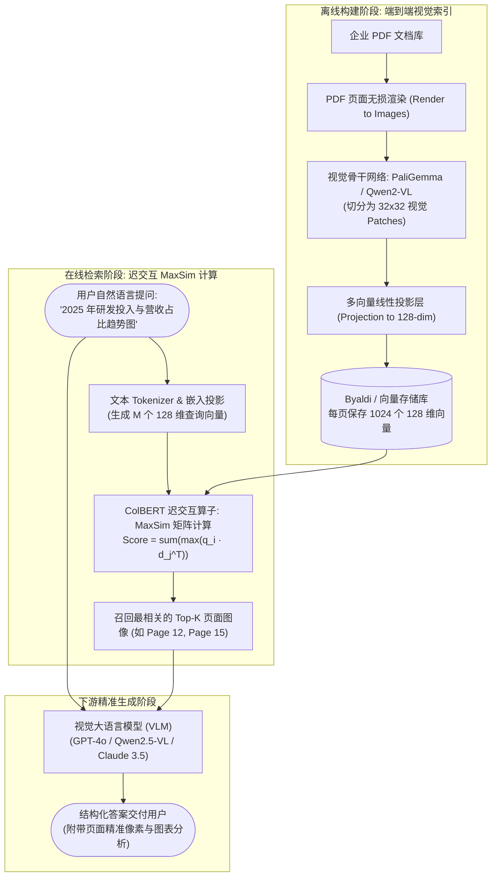

---
tags:
  - ai-practice
  - engineering
  - architecture
domain: RAG调优
difficulty: 进阶
date_added: 2026-10-16
---

# 💡 多模态文档检索革命：基于 ColPali 的视觉无损分块与 ColBERT 迟交互检索实战

> **核心摘要**：企业级 RAG 知识库在处理研报、财务审计报告与技术规程时，高达 70% 的召回失效根源在于“传统文本提取管道对视觉排版的不可逆破坏”。本文深度剖析 **ColPali** 架构的工程实现，详解如何跳过脆弱的 OCR 与分块（Chunking）步骤，直接利用视觉语言模型（VLM）将文档页面转换为 Patch 多向量表征，并通过 **ColBERT 迟交互算子（Late Interaction MaxSim）** 实现兼顾图表理解、复杂多栏表格结构保持与毫秒级精准检索的全新工业级 RAG 范式。

---

## 🎯 业务/技术背景与痛点

在企业知识库、金融研报问答、法律合规审核与高端装备运维场景中，海量核心资产以 PDF 格式存储。然而，基于传统纯文本的 RAG 架构在此类文档上面临致命瓶颈：

```
[原始 PDF 文档] 
  │ (排版破坏)
  ├──> 1. OCR 识别工具 ──> 单元格边界消失、合并单元格串行、数字归属错乱
  ├──> 2. 文本分块 (Chunking) ──> 强行按固定 Token 切割，表头与表体割裂
  └──> 3. 单向量嵌入 (Dense Embedding) ──> 3000 字内容压缩为单向量，图表语义全失
```

1. **复杂表格的“拍平乱码化”**：
   - 跨行跨列的资产负债表或合并利润表被 OCR 拍平成按行展开的离散文本，行列关系荡然无存；
   - 模型在检索“2025Q3 某业务线毛利率”时，召回的 Chunk 中数字密集但无法定位其所属的具体表头，导致下游大模型严重幻觉。
2. **非文字核心信息的彻底丢失**：
   - 研报中的趋势折线图、市场份额饼图、系统架构图以及拓扑流程图，在传统纯文本清洗流程中往往被作为“图片附件”直接剥离丢弃；
   - 当用户提问“根据趋势图判断未来三年复合增长率趋势”时，纯文本 RAG 检索器召回率直接降为 0。
3. **多栏排版（Multi-Column Layout）与跨页阅读串流**：
   - 双栏排版的学术论文或券商研报，常规文本抽取引擎极易将左栏末尾与右栏开头错拼在同一行，产生语义混乱的毒化数据；
4. **冗长级联管道的高运维成本与延迟**：
   - 传统方案串联了版面分析（LayoutLM）、OCR（PaddleOCR/Tesseract）、规则正则切块、稠密向量模型等多道工序，任何一环的升级都会导致整个召回底座重构。

---

## 🏗️ 架构设计与解决方案

ColPali 架构的核心突破在于**以视觉图像作为文档的终极真实载体（Ground Truth）**，彻底告别文字提取的中间损耗，实现从“图像像素”到“多向量迟交互检索”的端到端统一。



### 核心机制详解：

1. **图像即数据（Vision as First-Class Citizen）**：
   - PDF 的每一页直接转为高保真图片输入，保留字体大小、颜色对比、坐标相对位置、表格线以及走势图的所有原始特征；
2. **细粒度 Patch 多向量映射**：
   - 图像经由视觉 Transformer 分割为网格状 patches（例如 1024 个 patch）。每个 patch 通过注意力层感知全局上下文后，被投影为一个 128 维向量；
   - 图像中的“折线图尖峰”或“表格中某一关键数字”在空间上精确对应特定的若干个 patch 向量；
3. **Late Interaction 算子的高表现力**：
   - 检索时，查询词“研发费用”仅需在 1024 个 patch 中寻找余弦相似度最高的一小块区域（$\max_{j} q_i \cdot d_j$），而无需整页向量在全局上牺牲细节做均值池化，彻底消除了信息瓶颈。

---

## 💻 关键代码 / 配置 / Prompt 模板

以下是在生产环境中基于 `byaldi` 库进行端到端视觉向量索引构建、Top-K 迟交互检索、并将召回的高清图像交付下游多模态大模型进行高可信精准问答的完整实现代码：

```python
import os
import base64
from io import BytesIO
from PIL import Image
from byaldi import RAGMultiModalModel
from openai import OpenAI

# ==========================================
# 1. 离线索引构建：初始化 ColPali 多模态模型并建库
# ==========================================
def build_visual_index(docs_dir: str, index_path: str):
    """
    将包含复杂表格、图表的 PDF 文档直接构建为 ColPali 视觉多向量索引
    """
    print(f"📦 正在加载 ColPali 检索模型 (基于 PaliGemma 架构)...")
    # 加载预训练模型
    RAG = RAGMultiModalModel.from_pretrained("vidore/colpali-v1.2", verbose=1)

    print(f"🔄 正在对目录 '{docs_dir}' 下的所有 PDF 进行页面渲染与视觉 Patch 编码...")
    # 自动完成 PDF 页面转图、32x32 Patch 多向量提取并持久化
    RAG.index(
        input_path=docs_dir,
        index_name=index_path,
        store_collection_with_index=True,
        overwrite=True
    )
    print("✅ 视觉多向量索引构建完成！")
    return RAG

# ==========================================
# 2. 在线检索：执行 ColBERT 迟交互 (MaxSim) 算子
# ==========================================
def search_relevant_pages(rag_model: RAGMultiModalModel, query: str, top_k: int = 2):
    """
    对输入查询计算 MaxSim 矩阵匹配，召回最相关的页面图像
    """
    print(f"\n🔍 正在检索查询: '{query}'")
    results = rag_model.search(query=query, k=top_k)
    
    retrieved_pages = []
    for rank, res in enumerate(results, start=1):
        print(f"  [Top {rank}] 文档: {res.doc_id} | 页面: Page {res.page_num} | MaxSim 得分: {res.score:.4f}")
        # res.base64 中存储了该页面的原始高清图片
        retrieved_pages.append({
            "page_num": res.page_num,
            "doc_id": res.doc_id,
            "score": res.score,
            "base64_image": res.base64
        })
    return retrieved_pages

# ==========================================
# 3. 下游生成：结合视觉多模态大模型 (VLM) 输出高保真回答
# ==========================================
def generate_grounded_answer(client: OpenAI, query: str, retrieved_pages: list):
    """
    将检索召回的页面高清图像直接喂入 GPT-4o / Qwen2.5-VL 生成精准答案
    """
    messages = [
        {
            "role": "system",
            "content": (
                "你是一个极其专业严谨的企业财报与研报分析专家。"
                "请仔细观察用户提供的文档页面原始高清图像（包含图表、趋势图和详细财务表格）。"
                "严格根据图像中可见的事实数据回答问题，指出数据所在具体表格或图表位置，严禁主观推断。"
            )
        }
    ]

    user_content = [
        {"type": "text", "text": f"用户提问：{query}\n\n以下是系统检索召回的关联文档页面（按相关度排序）："}
    ]

    # 将召回的页面图像按多模态结构组装
    for item in retrieved_pages:
        user_content.append({
            "type": "text",
            "text": f"--- 文档: {item['doc_id']} (第 {item['page_num']} 页) ---"
        })
        user_content.append({
            "type": "image_url",
            "image_url": {
                "url": f"data:image/jpeg;base64,{item['base64_image']}",
                "detail": "high"  # 开启高分辨率细节解析
            }
        })

    messages.append({"role": "user", "content": user_content})

    print("🤖 正在调用视觉大模型执行综合图文解析与回答...")
    response = client.chat.completions.create(
        model="gpt-4o",
        messages=messages,
        temperature=0.1
    )
    return response.choices[0].message.content

# ==========================================
# 4. 完整流水线运行
# ==========================================
if __name__ == "__main__":
    DOCS_DIR = "./sample_reports"
    INDEX_NAME = "enterprise_reports_idx"
    
    # 确保存放有样本 PDF
    os.makedirs(DOCS_DIR, exist_ok=True)
    
    # 模拟初始化/加载模型
    if not os.path.exists(INDEX_NAME):
        # 首次运行构建索引
        rag = build_visual_index(DOCS_DIR, INDEX_NAME)
    else:
        # 已有索引直接从磁盘快速加载
        rag = RAGMultiModalModel.from_index(INDEX_NAME)

    # 发起涉及图表和复杂排版的问答
    test_query = "请详细分析报告中披露的 2024-2025 年云业务收入季度环比增长率，并说明趋势图中的转折点。"
    top_pages = search_relevant_pages(rag, query=test_query, top_k=2)

    if top_pages:
        # 初始化客户端调用多模态模型
        openai_client = OpenAI(api_key=os.getenv("OPENAI_API_KEY", "sk-mock-key"))
        final_answer = generate_grounded_answer(openai_client, test_query, top_pages)
        print(f"\n💡 最终权威解析结果:\n{final_answer}")
```

---

## ⚠️ 生产环境踩坑与避坑指南

### 1. 坑点一：多向量存储空间膨胀（Storage Footprint Explosion）
- **现象**：传统稠密向量每页仅需 1 个 1024 维 float32 向量（约 4KB）；而 ColPali 每页产生 1024 个 128 维向量，单页原始存储高达 **512KB**。对于千万级页面知识库，向量索引将突破数 TB。
- **避坑方案**：
  1. **二值量化（Binary Quantization, BQ）**：将 128 维 float32 向量符号化压缩为 128-bit（16 字节），存储直接削减 **96.8%**；检索时利用 CPU AVX-512 POPCNT 汉明距离进行百倍级粗筛，再对 Top-100 进行原始浮点重打分；
  2. **视觉 Patch 语义剪枝（Patch Pruning）**：通过注意力阈值过滤掉纯白空白边距、纯背景等无信息量的 patch，平均可剔除 35%~50% 的冗余向量。

### 2. 坑点二：高密度复杂图表微小字号的模糊失真
- **现象**：默认模型将整页统一下采样为 $224 \times 224$ 或 $448 \times 448$ 像素输入，在超密集 A4 报表（如 6 号微型字体的财务附注）中，文字被模糊压缩，导致检索对齐失准。
- **避坑方案**：
  - **动态双尺度切分（Dynamic Resolution Slicing）**：对于纵横比异常或像素密度超标的页面，按纵向黄金比例切分为上半页与下半页（带 15% 重叠缓冲区）分别进行 Patch 编码；
  - 选用支持动态分辨率的升级版本（如基于 Qwen2-VL 的 ColQwen2 系列），支持原生大分辨率图像直接输入。

### 3. 坑点三：检索与生成阶段的 Token 配额失控
- **现象**：将 Top-5 甚至 Top-10 召回的整页高清图片一股脑全部作为 prompt 喂给下游多模态模型（如 GPT-4o 或 Claude 3.5），单次交互图片 Token 消耗高达数万，响应延迟达 10 秒以上且成本高昂。
- **避坑方案**：
  - **严格精简 Top-K（建议 K=1~2）**：由于 ColPali 页面级的精准率远高于传统分块，通常最具价值的信息集中在 Top-1 或 Top-2 页面；
  - **结合 Bounding Box 局部裁剪**：根据查询词命中最高评分的 Patch 坐标区域，自动对原图进行动态裁切（Crop），仅将命中区域及其周边上下文送入下游生成模型。

---

## 🔗 关联项目与引用
- 核心开源工具: [[ColPali]]
- 文档解析关联: [[MinerU]], [[Docling]], [[RAGFlow]]
- 向量存储底座: [[Weaviate]], [[LanceDB]]
- 今日日报脉络: [[2026-10-16-AI-Digest]]
- 论文引用: *ColPali: Efficient Document Retrieval with Vision Language Models (Fevry et al., 2024)*
