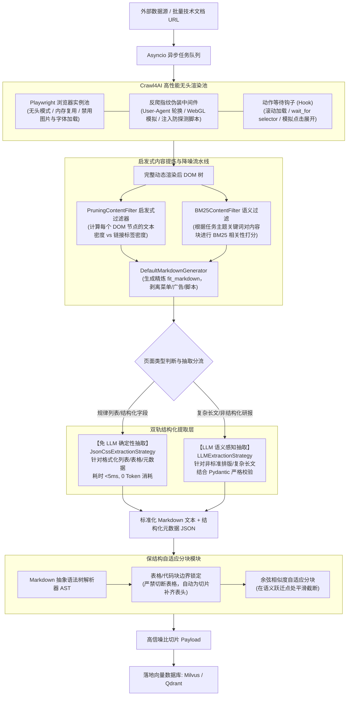

---
tags:
  - ai-practice
  - engineering
  - architecture
  domain: RAG调优
  difficulty: 进阶
  date_added: 2026-10-13
---

# 💡 大模型友好型高效网页抽取：基于 Crawl4AI 的异步无头爬取与自适应分块实战

> **核心摘要**：外部网络动态数据是企业级 RAG 知识库与领域模型后训练的关键原料。然而，传统爬虫无法应对 SPA 动态渲染，直接将生僻 HTML 丢给 LLM 会引发高达 90% 的 Token 噪声与上下文窗口浪费，而依赖商业云端爬虫 API 则面临高昂账单与并发限制。本文系统解构基于 **Crawl4AI v0.4** 的生产级高吞吐异步爬取方案，详解结合 Playwright 进程池、`PruningContentFilter` 无监督文本密度剪枝、免 LLM 的 `JsonCss` 确定性抽取与保结构语义分块，构建本地化、高吞吐、零 API 成本的数据清洗流水线。

---

## 🎯 业务/技术背景与痛点

在构建企业级检索增强生成（RAG）、动态竞品分析或垂类智能体知识库时，网络数据源（技术文档、行业研报、竞品动态、新闻舆情）往往是最重要的知识输入。但在实际落地摄入过程中，工程团队普遍面临严峻挑战：

1. **客户端动态渲染（SPA/CSR）成为数据断崖**：
   - 绝大多数现代化技术站点与 Web 应用（如基于 React、Next.js、Vue 构建的知识库系统）采用客户端异步拉取与懒加载机制。传统的 Python 同步抓取工具（如 `requests` + `BeautifulSoup` 或旧版 `Scrapy`）无法执行复杂 JavaScript，往往只能抓取到一个空壳骨架（如 `<div id="app"></div>`），导致核心内容全盘丢失。
2. **“上下文窗口税”（Context Window Tax）与极高噪声**：
   - 未经清洗的网页原始 HTML 中充斥着海量的样式代码（CSS）、事件监听脚本（JS）、顶部导航栏、侧边栏菜单、页脚版权、Cookie 授权弹窗以及追踪代码。实验统计表明，一段 500 字的有效正文在原始 HTML 中往往伴随着 20,000~50,000 个无意义 Token。直接将原始 HTML 输入 LLM，不仅浪费了极高的 API 费用，还会因无关文本挤占注意力机制，诱发严重的检索与回答幻觉。
3. **商业云端爬虫（如 Firecrawl SaaS）在海量抓取下的成本墙**：
   - 商业服务虽然省心，但按页收费（单页抓取通常需消耗 1~5 个积分），在面对数十万级别网页的日常巡检与全网知识库摄入时，企业每月账单可能高达数千美元；同时其云端 API 存在严格的并发限流与数据跨境合规风险。
4. **粗暴文本切分破坏结构语义（Chunking Boundary Corruption）**：
   - 传统 RAG 分块算法通常按固定字符数（如 500 或 1000 字符）硬性切分。当切分边界恰好落在复杂的 Markdown 表格、嵌套列表或多行代码块中央时，下游向量模型（Embedding Model）拿到的切片就会完全失去表头上下文，导致语义匹配度严重下降。

---

## 🏗️ 架构设计与解决方案

针对上述瓶颈，我们基于 **Crawl4AI v0.4** 搭建了一套全链路本地化的**异步无头采集、启发式启发降噪、双轨结构化提取与自适应保结构分块**系统：



### 核心机制分解：

1. **异步浏览器多标签页复用（Async Context Pooling）**：
   - 彻底规避“抓一个网页启停一次 Chromium”的高昂冷启动与内存开销。Crawl4AI 维持一个长驻的浏览器实例，通过 `asyncio` 并发调度多个轻量级 `BrowserContext` 与 `Page`，实现单机数十页面/秒的渲染吞吐。
2. **基于文本密度与链接密度的无监督剪枝（`PruningContentFilter`）**：
   - 传统的去噪通常依赖死板的黑名单 class 过滤（极易失效）。Crawl4AI 引入了先进的密度算法：计算每个节点内纯文本字符数与超链接标签、按钮标签的比例。导航条、侧边栏和页脚往往呈现“超链接密集、正文稀疏”的特征，会被算法以无监督方式自动裁剪，只保留核心长文本段落，Token 压缩率高达 85%~92%。
3. **零成本双轨抽取（Deterministic vs Cognitive Dual-Track）**：
   - 对于结构相对规则的站点（如 GitHub Trending、产品参数列表、技术规范表格），直接运行 `JsonCssExtractionStrategy`，在毫秒级内通过 CSS 选择器转换为结构化 JSON，避免调用大模型带来的昂贵开销与偶然格式错误；
   - 仅对高度分散、排版自由的文章核心观点或研报总结，才交由轻量级小模型运行 `LLMExtractionStrategy`，最大化兼顾效率与质量。
4. **Markdown 语法树感知分块（Syntax-Aware Chunking）**：
   - 在进入向量数据库前，解析 Markdown 语法树。遇到表格元素时，将整张表格作为一个整体打包；若表格超长，则在切分时将第一行 Table Header 复制到每个分块头部，彻底保证 RAG 检索时的表头语义连续性。

---

## 💻 关键代码 / 配置 / Prompt 模板

### 1. 生产级高并发异步抓取与无监督降噪流水线

以下代码演示如何在生产环境中配置抗指纹、无监督剪枝，并批量并发抓取目标站点的核心长文本与 fit_markdown：

```python
import asyncio
from typing import List, Dict, Any
from crawl4ai import AsyncWebCrawler, BrowserConfig, CrawlerRunConfig, CacheMode
from crawl4ai.content_filter_strategy import PruningContentFilter
from crawl4ai.markdown_generation_strategy import DefaultMarkdownGenerator

async def run_production_crawling_pipeline(urls: List[str]) -> List[Dict[str, Any]]:
    # 1. 打造极速、抗指纹的浏览器底层运行时配置
    browser_cfg = BrowserConfig(
        headless=True,
        verbose=False,
        text_mode=True,          # 禁用图像/音频资源加载，降低带宽与内存消耗 80%
        ignore_https_errors=True,
        use_persistent_context=False
    )
    
    # 2. 配置无监督文本/链接密度剪枝过滤器
    # threshold 越高，剪枝越激进；0.48 是平衡正文完整性与去噪的最佳黄金分割点
    pruning_filter = PruningContentFilter(
        threshold=0.48,
        min_word_threshold=15
    )
    
    md_generator = DefaultMarkdownGenerator(
        content_filter=pruning_filter,
        options={
            "ignore_links": False,
            "escape_html": True,
            "body_width": 0
        }
    )
    
    # 3. 页面抓取执行配置
    run_cfg = CrawlerRunConfig(
        markdown_generator=md_generator,
        cache_mode=CacheMode.BYPASS,      # 生产实时拉取可设为 BYPASS，调试设为 ENABLED
        page_timeout=30000,              # 30 秒超时熔断
        wait_for="article, main, body",   # 确保核心 DOM 挂载完成
        delay_before_return_html=0.5     # 等待客户端异步脚本渲染完毕
    )

    results = []
    
    # 4. 全异步单实例批量并行消费
    async with AsyncWebCrawler(config=browser_cfg) as crawler:
        for url in urls:
            try:
                res = await crawler.arun(url=url, config=run_cfg)
                if res.success:
                    results.append({
                        "url": url,
                        "raw_html_length": len(res.cleaned_html),
                        "fit_markdown": res.markdown.fit_markdown,
                        "fit_md_length": len(res.markdown.fit_markdown),
                        "compression_rate": f"{(1 - len(res.markdown.fit_markdown) / max(len(res.cleaned_html), 1)) * 100:.1f}%",
                        "metadata": res.metadata
                    })
                else:
                    print(f"抓取失败 [{url}]: {res.error_message}")
            except Exception as e:
                print(f"异常捕获 [{url}]: {str(e)}")

    return results

if __name__ == "__main__":
    target_urls = [
        "https://github.com/trending",
        "https://huggingface.co/papers"
    ]
    extracted = asyncio.run(run_production_crawling_pipeline(target_urls))
    for item in extracted:
        print(f"\n目标: {item['url']}")
        print(f"HTML 长度: {item['raw_html_length']} -> Fit Markdown 长度: {item['fit_md_length']}")
        print(f"Token 噪声压缩率: {item['compression_rate']}")
        print(f"正文前 300 字符预览:\n{item['fit_markdown'][:300]}")
```

### 2. 免 LLM 确定性抽取与大模型认知抽取双轨代码

```python
import asyncio
import json
from pydantic import BaseModel, Field
from crawl4ai import AsyncWebCrawler, CrawlerRunConfig, JsonCssExtractionStrategy, LLMExtractionStrategy

# ----------------- 模式 A: 零成本 JsonCss 结构化提取 -----------------
catalog_schema = {
    "name": "Documentation Items",
    "baseSelector": "div.section-card",
    "fields": [
        {"name": "title", "selector": "h3", "type": "text"},
        {"name": "doc_url", "selector": "a.link", "type": "attribute", "attribute": "href"},
        {"name": "description", "selector": "p.summary", "type": "text"},
        {"name": "tags", "selector": "span.badge", "type": "text"}
    ]
}

async def run_css_extraction(url: str):
    config = CrawlerRunConfig(
        extraction_strategy=JsonCssExtractionStrategy(schema=catalog_schema)
    )
    async with AsyncWebCrawler() as crawler:
        result = await crawler.arun(url, config=config)
        if result.success:
            return json.loads(result.extracted_content)
    return []

# ----------------- 模式 B: Pydantic 驱动的 LLM 认知抽取 -----------------
class PaperSummary(BaseModel):
    title: str = Field(description="论文完整标题")
    core_contribution: str = Field(description="核心创新点与技术方案")
    benchmark_metrics: List[str] = Field(description="取得的关键指标与测试结果")

async def run_llm_extraction(url: str):
    llm_strategy = LLMExtractionStrategy(
        provider="ollama/qwen2.5:7b", # 也可配置 openai/gpt-4o
        api_token="no-token-needed-for-local",
        schema=PaperSummary.model_json_schema(),
        extraction_type="schema",
        instruction="阅读清洗后的 Markdown 文本，精准提取出该论文的核心要素，严禁臆造！"
    )
    config = CrawlerRunConfig(
        extraction_strategy=llm_strategy
    )
    async with AsyncWebCrawler() as crawler:
        result = await crawler.arun(url, config=config)
        if result.success:
            return json.loads(result.extracted_content)
    return {}
```

---

## ⚠️ 生产环境踩坑与避坑指南

### 1. Playwright 内存泄漏与僵尸 Chromium 进程治理
- **坑点现象**：连续高并发抓取数千个网页后，服务器内存持续攀升至 100%，系统产生大量未被回收的孤儿 `chrome.exe` 或 `chromium` 进程，最终导致 OOM 崩溃。
- **避坑方案**：
  - 严禁每个请求都新建 `AsyncWebCrawler` 实例，必须采用全局单例上下文管理器；
  - 设置批处理重启阈值：每抓取 500 个页面后，主动关闭并重新实例化一次 crawler 进程；
  - 在 Linux/Docker 容器启动时增加 `--init` 参数（例如 `docker run --init`），确保僵尸进程被 Tini 正确收割。

### 2. 反爬对抗与“幽灵 403 / Cloudflare 拦截”
- **坑点现象**：在抓取某些高防站点时，直接返回 403 页面，或者卡死在 Cloudflare “Just a moment...” 人机验证页。
- **避坑方案**：
  - 在 `BrowserConfig` 中开启指纹伪装，显式配置 `user_agent_mode="random"`；
  - 启用网络慢速逼真模拟：
    ```python
    crawler_cfg = CrawlerRunConfig(
        simulate_user=True,
        magic=True # 开启 Crawl4AI 内部集成的主动绕过脚本
    )
    ```
  - 对于强防护站点，配合高质量轮换住宅代理（Rotating Residential Proxy）使用。

### 3. 表格与长代码块在自适应分块中被腰斩
- **坑点现象**：Markdown 中的宽大表格（如包含 10 列的性能对比表）在经过基于字符长度切分时，表头被分到了 Chunk-1，而数据行被分到了 Chunk-2，导致向量检索 Chunk-2 时完全无法理解数字所对应的列含义。
- **避坑方案**：
  - **基于 AST 的保结构分块器（AST-Aware Splitter）**：在分块切分逻辑中，将 `| col1 | col2 |` 的 Markdown 表格视为原子块（Atomic Block），严禁跨行粗暴切断；
  - **动态表头重挂载（Header Re-attaching）**：若表格行数过多必须分段，在生成子 Chunk 时，将原始 Table Header 字符串作为前缀强行拼接到每个子分块的顶部，保证向量语义自包含。

### 4. 幂等性控制与本地多级缓存机制
- **坑点现象**：下游向量管道因为异常失败重新触发抓取任务时，反复向目标服务器发起高频重复请求，导致 IP 被封禁且极大浪费网络带宽。
- **避坑方案**：
  - 将 `CrawlerRunConfig` 的缓存模式设置为 `CacheMode.ENABLED`；
  - Crawl4AI 内部使用基于 URL 和请求配置生成的哈希值作为缓存 Key。在 TTL 周期内再次抓取同一 URL 会直接从本地 SQLite 极速返回已有结果，确保数据管道具备全幂等重放能力。

---

## 🔗 关联项目与引用
- 核心抓取底座: [[Crawl4AI]]
- 商业云端方案对比: [[Firecrawl]]
- 文档版面解析与知识加工: [[Docling]], [[MinerU]], [[Kotaemon]]
- 向量存储与混合检索: [[Milvus]], [[Qdrant]], [[LanceDB]]
