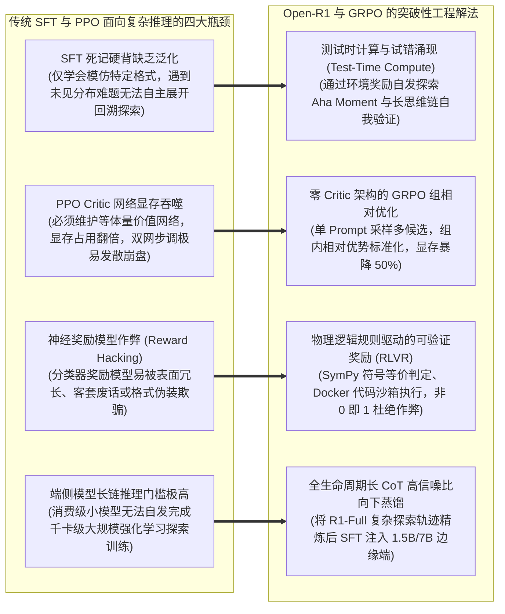

---
tags:
  - ai-practice
  - engineering
  - architecture
domain: 模型微调
difficulty: 进阶
date_added: 2026-11-12
---

# 💡 大模型强化推理与强化学习对齐：基于 Open-R1 与 GRPO 的可验证奖励函数设计与长思维链 (CoT) 蒸馏实战

> **核心摘要**：随着 DeepSeek-R1 与 OpenAI o1 等前沿推理模型的崛起，大模型能力的跃迁重心已从单纯依赖更大规模参数预训练与监督微调（SFT）的“死记硬背”，全面转向利用强化学习（Reinforcement Learning）激发测试时计算（Test-Time Compute）潜能与长思维链（Long CoT）的“自主思考与自我反思”。面向严肃数学推演、代码生成与复杂逻辑决策等严谨场景，传统的 PPO 算法由于必须维护庞大的 Critic 价值网络导致显存开销翻倍且极易发散，而基于主观神经网络评分的奖励模型则频繁遭遇奖励作弊（Reward Hacking）。本文基于 Hugging Face 官方开源的顶级全流程复现工程 **Open-R1**，深度落地一套工业级强化推理对齐与蒸馏体系：详解“零 Critic 架构的 GRPO（组相对策略优化）数学推导 - 多维物理规则驱动的可验证奖励引擎（RLVR）构建 - 动态长思维链长度正则化约束 - 7B/1.5B 边缘推理小模型无损蒸馏”全流程，系统性攻克组采样多样性塌缩、无限车轱辘反思循环、vLLM 生成与训练策略漂移及端侧模型通用遵循退化四大工程陷阱。

---

## 🎯 业务与技术背景：传统对齐与 SFT 在深度推理跃迁中的“四大瓶颈”

在过去的 LLM 研发中，业内普遍采用“预训练 + 指令 SFT + RLHF/DPO 对齐”的成熟范式。然而，当开发者试图将这种范式应用于数学奥赛、复杂算法编程或长链形式化验证等高严密性任务时，系统遇到了难以跨越的性能天花板：



1. **“死记硬背”的 SFT 无法孕育真实的自主纠错与泛化能力**：
   - 监督微调（SFT）本质上是在最大化训练集 Token 的条件概率，模型学会的是“模仿专家的答题语调”，而非“在思维受阻时主动否定前文并回溯重算”。一旦测试题超出微调样本的边界，SFT 模型往往会言之凿凿地推导出一个荒谬的结论，缺乏反思机制。
2. **传统 PPO 架构的 Critic 价值网络显存反噬与训练失稳**：
   - 在传统的近端策略优化（PPO）中，系统必须同时加载 Actor（策略网络）、Critic（价值网络）、Reference Model（无参参考模型）和 Reward Model（奖励模型）。对于 32B~70B 的大模型，仅仅为了维持 Critic 网络的参数与优化器状态，就消耗了额外的 50% 显存，且 Critic 的微小估计偏差会导致整个强化学习探索过程彻底发散崩溃。
3. **主观神经奖励模型的“奖励作弊（Reward Hacking）”顽疾**：
   - 基于人类标注训练出的标量 Reward Model，往往会无意识地赋予“字数更多、排版更精美、语气更谦逊”的回答更高的分数。在强化学习多轮迭代后，策略模型会迅速捕捉到这一漏洞，生成几千字看似严密实则漏洞百出的车轱辘话，严重偏离了追求“逻辑数学真实性”的初衷。
4. **长思维链能力难以高效下沉至端侧边缘模型**：
   - 边缘端设备（如个人 PC、工控设备、手机）算力有限，无法支撑百卡集群运行大规模强化学习算法。如何利用大模型通过强化学习涌现出的优质长推理轨迹，低成本、无损地注入到 1.5B、7B、14B 等端侧模型中，是当前企业落地推理大模型的关键痛点。

---

## 🏗️ 架构设计与解决方案：基于 Open-R1 与 GRPO 的强化推理闭环

Open-R1 采用了 DeepSeek 开创并被 Hugging Face 深度工程化的 **GRPO（Group Relative Policy Optimization，组相对策略优化）** 架构。系统摒弃了独立的 Critic 网络，通过高并发批量生成与严格的数学/代码规则验证器，实现了极低显存占用下的自主推理进化：

```mermaid
flowchart TD
    subgraph DataAndEnvironment [1. 问题输入与高并发采样网格]
        Prompt["原始逻辑/数学输入 Prompt $q$<br/>(如: '求函数 $f(x)=x^3-3x+1$ 在区间 [0, 2] 的极值')"]
        vLLMEngine["vLLM 极速组采样引擎 (Batch Group Sampler)"]
        GroupOutputs["单 Query 采样生成 $G$ 个候选回答组<br/>$\{o_1, o_2, ..., o_G\}$ (带完整的 <think> 思考标签)"]
        
        Prompt ==> vLLMEngine
        vLLMEngine ==> GroupOutputs
    end

    subgraph MultiRewardEngine [2. 物理规则驱动的可验证奖励引擎 (RLVR)]
        MathRule["数学精确求解器 (SymPy / LaTeX Equivalence)<br/>解析最终 boxed 答案并对比真实标准解"]
        CodeSandbox["代码测试用例沙箱 (PyTest / Docker Isolation)<br/>执行候选代码，验证 Pass@K 通过率"]
        FormatRule["格式结构规范器 (XML Tag Integrity)<br/>检查 <think> 是否闭合、答案标签是否符合规范"]
        LengthReg["思考长度正则项 (Thinking Length Penalty)<br/>抑制无效重复车轱辘话，鼓励紧凑推导"]
    end

    subgraph GroupAdvantage [3. 组内相对优势估算与梯度更新]
        ScoreAggregation["总奖励合成: $R_i = w_1 R_{\text{acc}} + w_2 R_{\text{fmt}} - w_3 R_{\text{len}}$"]
        GroupNormCalc["组内相对优势归一化:<br/>$A_i = \frac{R_i - \text{mean}(R)}{\text{std}(R) + \epsilon}$"]
        SurrogateLoss["GRPO 剪切代理损失更新 (无 Critic 价值网络)<br/>$\mathcal{L}_{\text{GRPO}} = -\frac{1}{G}\sum \left[ \min\left(r_t A, \text{clip}(r_t) A\right) - \beta \mathbb{D}_{\text{KL}}(\pi_\theta || \pi_{\text{ref}}) \right]$"]
        PolicyUpdate["策略模型梯度反向传播 ($\pi_\theta$)"]
    end

    subgraph DownstreamDistillation [4. 高质量长思考样本向下蒸馏]
        TrajectoryCollector["高质量 CoT 轨迹筛选器 (筛选 Reward=1.0 且逻辑完备的样本)"]
        EdgeSFT["边缘端小模型 (1.5B / 7B) 有监督长思考蒸馏"]
    end

    GroupOutputs ==> MathRule & CodeSandbox & FormatRule & LengthReg
    MathRule & CodeSandbox & FormatRule & LengthReg ==> ScoreAggregation
    ScoreAggregation ==> GroupNormCalc
    GroupNormCalc ==> SurrogateLoss
    SurrogateLoss ==> PolicyUpdate
    PolicyUpdate -.->|迭代更新权重| vLLMEngine
    PolicyUpdate ==> TrajectoryCollector ==> EdgeSFT
```

### 核心机制与数学原理解析：

1. **GRPO 优势函数估算原理解析**：
   - 在标准 PPO 中，优势函数依赖广义优势估计（GAE），需要训练一个庞大的价值网络 $V_\phi(s)$。
   - GRPO 巧妙地通过“同题同组对比”消除基线：对于同一个 Prompt $q$，模型采样输出一组候选序列 $\{o_1, o_2, \dots, o_G\}$，每个序列根据规则引擎获得标量奖励 $R_i$。组内平均奖励与方差分别为：
     $$\mu = \frac{1}{G}\sum_{i=1}^G R_i, \quad \sigma = \sqrt{\frac{1}{G}\sum_{i=1}^G (R_i - \mu)^2 + \epsilon}$$
   - 第 $i$ 个输出的优势函数直接简化为标准化相对得分：
     $$A_i = \frac{R_i - \mu}{\sigma}$$
   - 若某个样本在组内表现优于同组平均水准，其 $A_i > 0$，模型受到正向强化；反之受到负向惩罚。显存中无需驻留任何 Critic 参数，内存占用立减 50%。
2. **多维绝对可验证奖励矩阵（RLVR）设计**：
   - **正确性奖励（Accuracy Reward）**：使用 `SymPy` 符号计算库对大模型输出的数学表达式（如分式、根号、三角函数化简结果）与标注答案进行代数等价性校验，彻底解决“同一答案不同 LaTeX 表达导致误判”的问题；
   - **格式奖励（Format Reward）**：强制要求模型必须包含标准的 `<think>` 和 `</think>` 标签，且最终答案必须包裹在特定的结构化块（如 `\boxed{...}`）内；
   - **代码沙箱奖励（Code Sandbox Reward）**：对于编程问题，自动将模型生成的 Python 代码写入临时沙箱并执行预设的单元测试用例，按通过比例计算奖励。

---

## 💻 工业级核心落地代码实现

以下为基于 Hugging Face TRL、vLLM 与 Open-R1 规范编写的生产级 GRPO 强化学习训练脚本，完整实现了多维度规则奖励验证器、组采样配置以及长思维链抽取闭环：

```python
import os
import re
import sys
import subprocess
import tempfile
from typing import Any, Dict, List
import sympy
from latex2sympy2 import latex2sympy
from datasets import load_dataset
from transformers import AutoTokenizer
from trl import GRPOConfig, GRPOTrainer

# =========================================================================
# 1. 规则驱动的可验证奖励函数矩阵 (RLVR Verifiers)
# =========================================================================

def extract_boxed_answer(text: str) -> str:
    """从生成文本中提取标准 LaTeX boxed 答案"""
    matches = re.findall(r"\\boxed\{(.*?)\}", text)
    if matches:
        return matches[-1].strip()
    return ""

def accuracy_reward_func(prompts: List[str], completions: List[str], answer: List[str], **kwargs) -> List[float]:
    """基于 SymPy 代数等价性校验的高精度数学判定器"""
    rewards = []
    for completion, ground_truth in zip(completions, answer):
        model_ans = extract_boxed_answer(completion)
        if not model_ans:
            rewards.append(0.0)
            continue
            
        gt_ans = ground_truth.strip()
        # 1. 快速精确字符串比对
        if model_ans == gt_ans:
            rewards.append(1.0)
            continue

        # 2. 基于 SymPy 进行代数符号等价化简对比
        try:
            expr_model = latex2sympy(model_ans)
            expr_gt = latex2sympy(gt_ans)
            diff = sympy.simplify(expr_model - expr_gt)
            if diff == 0:
                rewards.append(1.0)
            else:
                rewards.append(0.0)
        except Exception:
            # 无法解析为代数表达式时回退为 0 分
            rewards.append(0.0)
            
    return rewards

def format_reward_func(completions: List[str], **kwargs) -> List[float]:
    """严格校验 <think> 思考标签与回答格式完整性"""
    rewards = []
    for completion in completions:
        has_think_start = "<think>" in completion
        has_think_end = "</think>" in completion
        has_boxed = "\\boxed{" in completion
        
        # 标签必须严格开闭且必须包含最终标记
        if has_think_start and has_think_end and has_boxed:
            # 确保思考标签在答案之前闭合
            think_end_idx = completion.find("</think>")
            boxed_idx = completion.find("\\boxed{")
            if think_end_idx < boxed_idx:
                rewards.append(1.0)
            else:
                rewards.append(0.2)  # 格式错位微罚
        else:
            rewards.append(0.0)
            
    return rewards

def code_execution_reward_func(prompts: List[str], completions: List[str], test_cases: List[str], **kwargs) -> List[float]:
    """通过安全子进程沙箱执行 Python 代码并校验单元测试"""
    rewards = []
    for completion, tests in zip(completions, test_cases):
        code_blocks = re.findall(r"```python(.*?)```", completion, re.DOTALL)
        if not code_blocks:
            rewards.append(0.0)
            continue
            
        full_code = code_blocks[-1] + "\n\n" + tests
        with tempfile.NamedTemporaryFile("w", suffix=".py", delete=False) as f:
            f.write(full_code)
            temp_path = f.name
            
        try:
            # 限制执行时间 3 秒以防死循环
            res = subprocess.run([sys.executable, temp_path], capture_output=True, timeout=3.0, text=True)
            if res.returncode == 0:
                rewards.append(1.0)
            else:
                rewards.append(0.0)
        except subprocess.TimeoutExpired:
            rewards.append(0.0)
        finally:
            if os.path.exists(temp_path):
                os.remove(temp_path)
                
    return rewards

# =========================================================================
# 2. GRPO 工业级强化学习训练引擎装配
# =========================================================================

def train_open_r1_pipeline():
    model_name_or_path = "Qwen/Qwen2.5-Math-7B-Base"
    output_dir = "./checkpoints/Open-R1-GRPO-Qwen2.5-7B"

    # 初始化 Tokenizer 并装配专用特殊标签
    tokenizer = AutoTokenizer.from_pretrained(model_name_or_path, trust_remote_code=True)
    if tokenizer.pad_token is None:
        tokenizer.pad_token = tokenizer.eos_token

    # 配置 GRPO 强化学习超参数
    training_args = GRPOConfig(
        output_dir=output_dir,
        learning_rate=2e-6,
        lr_scheduler_type="cosine",
        warmup_ratio=0.05,
        per_device_train_batch_size=1,
        gradient_accumulation_steps=4,
        num_train_epochs=1,
        # GRPO 专属组采样与约束参数
        num_generations=8,           # 每个 Prompt 生成 8 个候选组进行相对比对
        max_prompt_length=512,       # 问题最大长度
        max_completion_length=4096,  # 允许模型展开深度思考的充足 Token 预算
        beta=0.04,                   # 策略网络与参考模型的 KL 散度惩罚系数
        temperature=0.7,             # 适中的温度保障组内生成的多样性
        use_vllm=True,               # 启用 vLLM 极速高并发采样服务
        vllm_device="cuda:7",        # 将采样服务隔离在指定 GPU 上
        vllm_gpu_memory_utilization=0.85,
        logging_steps=1,
        save_strategy="steps",
        save_steps=50,
        bf16=True,
        report_to=["tensorboard"]
    )

    # 加载精选的数学推理数据集
    print("📥 加载 Open-R1 强化学习数据集...")
    dataset = load_dataset("HuggingFaceH4/MATH-500", split="train")

    def format_dataset(example):
        return {
            "prompt": f"<|im_start|>system\nYou are a reasoning expert. Think step by step inside <think>...</think> and provide the final answer in \\boxed{{...}}.<|im_end|>\n<|im_start|>user\n{example['problem']}<|im_end|>\n<|im_start|>assistant\n<think>\n",
            "answer": example["answer"]
        }

    dataset = dataset.map(format_dataset)

    # 实例化 GRPOTrainer
    print("🚀 启动基于纯规则奖励的 GRPO 强化学习训练循环...")
    trainer = GRPOTrainer(
        model=model_name_or_path,
        reward_funcs=[accuracy_reward_func, format_reward_func],
        args=training_args,
        train_dataset=dataset,
        processing_class=tokenizer,
    )

    # 开始训练
    trainer.train()
    
    # 保存最终合并模型
    print(f"🎉 训练完成，正在持久化强化推理模型至 {output_dir}")
    trainer.save_model(output_dir)
    tokenizer.save_pretrained(output_dir)

if __name__ == "__main__":
    train_open_r1_pipeline()
```

---

## ⚠️ 生产环境踩坑与避坑指南

### 1. 采样组多样性塌缩（Group Diversity Collapse）导致梯度归零

- **坑点现象**：在 GRPO 训练初期，若采样温度（Temperature）设置过低（如 0.2）或 Greedy 采样，同一个 Prompt 采样的 $G=8$ 个候选回答会高度趋同（全部得出相同错误，或者全部得出正确答案）。此时组内奖励均值等于每个样本的得分，方差 $\sigma \to 0$。根据优势公式 $A_i = \frac{R_i - \mu}{\sigma}$，所有样本的优势均趋近于 0，导致策略梯度反向传播失效，训练进程彻底停滞。
- **避坑方案**：
  - 维持健康的生成温度：在强化学习探索阶段，将采样 Temperature 设置在 $0.6 \sim 0.8$ 之间，Top-P 维持在 $0.90 \sim 0.95$；
  - 动态方差保护：在计算组内标准化时，加入微小的平滑因子 $\epsilon = 1e-4$；若检测到组内方差为 0（全组同分），则显式跳过该组的梯度累加，避免数值不稳定。

### 2. “思考长度无限膨胀”与车轱辘话作弊（Rambling Loop）

- **坑点现象**：大模型极易在强化学习中发现“通过延长思考文本能获得更高容错率”的捷径，自发学会使用“Let me rethink, wait, perhaps another method...”等大量模板化废话充斥思考过程，最终单次生成的思维链突破 8000 Token 耗尽上下文窗口并引发显存 OOM。
- **避坑方案**：
  - 引入**软长度惩罚（Soft Length Regularization）**：在奖励函数中增加长度约束项，对超过特定思考预算（如 2048 Token）的输出施加随长度单调递减的惩罚因子：
    $$R_{\text{final}} = R_{\text{acc}} - \lambda \cdot \max(0, \text{Len}_{\text{completion}} - L_{\text{target}})$$
  - 设置严格的生成早停（Early Stopping），当连续检测到重复 N-gram 超过阈值时强制打断生成并判定为格式失分。

### 3. vLLM 异步采样与策略更新的策略漂移（Off-Policy Lag）

- **坑点现象**：为了榨取吞吐，工业实践中通常使用单独的 vLLM 进程作为采样器（Worker），负责不断生产轨迹推给训练集群。如果梯度累积步数（Gradient Accumulation）过大，或采样队列缓冲过多，训练模型更新了数个 Step 之后，消费的依然是旧权重采集的样本。这种过度的 Off-Policy 偏离会导致 PPO/GRPO 的重要性权重比例（Importance Ratio $r_t$）严重超出剪切范围 $[1-\text{clip}, 1+\text{clip}]$，降低采样样本利用率。
- **避坑方案**：
  - 严格限制队列深度（Queue Depth $\le 2$），强制每次迭代完成后通过 NCCL 广播将策略模型权重即时同步至 vLLM 引擎；
  - 开启精确的参考模型 KL 散度约束（保持 $\beta \approx 0.04$），防止更新步子迈得过大引发策略崩塌。

### 4. 蒸馏至端侧小模型时的“认知失真与指令遵循退化”

- **坑点现象**：直接将 671B 巨兽模型的长长链生成数据用来微调 1.5B/7B 小模型时，小模型由于参数容量限制，往往只学到了“冗长的格式外壳”，其内部反思推导逻辑完全错乱，且丧失了原有的日常对话与通用指令遵循能力。
- **避坑方案**：
  - **高质量高信噪比数据清洗**：剔除长度超过 6000 Token 的极端冗长样本，仅保留思维链紧凑、反思步骤少于 3 次的高效蒸馏数据；
  - **混合数据配比（Data Blending）**：在小模型蒸馏 SFT 阶段，长思维链数学代码推理数据占比控制在 60%~70%，混合 30%~40% 的高质量通用对话（如 UltraFeedback / Alpaca）以稳固基础语言理解与人设遵循能力。

---

## 🔗 关联项目与引用

- **核心开源项目**：[[Open-R1]]（Hugging Face 官方全开源 DeepSeek-R1 复现基座）
- **关联工具与引擎**：[[veRL]]（分布式强化学习与推理自进化底座）, [[TRL]]（Hugging Face 官方 RL 库）, [[vLLM]]（极限高并发吞吐推理引擎）, [[DeepSpeed]]（大规模显存优化训练底座）, [[LLaMA-Factory]]（全功能微调与对齐框架）, [[Unsloth]]（Triton 手写内核高效微调基座）
- **关联日报动态**：[[2026-11-12-AI-Digest]], [[2026-11-11-AI-Digest]]
