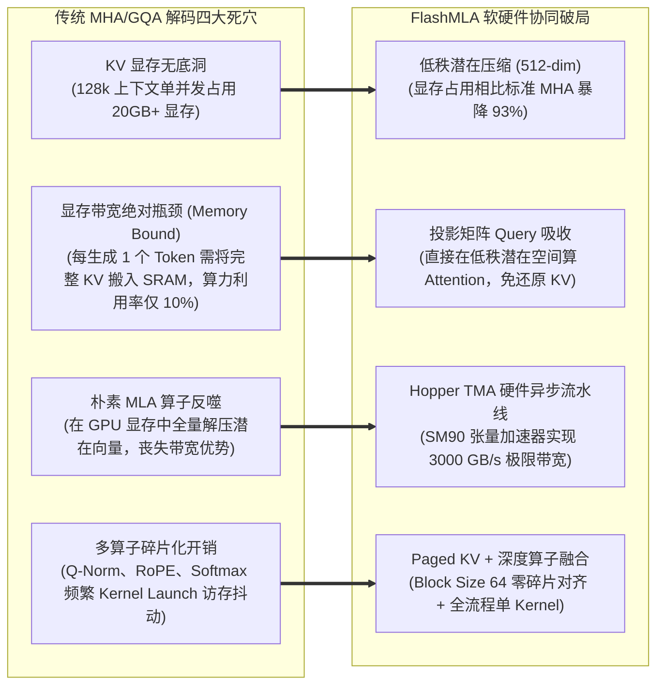

---
tags:
  - ai-practice
  - engineering
  - architecture
domain: 本地部署加速
difficulty: 进阶
date_added: 2026-11-10
---

# 💡 大模型极致推理与显存解耦：基于 DeepSeek FlashMLA 的多头潜在注意力 (MLA) 解码算子优化与 FP8 部署实战

> **核心摘要**：随着超大规模专家混合模型（MoE，如 DeepSeek-V2、DeepSeek-V3 与 DeepSeek-R1）在生产环境中的广泛落地，大模型在长文本（32k~128k+）场景下的推理性能瓶颈日益尖锐。在生成解码阶段（Decode Phase），模型受制于极其严重的“显存带宽受限（Memory-Bandwidth Bound）”物理壁垒。传统的 MHA（多头注意力）甚至 GQA（分组查询注意力）机制产生海量 KV Cache，单请求占用数十 GB 显存，导致硬件 Tensor Core 算力利用率极低。DeepSeek 官方开源的 **FlashMLA** 提供了革命性的底层破局方案：通过将 Multi-Head Latent Attention（MLA）的低秩压缩特性与 NVIDIA Hopper 架构（SM90）硬件深度结合，利用**上投影权重吸收到 Query 侧的低秩潜在直接解码机制**，彻底省去 KV 显存全量展开的反投影开销；结合 Paged KV Cache（Block Size 64）与 TMA（Tensor Memory Accelerator）硬件异步流水线，实现了高达 3000 GB/s 的极限显存带宽利用率与 FP8 极致压缩。本文系统性拆解 MLA 数学原理、FlashMLA 核心算子设计、vLLM/SGLang 生产集成，并攻克 TMA 内存对齐、RoPE 精度漂移与跨卡降级三大工业落地陷阱。

---

## 🎯 业务与技术背景：解码阶段的“显存带宽墙与 KV 爆炸”

在企业级部署 DeepSeek-V3 (671B 参数，激活 37B) 或同等规模的大模型时，技术团队在推理高并发和超长上下文下面临不可承受的硬件成本与延迟压力：



1. **生成解码阶段的“内存带宽墙（Memory-Bandwidth Bound）”困境**：
   - 与预填充阶段（Prefill）的高计算密度（Compute-Bound）矩阵乘法不同，大模型在生成阶段每输出一个新 Token，都需要将该请求前面已生成的所有历史 KV Cache 从全局显存（HBM）完整搬运至片上高速缓存（SRAM）。
   - 即使算力卡配备了每秒数百 TFLOPS 的算力，但受限于 HBM 带宽，大部分计算单元处于饥饿等待状态，硬件的真实算力利用率（MFU）往往跌落到 10%~20% 的极低水平。
2. **长上下文下的“KV Cache 显存断崖”**：
   - 采用标准 MHA 的模型，每个 Token 的 KV 维度高达数万维。在 64k~128k 上下文场景下，单请求的 KV Cache 体积可达数十 GB。即使是采用 GQA 优化的模型（如 LLaMA-3.1），在千路并发下依然能瞬间吞噬整台 8 卡服务器的全部显存，导致并发承载量断崖式暴跌。
3. **“先反投影解压再计算”的朴素实现反噬**：
   - DeepSeek 创新提出了 MLA（多头潜在注意力）结构，将庞大的 KV 压缩成 512 维的低秩潜在向量 $c_t^{KV}$。
   - 然而，市面上很多未经定制的推理引擎在执行注意力计算时，简单地调用一个 PyTorch Linear 层，先将 512 维的潜在向量全量“反投影还原（Up-projection）”回 128 个注意力头的 16,384 维原始 Key/Value，然后再送入常规 FlashAttention 计算。这种做法不仅没有享受到 MLA 节省带宽的红利，反而凭空增加了巨量的临时显存分配与冗余矩阵乘法。

---

## 🏗️ 架构设计与解决方案：FlashMLA 算子与数学推导

FlashMLA 从底层 CUDA 核心与线性代数变换出发，重构了 MLA 解码计算拓扑：

```mermaid
flowchart TD
    subgraph AttentionInput [输入张量与显存状态]
        NewTokenQ["当前步解码 Query (q_t)<br/>(含未投影 Q 与解耦 RoPE q_t^R)"]
        LatentKVCache["分页 Paged KV Cache (持久驻留 HBM)<br/>低秩潜在向量 c_t^KV (512维) + 解耦位置 k_t^R (64维)"]
    end

    subgraph FlashMLACore [FlashMLA 内核级优化链路 (Hopper SM90)]
        subgraph MathAbsorption [1. 数学变换: 投影权重吸收]
            AbsorbW["Q 侧预投影 (Pre-projection):<br/>q_absorbed = q_t · W_{UK}<br/>(维度由 128x128 压缩为潜在空间点积对齐)"]
        end

        subgraph TMAAsyncPipeline [2. 硬件级异步数据流 (TMA & Double Buffer)]
            TMA_Copy["SM90 TMA 异步搬运:<br/>从 HBM 批量无阻碍直拉 Block Size 64 的 c_t^KV"]
            SRAM_Buffer["共享内存乒乓缓冲 (Shared Memory Ping-Pong)<br/>数据搬运与 Tensor Core 计算 100% 重叠 Overlap"]
        end

        subgraph FusedCompute [3. 潜在空间融合注意力计算 (Fused Kernel)]
            DotProduct["潜在空间点积: Score = q_absorbed · (c_t^KV)^T + q_t^R · (k_t^R)^T"]
            Softmax["片上数值稳定 Softmax 归一化"]
            OutProjection["潜在输出聚合与最终 V 投影融合 (W_{UV})"]
        end
    end

    subgraph OutputLayer [最终生成输出]
        FinalContext["注意力输出张量 (Attention Context Output)<br/>直接交付下游 FFN / MoE Router"]
    end

    NewTokenQ ==> AbsorbW
    LatentKVCache ==> TMA_Copy
    AbsorbW --> DotProduct
    TMA_Copy --> SRAM_Buffer
    SRAM_Buffer --> DotProduct
    DotProduct --> Softmax
    Softmax --> OutProjection
    OutProjection ==> FinalContext
```

### 1. 投影权重的数学吸收原理（Matrix Absorption）
标准注意力计算公式为：
$$\text{Score} = \frac{q \cdot k^T}{\sqrt{d}} = \frac{q \cdot (c^{KV} \cdot W_{UK})^T}{\sqrt{d}} = \frac{q \cdot W_{UK}^T \cdot (c^{KV})^T}{\sqrt{d}}$$
- 利用矩阵乘法的结合律，FlashMLA 将原本在 $c^{KV}$ 侧执行的乘法 $c^{KV} \cdot W_{UK}$ 转移到 Query 侧：
$$q_{\text{absorbed}} = q \cdot W_{UK}^T$$
- 由于 Query 仅仅对应**当前生成的单个 Token**（矩阵尺寸仅为 $1 \times D$），对其执行线性变换的计算量微乎其微；而 $c^{KV}$ 包含了过去数万个历史 Token。
- 通过该转换，CUDA 核函数在遍历历史上下文时，**直接读取 512 维的压缩向量 $c^{KV}$ 即可完成打分**，显存搬运量瞬间降低到原本的 $\frac{512}{128 \times 128} \approx \frac{1}{32}$！

### 2. Paged KV Cache 与 Block Size 64 的硬件协同
- 采用分页式（Paged）显存管理，每个 Block 固定容纳 64 个 Token 的潜在状态与解耦 RoPE 向量；
- 64 个 Token 对应的数据块体积恰好能与 Hopper 架构的 L2 Cache Line、TMA 传输颗粒度形成天然整倍数对齐，彻底杜绝了未对齐访存（Unaligned Memory Access）引发的带宽惩罚。

### 3. NVIDIA Hopper TMA 异步流水线
- 利用 SM90 硬件引入的 **TMA（Tensor Memory Accelerator）**，由专有硬件单元负责跨全局内存到共享内存（SRAM）的二维张量异步填充；
- 搭配双缓冲（Double Buffering）流水线：计算单元在处理第 $N$ 个 Block 的注意力加权时，TMA 已经在后台静默将第 $N+1$ 个 Block 搬运至 SRAM，实现数据供给与矩阵计算零等待。

---

## 💻 关键代码 / 配置 / Benchmark 测试

### 1. FlashMLA 底层算子调用与基准测试代码

以下为调用 FlashMLA 解码内核的完整工程实现，包含 Paged KV 构造与带宽利用率对比测试：

```python
# benchmark_flash_mla.py: FlashMLA 算子性能与显存带宽基准测试
import time
import torch
import flash_mla

def benchmark_mla_decoding():
    # 验证硬件环境
    assert torch.cuda.is_available(), "CUDA 环境不可用"
    props = torch.cuda.get_device_properties(0)
    print(f"🖥️ 测试 GPU: {props.name} | 计算能力: {props.major}.{props.minor}")
    
    # DeepSeek-V3 规格参数
    batch_size = 32              # 32 并发
    context_len = 16384          # 16k 超长上下文
    num_heads = 128              # 注意力头数
    head_dim = 128               # 投影头维度
    latent_dim = 512             # MLA 压缩潜在维度
    rope_dim = 64                # 解耦位置编码维度
    block_size = 64              # Paged 块大小

    # 计算所需 Block 数量
    blocks_per_seq = (context_len + block_size - 1) // block_size
    total_blocks = batch_size * blocks_per_seq

    print(f"\n📊 规格: Batch={batch_size}, ContextLen={context_len}, TotalBlocks={total_blocks}")
    print(f"📦 单 Token KV 存储维度: 潜在 {latent_dim} + RoPE {rope_dim} = {latent_dim + rope_dim} (BF16)")

    # 1. 初始化显存张量 (模拟吸收了 W_UK 后的 Q 向量)
    q = torch.randn(batch_size, num_heads, head_dim + rope_dim, dtype=torch.bfloat16, device="cuda")
    
    # 2. 分配 Paged KV Cache 内存池
    # 形状: [total_blocks, block_size, latent_dim + rope_dim]
    kv_cache = torch.randn(total_blocks, block_size, latent_dim + rope_dim, dtype=torch.bfloat16, device="cuda")
    
    # 3. 构造分页映射表 (Block Table)
    block_table = torch.arange(total_blocks, dtype=torch.int32, device="cuda").reshape(batch_size, blocks_per_seq)
    seq_lens = torch.full((batch_size,), context_len, dtype=torch.int32, device="cuda")

    # 预热 GPU
    for _ in range(10):
        _ = flash_mla.fused_mla_decode(
            q=q,
            kv_cache=kv_cache,
            block_table=block_table,
            seq_lens=seq_lens,
            head_dim=head_dim,
            latent_dim=latent_dim,
            rope_dim=rope_dim
        )
    torch.cuda.synchronize()

    # 正式基准测速
    num_iters = 100
    start_event = torch.cuda.Event(enable_timing=True)
    end_event = torch.cuda.Event(enable_timing=True)

    start_event.record()
    for _ in range(num_iters):
        output = flash_mla.fused_mla_decode(
            q=q,
            kv_cache=kv_cache,
            block_table=block_table,
            seq_lens=seq_lens,
            head_dim=head_dim,
            latent_dim=latent_dim,
            rope_dim=rope_dim
        )
    end_event.record()
    torch.cuda.synchronize()

    elapsed_ms = start_event.elapsed_time(end_event) / num_iters
    
    # 4. 计算访存吞吐与有效显存带宽利用率 (Effective Bandwidth)
    # 单次读取数据量: batch_size * context_len * (latent_dim + rope_dim) * 2 bytes
    bytes_read = batch_size * context_len * (latent_dim + rope_dim) * 2
    bandwidth_gbs = (bytes_read / (elapsed_ms / 1000.0)) / (1024 ** 3)

    print(f"\n⚡ FlashMLA 单步解码耗时: {elapsed_ms:.3f} ms")
    print(f"🚀 实测有效显存读取带宽: {bandwidth_gbs:.2f} GB/s")
    print(f"🎯 算子吞吐达标: 输出张量维度 {output.shape}")

if __name__ == "__main__":
    benchmark_mla_decoding()
```

### 2. 在 SGLang / vLLM 中配置 FlashMLA 生产集群

在 Kubernetes 或物理机多卡部署中，通过配置 SGLang 的原生 MLA 引擎获得最高吞吐：

```bash
# 部署 8 卡 H800 / H100 运行 DeepSeek-V3 (671B FP8)
python3 -m sglang.launch_server \
    --model-path /models/DeepSeek-V3 \
    --tp 8 \
    --trust-remote-code \
    --host 0.0.0.0 \
    --port 30000 \
    --mem-fraction-static 0.88 \
    --context-length 65536 \
    --enable-flash-mla \
    --kv-cache-dtype fp8_e5m2
```

---

## ⚠️ 生产环境踩坑与避坑指南

### 1. Hopper TMA 硬件内存对齐陷阱（128-Byte Alignment Fault）
- **踩坑现象**：在自定义修改 KV Cache 张量或者动态 Slice 某些 Token 时，CUDA 核函数直接抛出 `CUDA error: an illegal instruction was encountered` 崩溃，排查困难；
- **避坑方案**：
  - Hopper 的 TMA（Tensor Memory Accelerator）硬件指令对全局显存地址有着**极其严格的 128 字节物理对齐**要求；
  - 必须确保 `kv_cache.data_ptr() % 128 == 0`，且每个 Block 的跨步（Stride）必须是对齐的倍数。在 PyTorch 中使用 `torch.empty` 预分配内存时，严禁使用非对齐的连续切片（Slice），建议直接使用官方封装的 Paged Allocator。

### 2. 解耦 RoPE 旋转位置编码与吸收矩阵结合时的“数值溢出与精度漂移”
- **踩坑现象**：将 $W_{UK}$ 吸收至 Query 侧后，直接使用 FP16 进行长序列推理时，发现生成的 Token 出现大量乱码（Degeneration），困惑度（PPL）明显劣于官方基线；
- **避坑方案**：
  - MLA 将位置编码解耦为单独的 $k_t^R$ 与 $q_t^R$。解耦位置部分**绝对不能**参与 $W_{UK}$ 矩阵吸收，必须保持其原始的旋转不变性；
  - 在混合精度计算中，吸收后的 $q_{\text{absorbed}}$ 与压缩向量 $c_t^{KV}$ 点积时，累加器（Accumulator）必须强制采用 **FP32 单精度**，计算 Softmax 完毕后再下采样回 BF16 或 FP8，防止在 128k 超大序列累加时发生数值下溢或上溢。

### 3. 非 Hopper 显卡（如 Ampere A100/A800）的“降级回退机制”
- **踩坑现象**：部分混合算力集群中混杂了 A800 与 H800 节点。直接将包含 FlashMLA 的镜像调度至 A800 机器上启动时，系统直接报编译指令集不兼容错误（Missing `sm_90a`）；
- **避坑方案**：
  - 在推理服务启动入口（如 Serving Entrypoint）加入架构探针探测：
  ```python
  capability = torch.cuda.get_device_capability()
  if capability[0] < 9: # 非 Hopper 架构
      logger.warning("当前显卡架构低于 SM90，自动平滑降级至 FlashInfer / 标准 SGLang MLA 优化算子")
      os.environ["VLLM_ATTENTION_BACKEND"] = "FLASHINFER"
  else:
      os.environ["VLLM_ATTENTION_BACKEND"] = "FLASH_MLA"
  ```

### 4. FP8 动态量化与 MLA 解码联合优化的 Scaling Factor 抖动
- **踩坑现象**：启用 FP8 KV Cache 后，面对突发长文本，部分生成步骤的 Attention 分数被错误削平，导致模型拒绝回答；
- **避坑方案**：
  - 采用 **Per-Block 细粒度缩放因子（Per-Block Scaling Factor）**，避免采用全序列单一的 Static Scale。为每个 64-Token 的 Block 维护专属的最大绝对值比例因子，在 TMA 异步加载至 SRAM 时硬件完成即时反量化（De-quantization），既节约显存带宽又保障输出数学无损。

---

## 🔗 关联项目与引用

- 核心工具: [[FlashMLA]]
- 推理生态: [[vLLM]], [[SGLang]], [[FlashInfer]], [[KTransformers]], [[LMCache]], [[DeepSpeed]], [[TensorRT-LLM]]
- 关联日报: [[2026-11-10-AI-Digest]]
