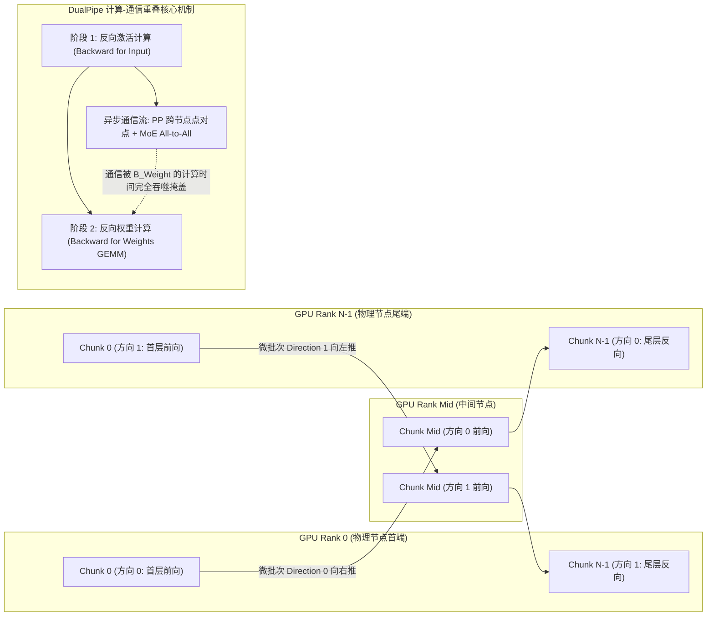

---
tags:
  - ai-practice
  - engineering
  - architecture
domain: "本地部署加速"
difficulty: "进阶"
date_added: 2026-11-20
---

# 💡 大模型极致训练与重叠并行架构：基于 DeepSeek DualPipe 的双向流水线调度、计算通信掩盖与零气泡实战

> **核心摘要**：针对万亿参数大模型（如 MoE 架构）分布式预训练中流水线气泡停顿（Pipeline Bubbles）严重与跨节点通信阻塞（All-to-All & P2P）拉低集群 MFU 的核心瓶颈，基于 DeepSeek 创新开源的 DualPipe 算法，通过双向微批次对向交错编排、反向传播两阶段细粒度解耦（B_input 与 B_weight）以及 WeightGradStore 显存精细治理，实现计算与通信的近乎 100% 物理重叠与流水线气泡极限消除。

---

## 🎯 业务/技术背景与痛点

在当今千亿乃至万亿参数混合专家模型（MoE，如 DeepSeek-V3 / R1 的 671B 参数）的万卡训练集群中，传统分布式并行拓扑（TP 张量并行 + PP 流水线并行 + EP 专家并行 + DP 数据并行）面临极其严峻的“通信墙”与“气泡墙”制约：

1. **传统流水线并行的固有“气泡停顿”硬伤**：
   - 无论是传统的 **GPipe** 还是工业界常用的 **1F1B (One-Forward-One-Backward)**，微批次均沿单一固定方向流动（从输入层所在的 Rank 0 顺序传递至最终损失层所在的 Rank N-1）。
   - 在训练开始的“起步热身阶段（Warm-up）”和批次结束的“排空阶段（Cool-down）”，大量 GPU 处于空转死等状态。对于拥有数十个流水线阶段（Pipeline Stages）的模型，流水线气泡开销（Bubble Ratio）常常占据整个训练轮次的 **15% ~ 25%**。
2. **MoE 专家并行 All-to-All 通信与 PP 跨节点 P2P 通信的双重压榨**：
   - MoE 架构引入了高密度的 Token 跨卡路由分发，每个 Transformer 层的专家分发（Dispatch）与聚合（Combine）都需要进行全卡级别的 All-to-All 集合通信；
   - 与此同时，流水线跨机器传递隐藏层激活张量（P2P 通信）也极具延迟。如果不能将这些耗时的网络传输完全掩盖在 GPU 张量核心（Tensor Core）高负荷矩阵乘法（GEMM）运算之下，GPU 计算单元将频繁陷入阻塞等待，使得集群的算力利用率（MFU）难以为继。
3. **Interleaved 1F1B（虚拟阶段）的显存膨胀代价**：
   - 社区曾提出 Interleaved 1F1B（每个物理 GPU 承载多个虚拟流水线阶段）来缩减气泡，但这种方案使得每个 GPU 必须长期缓存更多微批次的中间激活值（Activation Memory），导致显存急剧膨胀，容易引发 OOM，严重制约了 Batch Size 与长序列训练。

---

## 🏗️ 架构设计与解决方案

DeepSeek 团队在 DeepSeek-V3/R1 训练中首创并开源的 **DualPipe** 彻底颠覆了传统的单向流水线思维。它通过**双向微批次对向流动**与**反向传播计算阶段细粒度解耦**，构建了计算-通信全重叠的极致流水线：



### 核心解耦与重叠机理详解：

1. **双向对称微批次流动（Bidirectional Flow）**：
   - 将训练数据分为两个对等的数据流：**Direction 0（从物理节点首到尾）** 与 **Direction 1（从物理节点尾到首）**。
   - 每个物理 GPU 同时负责前半段模型的某一层和后半段模型的某一层（虚拟 Chunk 0 与 Chunk 1）。
   - 这种对称性使得集群两端的节点在微批次起步与排空时能够“互为填充”，首端 GPU 在等待 Direction 0 反向的同时，正全速执行 Direction 1 的前向与反向，直接将理论气泡比率降为传统 1F1B 的一半。

2. **反向计算两阶段精细切分 (Decoupling B_input & B_weight)**：
   - 传统 PyTorch `autograd` 在执行反向时，会将计算输入激活的梯度 $\nabla X$（用于反传给前一层）与计算模型权重的梯度 $\nabla W$（用于更新自身参数）绑定在一起执行。
   - DualPipe 将反向彻底切开：
     - **第一阶段：Backward for Input ($B_{input}$)**：以最短时间算出上游层所需的激活梯度，立即通过非阻塞 CUDA Stream 发起跨节点 P2P / All-to-All 传输；
     - **第二阶段：Backward for Weights ($B_{weight}$)**：在通信在后台硬件网卡传输的同时，GPU 张量核心专注执行计算密集型的权重矩阵乘法。由于 $B_{weight}$ 耗时通常大于通信时间，通信延迟被 100% 隐藏！

3. **WeightGradStore 显存精细隔离**：
   - 解耦反向传播后，激活梯度的生命周期与权重梯度累加时机发生分离。
   - DualPipe 设计了专用轻量容器 `WeightGradStore`，显式追踪张量引用计数并在完成 GEMM 后第一时间释放临时显存，防止显存峰值超出硬件容量。

---

## 💻 关键代码 / 配置 / Prompt 模板

### 1. Transformer 模块的反向阶段显式解耦封装

```python
# dualpipe_layer.py
import torch
import torch.nn as nn
from typing import Tuple

class DecoupledTransformerLayer(nn.Module):
    """
    符合 DualPipe 规范的解耦 Transformer 层：
    显式分离前向、反向激活梯度计算与反向权重梯度计算
    """
    def __init__(self, d_model: int, n_heads: int):
        super().__init__()
        self.d_model = d_model
        self.weight_qkv = nn.Parameter(torch.randn(d_model, 3 * d_model))
        self.weight_proj = nn.Parameter(torch.randn(d_model, d_model))
        
    def forward_chunk(self, x: torch.Tensor) -> Tuple[torch.Tensor, dict]:
        # 保存用于反向计算的中间激活上下文 context
        ctx = {"saved_input": x}
        # 简化版矩阵前向投影
        out = torch.matmul(x, self.weight_qkv)
        ctx["hidden_qkv"] = out
        final_out = torch.matmul(out[:, :, :self.d_model], self.weight_proj)
        return final_out, ctx

    def backward_input_chunk(self, grad_output: torch.Tensor, ctx: dict) -> Tuple[torch.Tensor, dict]:
        """
        第一阶段反向：仅计算传递给上一层的激活梯度 grad_input
        计算速度极快，完成后立刻发射通信
        """
        hidden_qkv = ctx["hidden_qkv"]
        # d(Loss)/d(hidden)
        grad_hidden = torch.matmul(grad_output, self.weight_proj.t())
        # d(Loss)/d(input)
        grad_input = torch.matmul(grad_hidden, self.weight_qkv[:, :self.d_model].t())
        
        # 缓存 grad_output 与 saved_input 留给阶段二计算权重梯度
        ctx["grad_output"] = grad_output
        ctx["grad_hidden"] = grad_hidden
        return grad_input, ctx

    def backward_weight_chunk(self, ctx: dict, weight_grad_store):
        """
        第二阶段反向：密集张量计算权重矩阵梯度，此阶段与跨机通信完全重叠
        """
        x = ctx["saved_input"]
        grad_hidden = ctx["grad_hidden"]
        grad_output = ctx["grad_output"]
        
        # 密集 GEMM 计算
        grad_w_proj = torch.einsum('bth,btk->hk', hidden_qkv[:, :, :self.d_model], grad_output)
        grad_w_qkv = torch.einsum('bth,btk->hk', x, grad_hidden)
        
        # 交付给 WeightGradStore 异步累加
        weight_grad_store.accumulate(self.weight_proj, grad_w_proj)
        weight_grad_store.accumulate(self.weight_qkv, grad_w_qkv)
        
        # 彻底释放缓存张量，归还显存
        del ctx["saved_input"], ctx["grad_output"], ctx["grad_hidden"], ctx["hidden_qkv"]
```

### 2. DualPipe 双向调度引擎编排与执行

```python
# train_dualpipe_cluster.py
import torch
import torch.distributed as dist
from dualpipe import DualPipe, WeightGradStore
from dualpipe_layer import DecoupledTransformerLayer

def run_dualpipe_training(rank: int, world_size: int):
    device = torch.device(f"cuda:{rank}")
    torch.cuda.set_device(device)
    
    # 1. 初始化每个物理 GPU 承载的两个对称方向 Chunk
    # Rank 0 承载 Direction 0 的第 0 块与 Direction 1 的最后一块
    chunk_dir0 = DecoupledTransformerLayer(d_model=8192, n_heads=64).to(device)
    chunk_dir1 = DecoupledTransformerLayer(d_model=8192, n_heads=64).to(device)
    
    # 2. 初始化权重梯度专用显存管理器
    weight_store = WeightGradStore()
    
    # 3. 构建 DualPipe 双向调度器
    # 自动创建通信 Stream、计算 Stream 与内存隔离栅栏
    pipeline_engine = DualPipe(
        modules=[chunk_dir0, chunk_dir1],
        weight_grad_store=weight_store,
        num_chunks=2,
        num_microbatches=32, # 微批次深度
        comm_backend="nccl",
        device=device
    )
    
    # 4. 模拟双向微批次输入数据流
    # microbatches_dir0 从 Rank 0 开始流向尾端
    # microbatches_dir1 从 Rank N-1 开始流向首端
    data_dir0 = [torch.randn(4, 2048, 8192, device=device) for _ in range(32)]
    data_dir1 = [torch.randn(4, 2048, 8192, device=device) for _ in range(32)]
    
    # 5. 执行单步训练循环（底层自动交错调度双向微批次）
    pipeline_engine.step(microbatches_0=data_dir0, microbatches_1=data_dir1)
    
    # 6. 将所有暂存的权重梯度同步并提交给 PyTorch 优化器
    weight_store.commit_all_gradients()
    
    # 优化器步进与梯度清零
    optimizer.step()
    optimizer.zero_grad(set_to_none=True)
    weight_store.reset()
```

---

## ⚠️ 生产环境踩坑与避坑指南

1. **坑点 1：CUDA Stream 同步不当导致的静默死锁与数据竞争**：
   - *现象*：DualPipe 在底层使用了计算流（Compute Stream）与点对点通信流（Comm Stream）并发执行。如果跨流同步依赖（`cudaStreamWaitEvent`）编写存在隐式环路，或者某一个 GPU Rank 上的通信事件未及时触发，整个千卡集群会无报错地永久卡死（GPU 利用率瞬间跌零）。
   - *避坑方案*：**严禁在算子内部手动插入 `torch.cuda.synchronize()` 全局阻断指令**。严格依赖 DualPipe 原生的调度图状态机，在每次微批次发射前通过专用的 CUDA Event 记录细粒度栅栏，确保仅有数据依赖的张量之间建立 Stream 等待关系。

2. **坑点 2：双向数据流微批次尺寸不对齐引发的气泡反噬**：
   - *现象*：Direction 0 与 Direction 1 的微批次大小（Sequence Length 或 Batch Size）若存在微小偏差，会导致两端前向和反向的耗时不均衡。原本用于掩盖通信的 $B_{weight}$ 计算一旦过早结束，通信暴露，气泡率不仅没有下降，反而因等待调度而加剧。
   - *避坑方案*：**实施严格的双向数据分发配准（Data Slicing Alignment）**。确保 Direction 0 与 Direction 1 的 Micro-batch 包含等长 Token 数量；在处理变长序列长文本时，必须预先在 Data Loader 阶段完成 Pack Sequence 填充对齐。

3. **坑点 3：WeightGradStore 显存未及时释放引发的 OOM 崩溃**：
   - *现象*：为了重叠通信，中间层激活值需要跨越更长的时间窗口才能被反向权重计算消耗。若微批次数量（`num_microbatches`）设置过大，滞留在 GPU 显存中的中间张量将线性叠加，触发显存爆仓。
   - *避坑方案*：**结合激活重计算（Activation Checkpointing）与微批次自适应动态规划**。对于非常深的 MoE 层，在 Chunk 内部启用选择性重计算（Selective Recomputation），并将 `num_microbatches` 保持在流水线阶段数（PP Stages）的 2 到 4 倍之间，达到 MFU 增益与显存开销的最佳平衡。

---

## 🔗 关联项目与引用
- 核心算法: [[DualPipe]]
- 协同加速基础设施: [[DeepEP]], [[DeepGEMM]], [[3FS]], [[FlashMLA]], [[DeepSpeed]]
- 官方技术论文与参考: DeepSeek-V3 Technical Report 及 [https://github.com/deepseek-ai/DualPipe](https://github.com/deepseek-ai/DualPipe)