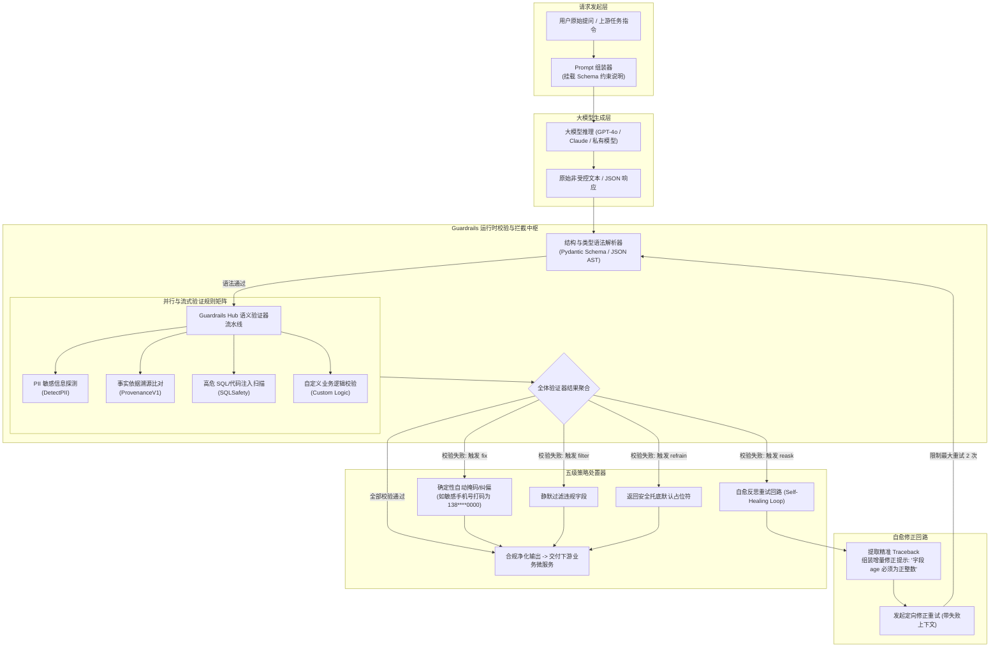

---
tags:
  - ai-practice
  - engineering
  - architecture
domain: Prompt工程
difficulty: 进阶
date_added: 2026-10-20
---

# 💡 大模型端到端输出安全防护：基于 Guardrails 的规范化校验与自愈重试实战

> **核心摘要**：大模型生成内容的不可预测性与概率漂移是阻碍企业将其接入关键业务链路的核心阻力。结构残缺的 JSON 会直接拖垮下游微服务，敏感隐私（PII）泄露会引发法律合规灾难，而幻觉生成更会使决策系统产生重大偏差。本文深入剖析基于 **Guardrails** 的**“声明式数据契约 + 语义安全守卫 + 自愈反思重试回路（Self-Healing Loop）”**端到端工程实践，系统详解 Guardrails Hub 验证器链编排、五级失败处置机制（reask/fix/filter/refrain）以及高吞吐并发校验的最佳落地范式。

---

## 🎯 业务/技术背景与痛点

在金融理赔审核、智能医疗问诊、政企私域客服与自动化 SQL/代码生成等严肃业务场景中，大模型必须直接作为结构化数据的生产者或作为面向终端用户的权威解答者。然而，纯概率推理模型在实际运行中频繁暴露致命缺陷：

```
[企业大模型生产落地痛点]
1. 结构化格式脆弱：即使在 Prompt 中反复强调返回合规 JSON，LLM 仍可能返回 Markdown 标记包裹、字段漏标、数值超出边界或枚举值拼写错误，导致下游序列化器直接抛出 Unmarshal 异常；
2. 敏感数据（PII）与企业机密泄露：模型在总结文本时可能无意中将客户真实电话、身份证号、银行卡号或内部接口秘钥直接暴露给前端用户；
3. 事实幻觉（Hallucination）难以感知：大模型生成的分析报告语言极具说服力，但推导依据完全脱离了企业检索提供的知识库上下文；
4. 传统重试机制代价高昂且低效：出现解析失败时，传统开发方案往往是“盲目全量重新请求一次”，模型不仅大概率复现同类错误，更造成翻倍的 Token 开销与延迟。
```

### 生产优化核心目标：
1. **零崩溃数据交付**：确保进入下游 RPC/HTTP 微服务的数据 100% 符合强类型规范；
2. **多层安全防线拦截**：在输出端实时侦测脱敏 PII、过滤毒性言论并拦截破坏性指令；
3. **闭环自愈修正（Self-Healing）**：失败时精准将“字段名、校验失败报错日志”作为增量上下文提示模型，以最小 Token 开销达成一次性自纠偏；
4. **灵活策略降级**：支持就地修复（fix）、静默裁剪（filter）或安全弃权（refrain），保障系统总体服务可用性。

---

## 🏗️ 架构设计与解决方案

为在企业应用中构建坚不可摧的输出安全防护墙，我们采用 **Guardrails** 设计了如下的分层拦截与自愈闭环流水线：



### 关键架构机制说明：
1. **分级校验流水线**：第一阶段进行纯代码级别的确定性结构校验（无模型开销，纳秒级阻断错误 JSON）；第二阶段并行触发轻量级本地或小模型验证器（如 PII 正则、毒性分类模型）；第三阶段按需执行高维向量语义比对（防幻觉溯源）；
2. **增量自愈协议（Reask Protocol）**：当字段触发 `reask` 时，Guardrails 不会重新发送整个冗长的对话历史，而是仅打包 `{字段: 报错原因, 原生成内容: xxx}` 作为纠错补丁发送，模型针对性修复该字段，大幅节约算力；
3. **生产级 OpenTelemetry 观测**：全流程暴露打点指标，包括校验耗时、各验证器失败率（Fail Ratio）、Reask 触发频次与 Token 修正效率。

---

## 💻 关键代码 / 配置 / Prompt 模板

以下为生产级落地的端到端智能审批单抽取与内容合规守卫脚本：

```python
import os
import re
from typing import List, Optional
from pydantic import BaseModel, Field
from guardrails import Guard
from guardrails.validators import (
    Validator,
    register_validator,
    ValidationResult,
    PassResult,
    FailResult
)
from guardrails.hub import DetectPII, ProvenanceV1

# 1. 自定义业务领域验证器：校验审批金额与申请理由的逻辑自洽性
@register_validator(name="corporate_expense_validator", data_type="float")
class CorporateExpenseValidator(Validator):
    """
    企业财务报销合规校验器：
    - 单笔金额大于 50,000 元必须在备注中明确注明‘经过 VP 预审批’，否则触发自愈重问
    """
    def __init__(self, max_unapproved_limit: float = 50000.0, on_fail: str = "reask"):
        super().__init__(on_fail=on_fail, max_unapproved_limit=max_unapproved_limit)
        self.max_unapproved_limit = max_unapproved_limit

    def validate(self, value: float, metadata: dict) -> ValidationResult:
        reason = metadata.get("expense_reason", "")
        if value > self.max_unapproved_limit:
            if "经过 VP 预审批" not in reason and "VP approved" not in reason:
                return FailResult(
                    error_message=f"金额 {value} 元超过未预审额度上限 ({self.max_unapproved_limit}元)。"
                                  f"如果确实超过上限，必须在 expense_reason 中明确注明经过 VP 预审批，并附带审批编号。"
                )
        return PassResult()


# 2. 声明强类型合规契约模型 (Pydantic Schema)
class ExpenseReimbursementItem(BaseModel):
    item_name: str = Field(description="费用项名称，例如：差旅机票、客户招待餐饮")
    amount: float = Field(
        description="报销金额（人民币）",
        validators=[CorporateExpenseValidator(max_unapproved_limit=50000.0, on_fail="reask")]
    )
    category: str = Field(description="费用类别：Travel, Entertainment, Equipment, Other")


class AuditApprovalDocument(BaseModel):
    applicant_name: str = Field(description="申请人姓名")
    department: str = Field(description="所属部门")
    
    # 挂载 PII 敏感信息脱敏：自动将身份证号、私人手机、个人邮箱进行掩码处理
    contact_info: str = Field(
        description="联系方式及个人身份信息",
        validators=[
            DetectPII(
                pii_entities=["PHONE_NUMBER", "EMAIL_ADDRESS", "US_SSN"],
                on_fail="fix" # 自动替换为 <REDACTED>
            )
        ]
    )
    
    expense_reason: str = Field(description="报销申请原因与背景说明")
    
    items: List[ExpenseReimbursementItem] = Field(description="报销明细清单")
    
    # 挂载真实性溯源：确保总金额与关键事实严格基于提供的原始票据上下文，杜绝伪造
    audit_verdict: str = Field(
        description="合规审核初审结论与风险提示",
        validators=[
            ProvenanceV1(
                threshold=0.80,
                validation_method="sentence",
                on_fail="reask"
            )
        ]
    )


# 3. 实例化 Guard 保护器
expense_guard = Guard.from_pydantic(output_class=AuditApprovalDocument)

# 4. 执行受守卫保护的安全推理与自愈重试流水线
def process_reimbursement_ticket(ticket_raw_context: str):
    """
    生产级调用入口：自动处理模型输出、触发安全验证器管道、如遇格式或规则错误自动反思重试
    """
    system_prompt = (
        "你是一个严格的企业财务合规审计专家。请依据输入的原始报销审批工单内容，"
        "精准抽取出符合 JSON Schema 规范的审批数据。"
    )

    try:
        # 执行 Guard 包装的调用
        execution_result = expense_guard(
            model="gpt-4o",
            messages=[
                {"role": "system", "content": system_prompt},
                {"role": "user", "content": f"【原始报销工单资料】：\n{ticket_raw_context}"}
            ],
            # 将原始资料作为 metadata 传入供 Provenance 溯源验证器比对
            metadata={
                "passages": [ticket_raw_context],
                "expense_reason": ticket_raw_context # 供自定义验证器取用
            },
            temperature=0.1,
            max_tokens=2048,
            num_reasks=2 # 允许最大自愈重试 2 次
        )

        print("\n✅ 数据通过全部 Guardrails 安全审计与规范校验！")
        print("执行历史轮次:", len(execution_result.history))
        print("最终合规交付数据:")
        import json
        print(json.dumps(execution_result.validated_output, ensure_ascii=False, indent=2))
        return execution_result.validated_output

    except Exception as e:
        print(f"\n❌ 严重告警：超过最大自愈重试次数或触发不可恢复熔断异常: {str(e)}")
        # 生产中接入报警群与兜底人工审核工单流水
        raise

if __name__ == "__main__":
    # 模拟一份包含敏感隐私且金额巨大的输入工单（用于测试 PII 自动脱敏与自愈逻辑）
    mock_ticket = """
    【报销申请单 #EXP-20261020-889】
    申请人：李华
    部门：基础架构与 AI 研发中心
    联系方式：私人手机 13912345678，个人备份邮箱 lihua_backup@gmail.com。
    申请事由：采购紧急备用服务器及 GPU 算力集群调度网卡。该款项因采购紧急，已在事前由李华当面汇报并经过 VP 预审批（审批编号：VP-PRE-2026-901）。
    明细清单：
    1. 800G InfiniBand 专有交换机光模块及配套线缆：金额 85,000 元。类别：Equipment。
    初审结论：票据齐全，属于重点基础设施加急支出，且已核实具备合规预审流程。
    """

    process_reimbursement_ticket(mock_ticket)
```

---

## ⚠️ 生产环境踩坑与避坑指南

### 1. Reask 自愈死循环引发延迟爆炸与成本雪崩
- **现象**：当验证器报错信息过于抽象（例如仅抛出 `Failed validation` 而未明确预期格式），大模型在 Reask 过程中继续随机尝试，导致达到 `num_reasks` 上限后仍然失败，且单次用户请求耗时飙升至十几秒；
- **避坑方案**：
  - 在编写自定义 Validator 或重写错误提示时，**必须提供确切的“正例示范（Few-shot fix example）”**，明确告诉模型期望的格式（如 `Expected format: YYYY-MM-DD, received: 2026/10/20`）；
  - 生产网关必须硬性限制 `num_reasks <= 2`，超过后降级为 `on_fail="refrain"` 或转入人工审核流。

### 2. 语义模型验证器（如 Provenance / Toxic）带来过高延迟
- **现象**：如果对生成的每一个句子都调用远程的大模型或沉重的 Cross-Encoder 进行事实查验，单次推理校验延迟增加 1~3 秒；
- **避坑方案**：
  - 实施**冷热分级验证（Tiered Validation）**：基础格式、枚举范围、数值边界与 PII 正则探测采用纳秒级纯 Python 规则在本地执行；
  - 语义溯源类复杂验证器通过本地量化轻量模型（如 0.5B Embedding/Rerank 模型）进行异步或并行校验；
  - 善用 Guardrails 的元数据缓存（Cache Validation），对高频命中短语直接跳过语义比对。

### 3. PII 脱敏过于激进导致业务上下文丢失
- **现象**：通用 PII 检测器将产品序列号、工单批次号误判为银行卡号或身份证并强制替换为 `<REDACTED>`，破坏了下游业务流转；
- **避坑方案**：
  - 明确配置 `pii_entities` 白名单，不要无脑开启全量探测；
  - 针对企业专有格式（如工单号 `EXP-xxxx`），编写显式正则先将其排除在 PII 探测范围之外。

---

## 🔗 关联项目与引用
- 核心框架: [[Guardrails]]
- 关联项目: [[Instructor]], [[Outlines]], [[NeMo-Guardrails]], [[Promptfoo]], [[DeepEval]]
- 关联日报: [[2026-10-20-AI-Digest]]
