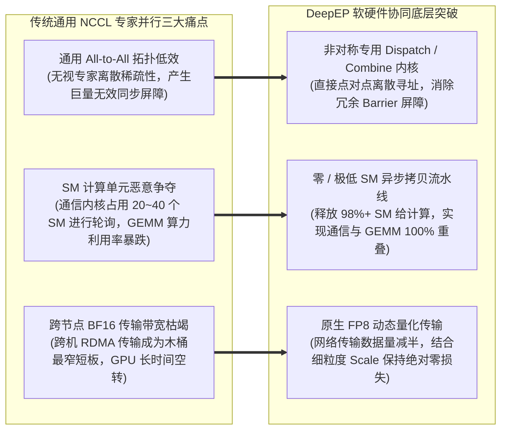

---
tags:
  - ai-practice
  - engineering
  - architecture
domain: 本地部署加速
difficulty: 进阶
date_added: 2026-11-13
---

# 💡 大规模 MoE 专家并行通信与推理加速：基于 DeepSeek DeepEP 的 All-to-All 通信优化、FP8 Dispatch 与零 SM 负载实战

> **核心摘要**：在万亿参数混合专家大模型（MoE，如 DeepSeek-V3 671B、DeepSeek-R1 与万亿级 MoE 集群）走向规模化生产落地的过程中，分布式系统面临着从“单机算力受限”向“跨节点通信墙与资源争抢”转移的根本性瓶颈。在专家并行（Expert Parallelism, EP）模式下，每个 Token 需根据动态门控路由分发至特定 GPU 节点上的专家网络，产生极高频、离散且非对称的 All-to-All 跨机网络通信。传统的通用 NCCL 通信原语不仅吞吐受限，更会暴力占用大量流式多处理器（SM），导致与 FFN 矩阵乘法（GEMM）计算产生恶性冲突。DeepSeek 官方开源的 **DeepEP** 提供了工业级的底层破局范式：通过**非对称的 Dispatch 与 Combine 专用通信内核、原生 FP8 低精度传输与细粒度动态缩放、分层 NVLink-RDMA 拓扑协同**，以及利用硬件异步拷贝引擎实现的**低/零 SM 占用纯异步通信重叠（Overlap）**，使 MoE 跨机 All-to-All 延迟暴降 40%~60%，真正实现了算力与网络带宽的物理极限榨取。本文全面拆解 MoE 专家并行通信痛点、DeepEP 软硬件协同架构、生产级集成流水线，并深入攻克跨 NUMA 亲和性失步、RDMA 网卡拓扑错位与动态路由 Buffer 溢出三大工程陷阱。

---

## 🎯 业务与技术背景：MoE 专家并行的“全互联通信墙与 SM 资源争抢”

在训练或部署超大规模 MoE 模型（以 DeepSeek-V3 为例：总参数 671B，激活 37B，256 个路由专家 + 1 个共享专家，每步激活 Top-8 专家）时，业界通常采用多维混合并行策略：张量并行（TP）结合专家并行（EP，如 EP=64 或 EP=256）。然而，随着 EP 规模的扩大，系统瓶颈急剧暴露：



1. **“全对全（All-to-All）”网络流量风暴与非对称路由**：
   - 在稠密模型中，通信主要是规范整齐的 All-Reduce 或 All-Gather；但在 MoE 专家并行中，序列中的每个 Token 被独立路由到分布式集群中的不同专家。每个 GPU 既要将本地生成的局部 Token 分发给其他数十台宿主机上的专家（Dispatch 阶段），又要在计算完成后将专家的输出无缝聚合并还原回原始序列（Combine 阶段）。
   - 传统采用标准 `torch.distributed.all_to_all` 的方案强行要求输入输出数据规整，不仅产生海量的补零（Padding）开销，更因全局阻塞式屏障（Barrier）导致任何单张网卡的微小抖动都会放大为全集群的停顿（Straggler Effect）。
2. **SM（流式多处理器）资源争抢导致 GEMM 算力崩塌**：
   - 现代 GPU（如 H100/H800/A100）拥有 100~132 个 SM。为了驱动高吞吐的网络通信，传统 NCCL 通信 Kernel 通常会占用 16 到 32 个甚至更多的 SM 来维持网络队列推送、包头封装与内存轮询。
   - 这意味着，当底层框架试图让“通信”与“专家 FFN 的 GEMM 矩阵计算”并发执行时，GEMM 能调用的 SM 数量瞬间被削减了 20%~30%，导致矩阵乘法严重降速，所谓的“计算-通信重叠”往往演变为“负优化”。
3. **节点内 NVLink 与跨节点 RDMA 的带宽断崖**：
   - 单机 8 卡内部的 NVLink 互联带宽高达 900 GB/s ~ 3.2 TB/s，而跨节点 InfiniBand/RoCE 网卡带宽通常仅为 400 Gbps（约 50 GB/s）。如果通信库缺乏分层感知能力，直接将所有跨卡请求扁平化对待，会导致跨机慢链路迅速阻塞节点内快链路，全集群吞吐被最低网络规格彻底锁死。

---

## 🏗️ 架构设计与解决方案：DeepEP 软硬件协同优化架构

DeepEP 针对 MoE 的非对称稀疏通信特性，在 CUDA 驱动层与 NCCL 之上重塑了通信流水线：

```mermaid
flowchart TD
    subgraph HostRouting [前置路由决策与准备]
        TokensInput["输入 Token 序列 (Tokens × Hidden Dim)"]
        MoERouter["门控路由器计算 Top-K 目标专家 ID 及权重"]
        SortAndIndex["局部 Token 重排与目标 Rank 映射分组"]
        TokensInput ==> MoERouter ==> SortAndIndex
    end

    subgraph DeepEPCorePipeline [DeepEP 核心异步双轨流水线]
        subgraph QuantAndBuffer [1. 内存与量化预处理]
            FP8Cast["FP8 E4M3 动态缩放量化 (Per-Token Max-Abs Scale)"]
            StaticEPBuffer["固定显存池 EPBuffer (避免运行期 cudaMalloc)"]
        end

        subgraph LowSMDispatch [2. 极低 SM 占用 All-to-All Dispatch 引擎]
            IntraNVLQueue["节点内通信: NVLink Direct P2P 共享内存直写"]
            InterRDMAQueue["节点间通信: 硬件 DMA / RoCE 零拷贝网络传输"]
            SMGovernor["SM 占用节流阀 (锁定仅使用 1~2 个 SM 执行信标调度)"]
        end

        subgraph OverlappedGEMM [3. 专家计算完全重叠 (Compute Overlap)]
            ExpertGEMM["本地专家权重前向计算 (利用剩余 98%+ SM 跑 Full GEMM)"]
        end

        subgraph LowSMCombine [4. 极低 SM 占用 All-to-All Combine 引擎]
            WeightScaling["门控权重加权融合 (Weights Scaling)"]
            ReverseInterRDMA["逆向跨机网络聚合与节点内反向重组"]
        end
    end

    subgraph FinalOutput [下游输出还原]
        OriginalOrder["恢复原始序列位置拓扑 (Unsort & Resume Sequence)"]
    end

    SortAndIndex ==> FP8Cast
    FP8Cast --> StaticEPBuffer
    StaticEPBuffer ==> IntraNVLQueue & InterRDMAQueue
    SMGovernor -.-> IntraNVLQueue & InterRDMAQueue
    
    IntraNVLQueue & InterRDMAQueue ==>|数据就绪通知| ExpertGEMM
    ExpertGEMM ==> WeightScaling
    WeightScaling ==> ReverseInterRDMA
    ReverseInterRDMA ==> OriginalOrder
```

### 1. 非对称 Dispatch 与 Combine 拓扑设计

- **Dispatch 阶段**：本地 GPU 依据 Top-K 索引，将张量直接切块推送至目标 Rank。DeepEP 支持直接传入稀疏的索引列表，内部维护每个目标专家的偏移指针，无需显存连续性拷贝与冗余 Padding。
- **Combine 阶段**：各个目标 GPU 计算完毕后，将输出张量以非对称形式回传。DeepEP 内置了融合算子，在接收数据的同时，直接就地（In-place）完成与门控权重（Routing Weights）的点乘与累加，彻底消除了显存中间写回开销。

### 2. 纯硬件异步拷贝与零 SM / 极低 SM 通信重叠

DeepEP 充分挖掘了 NVIDIA Hopper 架构的 TMA（Tensor Memory Accelerator）与 Asynchronous Copy 硬件单元：
- 通信内核并不常驻在 SM 上执行死循环轮询，而是将跨节点 RDMA 接收完成的标志位映射为硬件可检测的内存屏障（Hardware Memory Barrier）；
- 调度器仅在 Token 到达的关键跳步唤醒极少量的硬件线程（通常仅占用 1 个 SM），其余全部 SM 资源完整释放给计算流（Compute Stream），使得跨机通信与本地专家 FFN 矩阵乘法能够实现完全互不干扰的并行执行。

### 3. 原生细粒度 FP8 动态量化传输机制

为了进一步击穿跨节点 RDMA 带宽墙，DeepEP 实现了基于 FP8（E4M3 格式）的传输流水线：
$$\mathbf{X}_{FP8} = \text{clip}\left(\text{round}\left(\frac{\mathbf{X}}{S_{token}}\right), -448, 448\right)$$
其中 $S_{token} = \frac{\max(|\mathbf{X}|)}{448}$。在跨机传输前，张量被压缩为 8-bit；在目标卡接收后直接送入支持 FP8 输入的 Tensor Core GEMM 算子进行计算，节省了 50% 的跨机通信体量，且在全流程中消除了反量化回 FP16 的中间显存驻留。

---

## 💻 关键代码与生产集成：基于 DeepEP 的 MoE 并行层实战

以下展示如何在 PyTorch / 分布式环境中基于 DeepEP 构建一个兼具高吞吐与极低延迟的 MoE 专家并行层：

```python
import os
import torch
import torch.nn as nn
import torch.distributed as dist
import deep_ep

class ProductionDeepEPMoELayer(nn.Module):
    """
    基于 DeepSeek DeepEP 深度优化的工业级 MoE 专家并行通信与执行层
    支持低延迟/高吞吐双模式切换、FP8 原生传输与零动态显存分配
    """
    def __init__(
        self,
        hidden_dim: int = 7168,      # DeepSeek-V3 隐藏层标准维度
        num_local_experts: int = 8,  # 当前卡承载的物理专家数
        top_k: int = 8,              # 每个 Token 激活的专家数量
        low_latency: bool = True     # 是否启用低延迟在线推理模式
    ):
        super().__init__()
        self.hidden_dim = hidden_dim
        self.num_local_experts = num_local_experts
        self.top_k = top_k
        self.low_latency = low_latency
        
        self.rank = dist.get_rank()
        self.world_size = dist.get_world_size()
        self.total_experts = self.world_size * self.num_local_experts

        # 1. 预分配固定尺寸的 DeepEP 通信缓冲区 (Memory Pool)
        # 彻底杜绝推理/训练热路径中的 cudaMalloc，消除显存碎片与分配延迟抖动
        self.nvl_buffer_bytes = 128 * 1024 * 1024   # 128 MB NVLink 快速缓冲区
        self.rdma_buffer_bytes = 256 * 1024 * 1024  # 256 MB 跨节点 RDMA 缓冲区
        
        self.ep_buffer = deep_ep.Buffer(
            group=dist.group.WORLD,
            num_nvl_bytes=self.nvl_buffer_bytes,
            num_rdma_bytes=self.rdma_buffer_bytes,
            low_latency_mode=self.low_latency
        )

        # 2. 本地专家 FFN 权重定义 (简单以线性层示意，生产环境使用 FP8 融合 GEMM)
        self.local_experts = nn.ModuleList([
            nn.Sequential(
                nn.Linear(hidden_dim, hidden_dim * 4, bias=False),
                nn.SiLU(),
                nn.Linear(hidden_dim * 4, hidden_dim, bias=False)
            ) for _ in range(self.num_local_experts)
        ])

    def forward(
        self,
        x: torch.Tensor,
        topk_idx: torch.Tensor,
        topk_weights: torch.Tensor
    ) -> torch.Tensor:
        """
        前向推导：输入 Token -> 极速 Dispatch -> 本地专家计算 -> 极速 Combine
        :param x: [num_tokens, hidden_dim]
        :param topk_idx: [num_tokens, top_k]
        :param topk_weights: [num_tokens, top_k]
        """
        orig_shape = x.shape
        num_tokens = orig_shape[0]

        # -------------------------------------------------------------
        # 步骤 1: 非对称 All-to-All Dispatch (将 Token 推送至目标专家所在 GPU)
        # -------------------------------------------------------------
        # 启动极低 SM 占用的异步分发通信
        dispatched_tokens, handles = self.ep_buffer.dispatch(
            x=x,
            topk_idx=topk_idx,
            async_finish=False
        )

        # -------------------------------------------------------------
        # 步骤 2: 本地专家并行计算 (与跨机网络搬运实现完全重叠)
        # -------------------------------------------------------------
        # dispatched_tokens 内部包含了分发到本 GPU 上各个专家的 Token 集合
        # 获取每个本地专家接收到的 Token 数量切分信息
        expert_outputs = torch.empty_like(dispatched_tokens)
        
        # 针对本地承载的专家进行轻量批处理推导
        offset = 0
        tokens_per_expert = dispatched_tokens.size(0) // self.num_local_experts
        for exp_id in range(self.num_local_experts):
            if tokens_per_expert > 0:
                expert_chunk = dispatched_tokens[offset : offset + tokens_per_expert]
                # 计算本地专家 FFN
                computed_chunk = self.local_experts[exp_id](expert_chunk)
                expert_outputs[offset : offset + tokens_per_expert] = computed_chunk
                offset += tokens_per_expert

        # -------------------------------------------------------------
        # 步骤 3: 非对称 All-to-All Combine (将专家成果聚合回源请求卡)
        # -------------------------------------------------------------
        # 内部自动完成逆向网络回传并融合 topk_weights 权重加权
        combined_output = self.ep_buffer.combine(
            x=expert_outputs,
            topk_weights=topk_weights,
            handles=handles
        )

        return combined_output

# ---------------------------------------------------------------------
# 生产级集成测试入口
# ---------------------------------------------------------------------
def benchmark_deep_ep():
    if not dist.is_initialized():
        dist.init_process_group("nccl")
    
    rank = dist.get_rank()
    torch.cuda.set_device(rank)
    
    moe_layer = ProductionDeepEPMoELayer(
        hidden_dim=7168,
        num_local_experts=8,
        top_k=8,
        low_latency=True
    ).cuda()

    batch_tokens = 128
    dummy_x = torch.randn(batch_tokens, 7168, dtype=torch.bfloat16, device="cuda")
    dummy_topk_idx = torch.randint(0, dist.get_world_size() * 8, (batch_tokens, 8), device="cuda")
    dummy_topk_weights = torch.softmax(torch.randn(batch_tokens, 8, device="cuda"), dim=-1)

    # 预热并测试执行时间
    for _ in range(5):
        _ = moe_layer(dummy_x, dummy_topk_idx, dummy_topk_weights)
    
    torch.cuda.synchronize()
    start_event = torch.cuda.Event(enable_timing=True)
    end_event = torch.cuda.Event(enable_timing=True)
    
    start_event.record()
    out = moe_layer(dummy_x, dummy_topk_idx, dummy_topk_weights)
    end_event.record()
    
    torch.cuda.synchronize()
    elapsed_ms = start_event.elapsed_time(end_event)
    
    if rank == 0:
        print(f"✅ DeepEP MoE Dispatch-Compute-Combine 单步耗时: {elapsed_ms:.2f} ms")
        print(f"✅ 输出张量检验成功: {out.shape}, 数值有效性: {not torch.isnan(out).any()}")

if __name__ == "__main__":
    benchmark_deep_ep()
```

---

## ⚠️ 生产环境踩坑与避坑指南

### 1. 跨 NUMA 节点与 PCIe/RDMA 网卡拓扑错位导致性能雪崩
- **踩坑现象**：在多路 CPU（如双路 AMD EPYC 或 Intel Xeon）与 8 卡 GPU 的服务器中，DeepEP 的跨机通信延迟在偶发批次中暴增 5~8 倍，且 GPU 显存带宽与 RDMA 带宽出现严重不对称抖动。
- **根本原因**：Linux 进程未绑定正确的 NUMA 节点。例如 GPU 0 物理挂载在 NUMA 0 对应的 PCIe 根复合体（Root Complex）上，而绑定的 InfiniBand 网卡 `mlx5_0` 或进程线程却跑在 NUMA 1 上。此时每一次 RDMA 传输都必须强制跨越耗时极高的 UPI/Infinity Fabric 互联总线。
- **避坑方案**：
  - 启动进程时，使用 `numactl` 或在容器中配置亲和性绑定：
    ```bash
    # 获取 GPU 0 对应的 NUMA 节点 (假设为 NUMA 0)
    export CUDA_VISIBLE_DEVICES=0
    numactl --cpunodebind=0 --membind=0 python train_moe.py
    ```
  - 严格确保每个 GPU Rank 绑定的 RDMA 网卡设备物理对齐（如 `export NCCL_IB_HCA=mlx5_0:1`），避免跨卡跨总线路由。

### 2. 专家热点（Expert Hotspot）引发固定 Buffer 溢出与 OOM
- **踩坑现象**：在特定长上下文或垂直领域数据输入时，门控路由器（Router）将过半数的 Token 集中分发给某几个“超级专家”，导致承载该专家的 GPU 在执行 `ep_buffer.dispatch()` 时直接崩溃，抛出 `Buffer overflow in DeepEP` 异常。
- **根本原因**：为了实现极端低延迟，DeepEP 采用预先分配的固定尺寸连续环形缓冲区（`num_rdma_bytes`）。一旦动态路由严重失衡，单一专家接收的 Token 数量突破了预估的最大上限（Token Capacity），即刻触发内存越界保护。
- **避坑方案**：
  - **前置路由负载均衡辅助损失（Auxiliary Loss）**：在训练阶段强制加入专家均衡损失（如 Switch Transformer Auxiliary Loss 或 DeepSeek 提出的免辅助损失动态偏置算法），从模型结构层面抑制过度集中的热点；
  - **设置动态 Token 溢出丢弃/重定向容错门限**：在生产推理 Serving 中，配置 `expert_capacity_factor`（例如设置为 1.5），超出容量的极端 Token 走本地兜底专家计算或安全截断。

### 3. FP8 量化动态缩放（Scale）溢出与精度坍缩
- **踩坑现象**：在启用 FP8 Dispatch 后，深层 MoE 网络的输出在训练几千步后发生梯度爆炸，或在推理生成时偶发乱码。
- **根本原因**：FP8（E4M3）的动态表示范围较窄（最大值为 448）。若采用全张量统一缩放因子（Global Tensor Scale），当激活值中出现微量的离群点（Outlier Tokens）时，会导致大部分正常维度的数值被严重压缩下溢为 0。
- **避坑方案**：
  - 严格采用 **Per-Token 细粒度缩放（Per-token Scale）** 或 **Block-wise 缩放**，将 Scale 计算粒度限制在每个 Token 或每 128 维局部通道内；
  - 在计算 Scale 时加入 $\epsilon = 1e-12$ 防止除零，并对 Scale 因子本身使用 FP32 精度随网络包头同步传输，确保目标端精确无损还原。

---

## 🔗 关联项目与引用
- 相关开源工具: [[DeepEP]], [[FlashMLA]], [[Open-R1]], [[vLLM]], [[SGLang]], [[veRL]]
- 关联日报速览: [[2026-11-13-AI-Digest]]
- 论文与代码参考: [DeepSeek-AI GitHub: deepseek-ai/DeepEP](https://github.com/deepseek-ai/DeepEP), DeepSeek-V3 Technical Report
