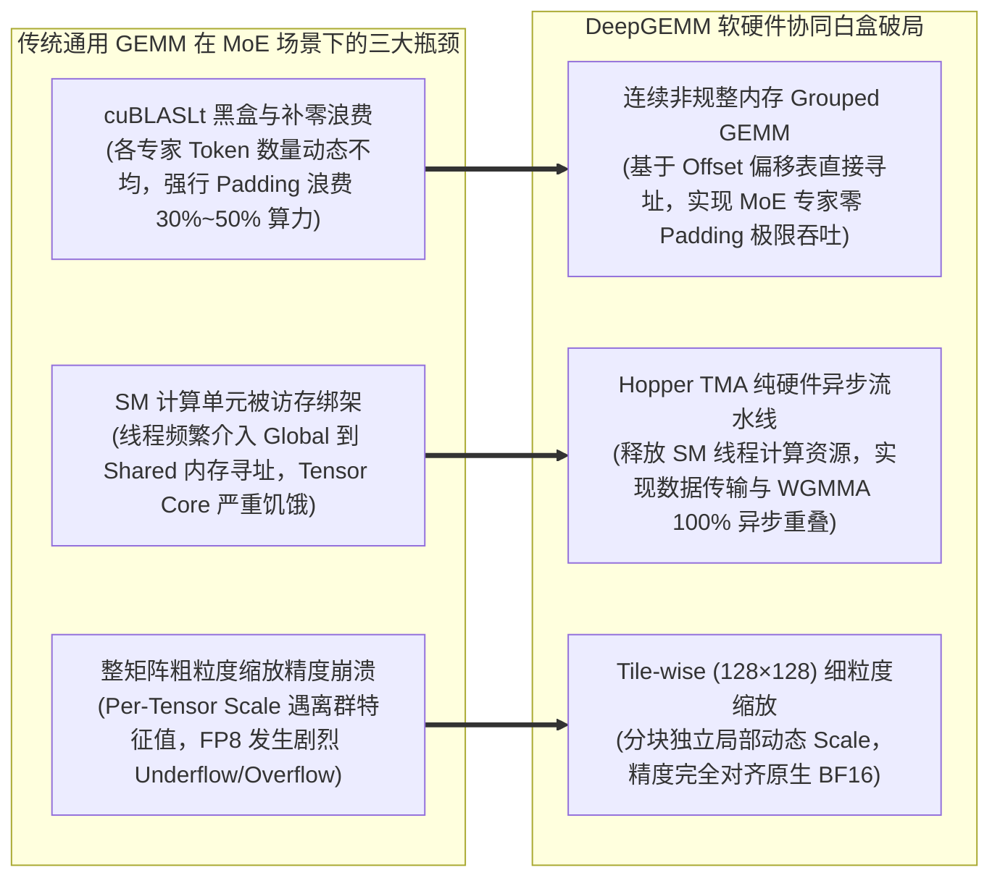

---
tags:
  - ai-practice
  - engineering
  - architecture
domain: 本地部署加速
difficulty: 进阶
date_added: 2026-11-17
---

# 💡 大规模大模型 FP8 极限计算加速：基于 DeepSeek DeepGEMM 的 Hopper TMA 算子优化、MoE 分组矩阵乘与细粒度缩放实战

> **核心摘要**：随着以 DeepSeek-V3（671B）、DeepSeek-R1 以及万亿级开源模型为代表的新一代巨量模型全面普及，大模型推理与训练的算力基础设施正在经历从 FP16/BF16 向 FP8 低精度计算的不可逆跃迁。在 NVIDIA Hopper 架构（H100/H800/H20）及下一代硬件上，FP8 Tensor Core 理论算力（TFLOPS）高达 BF16 的两倍。然而在实际工程落地中，业界长期面临三大死穴：通用黑盒数学库（如 cuBLASLt）在非对称、动态专家负载的 MoE 分组矩阵乘（Grouped GEMM）中产生大量无效补零（Padding）开销；流式多处理器（SM）被繁重的内存寻址与搬运严重霸占；以及粗粒度缩放导致的 FP8 动态范围溢出与精度雪崩。由 DeepSeek 官方开源的 **DeepGEMM** 带来了颠覆性的白盒算子实现：通过**深度协同 Hopper 硬件 TMA 异步内存拷贝引擎、300 行精简 CUDA 汇编级调度、MoE 动态分组矩阵乘零填充优化，以及 Tile-wise（128×128）细粒度动态缩放**，在保持数值无损的前提下彻底榨干 Tensor Core 硬件潜能。本文将全面复盘 MoE 计算性能陷阱、DeepGEMM 核心微架构原理、生产级替换实战，并深入攻克 JIT 冷启动抖动、长文本离群值溢出与专家负载倾斜三大工程死穴。

---

## 🎯 业务与技术背景：FP8 时代 MoE 矩阵乘法的“算力黑洞与精度悬崖”

在现代万亿参数大模型（尤其是基于细粒度路由的稀疏 MoE 架构）中，前馈网络（FFN / MLP）占据了全模型超过 80% 的浮点运算量与显存占用。从 BF16 全面迁移至 FP8 成为降低算力成本与突破显存带宽墙的核心途径：



1. **MoE 专家分组矩阵乘法中的“补零（Padding）灾难”**：
   - 在稠密模型中，GEMM 形状 `[M, K] × [K, N]` 在一个批次内是完全规整的；但在 MoE 专家并行中，Token 经过 Router 判定后被分流到数十上百个不同专家。每个专家在当前 Step 分配到的实际 Token 数量（`tokens_per_expert`）极度不均，有的专家分到 384 个 Token，有的专家可能分到 0 或仅 16 个 Token。
   - 传统依赖 cuBLASLt 或标准 Batched GEMM 的做法，必须以当前批次中 Token 数最多的专家为基准，对所有较小的专家进行大量的补零（Padding），或者拆分成大量碎片化的小 Kernel 执行。这不仅导致了 30%~50% 的无效算力浪费，更引发频繁的显存抖动。
2. **SM 计算单元深陷访存搬运泥潭**：
   - 在传统的 CUDA GEMM 实现中，SM 内部的计算线程既要负责计算矩阵乘累加，又要花费大量时钟周期执行全局显存（Global Memory）到共享显存（Shared Memory）的数据寻址、边界检查和显式装载指令。这导致即便 Tensor Core 具备超高理论算力，实际运算单元却长期处于“等待数据喂饱”的空转状态。
3. **低精度 FP8（E4M3）狭窄动态范围与离群值（Outliers）**：
   - 相比 BF16 拥有 8 位指数位（Exponent），FP8 E4M3 仅有 4 位指数位与 3 位尾数位，动态范围被急剧压缩至 `[-448, 448]`。
   - 如果采用传统的全张量单一缩放因子（Per-Tensor Scaling），大模型内部深层网络常年存在的少数极高绝对值的离群激活特征（Activation Outliers）会强行拉大缩放基数，导致其余绝大多数占主流的微小激活值精度下溢归零，导致模型输出语无伦次。

---

## 🏗️ 架构设计与解决方案：DeepGEMM 硬件级微架构演进

DeepGEMM 彻底摒弃了上万行封装的沉重模板库，直接立足于 NVIDIA Hopper 架构的最底层物理特性：

```mermaid
flowchart TD
    subgraph HostDispatch [主机侧请求分发与张量准备]
        TokensInput["动态批次 Token 激活张量 A (FP8 E4M3)"]
        ExpertWeights["专家权重池张量 B (FP8 E4M3, 转置布局)"]
        TokenOffsets["专家偏移索引表 tokens_per_expert"]
        HostDispatchPlan["JIT 运行时匹配最优 Tile 与流水线深度"]
    end

    subgraph HopperSMExecution [NVIDIA Hopper 流式多处理器 (SM90a)]
        subgraph TMACopyPipeline [1. 硬件级异步内存管道 (TMA + mbarrier)]
            TMA_Desc["初始化 TMA 张量描述符 (Tensor Map Descriptor)"]
            TMA_Async["TMA 硬件单元异步直传: Global -> Shared Memory"]
            MultiStageBarrier["多阶段异步屏障协同 (3~5 Stage Software Pipelining)"]
        end

        subgraph WGMMAExecution [2. 异步 Warpgroup 矩阵乘累加 (WGMMA)]
            WG_Schedule["Warpgroup 调度 (128 线程成组协作)"]
            TensorCoreAccum["Tensor Core 硬件执行: FP8 × FP8 -> FP32 寄存器累加"]
            ZeroPaddingSchedule["依据 TokenOffsets 跳过非专家区域 (零 Padding)"]
        end

        subgraph ScaleAndEpilogue [3. 细粒度反量化融合输出]
            TileScaleA["获取激活 Tile (128×K) 缩放因子 Scale_A"]
            TileScaleB["获取权重 Tile (N×128) 缩放因子 Scale_B"]
            FusedDequant["融合计算: Accum_FP32 × Scale_A × Scale_B"]
            StoreResult["写回全局内存 (BF16 / FP8)"]
        end
    end

    TokensInput & ExpertWeights ==> TMA_Desc
    TokenOffsets ==> ZeroPaddingSchedule
    HostDispatchPlan ==> TMACopyPipeline
    TMA_Desc ==> TMA_Async
    TMA_Async ==> MultiStageBarrier
    MultiStageBarrier ==> WG_Schedule
    WG_Schedule ==> TensorCoreAccum
    TensorCoreAccum ==> ZeroPaddingSchedule
    ZeroPaddingSchedule ==> FusedDequant
    TileScaleA & TileScaleB ==> FusedDequant
    FusedDequant ==> StoreResult
```

### 1. 深度协同 Hopper TMA 硬件加速引擎
- Hopper 架构引入了硬件级 **Tensor Memory Accelerator (TMA)**，它是一个独立于 SM 计算流水线的物理 DMA 控制器。
- DeepGEMM 通过构造 TMA 张量描述符（Tensor Map Descriptor），只需在 SM 中发射一条极轻量的异步拷贝指令，TMA 即可全自动将多维分块张量从 HBM 连续搬移到 Shared Memory 中，配合硬件异步屏障 `cuda::barrier` 和 `mbarrier` 实现多缓冲循环队列。整个搬运过程 SM 占用率为 0%，使得计算与数据预取完全解耦。

### 2. Warpgroup 级别异步执行指令（WGMMA）
- 传统 MMA 指令以单个 Warp（32 线程）为粒度调度；而 Hopper 提供了 **WGMMA（Warpgroup-level Matrix Multiply and Accumulate）**，以包含 4 个 Warp 的 Warpgroup（128 线程）作为一个不可分割的硬件计算单元。
- DeepGEMM 调度 WGMMA 指令直接读取 Shared Memory 中的 FP8 数据，将结果直接累加至各线程的 FP32 寄存器中，消除了繁琐的寄存器中间周转，显著削减寄存器压力（Register Pressure）并提升 Occupancy。

### 3. MoE Grouped GEMM 零填充（Zero Padding）寻址
- 针对各专家处理 Token 数不同的离散特性，DeepGEMM 设计了紧凑的非连续专家调度方案。所有 Token 依然紧凑存放在单个内存连续的输入张量中，底层 Kernel 根据 `tokens_per_expert` 前缀和累加偏移量动态分发 Tile 网格。
- 无论各个专家的分配比例多不平衡，没有任何一个线程块（Threadblock）会浪费算力在无意义的零填充上。

### 4. Tile-wise (128×128) 细粒度分组缩放
- 为了在 FP8 低精度下彻底扼杀离群值溢出问题，DeepGEMM 采用了细粒度分块缩放策略：
  - 激活矩阵 A 按行和沿 K 维以 128 个元素为分块维护一个 `float32` 缩放因子；
  - 权重矩阵 B 按列和沿 K 维以 128 个元素为分块维护一个 `float32` 缩放因子；
- 在 Tensor Core 完成 FP8 乘加得到 FP32 累加值后，在 Epilogue 阶段将累加结果逐 Tile 乘以对应分块的缩放因子并转为 BF16 存出，实现极度平滑的数值动态范围覆盖。

---

## 💻 关键代码与生产级集成实战

以下展示如何在 PyTorch / 自定义 MoE 模块中，将传统的低效 MoE 前向计算无缝切换为基于 DeepGEMM 的生产级优化流水线。

### 1. 细粒度 FP8 动态量化工具函数

```python
import torch
import deep_gemm


def quantize_to_fp8_fine_grained(tensor: torch.Tensor, tile_size: int = 128):
    """将输入的 2D 激活张量 [M, K] 动态量化为带有 Tile-wise (128 元素) 缩放因子的 FP8 (E4M3)。

    参数:
        tensor: 输入张量，形状为 [M, K]，dtype 通常为 bfloat16
        tile_size: 分块缩放步长，默认为 128
    返回:
        tensor_fp8: 量化后的 float8_e4m3fn 张量
        scales: 细粒度缩放因子，形状为 [M, K // tile_size]，dtype 为 float32
    """
    assert tensor.dim() == 2, "输入张量必须为 2 维 [M, K]"
    M, K = tensor.shape
    assert K % tile_size == 0, f"维度 K ({K}) 必须能被 tile_size ({tile_size}) 整除"

    # 将张量沿 K 维重塑为分块视图: [M, num_tiles, tile_size]
    reshaped = tensor.view(M, K // tile_size, tile_size)

    # 计算每个分块的最大绝对值 (Max-Abs), 防止除零添加 eps
    max_vals = torch.amax(torch.abs(reshaped), dim=-1, keepdim=True).clamp(min=1e-6)

    # FP8 E4M3 的最大正规数表示范围为 448.0
    fp8_max = 448.0

    # 缩放因子 Scale = max_val / 448.0
    scales = (max_vals / fp8_max).squeeze(-1).to(torch.float32)

    # 量化计算: x_fp8 = clamp(x / scale, -448, 448)
    scaled = reshaped / max_vals * fp8_max
    clamped = scaled.clamp(min=-fp8_max, max=fp8_max)
    tensor_fp8 = clamped.view(M, K).to(torch.float8_e4m3fn)

    return tensor_fp8, scales
```

### 2. 生产级 MoE 专家 FFN 层 DeepGEMM 算子集成

```python
import torch
import torch.nn as nn
import deep_gemm


class DeepGEMMMoEExpertLayer(nn.Module):
    """基于 DeepGEMM 的生产级高性能 MoE 专家层。

    替代传统基于 cuBLASLt 或拆分循环小 Kernel 的前向推导，
    支持动态 Token 专家分组与零填充极速推演。
    """

    def __init__(self, num_experts: int, hidden_dim: int, ffn_dim: int):
        super().__init__()
        self.num_experts = num_experts
        self.hidden_dim = hidden_dim
        self.ffn_dim = ffn_dim

        # 预先离线量化好的专家权重 (Gate & Up 融合投影, Down 投影)
        # 权重以 FP8 E4M3 格式直接持久化存放，大幅节省模型权重显存占用
        self.register_buffer(
            "gate_up_weights_fp8",
            torch.empty((num_experts, 2 * ffn_dim, hidden_dim), dtype=torch.float8_e4m3fn, device="cuda")
        )
        self.register_buffer(
            "down_weights_fp8",
            torch.empty((num_experts, hidden_dim, ffn_dim), dtype=torch.float8_e4m3fn, device="cuda")
        )

        # 权重的离线细粒度缩放因子 (Tile-wise 128x128)
        self.register_buffer(
            "gate_up_scale",
            torch.ones((num_experts, (2 * ffn_dim) // 128, hidden_dim // 128), dtype=torch.float32, device="cuda")
        )
        self.register_buffer(
            "down_scale",
            torch.ones((num_experts, hidden_dim // 128, ffn_dim // 128), dtype=torch.float32, device="cuda")
        )

    def forward(
        self,
        sorted_tokens: torch.Tensor,
        tokens_per_expert: torch.Tensor,
    ) -> torch.Tensor:
        """执行 MoE 专家的分组前向计算。

        参数:
            sorted_tokens: 经过 DeepEP 重新排序按专家聚合的激活 Token, [Total_Tokens, Hidden_Dim], BF16
            tokens_per_expert: 各专家实际分配到的 Token 数量, [Num_Experts], int32
        返回:
            ffn_outputs: 专家前向计算后的产出张量, [Total_Tokens, Hidden_Dim], BF16
        """
        total_tokens = sorted_tokens.size(0)
        if total_tokens == 0:
            return torch.zeros_like(sorted_tokens)

        # 1. 运行时动态细粒度量化输入激活至 FP8
        tokens_fp8, scale_tokens = quantize_to_fp8_fine_grained(sorted_tokens, tile_size=128)

        # 2. 分配中间激活显存池
        gate_up_out = torch.empty((total_tokens, 2 * self.ffn_dim), dtype=torch.bfloat16, device="cuda")

        # 3. 第一阶段: 专家分组 GEMM 计算 Gate & Up 投影
        # DeepGEMM 依据 tokens_per_expert 自动执行零填充寻址
        deep_gemm.moe_grouped_gemm_fp8(
            tokens_fp8,
            self.gate_up_weights_fp8,
            scale_tokens,
            self.gate_up_scale,
            tokens_per_expert,
            gate_up_out,
        )

        # 4. 激活函数 (例如 SwiGLU: split -> silu(gate) * up)
        gate, up = gate_up_out.chunk(2, dim=-1)
        activated = torch.nn.functional.silu(gate) * up

        # 5. 动态量化中间激活至 FP8
        activated_fp8, scale_act = quantize_to_fp8_fine_grained(activated, tile_size=128)

        # 6. 第二阶段: 专家分组 GEMM 计算 Down 投影
        down_out = torch.empty((total_tokens, self.hidden_dim), dtype=torch.bfloat16, device="cuda")
        deep_gemm.moe_grouped_gemm_fp8(
            activated_fp8,
            self.down_weights_fp8,
            scale_act,
            self.down_scale,
            tokens_per_expert,
            down_out,
        )

        return down_out
```

---

## ⚠️ 生产环境踩坑与避坑指南

### 1. JIT 编译冷启动与请求毛刺（Tail Latency Spike）
- **现象**：在在线大模型推理服务（如 vLLM / SGLang）接入 DeepGEMM 后，服务重启接收第一批请求时，个别请求出现高达 100~300ms 的额外延迟甚至触发网关超时。
- **根因**：DeepGEMM 内部采用 JIT 动态编译以根据实际运行时的矩阵维度（M, N, K）生成最优 PTX。未预热的新 M 维度会触发即时编译。
- **避坑方案**：在服务上线暴露健康检查探针（Health Check）之前，执行全维度 **Warmup 预热阶段**：
  ```python
  def warmup_deepgemm_kernels(layer: DeepGEMMMoEExpertLayer):
      """服务冷启动时预热常用 Token 批次形状，触发 JIT 编译缓存。"""
      test_batch_sizes = [1, 8, 16, 32, 64, 128, 256, 512, 1024]
      for bs in test_batch_sizes:
          dummy_input = torch.randn((bs, layer.hidden_dim), dtype=torch.bfloat16, device="cuda")
          dummy_counts = torch.full((layer.num_experts,), bs // layer.num_experts, dtype=torch.int32, device="cuda")
          dummy_counts[0] += bs % layer.num_experts
          with torch.no_grad():
              _ = layer(dummy_input, dummy_counts)
      torch.cuda.synchronize()
      print("DeepGEMM 内核 JIT 预热完成，编译缓存已持久化。")
  ```

### 2. 专家负载剧烈偏斜（Hotspot Routing）导致 SM 计算负载失衡
- **现象**：当某些专家分到 90% 的 Token，而其他专家处于空闲状态时，MoE 分组 GEMM 的硬件加速比出现明显衰减。
- **根因**：如果大量负载集中在单个专家，该专家的计算网格（Grid）受限于其独立的 Tile 划分，无法打散到全 GPU 的所有 SM 上并发执行。
- **避坑方案**：
  - 在前置 Router 阶段开启 **辅助负载均衡损失（Auxiliary Load Balancing Loss）** 或使用 **无偏专家路由限制（Top-K with Expert Capacity Clamp）**；
  - DeepGEMM 开启 **Persistent Threadblock 模式**，允许跨专家动态窃取计算 Tile，使富余的 SM 能够协同分担长尾大专家的矩阵计算。

### 3. FP8 缩放因子除零与非正规数（Denormal Numbers）保护
- **现象**：当输入张量中包含大量全零 Padding 或极弱激活时，动态计算得到的 Scale 因子趋于 0，在执行反量化除法时产生 `NaN` 或 `Inf`，污染后续层。
- **避坑方案**：在动态提取分块最大绝对值时，严格锁定下限阈值（`clamp(min=1e-6)`），并在 Epilogue 反量化时检测无效值，保证数值绝对稳定性。

---

## 🔗 关联项目与引用
- 核心项目底座：[[DeepGEMM]]
- 相关通信底座：[[DeepEP]]（MoE 专家并行 All-to-All 高性能通信内核）
- 注意力加速算子：[[FlashMLA]]（Multi-Head Latent Attention 极限解码内核）
- 现代推理框架集成：[[vLLM]], [[SGLang]], [[KTransformers]]
- 来源日报：[[2026-11-17-AI-Digest]]
