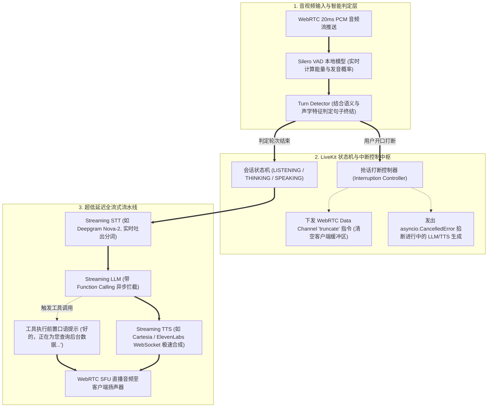

---
tags:
  - ai-practice
  - engineering
  - architecture
domain: Agent设计
difficulty: 进阶
date_added: 2026-11-17
---

# 💡 实时全双工语音智能体架构：基于 LiveKit Agents 的低延迟 WebRTC 管道、智能打断与多模态会话状态机实战

> **核心摘要**：大模型智能体的交互形态正在从“冷冰冰的文本终端与轮询对话框”，向“具有自然生命感、毫秒级响应的实时全双工（Full-Duplex）具身视听交互”发生质的跃迁。然而在传统构建方案中，语音智能体普遍深陷三大工程泥潭：其一，传统“录音 -> STT 语音识别 -> LLM 全量推理 -> TTS 语音合成 -> 播放”串行流水线带来长达 2.5~4.0 秒的窒息延迟；其二，缺乏智能打断机制，当用户开口插话或纠正时，Agent 仍在机械自顾自朗读，产生灾难性的“抢麦碰撞”；其三，网络抖动导致的丢包破音与工具调用期的尴尬静默。依托全球开源标杆 **LiveKit Agents**，工业界首次实现了**端到端 300~500ms 超低延迟 WebRTC 流式管道、Silero VAD + Turn Detector 意图级智能断句、毫秒级抢话熔断清空缓冲，以及视听多模态与 SIP 电话网络无缝穿透**。本文全面剖析实时语音智能体的状态机演进、流式并行调度核心原理、生产级代码实现，并深度拆解环境杂音误打断、异步工具调用“假死”感与跨国 WebRTC 抖动三大高频踩坑实践。

---

## 🎯 业务与技术背景：传统语音 AI 的“三大延迟与交互死穴”

在将智能体部署到车载助手、AI 心理咨询、口语外教或企业电话呼叫中心等真实业务场景时，用户对交谈节奏的宽容度极低。人类对话在自然状态下的停顿与反馈间隔通常在 **200~400 毫秒** 之间。

```mermaid
flowchart LR
    subgraph TraditionalPipeline [传统串行级联流水线 (延迟 2.5s ~ 4.0s)]
        T1["录音等待完整静默 (800ms)"] --> T2["整段上传 STT 转录 (600ms)"]
        T2 --> T3["LLM 生成完整回答 (1200ms)"]
        T3 --> T4["TTS 全文语音合成 (500ms)"]
        T4 --> T5["客户端开始下载播放 (200ms)"]
    end

    subgraph LiveKitStreamingPipeline [LiveKit 全流式全双工流水线 (延迟 300ms ~ 500ms)]
        L1["20ms PCM 音频实时分片流"] --> L2["Silero VAD + Turn Detector (<50ms)"]
        L2 --> L3["Deepgram 流式出词 (首字 100ms)"]
        L3 --> L4["流式 LLM 首 Token (100ms)"]
        L4 --> L5["Cartesia 极速流式语音合成 (80ms)"]
        L5 --> L6["WebRTC 亚秒级流式边播边收"]
    end
```

1. **“串行级联”导致的漫长等待与机械割裂感**：
   - 传统的 HTTP 请求-响应架构要求每个环节“全量拿到输入”才开始计算。用户说完一句话后，系统要等待长时间的静默超时判定（Silence Timeout），再转录全部文本，再等待 LLM 吐出足够句子，最后合成出完整的音频文件发给前端。整个过程耗时常常超过 3 秒，完全沦为“对讲机式的单工对答”。
2. **缺乏即时抢话打断（Barge-In）能力的“抢麦冲突”**：
   - 当用户发现 Agent 的理解产生偏差，或者用户想直接打断询问下一环节时，如果 Agent 还在播报上一个耗时 10 秒的长段落，传统的播放器完全无法感知用户的插话意图。用户在说话，扬声器在放音，导致交谈彻底陷入混乱，用户体验呈现断崖式下跌。
3. **工具调用（Function Calling）期间的“真空尴尬期”**：
   - 当 Agent 需要调用天气查询、订单系统或数据库等外部工具时，LLM 推理暂时中止，TTS 没有音频流输出。在纯语音交谈中，超过 1 秒的突然绝对死寂会让用户误以为电话掉线或系统崩溃，进而重复提问引发状态机紊乱。

---

## 🏗️ 架构设计与解决方案：LiveKit Agents 全双工实时流式架构

LiveKit Agents 架构将实时网络底层与大模型推理中枢彻底打通，形成了一条毫秒级响应的闭环回路：



### 1. WebRTC SFU 原生低延迟流媒体传输
- 抛弃低效的 HTTP / WebSocket 轮询方案，基于 LiveKit 的分布式 WebRTC SFU（Selective Forwarding Unit）架构。音频与视频直接通过 UDP / DTLS 传输，端到端网络传输开销稳定控制在 **20~50 毫秒** 范围内，且具备极强的弱网丢包恢复能力。

### 2. Silero VAD 与 Turn Detector 双阶意图断句
- **第一阶（声学能量过滤）**：采用轻量级轻量化本地 Silero VAD 模型（基于 ONNX 纯 CPU 运行，耗时 < 5ms），每 20ms 检测一次音频帧中是否有人声成分。
- **第二阶（语义意图终结判定）**：结合上下文语义，识别用户是“话说到一半思考喘气（例如：‘我想预订一张明天去……嗯……北京的机票’）”还是“完整表达完毕”。智能避免过早抢话插嘴，保证对话自然度。

### 3. 毫秒级打断（Interruption Handling）与异步任务级联取消
- 当 Agent 处于 `SPEAKING` 状态时，一旦 Silero VAD 连续检测到超过 300~400ms 的稳定人类发音，打断机制瞬间激活：
  1. 向客户端发送协议级 `truncate` 数据帧，客户端硬件播放器立即丢弃当前待播放的音频 Buffer，扬声器在 10ms 内瞬间静音；
  2. 服务端正在挂起执行的 LLM 生成迭代器和 TTS 编码任务接收到标准的 Python `CancelledError`，立即中止 Token 消耗与计费，会话状态重置为 `LISTENING`。

### 4. 工具执行期的垫字提示（Filler Speech）平滑机制
- 在识别到需要执行耗时超过 500ms 的外部 API 工具调用时，系统自动注入前置口语化垫字（如：“正在为您调取数据，请稍等……”），保持音频流不间断，彻底消灭用户心智上的“死机空白期”。

---

## 💻 关键代码与生产级实现实战

以下展示如何在 Python 异步运行时中，基于 LiveKit Agents 构建一个支持流式级联、智能打断、工具垫字语音以及电话 SIP 接入的生产级语音智能体：

```python
import asyncio
import logging
from typing import Annotated
from livekit.agents import (
    AutoSubscribe,
    JobContext,
    WorkerOptions,
    cli,
    llm,
)
from livekit.agents.voice_assistant import VoiceAssistant
from livekit.plugins import cartesia, deepgram, openai, silero

logging.basicConfig(level=logging.INFO)
logger = logging.getLogger("production-voice-agent")


class EnterpriseVoiceAgent:
    """企业级低延迟全双工语音助手。

    具备亚秒级流式响应、抢话熔断打断、异步业务工具执行与口语化垫字平滑。
    """

    def __init__(self, ctx: JobContext):
        self.ctx = ctx

    async def run(self):
        # 1. 订阅客户端音视频流
        await self.ctx.connect(auto_subscribe=AutoSubscribe.AUDIO_ONLY)

        # 2. 构建系统认知基准与对话提示词
        chat_context = llm.ChatContext().append(
            role="system",
            text=(
                "你是一个反应敏捷、表达精简的企业级实时语音管家。你的职责是通过语音解答用户关于服务、运维和业务的咨询。"
                "注意事项：\n"
                "1. 务必使用自然的口语化短句，切勿返回长篇大论或包含 Markdown 语法符号；\n"
                "2. 每次回答尽量控制在 1~2 句话内，适时引导用户继续发问；\n"
                "3. 在调用工具查询复杂数据时，系统会自动发出提示，你只需专注于总结关键事实。"
            ),
        )

        # 3. 初始化高可用流式管线组件
        vad = silero.VAD.load(
            min_speech_duration=0.25,        # 过滤短暂杂音，持续发音 250ms 以上才计入人声
            min_silence_duration=0.5,        # 用户停顿超过 500ms 且意图完整才触发断句
        )
        stt = deepgram.STT(
            model="nova-2-general",          # 业界极速流式转录模型
            language="zh-CN",
            interim_results=True,            # 开启中间临时转录结果，加速首字预测
        )
        agent_llm = openai.LLM(
            model="gpt-4o-mini",             # 超低首 Token 延迟模型 (TTFT < 200ms)
            temperature=0.6,
        )
        tts = cartesia.TTS(
            model="sonic-multilingual",      # Cartesia 80ms 极低延迟语音合成
            voice="248be419-c632-4f23-add1-073ca7cd4236",
        )

        # 4. 构建 VoiceAssistant 核心中枢
        assistant = VoiceAssistant(
            vad=vad,
            stt=stt,
            llm=agent_llm,
            tts=tts,
            chat_ctx=chat_context,
            allow_interruptions=True,        # 允许用户随时打断
            interrupt_speech_duration=0.35,  # 用户抢话 350ms 后立即触发物理中断
            interrupt_min_words=1,           # 至少识别到 1 个有效词即收声
        )

        # 5. 挂载业务工具 (Function Calling)
        @assistant.function_context.register
        async def query_cluster_load(
            region: Annotated[str, llm.TypeInfo(description="集群所在区域名称，如 'beijing' 或 'shanghai'")]
        ) -> str:
            """查询指定数据中心计算集群的当前负载情况"""
            # 在执行耗时查询前，让 Assistant 主动播报垫字，防止静音尴尬
            await assistant.say(f"正在为您连接 {region} 集群监控中心，请稍候...", allow_interruptions=True)
            
            # 模拟异步 I/O 网络耗时
            await asyncio.sleep(1.2)
            
            return f"{region} 集群当前 CPU 平均利用率 42%，GPU 显存占用 68%，网络链路通畅，无异常告警。"

        # 6. 注册生命周期回调与监控埋点
        @assistant.on("user_started_speaking")
        def _on_user_speaking():
            logger.info("⚡ [VAD] 检测到用户开始说话，准备倾听...")

        @assistant.on("agent_started_speaking")
        def _on_agent_speaking():
            logger.info("🔊 [TTS] Agent 开始流式放音...")

        @assistant.on("interruption")
        def _on_interruption():
            logger.warning("🛑 [Barge-In] 触发抢话打断！已自动截断播放并取消在途推理任务。")

        # 7. 启动助手并在房间就位
        assistant.start(self.ctx.room)

        # 8. 主动打招呼欢迎入房
        await assistant.say("您好！我是您的实时语音智能助理，请问有什么可以为您效劳？", allow_interruptions=True)


async def entrypoint(ctx: JobContext):
    agent = EnterpriseVoiceAgent(ctx)
    await agent.run()


if __name__ == "__main__":
    cli.run_app(
        WorkerOptions(
            entrypoint_fnc=entrypoint,
            ws_url=None,  # 自动读取环境变量 LIVEKIT_URL
            api_key=None, # 自动读取环境变量 LIVEKIT_API_KEY
            api_secret=None, # 自动读取环境变量 LIVEKIT_API_SECRET
        )
    )
```

---

## ⚠️ 生产环境踩坑与避坑指南

### 1. 键盘敲击与环境背景杂音引发“误打断（False Barge-In）”
- **现象**：当用户在安静交谈时，突然的咳嗽声、关门声或键盘敲击机械音导致正在讲话的 Agent 频繁戛然而止，严重破坏对话连贯性。
- **根因**：基础能量型 VAD 仅检测声音振幅，将非语音的短脉冲冲击误判为人声起始。
- **避坑方案**：
  - 开启 **Silero VAD 的语义概率阈值过滤**（`speech_threshold=0.6`），拒绝纯能量脉冲；
  - 调整 `interrupt_speech_duration` 至 350~450ms：要求声音信号不仅具备人声特征，且必须维持一定时长，过滤单次咳嗽与瞬态敲击。

### 2. 用户沉思停顿与意图被“过早抢答”
- **现象**：用户在思考下一句话时稍微放慢了语速并停顿了 300 毫秒（例如说：“我想要买那个……那个红色的”），Agent 立即误以为用户说完了并抢先插话。
- **根因**：静态配置的 `min_silence_duration` 过短，未结合声调上扬/下降与语义完整度动态评估。
- **避坑方案**：
  - 引入深度学习驱动的 **Turn Detector 意图断句模型**：分析语音的末尾声学基频（F0）特征（未完结通常语调平缓或上扬，完结通常语调下降）；
  - 对包含连词（“但是”、“而且”、“或者”）的短语动态拉长静音判定窗口至 800ms。

### 3. WebRTC 跨国与企业内网环境丢包引发爆音与机器人音（Robotic Audio）
- **现象**：客户端听到 Agent 声音出现断断续续的机械卡顿、音调变调或断音。
- **根因**：企业内网 UDP 防火墙限制导致严重丢包，或者客户端 Jitter Buffer 缓冲区配置不当。
- **避坑方案**：
  - 强制开启 **Opus 编码器内置的带内前向纠错（In-band FEC, Forward Error Correction）**，允许丢包率在 20% 以内无损恢复；
  - 在 LiveKit SFU 节点配置自动化 **STUN / TURN 转发网关**，当 UDP 丢包恶化至临界值时无缝平滑切至 TCP/TLS 隧道通道。

---

## 🔗 关联项目与引用
- 核心项目底座：[[LiveKit-Agents]]
- 智能体工具集成：[[FastMCP]], [[Composio]]
- 交互界面与状态同步：[[CopilotKit]], [[Browser-Use]]
- 状态机与工作流编排：[[LangGraph]], [[CrewAI]]
- 来源日报：[[2026-11-17-AI-Digest]]
