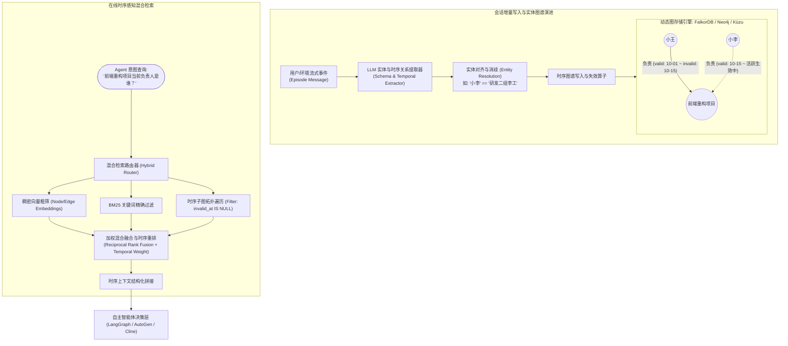

---
tags:
  - ai-practice
  - engineering
  - architecture
domain: Agent设计
difficulty: 进阶
date_added: 2026-10-17
---

# 💡 智能体时序记忆架构：基于 Graphiti 的动态时序知识图谱与状态演化检索实战

> **核心摘要**：长周期自主智能体（Long-Horizon Autonomous Agents）在跨会话多轮交互中，面临最致命的痛点是**“事实状态时序漂移（Temporal State Drift）”**。传统基于向量相似度的记忆方案（如 Chroma、Pinecone）无法感知时间的因果顺序与事实覆盖，导致新旧矛盾事实同时被召回引发严重幻觉。本文深度剖析基于 **Graphiti** 的**动态时序知识图谱（Temporal Knowledge Graph）**架构，详解如何通过**双时态建模（Bi-Temporal Modeling）**、**流式实体解析与图谱增量融合**、**时序失效边标记**以及**亚 10 毫秒混合多模检索**，构建生产级自进化智能体长效记忆体系。

---

## 🎯 业务/技术背景与痛点

在构建智能客服助理、个人开发副驾驶（Copilot）、金融投顾或企业内部运维 Agent 时，智能体往往需要维持数周乃至数月的跨会话长期记忆。然而，基于传统纯向量数据库的“扁平切片检索”在处理动态变化的客观世界时彻底失效：

```
[时间线演进]
Day 1: "小王负责前端重构项目，项目预期于 11月1日 发布。" ────> 存入向量库 Chunk A
Day 15: "因后端改版，小王转去支援支付中台，前端重构改由小李负责，发布推迟至 12月15日。" ────> 存入向量库 Chunk B

[用户提问: "谁是前端重构的负责人？什么时候发布？"]
        │
        ▼ (传统向量数据库基于余弦相似度检索)
┌────────────────────────────────────────────────────────┐
│ 传统向量检索严重缺陷:                                   │
│ 1. Chunk A 与 Chunk B 语义相似度极高，均被 Top-K 召回    │
│ 2. 检索结果包含相互矛盾的事实: "小王负责 vs 小李负责"   │
│ 3. 下游大模型无法判断时间先后，产生胡言乱语与错误执行  │
└────────────────────────────────────────────────────────┘
```

1. **时序盲目性（Temporal Blindness）与事实矛盾**：
   - 传统向量检索仅依据语义嵌入的几何距离打分，完全丢失了事实产生与失效的物理时间戳；
   - 历史过期的废弃配置、改签的行程、换岗的负责人与最新事实在向量空间中紧密相邻，导致 Agent 频繁引用过期数据执行不可逆动作（如向旧邮箱发送敏感邮件）。
2. **生硬删除丢失因果溯源（Loss of Audit Provenance）**：
   - 简单的解决办法是物理覆写或删除旧记忆，但这会导致 Agent 彻底丧失因果推理能力（无法回答“为什么发布日期会推迟？”、“上周探讨过的第一版方案核心参数是什么？”）。
3. **全量构建图谱的计算成本与延迟不可承受**：
   - 传统知识图谱（Knowledge Graph RAG）通常需要离线批量处理全部文档并重构图谱，无法应对会话实时流式注入、高频实体消歧与毫秒级即时写入的要求。

---

## 🏗️ 架构设计与解决方案

Graphiti 通过引入**双时态动态图模型（Bi-Temporal Dynamic Graph）**，将每个事实建模为带有时间生命周期的拓扑边，实现了“保留历史演变全貌，同时精准感知当前活跃状态”的长效记忆底座。



### 核心机制详解：

1. **双时态边定义（Bi-Temporal Edges）**：
   - 每条事实边维护两个核心时间维度：
     - **有效时间（Valid Time）**：`valid_at`（该事实在客观现实中何时成立）与 `invalid_at`（何时被新事实推翻失效）；
     - **事务时间（Transaction Time）**：系统在数据库中何时捕获记录此项事实。
   - 查询当前状态时，仅需添加简单谓词过滤：`WHERE edge.invalid_at IS NULL`；查询历史变迁时，根据时间旅行切片重放整个拓扑状态。
2. **流式实体解析与图谱合并（Incremental Entity Resolution）**：
   - 提取新实体时，Graphiti 计算其与邻近节点的向量相似度与上下文图拓扑，自动判断是否将“小李”、“李工”合并至同一规范实体 ID，防止图谱节点无序爆炸。
3. **三模融合混合检索（Hybrid Search < 10ms）**：
   - 将图拓扑（获取关联上下文）、向量匹配（容忍自然语言模糊表达）与 BM25（确保专业术语与代码标识符精准匹配）通过 RRF（倒数排名融合）统一聚合，在 10 毫秒内输出最精准的情境事实。

---

## 💻 关键代码 / 配置 / Prompt 模板

### 1. 完整可运行 Python 实战：时序演化与跨轮记忆查询

以下代码演示如何基于 Graphiti 构建多轮对话时序图谱，验证事实变更自动使旧边失效并精准召回当前状态：

```python
import asyncio
from datetime import datetime, timezone
from graphiti_core import Graphiti
from graphiti_core.nodes import EpisodeType

async def run_temporal_memory_demo():
    # ==========================================
    # 1. 初始化 Graphiti 客户端并连接本地 FalkorDB/Neo4j
    # ==========================================
    # 注意: 本地需运行 Docker: docker run -p 7687:7687 -e NEO4J_AUTH=neo4j/password neo4j:latest
    # 或者 FalkorDB: docker run -p 6379:6379 falkordb/falkordb:latest
    graphiti = Graphiti(
        "bolt://localhost:7687",
        auth=("neo4j", "password")
    )

    print("--> 1. 模拟写入初始会话事件 (2026年10月01日)...")
    episode_1 = (
        "【团队立项周会】前端重构专项正式启动，由工程师小王全权牵头负责。"
        "经过架构评审，该项目的最终交付上线时间确定为 2026年11月01日。"
        "目前依赖的核心微服务是统一认证服务 AuthV2。"
    )
    await graphiti.add_episode(
        name="立项会议纪要_2026-10-01",
        episode_body=episode_1,
        source=EpisodeType.message,
        source_description="Slack 会议频道",
        reference_time=datetime(2026, 10, 1, 14, 0, tzinfo=timezone.utc)
    )

    print("--> 2. 模拟写入后续状态变更事件 (2026年10月17日，事实发生演化)...")
    episode_2 = (
        "【架构调整紧急通报】因底层支付中台安全合规整改，小王被紧急借调至支付组担任主力。"
        "前端重构专项即日起全面交接给资深架构师小李全权负责。"
        "由于交接磨合及 AuthV2 接口变更，前端重构项目的发布交付时间顺延推迟至 2026年12月15日。"
    )
    await graphiti.add_episode(
        name="人员与排期变更通知_2026-10-17",
        episode_body=episode_2,
        source=EpisodeType.message,
        source_description="邮件通知群发",
        reference_time=datetime(2026, 10, 17, 9, 30, tzinfo=timezone.utc)
    )

    # ==========================================
    # 3. 执行时序感知复合查询：验证是否能正确过滤失效事实
    # ==========================================
    print("\n--> 3. 正在执行查询: '前端重构项目的当前负责人是谁？交付时间是什么时候？'")
    results = await graphiti.search(
        query="前端重构项目当前负责人及最新上线交付日期",
        num_results=5
    )

    print("\n=== 检索返回的时序图谱事实条目 ===")
    for edge in results:
        status_tag = "【当前生效中】" if edge.invalid_at is None else f"【已失效 (失效时间: {edge.invalid_at})】"
        print(f"{status_tag}")
        print(f"  关联实体: [{edge.source_node.name}] ---> [{edge.target_node.name}]")
        print(f"  事实详情: {edge.fact}")
        print(f"  生效时间: {edge.valid_at}")
        print("-" * 50)

    # ==========================================
    # 4. 构建供给下游 Agent 的精准防幻觉 Prompt 注入块
    # ==========================================
    active_facts = [edge.fact for edge in results if edge.invalid_at is None]
    historical_facts = [f"{edge.fact} (已于 {edge.invalid_at} 变更失效)" for edge in results if edge.invalid_at is not None]

    agent_context = (
        "【当前确认的事实状态】:\n" + "\n".join([f"- {f}" for f in active_facts]) +
        "\n\n【已被覆盖的历史背景变更】:\n" + "\n".join([f"- {f}" for f in historical_facts])
    )

    print("\n=== 生成的 Agent 记忆上下文注入提示词 ===")
    print(agent_context)

if __name__ == "__main__":
    asyncio.run(run_temporal_memory_demo())
```

---

## ⚠️ 生产环境踩坑与避坑指南

1. **实体与关系无序膨胀（Entity Explosion）与本体控制**：
   - **坑点**：若对输入文本不做实体类型约束，LLM 会将“明天”、“很好的方案”、“紧急通知”等口语词汇抽取为图节点，导致图谱节点与边数量呈指数级暴增，不仅拖垮检索延迟，更劣化实体对齐精度；
   - **避坑方案**：在初始化 Graphiti 时，显式定义清晰的**领域本体 Schema（Domain Ontology）**，明确限定合法实体类型（如 `Person`, `Project`, `Service`, `Date`）与合法关系谓词（如 `OWNS`, `DEPENDS_ON`, `SCHEDULED_AT`），未命中白名单的离散噪音词一律予以过滤。
2. **多跳遍历性能退化与局部子图剪枝**：
   - **坑点**：在实体关系错综复杂的图谱中，若不做跳数限制（Hop Limit），一次查询可能触发全图扩散式遍历，导致查询延迟从 8ms 暴增至数秒；
   - **避坑方案**：将图谱遍历深度严格限制在 **1 ~ 2 跳以内**，配合稠密向量索引先行筛选出 Top-N 个最强相关中心实体节点（Seed Nodes），再由这批 Seed 节点向外局部展开，兼顾关联丰富度与亚 10 毫秒低延迟。
3. **相对时间副词歧义（Relative Time Disambiguation）**：
   - **坑点**：用户输入“昨天我们修改了接口入参”，若缺乏显式参考时间，不同会话中的“昨天”会导致时间戳推导混乱；
   - **避坑方案**：在调用 `add_episode` 时，业务层必须将消息产生的绝对 UTC 时间作为 `reference_time` 显式注入，引导图谱抽取器将“昨天”自动换算并锚定为绝对日期 `2026-10-16`。

---

## 🔗 关联项目与引用
- 关联工具: [[Graphiti]], [[Mem0]], [[Letta]], [[LangGraph]], [[LlamaIndex]]
- 关联日报: [[2026-10-17-AI-Digest]]
- 参考资料: [Zep / Graphiti GitHub Repository](https://github.com/getzep/graphiti)
