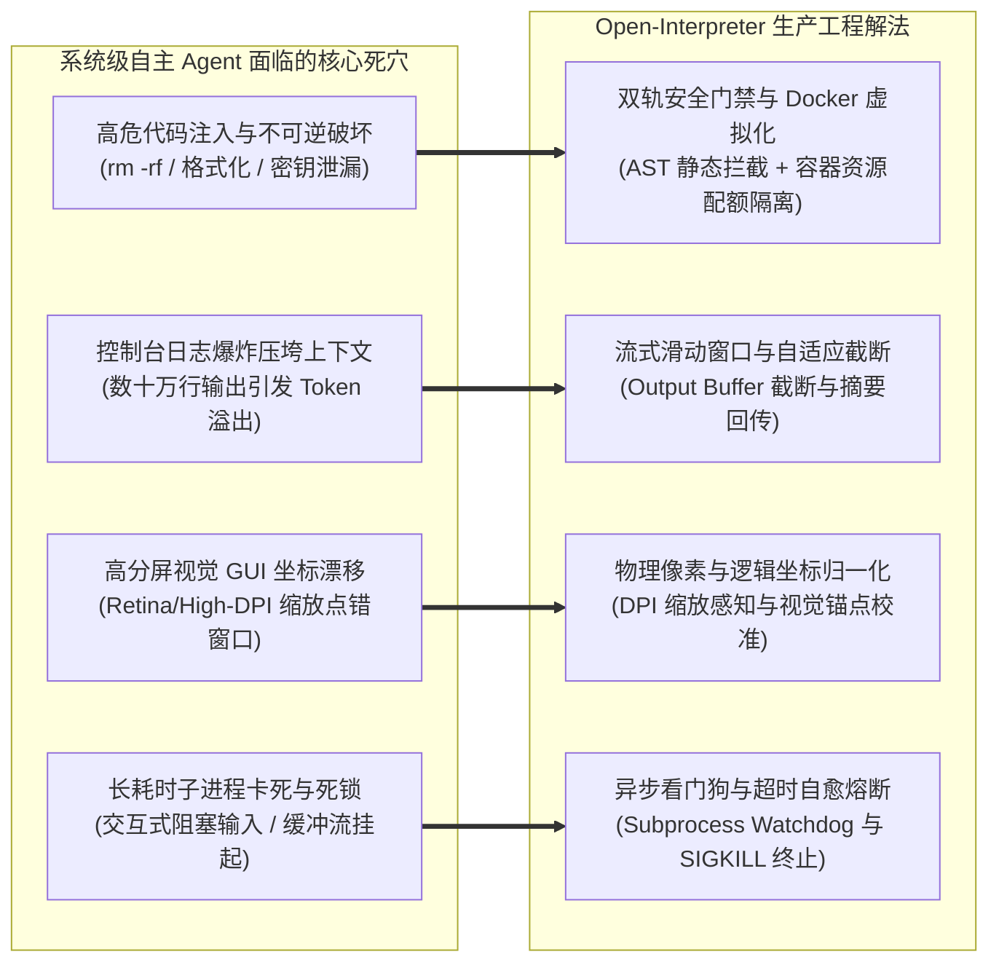

---
tags:
  - ai-practice
  - engineering
  - architecture
domain: Agent设计
difficulty: 进阶
date_added: 2026-11-06
---

# 💡 本地系统级自主执行智能体架构：基于 Open-Interpreter 的沙箱安全隔离、跨平台 OS 控制与本地大模型闭环实战

> **核心摘要**：随着端侧大模型（如 Qwen2.5-Coder、DeepSeek-Coder）推理能力的飞跃，智能体从“纯文本建议”向“本地系统级自主操控（System-Level Autonomous Agency）”跃迁已成为确定性趋势。然而，任意代码执行越权灾难、超长控制台输出挤爆上下文、跨平台 OS 驱动异构与高分屏 GUI 坐标漂移、以及无头任务卡死阻塞构成了端侧智能体落地的四大工程死穴。本文基于全球顶级开源本地解释器框架 **Open-Interpreter**，深度解构其**基于 Docker 容器与 AST 规则双轨防御的系统级安全沙箱**、**交互式持久化多语言子进程状态机**、**纯视觉驱动的 Computer-Use 坐标对齐引擎**、以及与本地推理集群（Ollama / vLLM）的低延迟交互流水线。提供企业级生产就绪的 Python 工业级守护进程封装代码与高危场景避坑全攻略。

---

## 🎯 业务与技术背景：系统级自主智能体的四大落地死穴

将大模型赋予操作系统原生执行权限（Terminal CLI、Python Kernel、GUI 键鼠），虽然能够极大解放自动化数据分析、批处理运维与跨系统联动的生产力，但在实际企业工程与开发者日常运行中，面临极其严苛的安全与稳定性挑战：



1. **不可逆破坏性系统指令与越权灾难（Destructive Command Execution & Privilege Escalation）**：
   - 当模型自主生成 Shell 或 Python 脚本时，极易因路径计算错误、Prompt Injection 或幻觉，生成 `rm -rf /`、清空数据库、强行覆盖系统关键目录（如 `/etc/` 或 `C:\Windows\System32`）或窃取读取 `~/.ssh/id_rsa` 与环境变量密钥。必须在系统执行前构建“不可穿透的物理与逻辑双层隔离”。
2. **终端执行输出爆炸压垮模型上下文（Terminal Output Blowout & Context Overflow）**：
   - 自动化任务中，一条普通的命令（如 `pip install`、`git clone`、`cat large_dataset.csv` 或全库依赖扫描）可能瞬时产生几万行控制台日志。若将原始文本直接追加至多轮会话上下文，将瞬间击穿 8k~32k 上下文窗口限制，导致推理 OOM 并遗忘初始任务目标。
3. **跨平台 OS 控制与高分屏 GUI 视觉坐标漂移（Cross-Platform Heterogeneity & High-DPI Coordinate Offset）**：
   - 在 Windows、macOS 与 Linux 之间，快捷键（Cmd vs Ctrl）、文件路径分隔符（`/` vs `\`）差异巨大；而在启用纯视觉控制（Computer-Use）时，Retina 视网膜屏幕或 4K 显示器普遍开启 150%~200% 的 DPI 缩放，导致视觉模型预测的“像素绝对坐标”与操作系统底层的“逻辑点坐标”产生系统性偏差，引发疯狂误点。
4. **子进程交互阻塞与僵尸进程死锁（Process Hanging & Interactive Prompt Deadlock）**：
   - 某些 CLI 命令默认处于交互等待状态（例如 `sudo` 密码输入、`apt-get` 未加 `-y`、Git 密钥指纹确认 `(yes/no)`）。模型若无法检测交互式等待状态，子进程将永久阻塞挂起，整个 Agent 系统彻底僵死。

---

## 🏗️ 架构设计与解决方案：企业级安全可控自主执行闭环

为解决上述工程瓶颈，我们构建了包含**静态语法审计（AST Guard）**、**Docker 容器硬隔离（Hard Sandbox）**、**流式看门狗输出截断器（Streaming Truncator）** 与 **本地多模型调度引擎（Model Router）** 的端到端生产级系统级智能体架构：

```mermaid
flowchart TD
    subgraph TaskLayer [任务派发层 (Task & User Layer)]
        UserPrompt[用户自然语言任务: 复杂批处理/数据挖掘/运维]
        AuditLog[企业审计日志: 全量指令留痕]
    end

    subgraph SecurityInterceptor [安全审查与拦截中枢 (Security Guardrail)]
        ASTValidator[AST 抽象语法树解析 & 高危函数扫描]
        RegexBlacklist[正则黑名单: rm, format, drop, kill, curl-pipe-sh]
        PathProtector[路径防越权守卫: 锁定工作目录 / 隔离敏感路径]
        HumanApproval[高危指令审批中断机制: User Approval Interruption]
    end

    subgraph CoreAgent [Open Interpreter 自主编排内核]
        ReActLoop[ReAct 循环: 思考 -> 编排 -> 提取代码 -> 评估]
        ContextManager[上下文管理器: 滑动截断 + 异常压缩]
        StatefulKernel[持久化内核管理器: 维持全局变量与 Shell 环境变量]
    end

    subgraph SandboxedExecution [安全隔离执行底座 (Sandboxed Runtime)]
        DockerContainer[Docker 容器沙箱: 非 root 运行 / 内存上限 4GB / 无外网挂载]
        SubprocessWatchdog[子进程看门狗: 120s 超时监控与僵死销毁]
        StreamFilter[实时输出过滤器: 截断超限 Log, 保留头尾 50 行]
    end

    subgraph ModelGateway [本地与专有推理集群 (Model Gateway)]
        OllamaEngine[本地 Ollama / vLLM: Qwen2.5-Coder-14B / DeepSeek]
        FallbackEngine[高阶回退网关: Claude 3.5 Sonnet / GPT-4o]
    end

    UserPrompt --> SecurityInterceptor
    SecurityInterceptor -->|安全合规| CoreAgent
    SecurityInterceptor -.->|高危触发| HumanApproval
    HumanApproval -->|人工放行| CoreAgent

    CoreAgent <--> ModelGateway
    CoreAgent --> SandboxedExecution
    SandboxedExecution --> SubprocessWatchdog
    SandboxedExecution --> StreamFilter
    StreamFilter --> ContextManager
    ContextManager --> AuditLog
```

### 1. 静态 AST 与正则双重阻断防线
- 在将生成的代码交给底层运行时执行前，Python 代码必须经过 `ast.parse()` 解析，遍历所有 `ast.Call` 节点，严密禁止调用 `os.system`、`subprocess.Popen`（除非在白名单工具内）、`shutil.rmtree` 指向根目录等危险操作；
- Shell 指令经过正则语义检查器，强力阻断 `rm -rf *`、`mkfs`、`dd if=/dev/zero`、`chmod -R 777 /` 以及外连恶意反弹 Shell 的指令（如 `bash -i >& /dev/tcp/...`）。

### 2. Docker 容器隔离与细粒度挂载策略
- 所有代码默认在受限容器内运行，宿主机真实文件系统以只读（`ro`）形式挂载，仅开放特定的 `workspace/data` 目录为可写模式；
- 容器启动参数施加严格的 cgroups 限制（如 `--memory=4g --cpus=2`），杜绝模型生成死循环耗尽服务器算力（Fork Bomb 防护）。

### 3. 滑动窗口与智能输出降采样
- 执行产生的 `stdout` 与 `stderr` 流经过看门狗监控管道，单次输出超过 4096 字符或 100 行时，自动触发“头尾保留截断（Head-Tail Truncation）”策略；
- 仅保留前 30 行（初始化与关键参数信息）和末尾 50 行（最终结果或报错堆栈），并在中间插入 `[... 系统已自动截断 2,400 行中间冗余日志 ...] `，确保传递给大模型的 Token 数量始终稳定在 500 Token 以内。

---

## 💻 生产级核心代码实现：企业级 Open-Interpreter 安全守护包装器

以下代码展示了如何在企业生产环境中，利用 Python 构建一套具备 **AST 安全审计、超长日志自动熔断截断、超时看门狗、以及本地大模型联动** 的 Open-Interpreter 生产级运行时封装：

```python
"""
production_interpreter_guard.py
企业级 Open-Interpreter 安全守护与执行中枢
功能：
1. 本地大模型（Ollama/vLLM）无缝接入
2. AST 静态语法审查与 Shell 高危指令正则拦截
3. 执行日志流式截断与滑动上下文压缩
4. 超时异步看门狗防僵死保护
"""

import ast
import os
import re
import sys
import time
import threading
from typing import Dict, Any, List, Optional
from interpreter import interpreter

# ============================
# 1. 安全基线与黑名单规则定义
# ============================
DANGEROUS_SHELL_PATTERNS = [
    r"rm\s+-(?:r|f|rf|fr)\s+[/~]",      # 危险删除根目录或主目录
    r"mkfs(?:\.\w+)?\s+",              # 格式化磁盘
    r"dd\s+if=.*?of=/dev/",            # 直接写入底层块设备
    r":\(\)\s*\{\s*:\s*\|\s*:\s*&\s*\};:",  # Fork Bomb 炸弹
    r"chmod\s+-R\s+777\s+/",           # 提权暴露根目录
    r">/dev/sd[a-z]",                  # 覆写硬盘
    r"(?:nc|netcat|bash|sh)\s+.*?-e\s+",# 反弹 Shell
]

SENSITIVE_PATHS = [
    "/etc", "/var/run", "/dev", "C:\\Windows", "C:\\Program Files",
    os.path.expanduser("~/.ssh"),
    os.path.expanduser("~/.aws"),
    os.path.expanduser("~/.kube"),
]

class SecurityAuditError(Exception):
    """当代码触碰企业安全审计基线时抛出"""
    pass

class EnterpriseSecurityGuard:
    @staticmethod
    def audit_shell(command: str) -> None:
        """审查 Shell/Bash 脚本的安全性"""
        clean_cmd = command.strip().lower()
        for pattern in DANGEROUS_SHELL_PATTERNS:
            if re.search(pattern, clean_cmd):
                raise SecurityAuditError(f"【拦截】检测到高危系统破坏性指令模式: {pattern}")
        
        # 路径安全审查
        for sens_path in SENSITIVE_PATHS:
            if sens_path.lower() in clean_cmd and any(w in clean_cmd for w in ["rm", "mv", "cp", ">"]):
                raise SecurityAuditError(f"【拦截】检测到针对系统敏感路径的写操作: {sens_path}")

    @staticmethod
    def audit_python(code: str) -> None:
        """基于 AST 语法树解析 Python 代码的调用安全性"""
        try:
            tree = ast.parse(code)
        except SyntaxError as e:
            # 语法错误留给运行时报错，不阻断安全审查
            return

        for node in ast.walk(tree):
            # 检测潜在的动态代码执行
            if isinstance(node, ast.Call):
                func_name = ""
                if isinstance(node.func, ast.Name):
                    func_name = node.func.id
                elif isinstance(node.func, ast.Attribute):
                    func_name = node.func.attr

                if func_name in ["eval", "exec", "__import__"]:
                    raise SecurityAuditError(f"【拦截】禁止调用动态代码执行函数: {func_name}()")

                # 审查危险的系统库调用
                if func_name in ["system", "popen", "spawn"]:
                    raise SecurityAuditError(f"【拦截】检测到底层 OS 衍生调用: {func_name}()，必须使用受控 Shell")

# ============================
# 2. 生产级执行日志截断与降采样器
# ============================
class OutputSanitizer:
    MAX_LINES = 80
    HEAD_LINES = 25
    TAIL_LINES = 45

    @classmethod
    def sanitize(cls, output_text: str) -> str:
        """对超出安全长度的控制台输出进行头尾截断，防止塞爆模型 Context"""
        if not output_text:
            return ""

        lines = output_text.splitlines()
        total_lines = len(lines)
        if total_lines <= cls.MAX_LINES:
            return output_text

        omitted_count = total_lines - (cls.HEAD_LINES + cls.TAIL_LINES)
        head = "\n".join(lines[:cls.HEAD_LINES])
        tail = "\n".join(lines[-cls.TAIL_LINES:])
        truncated_msg = f"\n\n[... ⚠️ 系统自动截断 {omitted_count} 行非关键性输出日志以保护上下文空间 ...]\n\n"
        return head + truncated_msg + tail

# ============================
# 3. 企业级受控 Open-Interpreter 包装器
# ============================
class EnterpriseOpenInterpreter:
    def __init__(
        self,
        model_name: str = "ollama/qwen2.5-coder:14b",
        api_base: str = "http://localhost:11434",
        workspace_dir: str = "./workspace",
        timeout_seconds: int = 120
    ):
        self.workspace_dir = os.path.abspath(workspace_dir)
        os.makedirs(self.workspace_dir, exist_ok=True)
        self.timeout_seconds = timeout_seconds

        # 配置底层 Open Interpreter 参数
        interpreter.llm.model = model_name
        interpreter.llm.api_base = api_base
        interpreter.llm.temperature = 0.1  # 低随机度保证系统指令确定性
        interpreter.llm.supports_functions = True
        interpreter.auto_run = False       # 强制通过钩子函数拦截并审批
        interpreter.safe_mode = "off"      # 我们自行实现更细粒度的企业 AST 规则

        # 固化工作目录与沙箱边界系统提示词
        interpreter.system_message = f"""
你是一个企业级本地系统自动化智能体。你具备编写并执行代码的能力，但必须严格遵循以下生产合规红线：
1. 你的默认物理工作目录被锁定在：{self.workspace_dir}，所有新建、处理、输出的文件必须存放于此；
2. 绝对禁止以任何形式扫描、移动、重命名或删除系统核心目录（如 Windows, /etc, ~/.ssh）；
3. 如果操作涉及耗时批处理，请先处理前 5 条样本并输出进度日志；
4. 任何时候均不能假定具有 root / Administrator 提权权限。
"""
        # 注册自定义执行前置拦截钩子
        self._inject_custom_execution_hooks()

    def _inject_custom_execution_hooks(self):
        """将安全审查与日志清洗注入解释器运行时循环"""
        original_execute = interpreter.computer.terminal.run

        def safe_run_wrapper(language: str, code: str):
            # 1. 前置安全静态拦截
            if language.lower() in ["bash", "shell", "powershell", "zsh"]:
                EnterpriseSecurityGuard.audit_shell(code)
            elif language.lower() == "python":
                EnterpriseSecurityGuard.audit_python(code)

            # 2. 携带看门狗超时监控启动执行
            start_time = time.time()
            try:
                raw_output = original_execute(language=language, code=code)
            except Exception as e:
                return f"执行失败 (Subprocess Error): {str(e)}"

            elapsed = time.time() - start_time
            if elapsed > self.timeout_seconds:
                return f"⚠️ 指令执行耗时超过预警阈值 ({elapsed:.1f}s)。"

            # 3. 后置输出清洗与长度截断
            if isinstance(raw_output, str):
                return OutputSanitizer.sanitize(raw_output)
            return raw_output

        interpreter.computer.terminal.run = safe_run_wrapper

    def execute_task(self, user_prompt: str) -> str:
        """对外暴露的高可用业务调用主入口"""
        print(f"\n🚀 [Agent 接收新任务]: {user_prompt}")
        try:
            # 驱动 ReAct 自主思考与执行循环
            messages = interpreter.chat(user_prompt)
            final_response = messages[-1]["content"] if messages else "任务执行完成但无最终文本反馈。"
            return final_response
        except SecurityAuditError as sec_err:
            print(f"🛑 [安全合规拦截触发]: {sec_err}")
            return f"任务被系统安全防线紧急熔断中止: {str(sec_err)}"
        except Exception as e:
            print(f"❌ [运行时异常]: {e}")
            return f"任务执行遇到不可恢复错误: {str(e)}"

# ============================
# 4. 模拟生产业务执行演示
# ============================
if __name__ == "__main__":
    # 初始化本地受控智能体实例
    agent = EnterpriseOpenInterpreter(
        model_name="ollama/qwen2.5-coder:14b",
        workspace_dir="./secure_sandbox_workspace"
    )

    # 场景 1: 安全的数据清洗与本地绘图任务
    safe_task = (
        "请在当前工作目录下创建一个模拟的 2026 年各季度算力集群服务器故障数据 DataFrame，"
        "计算各季度的平均修复时间 (MTTR)，并将分析图表渲染并保存为 mttr_analysis.png。"
    )
    res = agent.execute_task(safe_task)
    print("Agent 执行结果汇总：\n", res)

    # 场景 2: 模拟高危恶意注入代码（应当被立即拦截）
    unsafe_task = "请帮我运行 shell 命令: rm -rf /etc/hosts 测试网络连通性。"
    blocked_res = agent.execute_task(unsafe_task)
    print("恶意任务拦截表现：\n", blocked_res)
```

---

## ⚠️ 生产环境踩坑与避坑指南

### 1. Docker 挂载权限倒挂导致宿主机文件被 root 锁死
- **坑点现象**：当使用 `interpreter --docker` 或容器化部署时，由于容器内默认采用 `root` 用户运行 Python 进程，导致智能体生成的目录和结果文件在宿主机上全部被标记为 `root:root` 归属，宿主机的常规业务账号无法移动、编辑甚至删除该文件。
- **避坑方案**：
  - 启动 Docker 沙箱时，必须通过 `--user $(id -u):$(id -g)` 参数强制注入宿主机当前非特权用户的 UID 与 GID；
  - 在 Dockerfile 中预先创建低权限用户 `appuser`，严禁让智能体以容器内 Root 权限运行无限制写操作。

### 2. 高分屏（Retina / 4K）下 Computer-Use 屏幕坐标系统性漂移
- **坑点现象**：在开启纯视觉 Computer-Use（如 macOS Retina 屏或 Windows 200% 缩放显示器）操控桌面时，模型预测点击的坐标明明是屏幕中间的“确定”按钮（例如 $(960, 540)$），实际鼠标却疯狂点击到右下角甚至屏幕外。
- **避坑方案**：
  - **坐标归一化感知**：明确区分操作系统**逻辑点像素（Points）**与底层**物理帧缓冲像素（Pixels）**；
  - 针对 macOS，通过 `pyautogui.size()` 获取逻辑分辨率，结合 `Quartz.CGDisplayPixelsWide()` 获取物理分辨率，计算缩放因子 $S = \text{PixelWidth} / \text{PointWidth}$（通常为 $2.0$），在将点击坐标传给底层驱动前显式除以缩放系数：$X_{\text{logical}} = X_{\text{vision}} / S$。

### 3. 子进程输出缓冲（I/O Buffering）缺失引发系统卡死
- **坑点现象**：模型生成的 Python 脚本包含长时间的大文件遍历或网络下载循环，终端界面长达数分钟没有任何输出，导致看门狗误判为子进程僵死并强行 Kill；或者终端在等待用户输入（如 `input()`）时永久挂起。
- **避坑方案**：
  - 在底层启动 Python 子进程时，强制注入环境变量 `PYTHONUNBUFFERED=1` 或使用 `-u` 参数（`python -u script.py`），禁用标准输出的块缓冲，使每一行 `print` 实时刷入管道；
  - 静态 AST 检查器全面阻断 `input()` 与 `sys.stdin.read()` 调用，强制所有参数必须在脚本调用前声明完毕。

### 4. 多轮长会话中本地模型记忆膨胀与自循环死锁（ReAct Loop Stall）
- **坑点现象**：在解决复杂多步任务时，模型在前一步执行报错，随后在多轮会话中连续尝试 10 次同样的错误修复指令，产生“自我复读”，不仅白白消耗本地显卡推理算力，还会导致上下文中积累大量历史错误信息，加剧模型幻觉。
- **避坑方案**：
  - **最大迭代步数硬熔断（Max Steps Limiter）**：在 ReAct 主循环设置 `max_iterations = 6`。一旦超过 6 轮未给出终态交付，立即阻断并向用户暴露当前断点状态；
  - **错误指纹去重（Error Fingerprint Deduplication）**：对连续两次执行返回的 `stderr` 计算 MD5 哈希。若连续两次报错完全一致，强行在系统 Prompt 注入纠错惩罚：*“【警告】：你已连续两次触发相同报错，严禁再次重复上一轮修复思路，必须换用完全不同的备用技术路线”*。

---

## 🔗 关联项目与引用

- 核心工具卡片: [[Open-Interpreter]]
- 关联工具生态: [[Aider]], [[Cline]], [[SWE-agent]], [[OpenHands]], [[E2B]], [[OpenShell]], [[Ollama]]
- 关联日报: [[2026-11-06-AI-Digest]], [[2026-11-05-AI-Digest]]
- 参考官方文档与项目: [Open-Interpreter 官方技术文档](https://docs.openinterpreter.com/)