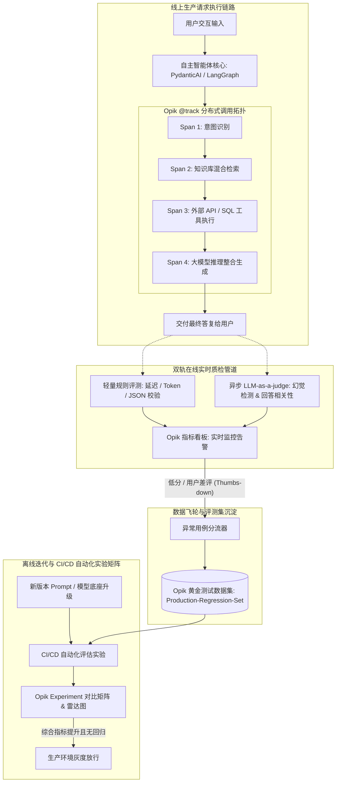

---
tags:
  - ai-practice
  - engineering
  - architecture
domain: Evaluation-and-Ops
difficulty: 进阶
date_added: 2026-10-30
---

# 💡 生产级 Agent 全链路追踪与自动化评测闭环：基于 Opik 的在线质检与评测飞轮实战

> **核心摘要**：随着多步骤自主智能体（Agent）和复杂 RAG 系统的生产落地，系统逐渐暴露出“调用链路黑盒难定位”、“线上质量不可见与指标漂移”、“提示词调整暗度陈仓式质量倒退”以及“缺乏真实生产错误回归测试集”四大严峻痛点。本文基于开源 LLM 评测与可观测性平台 **Opik**，系统性拆解 **`@track` 全链路分布式 Span 拓扑埋点**、**双轨在线实时质检（启发式规则 + 异步 LLM-as-a-judge）**、**生产失败流量一键沉淀数据集（Feedback Data Loop）** 以及 **CI/CD 自动化对比实验矩阵（Experiment Matrix）** 的全套闭环落地架构，附带可直接运行的完整工程代码与生产级避坑指南。

---

## 🎯 业务与技术背景：生产级 Agent 的四大工程暗礁

当企业的大模型应用从单轮 Prompt 问答演进为具备工具调用、自我反思、多跳知识检索与多步决策能力的 Agent 时，系统的不可控性和维护难度呈指数级剧增：

1. **多步级联调用的“黑盒暗室”与根因定位困难**：
   - 一次典型的智能体交互可能经历：“意图解析 -> 知识检索 -> 工具参数构建 -> 终端执行 -> 结果反思 -> 最终输出”多个阶段；
   - 一旦最终输出答非所问或产生幻觉，排查人员无法直观获知：究竟是 RAG 检索返回了无关上下文？还是工具执行时参数格式错位？抑或是大模型在整合多源信息时发生了逻辑幻觉？
2. **离线基准测试与真实线上流量的“严重脱节”**：
   - 团队在开发阶段依赖数十条静态测试用例，往往显示出 90%+ 的准确率；
   - 然而上线后，面对海量终端用户极其多样化、带有拼写错误和歧义的真实输入，系统的意图遵循度与回答质量发生剧烈波动，缺乏持续量化的线上质量监控面板。
3. **“暗度陈仓式”的 Prompt 迭代回归灾难**：
   - 算法工程师为了修复线上出现的某个特定 Badcase，针对性地修改了 System Prompt 或少样本示例；
   - 在缺乏自动化回归测试矩阵的情况下，这种局部修补极易“修好一个 Case，搞砸另外十个原本正常的场景”，导致模型在暗处产生不可预测的能力退化。
4. **生产异常数据沉淀为工程资产的断点**：
   - 真实生产环境中发生的工具超时、用户踩（Thumbs-down）和模型幻觉，是最宝贵的黄金对齐数据；但通常因缺乏系统化沉淀工具，散落于各处日志中，无法一键反哺至测试集。

---

## 🏗️ 架构设计与解决方案

基于 **Opik** 构建的企业级全链路追踪与评测飞轮，实现了从“线上请求捕获”、“实时质量打分”、“异常流量沉淀”到“离线 CI/CD 自动化实验评估”的完整闭环生命周期：



### 核心解法机制

1. **分布式 Span 拓扑埋点（Distributed Span Graphing）**：
   - 通过 `@track` 装饰器对 Agent 各环节（RAG 检索、工具调用、LLM 调用）进行树状包裹，精准捕获每个阶段的入参、出参、耗时与 Token 消耗，使复杂的黑盒调用一览无余；
2. **双轨异步在线质检（Dual-Track Real-time Evaluation）**：
   - 规则质检（硬指标）：微秒级校验 JSON Schema 合法性、空字段检查与系统延迟阈值；
   - 认知质检（软指标）：由异步线程池调度轻量裁判模型（如 Claude-3.5-Haiku 或 Qwen-2.5-7B），对生成的答复在线计算 `AnswerRelevance`（回答相关性）与 `Hallucination`（幻觉度）打分；
3. **数据飞轮闭环（Feedback to Dataset Loop）**：
   - 设定质检水位线（如 `relevance < 0.6` 或用户点击踩），自动触发“沉淀至回归测试集”流水线；
4. **CI/CD 自动化版本对比实验（Experiment Matrix）**：
   - 在研发新版本 Prompt 时，通过 `opik.evaluate()` 在沉淀的数据集上一键并发跑测，生成直观的分数对比热力图，为生产发布提供严密的量化门禁。

---

## 💻 工业级实现代码与配置实战

以下代码展示了如何利用 Opik 构建一套包含全链路追踪、在线双轨评分及离线自动化回归测试矩阵的完整生产闭环：

```python
import os
import time
from typing import List, Dict, Any
import opik
from opik import track, Opik
from opik.evaluation import evaluate
from opik.evaluation.metrics import Hallucination, AnswerRelevance, BaseMetric, score_result

# ==============================================================================
# 1. 基础环境与自定义轻量启发式规则指标定义
# ==============================================================================

# 配置 Opik 私有化服务端地址与统一项目空间
os.environ["OPIK_URL_OVERRIDE"] = "http://localhost:5173/api"
os.environ["OPIK_PROJECT_NAME"] = "enterprise-agent-production"

client = Opik()

class JsonOutputFormatMetric(BaseMetric):
    """
    轻量启发式规则质检：校验模型输出是否包含核心业务字段且格式合法
    """
    def __init__(self, name: str = "json_format_compliance"):
        super().__init__(name=name)

    def score(self, output: str, **kwargs) -> score_result.ScoreResult:
        import json
        try:
            parsed = json.loads(output)
            # 必须包含 summary 和 action 字段
            if "summary" in parsed and "action" in parsed:
                return score_result.ScoreResult(name=self.name, value=1.0, reason="JSON 格式完好且契约字段齐全")
            return score_result.ScoreResult(name=self.name, value=0.5, reason="JSON 合法但缺失核心契约字段")
        except Exception:
            # 非 JSON 结构判定为不达标
            return score_result.ScoreResult(name=self.name, value=0.0, reason="输出未按指令返回合法 JSON 结构")


# 初始化核心质检器 (启发式规则 + 语义度量)
format_metric = JsonOutputFormatMetric()
relevance_metric = AnswerRelevance()
hallucination_metric = Hallucination()


# ==============================================================================
# 2. 端到端 Agent 全链路拓扑埋点实战 (@track 嵌套追踪)
# ==============================================================================

@track(name="subtask_rag_retrieval")
def retrieve_internal_policy(query: str) -> List[str]:
    """
    子 Span 1: 企业私有知识库多路召回
    """
    # 模拟从向量库与关系库检索出的上下文
    return [
        "《员工福利管理细则》第 14 条：正式员工入职满一年享有 5 天全薪年休假，满三年享有 10 天。",
        "《请休假审批流》：申请连续年假超过 3 天需经部门总监级及 HRBP 二级审批。"
    ]


@track(name="subtask_tool_leave_quota")
def query_user_leave_balance(user_id: str) -> Dict[str, Any]:
    """
    子 Span 2: 外部 HR 核心系统接口调用
    """
    # 模拟通过 API 查询员工假期账户
    return {
        "user_id": user_id,
        "entry_date": "2024-03-15",
        "tenure_years": 2.5,
        "remaining_annual_leave_days": 4.5
    }


@track(name="enterprise_hr_copilot", capture_input=True)
def run_hr_assistant_agent(user_id: str, query: str) -> str:
    """
    根 Trace: 智能体端到端决策主管道
    """
    # 1. 执行知识库检索子任务
    retrieved_docs = retrieve_internal_policy(query)
    
    # 2. 执行外部工具调用子任务
    user_status = query_user_leave_balance(user_id)
    
    # 3. 构造决策提示词并模拟大模型生成
    # 实际项目中可替换为任意真实 LLM 调用 (OpenAI / vLLM / LiteLLM)
    simulated_model_output = (
        '{\n'
        '  "summary": "您入职满2年且剩余年假4.5天。根据制度入职满一年享5天年假；若申请超过3天连续休假需经部门总监与HRBP二级审批。",\n'
        '  "action": "AUTO_FILL_LEAVE_FORM",\n'
        '  "suggested_next_steps": "建议您直接在内网发起休假申请，系统已自动关联对应审批人。"\n'
        '}'
    )
    
    # 4. 在线实时质量打分并关联至当前 Trace
    fmt_res = format_metric.score(output=simulated_model_output)
    rel_res = relevance_metric.score(input=query, output=simulated_model_output, context=retrieved_docs)
    hal_res = hallucination_metric.score(input=query, output=simulated_model_output, context=retrieved_docs)
    
    # 将指标直接持久化到当前 Trace 的上下文空间
    opik.log_metric(name="json_compliance", value=fmt_res.value)
    opik.log_metric(name="answer_relevance", value=rel_res.value)
    opik.log_metric(name="hallucination_score", value=hal_res.value)
    
    # 5. 异常流量数据飞轮捕获判定
    if fmt_res.value < 0.5 or rel_res.value < 0.6:
        # 触发自动样本采集逻辑 (自动标记并入库)
        triage_badcase_to_dataset(query, simulated_model_output, "quality_score_below_threshold")
        
    return simulated_model_output


def triage_badcase_to_dataset(query: str, bad_output: str, tag: str):
    """
    数据飞轮：将线上低分异常流量自动追加到黄金评测集
    """
    dataset_name = "production-regression-test-dataset"
    try:
        ds = client.get_or_create_dataset(name=dataset_name)
        ds.insert([
            {
                "input": query,
                "expected_behavior": "需严格符合 JSON 规范且完全依据上下文真实年假政策回答",
                "failure_snapshot": bad_output,
                "incident_tag": tag
            }
        ])
        print(f"🚨 [Data Flywheel] 成功将线上低分 Badcase 归档至回归测试集: {dataset_name}")
    except Exception as e:
        print(f"数据飞轮摄取异常: {e}")


# ==============================================================================
# 3. 离线 CI/CD 自动化回归评测矩阵 (Experiment Runner)
# ==============================================================================

def execute_offline_evaluation_matrix():
    """
    当修改了 Agent 核心 Prompt 或升级模型时，在测试集上执行自动化门禁对比
    """
    print("\n🚀 [CI/CD Pipeline] 开始在生产黄金数据集上执行自动化回归评测矩阵...")
    dataset = client.get_or_create_dataset(name="production-regression-test-dataset")
    
    # 待评测的新版智能体逻辑
    def candidate_agent_v2(item: Dict[str, Any]) -> str:
        # 执行新版本的 Agent
        return run_hr_assistant_agent(user_id="test_user", query=item["input"])
    
    # 批量执行评测实验并上报 Opik Dashboard
    eval_results = evaluate(
        dataset=dataset,
        task=candidate_agent_v2,
        scoring_metrics=[format_metric, relevance_metric, hallucination_metric],
        experiment_name="Prompt_V2_Candidate_Audit"
    )
    print("✅ 自动化对比实验执行完毕，请前往 Opik 控制台查看指标对比雷达图！")


# ==============================================================================
# 4. 主程序运行验证
# ==============================================================================

if __name__ == "__main__":
    print("⚡ 启动企业级智能体生产调用与追踪...")
    
    sample_user_query = "我想休4天年假，请问我还有多少余额？审批需要找谁？"
    answer = run_hr_assistant_agent(user_id="EMP_88921", query=sample_user_query)
    
    print("\n--- 智能体输出 ---")
    print(answer)
    print("------------------")
    print("📊 当前调用的分布式拓扑 Span 与三维质检分数已完全上报至 Opik 本地服务！")
```

---

## ⚠️ 生产环境踩坑与避坑指南

### 1. 同步遥测打点阻塞业务请求导致 P99 恶化（Telemetry Latency Overhead）
- **生产故障表现**：在默认同步配置下，如果每一次 `@track` 都通过 HTTP 同步等待 Opik 服务端返回 ACK，在网络轻微抖动时，用户端原本 100ms 的操作可能被拉长至 400ms，严重损害吞吐量。
- **避坑方案**：
  - **启用后台异步非阻塞上报（Async Batch Dispatching）**：确保 Opik 客户端配置为后台守护线程批量缓冲上传（`opik.flush()` 在后台以预设时间间隔如 2 秒或达到 50 条批次时异步发送）；
  - **熔断机制保护**：在调用追踪包装器外部增加超时保护与异常降级（`try...except` 吞掉上报异常），确保即使可观测性底座短暂维护，线上核心交易与交互业务绝不中断。

### 2. 线上全量开启 LLM-as-a-judge 导致“裁判成本反噬（Cost Explosion）”
- **生产故障表现**：许多团队为了全面掌控质量，对线上每一笔用户交互都调用 GPT-4o 作为裁判模型计算幻觉评分。结果导致“评测模型的账单费用比业务应用本身还要高出 3 倍”，且引发外部 API 的并发限流。
- **避坑方案**：
  - **动静结合的阶梯式采样质检策略**：
    - 对所有流量执行 100% 的**轻量级启发式规则质检**（正则、JSON 格式、敏感词、耗时、Token 数）；
    - 对重度的 **LLM-as-a-judge 语义评测**采用动态自适应采样率（常规业务抽样 5% ~ 10% 流量评估；当检测到规则异常或用户点击踩时，才 100% 触发裁判模型）；
  - **裁判模型分层降本**：选用吞吐极高、成本仅为旗舰模型几十分之一的高性价比模型（如 Claude-3.5-Haiku、DeepSeek-V3 或本地部署的 Qwen-2.5-7B-Instruct）作为日常在线质检裁判，保留旗舰模型用于月度深度复盘。

### 3. LLM-as-a-judge 的位置偏置与长度偏置（Position & Length Bias）
- **生产故障表现**：裁判模型在给回答打分时，本能地偏好更冗长、排版更华丽的答复（即使其中包含车轱辘废话），并且对上下文的摆放顺序敏感，导致评分失真。
- **避坑方案**：
  - **结构化少样本少歧义 Prompt（Few-Shot Rubrics）**：在裁判 Prompt 中提供极其精确的打分量规（例如明确规定：必须针对检索事实进行逐句事实核验，文字冗余扣分）；
  - **引入结构化输出约束**：强制要求裁判模型采用统一的 JSON 格式输出 `{"score": float, "reasoning": "具体违规语句引用"}`，提高评测的可审计性与稳定性。

---

## 🔗 关联项目与引用

- 相关工具: [[Opik]], [[Langfuse]], [[Phoenix]], [[AgentOps]], [[DeepEval]], [[Promptfoo]], [[Ragas]]
- 知识库日报: [[2026-10-30-AI-Digest]]
- 参考仓库: [comet-ml/opik (GitHub)](https://github.com/comet-ml/opik)
