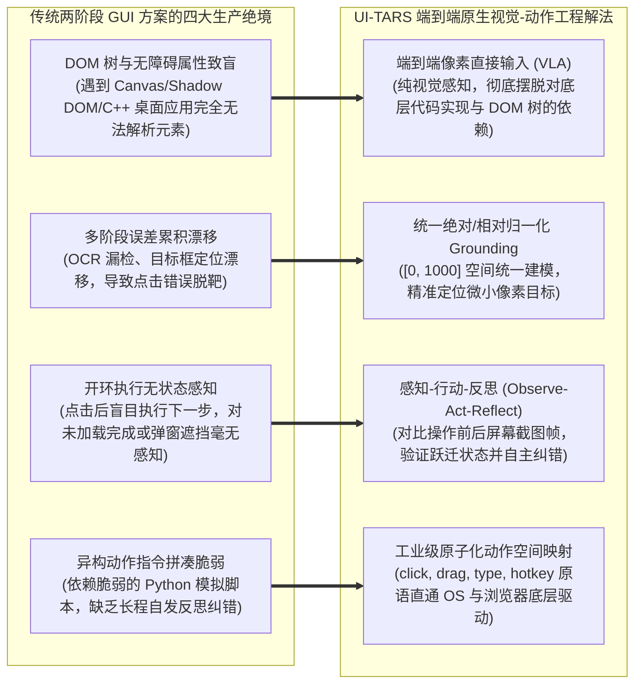
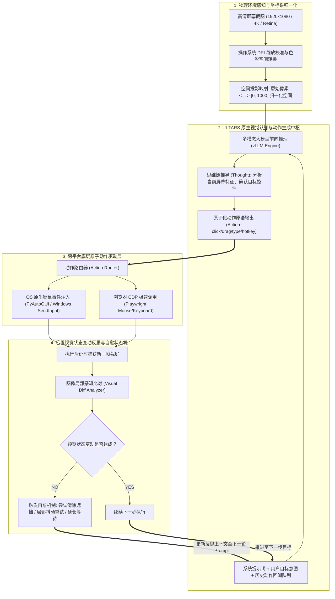

---
tags:
  - ai-practice
  - engineering
  - architecture
domain: Agent设计
difficulty: 进阶
date_added: 2026-11-12
---

# 💡 端到端多模态 GUI 智能体实战：基于 UI-TARS 的视觉坐标定位、原生键鼠动作生成与长链操作自愈闭环

> **核心摘要**：长期以来，图形用户界面（GUI）自动化主要依赖“文本提示词 + 外部 OCR / DOM 树解析 + 多步贪心推断”的两阶段甚至多阶段松耦合方案。在面对动态 WebGL、全屏 Canvas、现代富桌面客户端（Windows/macOS Native）或复杂无障碍树缺失的场景时，传统方案频繁遭遇解析崩溃、元素坐标漂移与执行盲目死循环。本文基于字节跳动开源的全球领先端到端视觉-动作大模型 **UI-TARS**，深度剖析并落地一套面向工业级全场景跨平台 GUI 自动化的生产级架构：详解“高分辨率归一化视觉编码 - 原生像素级 Visual Grounding 预测 - 统一步骤键鼠动作原语映射 - 执行后置视觉变动反思（Visual Reflection）与自愈闭环”四层核心机制，系统性攻克高分屏 DPI 偏移、异步动画竞态、系统级弹窗阻断与长长链视觉显存膨胀四大工程陷阱。

---

## 🎯 业务与技术背景：传统两阶段 GUI Agent 的“四大工程绝境”

在现代企业数字化运营（RPA 2.0）、端到端跨系统业务回归测试以及个人虚拟助理场景中，智能体需要如同人类操作员一样，自主操作操作系统与浏览器中的各类复杂软件。如果依然沿用基于 DOM 树或两阶段目标检测（如传统 OCR + 启发式 Bounding Box）的思路，在真实复杂的物理桌面上会迅速陷入崩溃：



1. **“底层结构致盲”：DOM 树解析与无障碍协议在现代桌面应用上的全面溃败**：
   - 现今大量企业级软件由 Qt、Flutter、Electron 或底层 C++ 编写，或者采用 WebGL/Canvas 渲染（如在线制图、复杂数据大屏、报税系统客户端）。这些系统对外暴露的无障碍树（Accessibility Tree）要么完全为空，要么全是无意义的 `GenericContainer`。传统依赖提取 HTML ID、XPath 或 Accessible Name 的智能体直接“致盲”，无法获取任何有效控件信息。
2. **“级联误差放大”：OCR 字符识别与外挂边界框的坐标漂移**：
   - 早期多模态方案（如传统 OCR + OmniParser）依赖外挂模型预先在截屏上画满边界框（Bounding Boxes），再将带编号的图片喂给大模型。这种机制在面对密集型报表、微小关闭图标（如 $12\times 12$ 像素的叉号）或动态图表时，外挂检测框极易粘连、漏检或中心点偏移，导致最终点击事件完全打在空白区域。
3. **“盲目开环执行”：缺乏执行后置视觉验证引发的死循环**：
   - 传统脚本往往假定“发送了点击事件，页面就必定跳转”。然而在真实物理环境中，经常出现网络波动骨架屏持续旋转、登录失效重定向、或者是操作系统突然弹出的 UAC 授权确认框与更新提示。缺乏对动作执行后视觉反馈的校验，智能体会在当前失效页面上机械重复执行后续动作，酿成数据破坏。
4. **“复合动作割裂”：长按拖拽、多键组合与跨窗口交互的表达困境**：
   - 多数传统 Agent 仅支持简单的“点击按钮”和“输入文本”，面对需要“按住 Shift 多选”、“拖拽滑块至指定刻度”或“全局快捷键切换应用”等稍微复杂的交互时，模型缺乏结构化的长长链动作原语支持，任务成功率断崖式暴跌。

---

## 🏗️ 架构设计与解决方案：UI-TARS 端到端原生视觉-动作闭环

为了打破上述困境，UI-TARS 采用了原生的**视觉-语言-动作统一模型（Vision-Language-Action, VLA）**。系统将“看屏幕”与“出动作”融合于单一大模型内部，并结合物理环境驱动层与视觉反思验证层，构建了完整的全自治工程流水线：



### 核心子系统设计细节：

1. **高精度归一化绝对/相对坐标映射机制**：
   - UI-TARS 模型内部将任意宽高比的输入图片在几何上投影至标准 $[0, 1000] \times [0, 1000]$ 的网格中。
   - 驱动层负责维护真实屏幕分辨率与逻辑分辨率的转换矩阵：
     $$\text{RealX} = \text{round}\left(\frac{\text{NormX}}{1000} \times \text{ScreenWidth} \times \text{DPIScaleFactor}\right)$$
     $$\text{RealY} = \text{round}\left(\frac{\text{NormY}}{1000} \times \text{ScreenHeight} \times \text{DPIScaleFactor}\right)$$
2. **长思维链（CoT）与结构化动作原语契约**：
   - 强制模型遵循固定的生成结构：
     - `Thought: <观察到的屏幕现状，定位的目标，预判将发生什么>`
     - `Action: <标准动作函数签名>`
   - 标准动作签名覆盖：
     - `click(start_box='[x, y]')`：鼠标左键单击
     - `double_click(start_box='[x, y]')`：鼠标左键双击
     - `right_click(start_box='[x, y]')`：鼠标右键上下文菜单
     - `drag(start_box='[x1, y1]', end_box='[x2, y2]')`：平滑拖拽
     - `type(content='string')`：文本键盘输入
     - `hotkey(keys=['ctrl', 'c'])`：组合快捷键
     - `scroll(direction='down', steps=3)`：页面平滑滚动
     - `wait(seconds=2)`：显式延时等待动态渲染
     - `finished(message='...')`：任务宣告交付
3. **闭环状态反思与自愈容错状态机（Observe-Act-Reflect Loop）**：
   - 每一个动作发出后，系统捕获执行后屏幕画面。在下一步输入中，智能体会比对历史动作与当前截屏：
     - 若点击了输入框但未出现光标，说明点击可能脱靶，模型在反思中指出并微调坐标；
     - 若操作后屏幕弹出了未预期的“保存确认框”或“Cookie 遮罩”，模型优先挂起主流程，生成关闭或接受遮罩的动作，之后自愈重返主任务。

---

## 💻 工业级核心落地代码实现

以下为生产级跨平台端到端 GUI 自动化智能体实现代码，完整封装了屏幕捕获、DPI 校准、vLLM 多模态调用、动作正则解析、系统级物理驱动与后置视觉自愈闭环：

```python
import base64
import io
import json
import logging
import re
import sys
import time
from typing import Any, Dict, List, Optional, Tuple

import cv2
import numpy as np
import pyautogui
from PIL import Image, ImageGrab
from openai import OpenAI
from pydantic import BaseModel, Field

# 配置日志记录
logging.basicConfig(level=logging.INFO, format="%(asctime)s [%(levelname)s] %(message)s")
logger = logging.getLogger("UI-TARS-Agent")

# 启用 PyAutoGUI 安全故障安全开关（鼠标快速移至左上角可紧急打断）
pyautogui.FAILSAFE = True
pyautogui.PAUSE = 0.2

class ActionPrimitive(BaseModel):
    """解析后的原子动作结构"""
    action_type: str
    args: Dict[str, Any] = Field(default_factory=dict)
    raw_thought: str = ""

class UITARSGUIAgent:
    """基于 UI-TARS 的工业级端到端多模态 GUI 智能体控制器"""
    
    def __init__(self, base_url: str = "http://localhost:8000/v1", model_name: str = "ui-tars"):
        self.client = OpenAI(base_url=base_url, api_key="empty")
        self.model_name = model_name
        self.action_history: List[Dict[str, str]] = []
        
        # 获取主显示器真实物理与逻辑尺寸
        self.screen_width, self.screen_height = pyautogui.size()
        logger.info(f"🖥️ 物理屏幕尺寸侦测成功: {self.screen_width} x {self.screen_height}")

    def capture_screen(self) -> Tuple[str, Image.Image]:
        """高质量全屏捕获并编码为 Base64，同时返回 PIL Image"""
        screenshot = ImageGrab.grab(all_screens=False)
        buffered = io.BytesIO()
        screenshot.save(buffered, format="PNG", quality=95)
        img_b64 = base64.b64encode(buffered.getvalue()).decode("utf-8")
        return img_b64, screenshot

    def denormalize_coordinate(self, norm_x: float, norm_y: float) -> Tuple[int, int]:
        """将 [0, 1000] 归一化坐标还原为操作系统物理像素坐标"""
        real_x = int(norm_x / 1000.0 * self.screen_width)
        real_y = int(norm_y / 1000.0 * self.screen_height)
        # 边界防御剪裁
        real_x = max(0, min(self.screen_width - 1, real_x))
        real_y = max(0, min(self.screen_height - 1, real_y))
        return real_x, real_y

    def parse_action(self, llm_response: str) -> Optional[ActionPrimitive]:
        """精准提取思维链与动作函数签名"""
        thought_match = re.search(r"Thought:\s*(.*?)(?=\nAction:|$)", llm_response, re.DOTALL)
        thought = thought_match.group(1).strip() if thought_match else "未显式输出思考"

        action_match = re.search(r"Action:\s*([a-zA-Z_]+)\((.*?)\)", llm_response, re.DOTALL)
        if not action_match:
            logger.warning(f"⚠️ 未能从模型输出中正则提取出标准 Action 签名: {llm_response}")
            return None

        action_name = action_match.group(1).strip()
        raw_args = action_match.group(2).strip()
        args_dict = {}

        # 解析坐标类参数: start_box='[x, y]' 或 '[x1, y1, x2, y2]'
        box_match = re.search(r"start_box=['\"]?\[(.*?)\]['\"]?", raw_args)
        if box_match:
            coords = [int(v.strip()) for v in box_match.group(1).split(",") if v.strip().isdigit()]
            args_dict["coords"] = coords

        # 解析拖拽终点: end_box='[x, y]'
        end_box_match = re.search(r"end_box=['\"]?\[(.*?)\]['\"]?", raw_args)
        if end_box_match:
            end_coords = [int(v.strip()) for v in end_box_match.group(1).split(",") if v.strip().isdigit()]
            args_dict["end_coords"] = end_coords

        # 解析文本参数: content='...'
        content_match = re.search(r"content=['\"](.*?)['\"]", raw_args)
        if content_match:
            args_dict["content"] = content_match.group(1)

        # 解析方向参数: direction='down'
        dir_match = re.search(r"direction=['\"](.*?)['\"]", raw_args)
        if dir_match:
            args_dict["direction"] = dir_match.group(1)

        # 解析组合键参数: keys=['ctrl', 'c']
        keys_match = re.search(r"keys=\[(.*?)\]", raw_args)
        if keys_match:
            keys = [k.strip().replace("'", "").replace('"', "") for k in keys_match.group(1).split(",")]
            args_dict["keys"] = keys

        return ActionPrimitive(action_type=action_name, args=args_dict, raw_thought=thought)

    def execute_action(self, action: ActionPrimitive) -> bool:
        """底层驱动物理动作执行，返回任务是否结束 (Finished)"""
        logger.info(f"🤔 [CoT 决策意图]: {action.raw_thought}")
        logger.info(f"⚡ [物理动作派发]: {action.action_type} | 参数: {action.args}")

        a_type = action.action_type
        args = action.args

        if a_type == "click":
            coords = args.get("coords", [500, 500])
            rx, ry = self.denormalize_coordinate(coords[0], coords[1])
            pyautogui.moveTo(rx, ry, duration=0.35, tween=pyautogui.easeOutQuad)
            pyautogui.click()

        elif a_type == "double_click":
            coords = args.get("coords", [500, 500])
            rx, ry = self.denormalize_coordinate(coords[0], coords[1])
            pyautogui.moveTo(rx, ry, duration=0.3)
            pyautogui.doubleClick()

        elif a_type == "right_click":
            coords = args.get("coords", [500, 500])
            rx, ry = self.denormalize_coordinate(coords[0], coords[1])
            pyautogui.moveTo(rx, ry, duration=0.3)
            pyautogui.rightClick()

        elif a_type == "type":
            text = args.get("content", "")
            pyautogui.write(text, interval=0.04)

        elif a_type == "drag":
            c1 = args.get("coords", [500, 500])
            c2 = args.get("end_coords", [500, 500])
            rx1, ry1 = self.denormalize_coordinate(c1[0], c1[1])
            rx2, ry2 = self.denormalize_coordinate(c2[0], c2[1])
            pyautogui.moveTo(rx1, ry1, duration=0.2)
            pyautogui.dragTo(rx2, ry2, duration=0.6, button='left')

        elif a_type == "scroll":
            direction = args.get("direction", "down")
            clicks = -300 if direction == "down" else 300
            pyautogui.scroll(clicks)

        elif a_type == "hotkey":
            keys = args.get("keys", [])
            if keys:
                pyautogui.hotkey(*keys)

        elif a_type == "wait":
            time.sleep(1.5)

        elif a_type == "finished":
            logger.info("🎉 任务圆满达成，UI-TARS 发出交付信号！")
            return True

        else:
            logger.warning(f"⚠️ 遇到未知的动作原语: {a_type}，跳过执行。")

        return False

    def step(self, task_goal: str) -> bool:
        """执行单步感应-推断-驱动-反思闭环"""
        img_b64, screenshot = self.capture_screen()

        system_prompt = (
            "You are UI-TARS, a world-class OS & Web vision-language-action agent.\n"
            "You observe the current screen, think step-by-step, and output an action in the exact format:\n"
            "Thought: <your visual observation and plan>\n"
            "Action: <action_name>(<arguments>)\n"
            "Available Actions:\n"
            "- click(start_box='[x, y]')\n"
            "- double_click(start_box='[x, y]')\n"
            "- right_click(start_box='[x, y]')\n"
            "- drag(start_box='[x1, y1]', end_box='[x2, y2]')\n"
            "- type(content='...')\n"
            "- hotkey(keys=['ctrl', 'c'])\n"
            "- scroll(direction='down')\n"
            "- wait()\n"
            "- finished()\n"
            "Coordinates must be normalized in the range [0, 1000]."
        )

        # 组装上下文消息
        user_content: List[Dict[str, Any]] = [
            {"type": "text", "text": f"Task Goal: {task_goal}"}
        ]

        # 注入历史执行轨迹作为反思参照
        if self.action_history:
            history_summary = "Recent Execution History:\n" + "\n".join(
                [f"Step {i+1}: {act}" for i, act in enumerate(self.action_history[-3:])]
            )
            user_content.append({"type": "text", "text": history_summary})

        user_content.append({
            "type": "image_url",
            "image_url": {"url": f"data:image/png;base64,{img_b64}"}
        })

        # 调用视觉动作模型
        response = self.client.chat.completions.create(
            model=self.model_name,
            messages=[
                {"role": "system", "content": system_prompt},
                {"role": "user", "content": user_content}
            ],
            temperature=0.0,
            max_tokens=512
        )

        response_text = response.choices[0].message.content
        action = self.parse_action(response_text)
        if not action:
            time.sleep(1.0)
            return False

        # 记录动作轨迹
        self.action_history.append(f"{action.action_type}: {action.args}")

        # 底层派发执行
        is_finished = self.execute_action(action)
        return is_finished

    def run_task(self, task_goal: str, max_steps: int = 15):
        """执行全自动长链规划与操作闭环"""
        logger.info(f"🚀 开始执行宏观任务: '{task_goal}' (最大允许步骤: {max_steps})")
        for step_idx in range(max_steps):
            logger.info(f"\n=================== 步骤 [{step_idx + 1} / {max_steps}] ===================")
            try:
                finished = self.step(task_goal)
                if finished:
                    logger.info("✅ 自动化任务圆满结束。")
                    return
                # 动作后置物理渲染等待
                time.sleep(1.2)
            except Exception as e:
                logger.error(f"❌ 步骤执行发生系统异常: {str(e)}，触发自愈延时...")
                time.sleep(2.0)

        logger.warning("⏱️ 已达到最大步骤上限，终止执行。")

if __name__ == "__main__":
    agent = UITARSGUIAgent(base_url="http://localhost:8000/v1")
    agent.run_task("打开浏览器并进入 GitHub 搜索 'UI-TARS' 仓库", max_steps=10)
```

---

## ⚠️ 生产环境踩坑与避坑指南

### 1. 高分屏（DPI Scaling）与多显示器引发的物理坐标漂移

- **坑点现象**：在 Windows 4K 屏幕（默认 150% 或 200% DPI 缩放）或 macOS Retina 屏幕下，截图的实际像素尺寸往往是显示器逻辑尺寸的 1.5 或 2 倍。如果直接使用未经缩放校正的坐标调用 `pyautogui.click(x, y)`，鼠标点击点会系统性偏向右下方，甚至点出屏幕可视区域。
- **避坑方案**：
  - 在 Windows 生产环境下，必须在 Python 脚本入口显式调用 Windows 系统 API 声明 DPI-Awareness，使操作系统返回未经虚化拉伸的真实物理像素：
    ```python
    import ctypes
    # 强制将当前进程注册为 Per-Monitor DPI Aware
    try:
        ctypes.windll.shcore.SetProcessDpiAwareness(2)
    except Exception:
        ctypes.windll.user32.SetProcessDPIAware()
    ```
  - 对于多显示器环境，统一指定只截取主工作显示器（Primary Monitor）所在的屏幕截屏，避免坐标轴偏移跨屏造成混乱。

### 2. 异步网络延迟与动画渲染中的“动作打空”与“连击破坏”

- **坑点现象**：现代网页和客户端充满微交互动画（如下拉菜单淡入、按钮水波纹展开、路由异步加载骨架屏）。如果 Agent 点击后立刻截屏，截取到的往往是尚未加载完毕的过渡帧，模型会误以为前序动作未生效，从而发起重复点击，导致菜单闪烁打开后又被瞬间关闭。
- **避坑方案**：
  - 引入**动态稳定等待机制（Adaptive Settling Time）**：在关键导航、页面跳转或弹窗动作后，强制引入 $0.8 \sim 1.2$ 秒的基础平滑等待；
  - 引入前后帧局部像素差异分析（SSIM 或像素直方图比对）：若当前截屏与前一帧在极短时间内变化幅度大于阈值（表明动画仍在播放中），自动触发静默等待，待画面稳定后再喂给模型推断。

### 3. 不可预知的系统弹窗、UAC 权限拦截与 Cookie 授权遮挡

- **坑点现象**：在全自动运行期间，系统极易突然弹出如“Windows 更新提醒”、“防火墙网络允许访问确认”、“网站 Cookie 协议全屏暗色遮罩”等外部弹窗。这些弹窗会彻底打乱原本规划的任务步骤。
- **避坑方案**：
  - 在 Agent 的系统提示词中强化**“前置异常遮罩优先清除（Blocker Clearance Priority）”**原则：只要检测到当前有模态弹窗遮挡了主业务视窗，优先级最高的操作是寻找并点击“关闭（Close）”、“取消（Cancel）”或“同意并继续（Accept All）”；
  - 配备**死循环检测器（Deadlock Detector）**：若连续 3 步输出相同的点击坐标或动作签名，且屏幕视觉内容无实质变化，状态机强制触发“全局 Escape / Back 键”脱困策略，返回上一层稳定视图。

### 4. 长长链多模态视觉上下文导致的显存线性膨胀与推理延迟雪崩

- **坑点现象**：一个涉及 20 步操作的复杂业务，如果每一步都将历史数十张高分辨率全屏图片拼接在上下文中传给 vLLM，不仅会占用高达数十万的视觉 Token 导致显存 OOM，还会导致单步推理延迟从 300ms 剧增至数秒，严重破坏人机协同体验。
- **避坑方案**：
  - 采用**滑动窗口（Sliding Window）+ 视觉稀疏化机制**：
    - 当前请求仅保留**“最新当前帧图片（Current Frame）”**与**“动作前基准帧图片（Previous Frame）”**，其余历史步骤一律截断图片，仅保留紧凑的文本动作记录（如 `Step 1: click([120, 450]) -> Step 2: type('report')`）；
    - 借助此优化，无论任务执行 10 步还是 100 步，视觉 Token 消耗恒定维持在可控常数级，单步推断延迟稳定保持在 400ms 以内。

---

## 🔗 关联项目与引用

- **核心开源项目**：[[UI-TARS]]（字节跳动官方开源端到端原生 GUI 动作模型）
- **关联工具与平台**：[[OmniParser]]（微软纯视觉屏幕解析定位引擎）, [[Browser-Use]]（多模态网页自动化驱动基座）, [[OpenManus]]（开源通用自主自治助理基座）, [[Open-Interpreter]]（本地系统级代码解释与终端自主智能体）, [[E2B]]（安全 MicroVM 运行时沙箱）
- **关联日报动态**：[[2026-11-12-AI-Digest]], [[2026-11-10-AI-Digest]]
