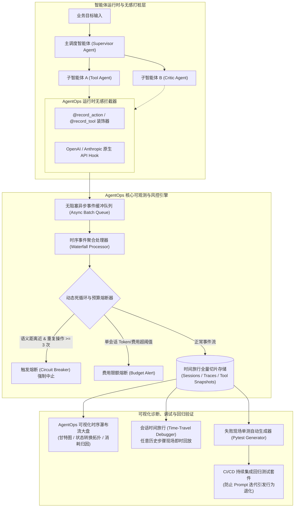

---
tags:
  - ai-practice
  - engineering
  - architecture
domain: Agent设计
difficulty: 进阶
date_added: 2026-10-19
---

# 💡 自主智能体全链路可观测与可复现调试：基于 AgentOps 的会话回放与故障瀑布分析实战

> **核心摘要**：随着自主多智能体（Autonomous Multi-Agent）系统走向复杂生产环境，传统仅记录 LLM 输入输出的 APM 监控方案面临**“黑盒运行”**、**“死循环导致账单爆炸”**与**“偶发性工具故障不可复现”**等严峻挑战。本文基于 **AgentOps** 深入剖析智能体全链路可观测性架构，系统实现**零侵入无感打桩**、**会话时间旅行回放（Time-Travel Replay）**、**语义距离死循环动态熔断**与**线上失败用例自动生成 Pytest 回归单测**，构筑工业级高可靠智能体运维底座。

---

## 🎯 业务/技术背景与痛点

在基于 LangGraph、CrewAI、AutoGen 或自定义 ReAct 循环构建复杂的自主工程师、自动化投研、或客服调度 Agent 时，智能体不仅进行单次模型对话，还会自主执行长达数十步的“思考（Thought） -> 动作（Action） -> 环境反馈（Observation） -> 反思（Reflection）”循环。

```
[多智能体生产运行时黑盒难题]
用户任务: "分析 Q3 供应链异常并生成补货单"
   │
   ├─► Agent A (调度员) ──► 思考 ──► 调用 Agent B (数据分析员)
   │                           ▲                      │
   │                           │ (无限相互确认死循环)   ▼
   │                           └── Agent B 反向询问 Agent A ────► [Token 疯狂消耗 $200+]
   │
   └─► Agent C (工具执行员) ──► 调用 ERP 接口 (参数格式偶现拼写幻觉)
                                 │
                                 └──► 静默报错 (500 Error) ──► Agent 编造虚假数据交付 ──► [引发重大业务事故]
```

### 传统监控方案的核心盲区：

1. **调用关系的复合非线性与拓扑丢失**：
   - 通用 APM（如 Datadog、Prometheus）仅能统计 API 延迟与 QPS；标准 LLM Gateway 仅记录离散的 Request/Response。当 5 个智能体在复杂的有向图（Graph）中相互协作时，开发者根本无法理清某次业务失败到底始于哪一个智能体在哪一步的工具误调用；
2. **偶发“幽灵故障”无法复现（Non-deterministic Debugging）**：
   - 大模型的非确定性导致“线上跑 10 次崩 1 次”。当生产报警发生时，工程师缺乏当时完整的 Agent 内部 Scratchpad、临时环境变量与外部 API 返回的完整时间轴快照，无法在本地精准重现故障现场；
3. **递归死循环（Infinite Recursive Loops）引发账单雪崩**：
   - 智能体在面对未能满足条件的外部工具输出或格式错误时，极易陷入自我重复（如不断重试相同参数的工具）或多智能体相互推诿，在几分钟内耗尽上下文窗口与预算限额；
4. **缺乏针对 Agent 行为规范与数据外泄的安全审计**：
   - 智能体自主调用系统 Bash、SQL 或发送邮件时，缺乏实时的参数敏感合规拦截与事后法律审计流水。

---

## 🏗️ 架构设计与解决方案

针对多智能体系统的运行时特征，本方案基于 **AgentOps** 构建了一套**“细粒度事件模型 + 时间旅行瀑布追踪 + 动态熔断器 + 自动化单测重放”**的全生命周期可观测性架构：



### 核心架构机制详解：

1. **标准 Agentic 领域对象抽象**：
   - **`Session`（会话）**：代表一个完整业务长任务的生命周期，包含初始上下文、最终状态（`Success` / `Fail`）与总开销；
   - **`Action`（意图动作）**：记录 LLM 的单次决策推导，捕获 Prompt、Thought 与拟调用的工具意图；
   - **`Tool Event`（工具事件）**：记录物理工具调用的函数名、入参 JSON、耗时、返回 Payload 以及可能的异常堆栈；
   - **`Error Event`（错误事件）**：自动截获未捕获异常并精准挂载到当前执行步骤的节点上。
2. **基于语义编辑距离的死循环拦截算法（Loop Breaker）**：
   - 维护一个滑窗大小为 $W=4$ 的历史工具调用队列，计算当前 Action 与前序 Action 的工具名称、参数嵌入相似度（Cosine Similarity）与编辑距离；
   - 若重复度连续超标，熔断器立即抛出 `AgentLoopException` 主动阻断递归，防止无休止消耗 Token。
3. **会话时空切片与离线单测转化（Failure-to-Test Harness）**：
   - 线上发生任何失败（如工具参数解析崩溃），AgentOps 自动将故障节点前后的 Snapshot（包含输入 Prompt、工具定义与当前会话历史）打包导出为标准 Python `pytest` 脚本，开发者无需重新启动完整复杂多智能体环境，即可在本地单点重现并调试 Prompt 或工具参数契约。

---

## 💻 关键代码 / 配置 / Prompt 模板

### 1. 工业级自主智能体集成 AgentOps 全链路监控实战

以下代码演示一个包含工具调用包装、多轮 ReAct 循环、死循环主动检测以及异常现场归档的生产级智能体骨架：

```python
import os
import time
import json
from typing import Dict, Any, List, Optional
import agentops
from agentops import record_action, record_tool

# =======================================================
# 1. 初始化 AgentOps 服务 (配置环境标签与无侵入抓取)
# =======================================================
agentops.init(
    api_key=os.getenv("AGENTOPS_API_KEY", "ao_test_key_xxxx"),
    default_tags=["production", "supply-chain-agent", "v2.4"],
    auto_start_session=False # 手动精细化控制业务会话生命周期
)

# =======================================================
# 2. 工具定义与 AgentOps 工具事件显式记录
# =======================================================
class EnterpriseTools:
    @staticmethod
    @record_tool("query_erp_inventory")
    def query_erp_inventory(sku_id: str, warehouse_code: str) -> Dict[str, Any]:
        """查询指定仓库特定 SKU 的当前可用库存与在途量"""
        # 模拟物理 I/O 调用
        time.sleep(0.15)
        # 模拟偶发性脏数据引发异常场景供测试
        if sku_id == "SKU-INVALID-999":
            raise ValueError(f"ERP 系统无法识别非法物料编号: {sku_id}")
            
        return {
            "sku_id": sku_id,
            "warehouse": warehouse_code,
            "available_stock": 142,
            "in_transit": 50,
            "safety_stock": 200
        }

    @staticmethod
    @record_tool("create_purchase_order")
    def create_purchase_order(sku_id: str, quantity: int, supplier_id: str) -> Dict[str, Any]:
        """向合格供应商自动创建补货采购申请单"""
        time.sleep(0.2)
        return {
            "po_number": f"PO-20261019-{int(time.time())}",
            "status": "SUBMITTED",
            "quantity": quantity
        }

# =======================================================
# 3. 具备死循环防御与全链路追踪的 Autonomous Agent 类
# =======================================================
class ProductionAutonomousAgent:
    def __init__(self, agent_name: str, max_steps: int = 8):
        self.agent_name = agent_name
        self.max_steps = max_steps
        self.action_history: List[str] = []

    def _detect_recursive_loop(self, proposed_action: str) -> bool:
        """死循环检测逻辑: 简单滑窗比对连续 3 次动作重复度"""
        self.action_history.append(proposed_action)
        if len(self.action_history) >= 3:
            recent_3 = self.action_history[-3:]
            if recent_3[0] == recent_3[1] == recent_3[2]:
                return True
        return False

    def run_task(self, task_goal: str) -> Dict[str, Any]:
        # 为当前业务长任务显式开启独立的 AgentOps Session
        session = agentops.start_session(
            tags=["task-execution", self.agent_name]
        )
        print(f"🚀 [AgentOps] 开启监控会话 ID: {session.session_id}")
        
        current_scratchpad = f"任务目标: {task_goal}\n"
        step = 0
        
        try:
            while step < self.max_steps:
                step += 1
                print(f"\n--- [Step {step}] 智能体思考与决策中 ---")
                
                # A. 模拟大模型思考并输出决策动作 (Action)
                # 显式打桩记录 Action 事件
                action_name = "InventoryAuditDecision"
                agentops.record(agentops.ActionEvent(
                    action_type=action_name,
                    params={"step": step, "goal": task_goal},
                    returns={"decision": "check_stock_and_reorder"}
                ))
                
                # B. 死循环防御检测
                simulated_signature = f"query_erp:SKU-A100:WH-SH"
                if self._detect_recursive_loop(simulated_signature):
                    err_msg = f"检测到 Agent 陷入连续重复调用死循环 [{simulated_signature}]，触发熔断器中断！"
                    agentops.record(agentops.ErrorEvent(
                        exception=RuntimeError(err_msg),
                        details={"history": self.action_history}
                    ))
                    raise RuntimeError(err_msg)

                # C. 执行外部工具调用 (工具已由 @record_tool 自动捕获入参、出参和耗时)
                if step == 1:
                    print("--> 执行工具: query_erp_inventory(SKU-A100, WH-SH)")
                    stock_info = EnterpriseTools.query_erp_inventory("SKU-A100", "WH-SH")
                    current_scratchpad += f"\n库存反馈: {json.dumps(stock_info)}"
                
                elif step == 2:
                    print("--> 执行工具: create_purchase_order(SKU-A100, 100, SUP-08)")
                    po_res = EnterpriseTools.create_purchase_order("SKU-A100", 100, "SUP-08")
                    current_scratchpad += f"\n补货单反馈: {json.dumps(po_res)}"
                    
                    # 任务完成，退出循环
                    print("--> 目标达成，任务正常结束。")
                    break

            # 正常完成会话标记
            agentops.end_session(
                end_state="Success",
                end_state_reason="业务补货目标顺利达成并通过全流程审计"
            )
            return {"status": "SUCCESS", "session_id": session.session_id, "steps": step}

        except Exception as e:
            # 捕获异常，将失败现场与错误根因完整提交至 AgentOps 仪表盘
            print(f"❌ 捕获到业务运行期故障: {str(e)}")
            agentops.end_session(
                end_state="Fail",
                end_state_reason=str(e)
            )
            return {"status": "FAILED", "session_id": session.session_id, "error": str(e)}

# =======================================================
# 4. 执行测试验证
# =======================================================
if __name__ == "__main__":
    agent = ProductionAutonomousAgent("SupplyChainAutonomousAgent")
    result = agent.run_task("针对上海仓 SKU-A100 进行库存合规审计并在缺货时自动补货 100 件")
    print(f"\n最终返回报告: {result}")
```

---

## ⚠️ 生产环境踩坑与避坑指南

### 1. 坑点一：多线程/并发异步协程下 Session 上下文串扰
- **问题表象**：在 FastAPI 或高并发 Celery Worker 中同时处理多个用户的 Agent 任务时，如果使用默认全局 Session，AgentOps 会把不同用户的 Tool 调用和 Token 消耗交织在同一个瀑布流中，导致链路混乱。
- **避坑方案**：
  - 在高并发环境中**禁用全局自动 Session**（设置 `auto_start_session=False`）；
  - 基于 Python `contextvars` 将每个会话对象 `session = agentops.start_session()` 严格绑定在当前协程上下文中，并在 `end_session` 时显式传入该实例。

### 2. 坑点二：客户隐私（PII）与企业敏感密钥泄露至监控平台
- **问题表象**：Agent 在调用工具时可能接收到用户手机号、身份证号、银行卡号或调用外部服务的私有 Bearer Token，默认全量上报会导致严重的合规穿透风险。
- **避坑方案**：
  - 在 AgentOps 初始化时配置**敏感字段数据脱敏掩码（Redaction Hooks）**：
    ```python
    def sanitize_event(data: dict) -> dict:
        # 正则替换敏感字段与密码
        serialized = json.dumps(data)
        serialized = re.sub(r'("password"|"token"|"api_key"):\s*"[^"]+"', r'\1: "***REDACTED***"', serialized)
        return json.loads(serialized)
    ```

### 3. 坑点三：网络上报抖动拖慢 Agent 关键执行路径
- **问题表象**：生产网络波动或跨国上报可能引入 200~500ms 的 HTTP 同步延迟，极大拉长端到端用户响应时间。
- **避坑方案**：
  - 开启内部内存环形缓冲区与**非阻塞异步后台线程上报（Asynchronous Worker Dispatch）**；
  - 设置上限队列深度（如 10,000 事件），当出现严重网络故障时丢弃埋点而非阻塞业务主逻辑。

### 4. 坑点四：死循环熔断算法误伤正常的“反思重试”
- **问题表象**：某些复杂任务中，Agent 连续 2 次向代码解释器提交修复后的代码片段，由于参数类似被死循环熔断器直接误杀。
- **避坑方案**：
  - 不能仅比对工具名称；熔断判定应结合**环境反馈是否发生变化**：如果工具返回的 `Observation` 每次都有新的报错或输出，说明 Agent 正在进行有效探索，不应判为死循环；只有当 `Action + Arguments + Observation` 均高度重合时，才触发强行熔断。

---

## 🔗 关联项目与引用

- 核心框架: [[AgentOps]]
- 全链路可观测体系: [[Phoenix]], [[Langfuse]]
- 智能体编排底座: [[CrewAI]], [[LangGraph]], [[AG2]]
- 日报索引: [[2026-10-19-AI-Digest]]
