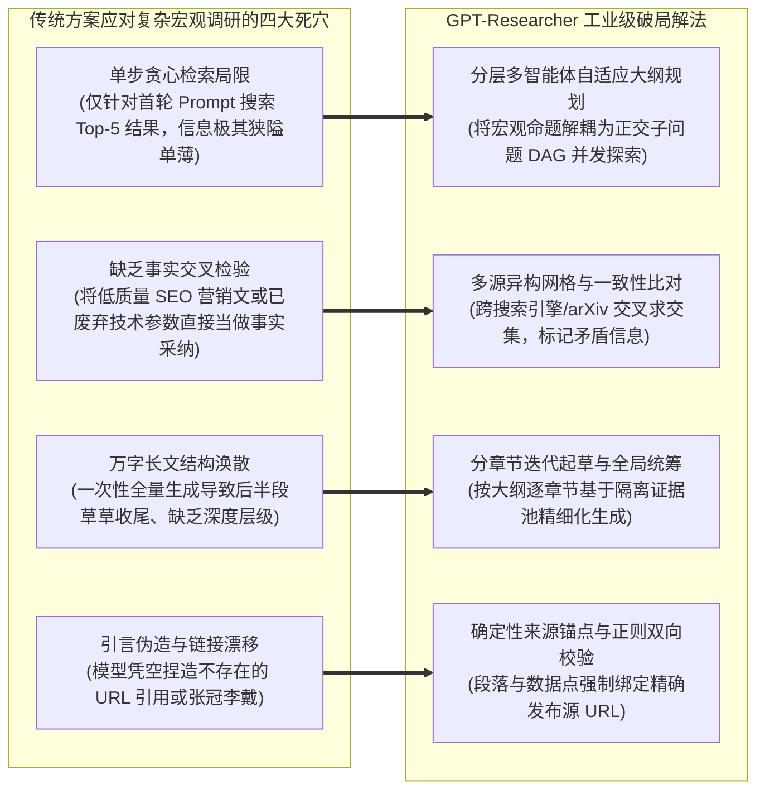

---
tags:
  - ai-practice
  - engineering
  - architecture
domain: Agent设计
difficulty: 进阶
date_added: 2026-11-11
---

# 💡 自主深度研究智能体架构：基于 GPT-Researcher 的分层多智能体并行检索、事实交叉验证与长篇综述自适应生成实战

> **核心摘要**：随着生成式 AI 应用全面纵深演进，“单轮检索问答（Single-turn RAG）”和“简单调用一次 Google 搜索的即兴 Agent”已无法胜任严肃的行业战略分析、技术架构对比与学术综述等长周期、高信息密度的深度研究任务。面向此类复杂场景，系统不仅需要针对开放性宏观命题展开系统性规划与多维度穷尽式检索，更需在海量异构网页中完成信噪比过滤、事实交叉验证与学术级精确溯源绑定。本文基于全球领先的开源深度研究智能体框架 **GPT-Researcher**，深度剖析并落地一套面向工业级研报交付的分层多智能体架构：详解“主编规划（Planner）- 子课题并发探索（Parallel Swarm）- 事实交叉校验（Fact-Checker）- 模块化长文合成（Publisher）”四层闭环，攻克搜索 API 限流、反爬阻断、事实冲突消解与长文本引用漂移四大工程陷阱。

---

## 🎯 业务与技术背景：传统检索方案在深度研报场景下的“四大生产死穴”

在企业战略调研、行业态势感知或大型技术选型中，分析师往往需要一份涵盖历史演进、核心技术机制对比、商业落地案例与潜在风险评估的万字级深度研究报告。如果直接让通用大模型或常规 RAG 管道处理此类需求，往往会遭遇不可调和的系统性失败：



1. **“单步贪心检索”导致的信息广度与深度严重不足**：
   - 普通 AI 搜索工具（如单次 Web Search Tool）只在接收到用户指令瞬间执行一次关键词查询。对于“分析 2026 年大模型显存压缩技术的演进脉络”这种课题，单次搜索最多返回 5~10 条网页摘要，遗漏了 MLA 架构、量化微架构适配、KV Cache 分布式卸载等多个关键支线，研报充斥着泛泛而谈的废话。
2. **缺乏多源事实交叉验证引发的“垃圾信息反噬”**：
   - 互联网公网上充斥着大量重复转载、甚至包含错误技术参数的营销文章。若智能体缺乏跨数据源的比对与清洗能力，虚假或过时的论断就会长驱直入进入最终研报，严重损害报告的权威性。
3. **上下文窗口与注意力稀释引发的“长文烂尾现象”**：
   - 强行让单次 LLM 对话处理几十篇完整网页的原始文本（动辄十万 Token），会导致严重的“Lost in the Middle”问题，模型无法保持逻辑连贯，最终生成的所谓“研报”往往只有一千余字，后半部分草草列举要点，深度荡然无存。
4. **引用幻觉（Hallucinated Citations）与溯源断裂**：
   - 商业严肃场景下，每个核心数据点（如“显存带宽利用率达到 3000 GB/s”）都必须给出可核验的出处。普通大模型在长文生成时极易“自作聪明”地拼凑出看似合理但实际 404 的虚假网页链接。

---

## 🏗️ 架构设计与解决方案：GPT-Researcher 分层多智能体认知流水线

为了保障研报的严谨性、全面性与结构化深度，系统采用分层多智能体解耦设计，构建包含五个核心角色的工作流：

```mermaid
flowchart TD
    subgraph InputStage [1. 任务启动与意图解析]
        UserQuery["用户调研命题<br/>(例如: 2026 开源通用自主 Agent 架构与生产级避坑深度报告)"]
        ResearchConfig["调研约束参数<br/>(深度级别: Detailed / 目标字数: 8000+ / 权威来源优先)"]
    end

    subgraph PlannerStage [2. 认知规划中枢 (Chief Editor Agent)]
        TopicDecompose["意图解耦与子领域识别"]
        OutlineGen["自适应动态大纲生成<br/>(1. 背景演进, 2. 核心架构, 3. 落地对比, 4. 生产避坑)"]
        SubQueries["正交子探索任务队列 (Sub-Research Questions)"]
        TopicDecompose --> OutlineGen --> SubQueries
    end

    subgraph SwarmExecution [3. 并发研究子智能体集群 (Researcher Swarm)]
        subgraph SubAgentA [Sub-Researcher 1: 模块化规划机制]
            Q1["搜索关键词生成"] --> S1["Tavily / SearXNG 并行请求"]
            S1 --> Scrape1["网页无头抓取与正文清洗"]
        end

        subgraph SubAgentB [Sub-Researcher 2: MCP 协议落地]
            Q2["搜索关键词生成"] --> S2["arXiv / 官方技术文档"]
            S2 --> Scrape2["网页无头抓取与正文清洗"]
        end

        subgraph SubAgentC [Sub-Researcher 3: 长链推理自愈]
            Q3["搜索关键词生成"] --> S3["GitHub Issue / 生产案例"]
            S3 --> Scrape3["网页无头抓取与正文清洗"]
        end
    end

    subgraph VerificationStage [4. 事实校验与证据池组织 (Fact-Checker Agent)]
        EvidenceStore["统一分主题证据池 (Structured Evidence Pool)"]
        Deduplication["语义去重与重复段落剔除"]
        CrossCheck["事实交叉一致性核验 (标记矛盾数据)"]
        SourceBinding["确定性来源 URL 锚点注入"]
        
        EvidenceStore --> Deduplication --> CrossCheck --> SourceBinding
    end

    subgraph PublishingStage [5. 分章节起草与最终统筹 (Publisher Agent)]
        ChapterWriter["分章节长文起草器 (Section Writers)"]
        TableSynthesizer["跨章节数据比对表格生成器"]
        GlobalReviewer["全局一致性审校与格式排版"]
        ExportOutput["工业级 Markdown / PDF 研报交付"]

        ChapterWriter --> TableSynthesizer --> GlobalReviewer --> ExportOutput
    end

    UserQuery ==> TopicDecompose
    ResearchConfig -.-> OutlineGen
    SubQueries ==> SubAgentA & SubAgentB & SubAgentC
    Scrape1 & Scrape2 & Scrape3 ==> EvidenceStore
    SourceBinding ==> ChapterWriter
```

### 核心分层工作机制说明

1. **主编智能体（Chief Editor Agent）**：
   - 负责破题与宏观战略规划。它分析用户输入的调研主题，结合当前行业标准范式，自动推导出一份详尽的树状大纲，并为大纲的每一个子章节生成独立的检索探索目标集合（Sub-queries）。
2. **分布式研究子智能体集群（Researcher Swarm）**：
   - 依据生成的子问题集合，并发派发多个无状态的 Researcher 实例。每个实例独立调用配置的搜索网格（如 Tavily 专线或 SearXNG），并发抓取排名前列的高置信度页面，剥离 HTML 冗余标签，抽取高密度核心语义段落。
3. **事实校验与证据池中枢（Fact-Checker & Context Pool）**：
   - 收集所有子研究员抓回的素材片段，先进行基于嵌入相似度的去重，然后触发 Critic 提示词对跨数据源的核心参数（如性能基准、发布时间、技术指标）进行交叉校验。将所有合规事实赋予唯一的数字引用标识符，并建立指向原始 URL 的映射表。
4. **分章节起草与总编出版（Section Writer & Chief Publisher）**：
   - 按照章节顺序，依次仅向 LLM 上下文中注入该章节所对应的经过验证的局部证据池，从而彻底消除了长文本注意力稀释问题。每个章节独立起草完成后，由总编智能体进行跨章节过渡衔接、补充引言与总结，并最终渲染出带有高保真 Markdown 表格与精确引用的万字级研报。

---

## 💻 关键生产级代码实现

以下为基于 Python 异步架构自主封装的工业级深度研究智能体核心控制管线代码：

```python
"""
工业级 Deep Research 分层多智能体调度引擎
实现：动态大纲规划、多源并行检索清洗、确定性来源追踪与分章节长篇研报生成
"""
import asyncio
import os
import re
from typing import List, Dict, Any, Optional
from pydantic import BaseModel, Field
import httpx
from openai import AsyncOpenAI

# 1. 结构化契约定义
class SubTopic(BaseModel):
    title: str = Field(description="子课题章节标题")
    search_queries: List[str] = Field(description="针对该子章节的多维度搜索关键词列表")
    key_points_to_cover: List[str] = Field(description="该章节必须深入论证的核心技术点")

class ResearchOutline(BaseModel):
    main_topic: str
    target_summary: str
    chapters: List[SubTopic]

class VerifiedFact(BaseModel):
    source_url: str
    source_title: str
    snippet: str
    domain_authority: float = 1.0

# 2. 深度研究核心执行控制器
class ProductionDeepResearcher:
    def __init__(self, openai_client: AsyncOpenAI, tavily_api_key: str):
        self.client = openai_client
        self.tavily_key = tavily_api_key
        self.planner_model = "gpt-4o"
        self.writer_model = "gpt-4o"
        self.evidence_pool: Dict[str, List[VerifiedFact]] = {}

    async def generate_outline(self, main_topic: str) -> ResearchOutline:
        """主编智能体：将宏观命题拆解为模块化大纲与搜索计划"""
        system_prompt = (
            "你是一名顶级前沿技术研究总监。请针对用户提出的宏观调研课题，"
            "制定结构严密、层层递进的万字级技术研报大纲。大纲需涵盖技术背景痛点、"
            "核心架构与机制深度剖析、横向竞品基准横评、生产环境实战避坑与未来展望。"
        )
        user_prompt = f"调研课题: {main_topic}\n请以严格的 JSON 结构输出研究大纲与每个章节的搜索关键词。"
        
        response = await self.client.beta.chat.completions.parse(
            model=self.planner_model,
            messages=[
                {"role": "system", "content": system_prompt},
                {"role": "user", "content": user_prompt}
            ],
            response_format=ResearchOutline,
            temperature=0.2
        )
        return response.choices[0].message.parsed

    async def search_and_scrape(self, query: str) -> List[VerifiedFact]:
        """无头抓取与搜索引擎调度网格（集成 Tavily / SearXNG）"""
        url = "https://api.tavily.com/search"
        payload = {
            "api_key": self.tavily_key,
            "query": query,
            "search_depth": "advanced",
            "include_raw_content": False,
            "max_results": 4
        }
        facts = []
        try:
            async with httpx.AsyncClient(timeout=20.0) as http_client:
                resp = await http_client.post(url, json=payload)
                if resp.status_code == 200:
                    data = resp.json()
                    for item in data.get("results", []):
                        facts.append(VerifiedFact(
                            source_url=item.get("url", ""),
                            source_title=item.get("title", ""),
                            snippet=item.get("content", "")[:1200]
                        ))
        except Exception as e:
            print(f"[警告] 搜索接口请求异常 ({query}): {e}")
        return facts

    async def research_chapter(self, chapter: SubTopic) -> List[VerifiedFact]:
        """子研究员智能体：针对单个章节并发搜索与事实提取"""
        print(f"🔍 [子智能体启动] 正在深入调研章节: {chapter.title}")
        tasks = [self.search_and_scrape(q) for q in chapter.search_queries]
        results_nested = await asyncio.gather(*tasks)
        chapter_facts: List[VerifiedFact] = []
        seen_urls = set()
        for r_list in results_nested:
            for f in r_list:
                if f.source_url not in seen_urls:
                    seen_urls.add(f.source_url)
                    chapter_facts.append(f)
        return chapter_facts

    async def write_chapter_draft(self, chapter: SubTopic, facts: List[VerifiedFact]) -> str:
        """分章节长文起草器：强制事实上下文注入与确定性引用锚点标记"""
        context_text = "\n\n".join([
            f"【来源 {idx+1}】: {f.source_title}\nURL: {f.source_url}\n内容: {f.snippet}"
            for idx, f in enumerate(facts)
        ])
        
        system_prompt = (
            "你是一名资深技术研报主笔。请根据下方提供的经过严格校验的事实证据池，"
            "撰写该技术章节的深度长文。要求：\n"
            "1. 逻辑严密、技术细节透彻，禁止泛泛而谈；\n"
            "2. 每一个核心结论或量化数据，必须在句末使用严格的 Markdown 链接锚点标注原始出处，例如: [来源名](URL)；\n"
            "3. 严禁捏造未经证据池证实的技术数据；\n"
            "4. 适当使用 Markdown 对比表格阐述关键指标。"
        )
        user_prompt = (
            f"章节标题: {chapter.title}\n"
            f"必须涵盖的关键点: {', '.join(chapter.key_points_to_cover)}\n\n"
            f"=== 事实证据池 ===\n{context_text}\n\n"
            f"请开始撰写本章节全文："
        )
        
        resp = await self.client.chat.completions.create(
            model=self.writer_model,
            messages=[
                {"role": "system", "content": system_prompt},
                {"role": "user", "content": user_prompt}
            ],
            temperature=0.3
        )
        return resp.choices[0].message.content

    async def execute_full_research(self, topic: str) -> str:
        """端到端全流程驱动总控"""
        print(f"🚀 开始执行深度调研课题: {topic}")
        outline = await self.generate_outline(topic)
        print(f"📋 大纲规划完成，共生成 {len(outline.chapters)} 个深度论证章节。")

        # 并发执行各章节探索
        research_tasks = [self.research_chapter(ch) for ch in outline.chapters]
        all_facts_nested = await asyncio.gather(*research_tasks)

        # 逐章节生成长文正文
        written_sections = []
        for ch, facts in zip(outline.chapters, all_facts_nested):
            print(f"✍️ 正在撰写章节: {ch.title} (关联引用源 {len(facts)} 个)...")
            section_content = await self.write_chapter_draft(ch, facts)
            written_sections.append(f"## {ch.title}\n\n{section_content}\n\n---")

        # 组装完整研报
        full_report = (
            f"# 📊 深度前沿技术调研报告：{outline.main_topic}\n\n"
            f"> **执行摘要**：{outline.target_summary}\n\n"
            f"---\n\n" + "\n\n".join(written_sections)
        )
        return full_report
```

---

## ⚠️ 生产环境踩坑与避坑指南

在将 GPT-Researcher 理念落地到高可用企业生产系统时，必须警惕以下关键陷阱：

1. **搜索引擎 API 限流与多源弹性重试策略**：
   - **踩坑现象**：在并发发起数十个子课题检索时，商业搜索 API（如 Tavily / Bing）频繁触发 `HTTP 429 Too Many Requests`，导致部分章节内容空洞。
   - **避坑方案**：
     - 在搜索层前置 `asyncio.Semaphore(3)` 信号量，限制最大并发搜索请求数为 3~5；
     - 构建多引擎自动降级路由：首选用 Tavily 进行高质量技术网页定位，遭遇 429 或配额耗尽时秒级无缝降级至私有化部署的 SearXNG 或 DuckDuckGo。
2. **反爬虫机制与动态渲染阻断（Cloudflare 拦截）**：
   - **踩坑现象**：部分高质量官方博客或论文发布站（如 Medium、Substack 或特定科技媒体）启用了严格的 Cloudflare 5 秒盾与强客户端 JavaScript 渲染，传统 `requests/httpx` 抓取仅能获得空白骨架屏或 403 页面。
   - **避坑方案**：
     - 部署无头爬虫集群驱动（如集成 Crawl4AI 或 Playwright 动态渲染服务）；
     - 优先利用搜索服务自带的 Markdown 提取缓存（如 Tavily `include_raw_content=False` 模式）；
     - 在正文清洗管道中加入置信度过滤器：若解析后的正文纯文本长度不足 150 字符，直接判定抓取失败，自动剔除该证据，防止噪声污染证据池。
3. **长文引用的“张冠李戴”与虚构死链后验过滤**：
   - **踩坑现象**：即使 Prompt 明确要求基于证据池标注，大模型在生成数千字后，仍有概率自行篡改 URL 尾缀，生成看似真实但实际无法访问的虚假超链接。
   - **避坑方案**：
     - **后置正则比对与白名单清洗（Regex Citation Sanitizer）**：在研报最终导出前，使用正则表达式提取文章内所有的 `[Title](URL)`，与前置抓取保存的 `VerifiedFact.source_url` 集合求严格交集。凡不在初始白名单内的 URL，强制替换为合法主域名或降级为纯文本引用，从根本上杜绝死链。
4. **子主题重叠导致的内容重复冗余**：
   - **踩坑现象**：主编智能体拆解的大纲中，不同子章节的搜索关键词可能高度相近，导致不同章节反反复复论述相同的内容（如两个章节都在阐述 MLA 的数学推导）。
   - **避坑方案**：
     - 引入全局事实去重哈希表：已在前面章节被选用的核心事实段落，打上“已消费”标签；在后续章节起草时，降低该片段的上下文权重，强制各章节关注自身特异性的探索维度。

---

## 🔗 关联项目与引用

- 关联工具: [[GPT-Researcher]], [[OpenManus]], [[Crawl4AI]], [[LangGraph]], [[Haystack]], [[Kotaemon]]
- 关联日报: [[2026-11-11-AI-Digest]]
- 参考资料:
  - GPT-Researcher 官方仓库: [assafelovic/gpt-researcher](https://github.com/assafelovic/gpt-researcher)
  - Tavily AI Search API 架构与最佳实践
