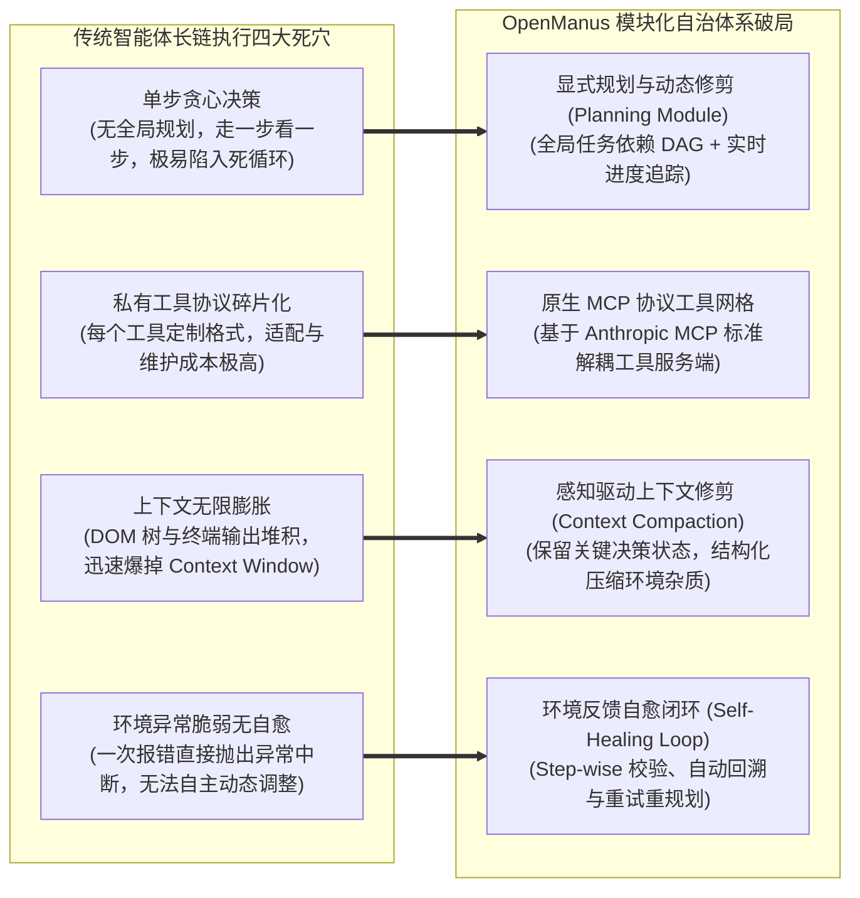

---
tags:
  - ai-practice
  - engineering
  - architecture
domain: Agent设计
difficulty: 进阶
date_added: 2026-11-10
---

# 💡 自主通用智能体工程实践：基于 OpenManus 的模块化 Agent 架构、MCP 工具编排与长链推理自愈实战

> **核心摘要**：随着大模型技术从“单步即兴问答”向“跨系统、长链路、高自主度的端到端任务交付（End-to-End Task Execution）”演进，传统基于硬编码 Function Calling 的智能体在面对真实业务时暴露出计划脆弱、工具协议碎片化、长时间运行上下文膨胀以及环境阻断无能为力等致命问题。本文基于目前全球最活跃的开源通用自主智能体框架 **OpenManus**，深度拆解面向复杂生产任务的工业级 Agent 构建方案：详解“规划（Plan）- 执行（Act）- 观察（Observe）- 反思（Reflect）”闭环架构、基于 Model Context Protocol (MCP) 的标准工具网格挂载、动态上下文滑动窗口修剪策略以及基于环境反馈的自愈重试机制，并在生产落地中系统性攻克反爬阻断、终端超时卡死与沙箱越权三大核心工程陷阱。

---

## 🎯 业务与技术背景：传统 Agent 在长长链复杂任务中的“生产死穴”

在构建面向“自动竞品调研”、“代码仓库全自动缺陷重构”或“多系统自动化数据归拢”等复杂自主任务时，传统的 LangChain/ReAct 简易智能体往往在执行到第 5~10 步时迅速崩溃：



1. **“单步贪心盲目决策”引发的任务迷航与死循环**：
   - 传统 ReAct（Thought-Action-Observation）模型依赖 LLM 每一步自发推导下一步。当面对跨度长达 30 步以上的任务时，由于缺乏全局任务拓扑图（Global Task DAG），LLM 极其容易在遇到无关分支时走偏，或者在同一操作（如不断刷新某个报错页面）中反复打转，耗尽 Token 额度。
2. **工具生态的“私有协议孤岛”与高昂接入成本**：
   - 企业级业务通常需要混合调用浏览器（Browser）、本地命令行终端（Bash/PowerShell）、文件系统以及第三方企业服务（Jira、GitLab、SAP）。如果每个工具都采用独立的入参 Schema 与自定义解析器，系统复杂度将呈指数级爆炸。
3. **环境输出杂质导致的“上下文雪崩（Context Explosion）”**：
   - 在真实网页浏览与终端运行中，一个复杂的网页 DOM 树动辄包含数万个 Token，一段编译报错输出可能长达几千行。若不加节制地将全量环境原始输出送入上下文，不仅单次推理成本飙升、推理延迟翻倍，还会严重稀释 LLM 的注意力（Attention Dilution），导致模型“忘记”最初的核心目标。
4. **单点失败即系统崩溃的“零容错性”**：
   - 真实世界环境充满不确定性：网络波动、选择器失效、临时权限缺失、页面弹出人机验证等。传统 Agent 缺乏“期望状态与实际状态的比对器”，一旦某个工具抛出异常，整个任务流瞬间崩溃中断。

---

## 🏗️ 架构设计与解决方案：OpenManus 模块化自治中枢

针对上述痛点，基于 OpenManus 的分层解耦思想，我们构建了一套面向工业级交付的高可用通用智能体架构：

```mermaid
flowchart TD
    subgraph UserInterface [任务入口与意图解析]
        UserPrompt["用户复杂宏观指令<br/>(例如: 自动化获取竞品最新功能并生成对比测试工程)"]
    end

    subgraph OpenManusKernel [OpenManus 自治执行中枢]
        Planner["全局任务规划器 (PlanningAgent)<br/>生成有向无环图 Task DAG & 设定验收标准"]
        
        subgraph StepExecutionLoop [单步微循环 (Micro-Execution Loop)]
            ContextPruner["上下文压缩与记忆裁剪器<br/>(滑动窗口 + 关键状态摘要)"]
            Executor["执行器 (ManusCore)<br/>思维链推导 -> 选定当前最佳动作"]
            Verifier["状态比对与反思器 (Step Verifier)<br/>对比环境反馈与本步预期"]
        end
        
        RecoveryEngine["自愈与动态重规划中枢<br/>(Step-wise Recovery & Re-Planning)"]
    end

    subgraph MCPToolMesh [标准化 MCP 协议工具网格]
        direction TB
        BrowserMCP["Browser-Use MCP Client<br/>(Playwright 真实浏览器 / 视觉感知 / 坐标点击)"]
        TerminalMCP["Sandboxed Terminal MCP<br/>(隔离容器环境 / 命令执行 / 进程监控)"]
        FileOpsMCP["FileSystem MCP<br/>(Markdown 研报导出 / 代码持久化)"]
        CustomMCP["企业系统 MCP 节点<br/>(内部知识库 / 监控告警 / 工单系统)"]
    end

    UserPrompt ==> Planner
    Planner -->|下发任务序列清单| StepExecutionLoop
    
    ContextPruner --> Executor
    Executor -->|MCP JSON-RPC 标准调用| BrowserMCP
    Executor -->|MCP JSON-RPC 标准调用| TerminalMCP
    Executor -->|MCP JSON-RPC 标准调用| FileOpsMCP
    Executor -->|MCP JSON-RPC 标准调用| CustomMCP

    BrowserMCP -.->|结构化观察结果 Observation| Verifier
    TerminalMCP -.->|结构化观察结果 Observation| Verifier
    FileOpsMCP -.->|结构化观察结果 Observation| Verifier
    CustomMCP -.->|结构化观察结果 Observation| Verifier

    Verifier -->|本步目标达成| StepExecutionLoop
    Verifier -.->|环境异常 / 偏离目标 / 死循环| RecoveryEngine
    RecoveryEngine ==>|动态修补 DAG 任务流| Planner
```

### 1. 动态双层规划架构（Global Planning & Step-wise Execution）
- **全局任务清单（Global Step Ledger）**：规划模块首先利用强推理大模型（如 DeepSeek-R1 / Claude 3.7 Sonnet）将模糊需求解构为有序的具体步骤清单，每个步骤均显式定义“预期产出”与“成功校验规则”；
- **自适应动态修正**：在每个子步骤执行完毕后，规划器并不盲目继续，而是重新审视任务总进度，若发现前置假设失效（例如目标网站无需登录即可公开访问），则动态剔除原计划中的登录步骤，避免机械死板的无效操作。

### 2. 原生 MCP 工具协议的标准化解耦
- 将所有的底层执行能力（浏览器控制、终端命令、文件系统）封装为符合 **Model Context Protocol (MCP)** 标准的独立 Server 进程。
- Agent 与工具之间通过统一的 JSON-RPC 协议进行通信。这意味着开发人员可以在不修改 Agent 核心调度逻辑的前提下，随时随地插入新的业务工具（如企业内部数据库查询 MCP Server、飞书通知 MCP Server），具备极强的横向扩展能力。

### 3. 上下文压缩与垃圾清理（Context Compaction & DOM Distillation）
- **DOM 智能树压缩**：对于 Browser-Use 捕获的完整 HTML 网页，通过预处理管线滤除所有无语义的 `<script>`、`<style>`、嵌套 `<div>`，仅提取具备交互属性的元素树（Accessibility Tree），附带数字标记序号（Index ID），将 10 万 Token 的庞大网页压缩至 1000 Token 以内；
- **滑动窗口与观察折叠**：长期运行过程中，仅保留最初的 System Prompt、全局 Plan、最近 3 步的完整观察结果，而对更早历史执行细节进行语义压缩折叠，彻底根除上下文溢出隐患。

---

## 💻 关键代码 / 配置 / Prompt 模板

### 1. 工业级 OpenManus Agent 核心调度实现

以下为生产化封装的 OpenManus 扩展实现，展示了如何集成 MCP 客户端、多步反思与自愈熔断机制：

```python
# enterprise_manus_agent.py: 生产级 OpenManus 强化自治调度器
import asyncio
import json
from typing import Dict, Any, List, Optional
from pydantic import BaseModel, Field
from app.agent.base import BaseAgent
from app.schema import Message
from app.logger import logger

class PlanStep(BaseModel):
    step_id: int
    description: str
    expected_output: str
    status: str = Field(default="pending") # pending, running, completed, failed
    retry_count: int = 0

class EnterpriseManusAgent(BaseAgent):
    """企业级模块化 OpenManus 自治智能体"""
    
    def __init__(self, model_name: str = "deepseek-reasoner", max_retries: int = 3):
        super().__init__()
        self.model_name = model_name
        self.max_retries = max_retries
        self.plan: List[PlanStep] = []
        self.current_step_idx: int = 0
        self.mcp_clients: Dict[str, Any] = {}

    async def initialize_mcp_mesh(self):
        """初始化挂载标准 MCP 工具网格"""
        logger.info("🔌 连接并初始化标准 MCP 工具服务集群...")
        # 实际生产中通过 stdio 或 SSE 挂载 Browser-Use 与 Terminal MCP 服务
        self.mcp_clients["browser"] = "MCPClient(browser-use-mcp)"
        self.mcp_clients["terminal"] = "MCPClient(sandboxed-bash-mcp)"
        self.mcp_clients["file"] = "MCPClient(filesystem-mcp)"

    async def plan_task(self, user_objective: str) -> List[PlanStep]:
        """第一阶段: 宏观认知与全局任务拓扑规划"""
        planning_prompt = f"""
你是一个具备工业级严谨度的任务规划架构师。请将用户目标拆解为执行步骤清单：
目标：{user_objective}

请输出严格的 JSON 列表格式，每个元素包含：
- "step_id": 步骤序号 (整数)
- "description": 核心行动说明 (明确使用哪个工具，执行何种操作)
- "expected_output": 本步骤成功的验收标准与期望状态
"""
        response = await self.llm.ask(messages=[Message.user_message(planning_prompt)])
        raw_steps = json.loads(response.content)
        self.plan = [PlanStep(**s) for s in raw_steps]
        logger.info(f"📋 任务规划成功完成，共拆解为 {len(self.plan)} 个执行步骤")
        return self.plan

    async def execute_step(self, step: PlanStep) -> Dict[str, Any]:
        """第二阶段: 单步执行与工具派发"""
        logger.info(f"▶️ 开始执行步骤 [{step.step_id}]: {step.description}")
        step.status = "running"
        
        # 组装受控的上下文切片 (保留 Plan + 最近状态)
        step_prompt = f"""
当前正在执行任务步骤：{step.description}
期望输出：{step.expected_output}
请决定需要调用的 MCP 工具及确切参数 (JSON-RPC)。
"""
        action_decision = await self.llm.ask(messages=[Message.user_message(step_prompt)])
        
        # 模拟通过 MCP 协议派发工具调用
        execution_result = await self._dispatch_mcp_tool(action_decision.content)
        return execution_result

    async def verify_and_reflect(self, step: PlanStep, execution_result: Dict[str, Any]) -> bool:
        """第三阶段: 状态比对与反思校验"""
        verify_prompt = f"""
请评估步骤执行是否达成预期：
【步骤目标】: {step.description}
【期望标准】: {step.expected_output}
【实际返回】: {json.dumps(execution_result, ensure_ascii=False)}

请严格判断本步是否成功。返回 JSON: {{"success": true/false, "reflection": "原因分析", "need_replan": true/false}}
"""
        eval_resp = await self.llm.ask(messages=[Message.user_message(verify_prompt)])
        eval_data = json.loads(eval_resp.content)
        
        if eval_data["success"]:
            step.status = "completed"
            logger.info(f"✅ 步骤 [{step.step_id}] 顺利达成验收标准")
            return True
        else:
            logger.warning(f"⚠️ 步骤 [{step.step_id}] 校验失败: {eval_data['reflection']}")
            step.retry_count += 1
            if step.retry_count <= self.max_retries:
                logger.info(f"🔄 触发单步重试 (第 {step.retry_count}/{self.max_retries} 次)...")
                return False
            else:
                step.status = "failed"
                raise RuntimeError(f"步骤 [{step.step_id}] 超过最大重试次数，任务熔断！")

    async def _dispatch_mcp_tool(self, action_content: str) -> Dict[str, Any]:
        """底层 MCP 工具分发代理"""
        # 实际生产代码在此执行异步 RPC 请求并捕获超时与退出码
        await asyncio.sleep(0.5)
        return {"status": "ok", "message": "页面数据抓取成功，提取到 15 条竞品数据", "code": 0}

    async def run_workflow(self, objective: str):
        """端到端完整闭环驱动"""
        await self.initialize_mcp_mesh()
        await self.plan_task(objective)
        
        for step in self.plan:
            success = False
            while not success and step.retry_count <= self.max_retries:
                result = await self.execute_step(step)
                success = await self.verify_and_reflect(step, result)
        
        logger.info("🎉 全链路任务圆满交付完成！")
```

### 2. 生产级 Prompt 模板：抗漂移规划与反思模板

```markdown
# SYSTEM PROMPT: 工业级 Autonomous Task Architect
你是一个高度专业、严谨且具备自主反思能力的系统自治工程师。
在执行用户复杂目标时，你必须遵循以下绝对纪律：

1. **绝对禁止贪心乱试**：未完成任务分解前不得调用底层副作用工具；
2. **行动前必带思考**：调用任何工具前，必须以 `<thought>` 标签显式列出：
   - 当前步骤在全局计划中的位置；
   - 本次调用的意图与预期返回值；
   - 潜在的失败风险与降级措施；
3. **环境反馈严格校验**：严禁无视工具报错信息；若终端返回非零 Exit Code 或页面出现 403/验证码，必须在 `<reflection>` 标签中承认失败并启动备用路线；
4. **输出原子化交付物**：所有最终产出必须落地为工作区中的具体文件（Markdown/JSON/代码），并在交付消息中明确给出文件路径。
```

---

## ⚠️ 生产环境踩坑与避坑指南

### 1. 真实浏览器自动化的“反爬风控与会话丢失”陷阱
- **踩坑现象**：使用 Playwright 默认的 Headless Chromium 访问各大主流平台时，频繁被 Cloudflare、Akamai 判定为人机脚本，弹出滑动验证码导致 Agent 死锁卡顿；
- **避坑方案**：
  - **启用真实持久化 Context（Persistent Context）**：挂载本地用户配置文件目录（User Data Dir），复用历史 Cookie 与登录 Session，避开每次冷启动带来的身份重新校验；
  - **注入抗检测探针（Stealth Script）**：使用 `playwright-stealth` 抹除 `navigator.webdriver` 标记，伪装 WebGL 渲染管线与真实屏幕分辨率；
  - **引入人工介入断点（Human-in-the-Loop Fallback）**：当检测到验证码元素时，不要让 LLM 盲目尝试点击，而是立即抛出告警通知运维人员在挂起的 UI 中完成一次性滑块，随后 Agent 自动恢复执行。

### 2. 长运行链路中的“Token 几何级膨胀与静默降智”
- **踩坑现象**：长链任务执行到第 20 步时，由于持续向 Prompt 追加每一轮的历史 Action 与 Observation，总 Token 迅速飙升至 32k 以上。模型不仅推理成本暴增，而且开始产生严重幻觉，遗忘初始目标；
- **避坑方案**：
  - **结构化状态外置存储（State Offloading）**：将网页抓取的原始数据、文件内容直接写入本地临时文件，Prompt 中仅保留核心摘要与“文件引用句柄”；
  - **观察结果折叠（Observation Truncation）**：对成功执行的中间历史，将 `Observation: <5000字网页内容>` 自动精炼为 `Observation: [成功访问目标网页，提取到 20 项数据，已存入 temp_data.json]`。

### 3. 子进程命令执行的“终端僵死（Hanging Deadlock）”
- **踩坑现象**：当 Agent 在终端执行 `npm install`、`pip install` 或某个等待用户交互输入（`Press [y/n]`）的脚本时，子进程挂起无输出，导致整个 Agent 彻底卡死；
- **避坑方案**：
  - **强制环境非交互参数**：所有终端命令强制注入非交互标识，例如 `DEBIAN_FRONTEND=noninteractive`、`pip install --yes`、`npm install --yes`；
  - **严格异步超时熔断（Async Timeout Guard）**：为每个 MCP Terminal 执行包装 `asyncio.wait_for(timeout=60)`，超时强制发送 `SIGKILL` 终止进程组，并将超时信息返回给反思器重试。

### 4. 生产环境的“沙箱越权与灾难性指令防御”
- **踩坑现象**：在全自动执行模式下，LLM 可能产生恶意幻觉或错误拼接字符串，执行诸如 `rm -rf /`、覆盖主项目根目录代码等不可逆破坏；
- **避坑方案**：
  - **严格的工作区目录隔离（Workspace Jail）**：利用 Linux Namespaces、Docker 容器或 E2B MicroVM 对执行目录进行物理隔离，禁止子进程访问宿主机敏感路径；
  - **高危命令前置 AST 拦截**：在 Terminal MCP 服务端设置关键词与正则表达式硬拦截网关，直接拦截包含 `rm -rf`、`format`、修改防火墙规则等敏感指令。

---

## 🔗 关联项目与引用

- 核心工具: [[OpenManus]]
- 依赖生态: [[Browser-Use]], [[FastMCP]], [[Cline]], [[SWE-agent]], [[MetaGPT]], [[OpenHands]], [[E2B]]
- 关联日报: [[2026-11-10-AI-Digest]]
